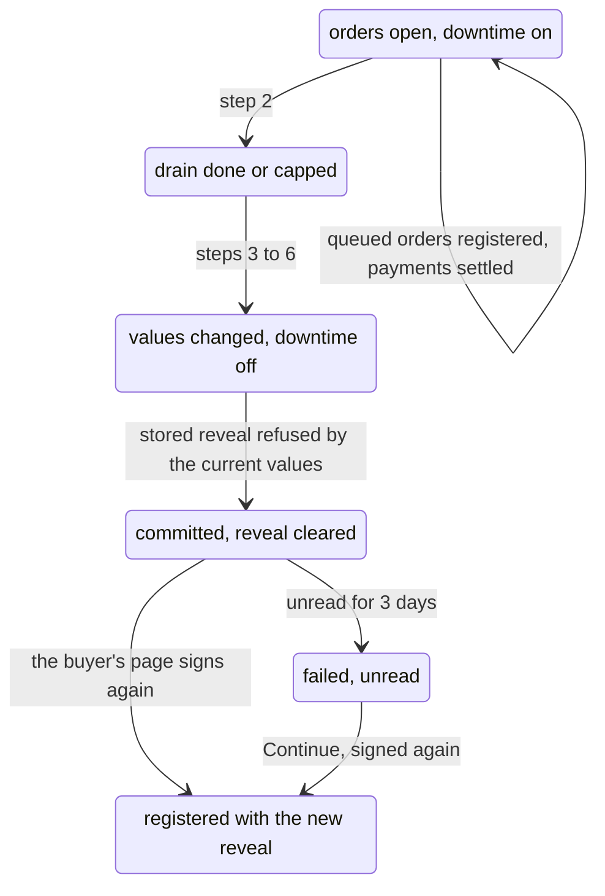
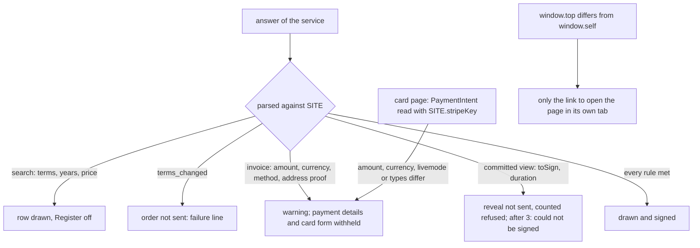
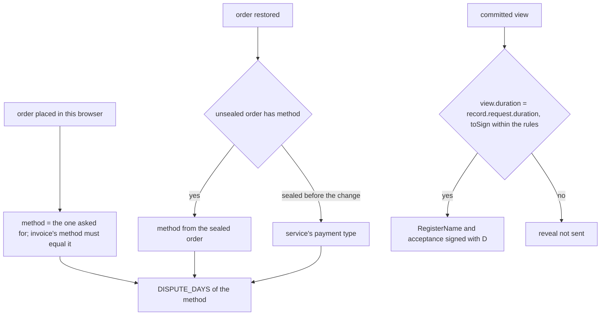
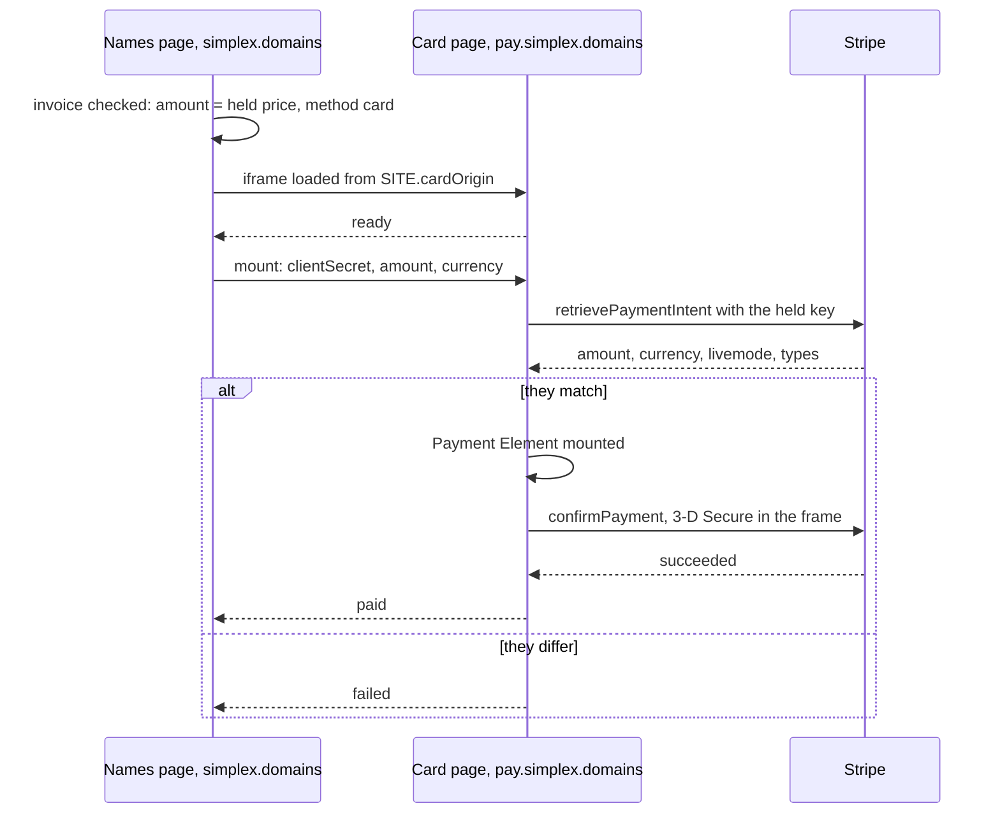
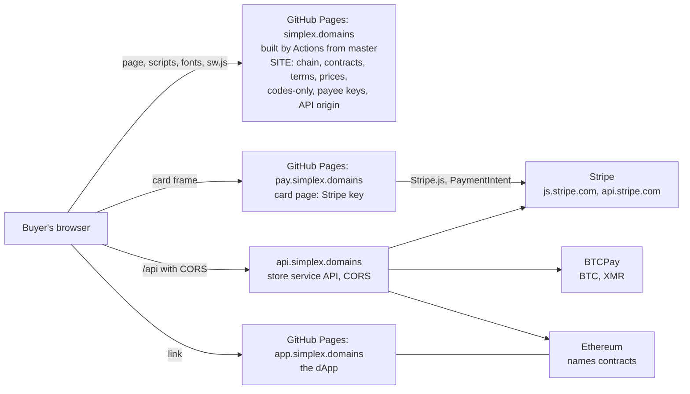
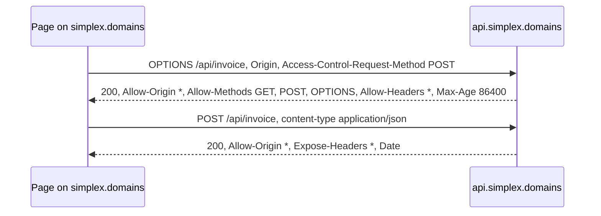
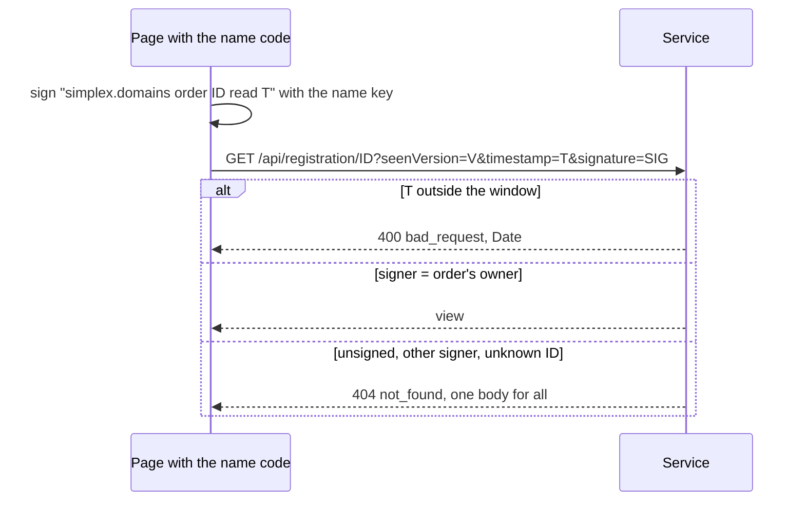

# Names: the page holds its deployment's values

Threat model of the result: [2026-11-25-names-threat-model.md](./2026-11-25-names-threat-model.md).

## 1. Scope

Repositories changed:

- simplex-chat/simplex.domains: the names page (`webapp/`) and the card page's source, their CI, their hosting;
- a second repository, which deploys the card page on `pay.simplex.domains` from a pinned simplex.domains commit (6.5);
- simplex-chat/simplex-chat: the store service (`apps/simplex-store-service`), its docs, the `apps/simplex-domains` submodule.

Unchanged: simplexmq, simplex-network/ens-contracts, simplex-namespace-contract, the badges page, the Pay with ETH dApp (app.simplex.domains).

Before this change: the countdown page served at simplex.domains is merged into the names page.

## 2. Goal

The page holds every value on which the destination of a buyer's signature and payment depends, and uses an answer of the service only after comparing it with those values. It is built from its repository and served by GitHub Pages, so the service host serves the API alone. A held value changes only with a page release. Every request that names an order is signed with the order's name key.

## 3. Values held in the page

### 3.1 The record

`SITE`, in `webapp/src/config.ts`, is used in place of the service's `GET /api/config` answer for everything but the downtime.

```ts
interface Deployment {
  chainId: number
  tld: string
  sponsor: Address
  resolver: Address
  namePolicy: Address
  baseRegistrar: Address
  termStart: number
  paidYears: number
  communityYears: number
  minCodeYears: number
  maxCodeYears: number
  codesOnly: boolean
  priceBaseCentsPerYear: number
  priceExceptions: PriceException[]
  currency: "usd"
  generalTerms: Terms
  communityTerms: Terms
  stripeKey: string
  stripeLive: boolean
  cardOrigin: string
  bitcoinHrp: string
  bitcoinReceiveKeys: Hex[]
  moneroSubaddressPrefix: number
  moneroPrimaryAddresses: string[]
  apiOrigin: string
  appOrigin: string
}

interface PriceException {
  labelLength: number
  centsPerYear: number
}
```

- A name's held price: `centsPerYear` of the exception of its length, else `priceBaseCentsPerYear`, times `paidYears`, as `SimplexPriceOracle` prices it.
- `DISPUTE_DAYS` stays in `flow.ts`, unchanged: card 120, btc 14, xmr 14, code 14.
- `bitcoinReceiveKeys` and `moneroPrimaryAddresses` are lists, so that a payee key is rotated without a downtime (3.8).

### 3.2 Mainnet values

| Field | Mainnet value | Read from | Used in |
|---|---|---|---|
| chainId | 1 | `eth_chainId` | every EIP-712 domain |
| tld | `simplex` | controller `tldSuffix()` = `.simplex` | namehash, display |
| sponsor | `0xeC9a522C756e46FB3E44d3405FFDd9368501Eb78` | controller `sponsor()` | `RegisterName` domain |
| resolver | `0x9BDa37F19b59Cbc58BA75932B3c598947fD88B0A` | controller `defaultResolver()` | registration's resolver, `SetText` domain |
| namePolicy | `0x5147b65F547b766DBaf520127e8f59834475021E` | controller `namePolicy()` | acceptance domain |
| baseRegistrar | `0x4c0589dbC22862Babb25EB72D11bBA49d84AAbE8` | deployments.mainnet.simplex.json | none: the name address link holds the address alone (7) |
| termStart | 1798761600 (2027-01-01 00:00 UTC) | service ini `term_start` | `durationFor` |
| paidYears | 2 | service ini `years`; controller `MIN_REGISTRATION`, 730 days | search answer, duration |
| communityYears | 2 | `Names/Community.hs` `communityYears` | search answer |
| minCodeYears, maxCodeYears | 2, 10 | `src/Simplex/Chat/Badges/Code.hs` `minNameYears`, `Group/Command.hs` `maxNameYears` | code check answer |
| codesOnly | true until paid sales open | service ini `codes_only` | search, checkout |
| priceBaseCentsPerYear, priceExceptions | 5000, none: $100 for 2 years, every name | the price oracle's base and exceptions | search answer, `catalog_changed`, invoice |
| currency | usd | `Catalog.hs` `catalogCurrency` | invoice |
| generalTerms | hash `0x70e0396b0a83f6c4e624b2e43d537b7c9816c6868bf705080237d93f5aa2541d`, link `https://raw.githubusercontent.com/simplex-chat/simplex-chat/7cfd522f0f26454fc913f978a45f5f6028017b10/docs/NAMES-CONDITIONS.md#sha256=6871119c6e4088d2b6f2d7890443a82a4b8e65dd1ccb73456ce8f13c3434e6ee` | policy `generalTermsLink()`, `generalTermsHash()` | search, sign answer, terms text |
| communityTerms | the same hash and link | policy `communityTermsLink()`, `communityTermsHash()` | same |
| stripeKey | `pk_live_…` | production ini `[stripe] publishable_key` | the card page (6.5) |
| stripeLive | true | the key's prefix | PaymentIntent comparison |
| cardOrigin | `https://pay.simplex.domains` | DNS | the card frame (6.5) |
| bitcoinHrp | `bc` | BIP-173 | address check |
| bitcoinReceiveKeys | W of each wallet in use, 33 bytes each | the service's start line (9.4), from BTCPay's derivation scheme | address check |
| moneroSubaddressPrefix | 42 | Monero mainnet subaddress network byte | address check |
| moneroPrimaryAddresses | the primary address of each wallet in use | the operator, from the wallet | B and A of the address check |
| apiOrigin | `https://api.simplex.domains` | DNS | API calls, CSP, preload, service worker |
| appOrigin | `https://app.simplex.domains` | DNS | name address link (7) |

### 3.3 Local values

`LOCAL`, in the same module, contains the dev chain's values:

- chainId 31337, tld `simplex`, termStart 1798761600, years and currency as on mainnet; `PRICE_BASE` and `PRICE_EXCEPTIONS` of `dev/deploy.ts`, which reads them from `LOCAL`;
- codesOnly false; `VITE_CODES_ONLY` for its e2e build;
- sponsor `0x0B306BF915C4d645ff596e518fAf3F9669b97016`, resolver `0x8A791620dd6260079BF849Dc5567aDC3F2FdC318`, namePolicy and baseRegistrar at the addresses `dev/deploy.ts` deploys to; `dev/deploy.ts` stops with an error when a deployed address differs from `LOCAL`;
- terms: the namespace fixtures' `general-terms.md` and `community-terms.md` links (`http://127.0.0.1:8098/terms/<sha256>.md#sha256=<sha256>`), and the alternates the e2e tests switch to, whose texts are in `e2e/helpers.ts`; a unit test compares each alternate's link with the sha256 of its text;
- stripeKey empty, for the dev server's stand-in form; `VITE_STRIPE_KEY` for a manual run with a test key;
- cardOrigin: the card page on a second local port;
- `bcrt` and 36 (stagenet subaddress), with the public keys of the dev keys in `dev/mock/addresses.ts`;
- apiOrigin empty, for Vite's proxy; `VITE_API_ORIGIN` for the cross-origin test;
- appOrigin `http://127.0.0.1:5181`, a loopback port nothing serves.

### 3.4 Selection

- `SITE = import.meta.env.MODE === "production" ? MAINNET : LOCAL`; Vite replaces the condition at build, so the production bundle contains `MAINNET` alone.
- `npm run build` builds with `MAINNET`; test builds use `vite build --mode devchain`, as Vite reserves the mode name `local`: the step "Production build tests" of `webapp.yml`, compose's `preview` service, and `build_site` of simplex-chat's `scripts/store-service/dev/contract-run.sh`; the dev server runs in development mode, with `LOCAL`.
- `test/build.test.ts`, as for the stand-in card form: the production build contains the mainnet sponsor and only `MAINNET`'s addresses.

### 3.5 What stays fetched

`downtime` of `GET /api/config`, set by the service (9.6). The page reads `/api/config` at each search and at each poll of an open order. The other fields of the answer are no longer read by the names page; the answer stays as it is, because the badges page reads its Stripe key from it.

Downtime, `downtime` true:

| Screen | Shown |
|---|---|
| search | each name's row without Register, and "You will be able to order names again soon." under the search |
| checkout, its code check included, name selection | not reached; "You will be able to order names again soon." |
| an open invoice | status; the payment details withheld, and the card form unless already mounted; "You will be able to pay again soon." |
| a committed order | status; "You will be able to continue the registration soon."; its reveal signed after the downtime |
| a registered order, Your names, Check your code | as outside the downtime |

A page that read `downtime: true` loads again when it reads `downtime: false`, so that a tab loaded before a page release signs with the released `SITE`. The conditions are those of `views/served-mode.ts` `reloadKeeps`, whose trigger becomes the downtime flag in place of `codesOnly`.

### 3.6 How a held value changes

A change of a held value other than a payee key (3.8) is made in a downtime. The service enters it first; the page follows at its next read of `/api/config`. Merging a simplex.domains pull request to master deploys the page (8.2), so a page release and its merge are one step.

| Step | Who | What |
|---|---|---|
| 1 | Operator | the service restarted with `[names] downtime = on` (9.6) |
| 2 | Operator | the capped drain (3.7) |
| 3 | Owner, Safe signers | chain changes: terms by `setGeneralTerms` or `setCommunityTerms`, prices by the price oracle |
| 4 | Operator | the service released from its prepared, tested pull request, with `downtime = on`; payee keys in BTCPay and the ini |
| 5 | Owner | simplex.domains pull request with the new values, merged; with a new Stripe key, the card page's repository moved to that merge |
| 6 | Operator | the service restarted with `downtime = off`, once step 5's `pages` jobs have completed and 600 seconds have passed, the `max-age` GitHub Pages serves with |
| 7 | Buyers | open orders signed again (3.7) |
| 8 | Owner | simplex-chat pull request: `apps/simplex-domains` moved to step 5's merge, merged |

- The Safe transactions of step 3 are signed before step 1 and executed at step 3.
- Step 8's CI runs the page's tests against the released service; before step 5, the service's tests against the pinned page fail where a held value changed.
- The service ini values the page holds change only in step 4; the README lists them: `[names]` `term_start`, `years`, `codes_only` and `tld`; `[chain]` `chain_id` and the contract addresses; the payee keys; `[stripe] publishable_key`.
- Before step 5, `dev/check-mainnet.ts` is run by hand: the controller's `sponsor()`, `defaultResolver()`, `namePolicy()`, `tldSuffix()`, the price oracle's base and exceptions, and the policy's terms links and hashes are read through a public RPC and compared with `MAINNET`.
- The contract addresses are the proxies', which stay the same across an upgrade; an upgrade that changes an EIP-712 type is a chain change of step 3.
- The steps are documented in the service README, "Changing a value the names page holds", and in the page README, Hosting.

```mermaid
sequenceDiagram
  participant X as Operator
  participant S as Service host
  participant P as Names page
  participant O as Owner
  participant C as Chain
  participant R as simplex.domains
  participant B as Buyer
  participant M as simplex-chat
  X->>S: restart with downtime = on
  P->>S: GET /api/config
  S-->>P: downtime: true
  P->>P: Register off, payment details withheld
  X->>S: capped drain (3.7)
  O->>C: terms or prices changed by the Safe
  X->>S: service released, downtime = on; payee keys in the ini
  O->>R: PR with the new values, merged; GitHub Pages deploys it
  X->>S: restart with downtime = off
  B->>P: open order: reveal signed again with the new values
  P->>S: POST /api/registration/ID/reveal
  O->>M: PR: page pin moved to that merge, merged
```

### 3.7 Orders open across a change

Drain, step 2:

1. The worker registers the orders already queued with their stored reveals; the providers settle the payments in progress.
2. The operator waits until `simplex_store_names_queue_oldest_change_timestamp_seconds` is absent, as no order the service moves on is left, or until the cap, 15 minutes, passes.

Signed again, step 7, through the path the worker uses for a refused terms acceptance, for a change of the sponsor, the chain id, the name policy or the terms:

1. The worker clears a stored reveal that the current values refuse, and the order waits, committed, for its page to sign again: on a terms mismatch, a refused acceptance, an acceptance for another policy, or an expired signature (`judge`, `relayAcceptance`, `sendRegister`), and, with this change, on a `RegisterName` refused under the service's current configuration (`intentRefused`), in place of failing the order with `FRSignatureRefused`.
2. The page of the order's buyer, loaded after step 5, reads the committed view without a reveal, and signs `RegisterName` and the acceptance again with `SITE`'s values; with changed terms, the buyer accepts them first (`termsChanged`).
3. A commitment past its age is committed again through the page's `/retry` (`retryDue`, `retryRegistration`).
4. An order whose page has not read it for 3 days fails with `unread`; its buyer's Continue signs it again (`revealHandler`).

A change of the resolver or the TLD changes every open order's commitment (`registrationOf`, `makeCommitment`), so those orders cannot be signed again: the drain of step 2 runs without the cap, and an order still open after it is closed by support's `//close`, its payment kept as balance or refunded.



### 3.8 A payee key rotated

1. A page release adds the new Bitcoin key or Monero primary address to `SITE`.
2. BTCPay and the service's ini switch to the new wallet.
3. A page release removes the old key once its last invoice has expired.

## 4. Answers compared with the held values

### 4.1 Every answer the page takes from the service

| Answer | Field | Rule |
|---|---|---|
| `GET /api/config` (`config.ts` `configOf`) | downtime | read (3.5) |
| `GET /api/name/:hash` (`api.searchName`) | available.terms | equal to `SITE`'s terms of the name's kind; otherwise read as `terms: null` |
| same | available.price | a paid order only at the held price of the name's length (3.1); a code order as given |
| same | available.years | equal to `paidYears` |
| same | community.years | equal to `communityYears` |
| same | community, the flag | as given |
| same | registered: owner, resolver, expiresAt, records | as given |
| same | records.own.nonce | as given; a transaction with a wrong nonce reverts |
| `GET /api/name/:hash/sign` (`api.signFor`) | acceptance.policy | not used: the acceptance is signed over `SITE.namePolicy` |
| same | acceptance.termsHash | not used: the acceptance is signed over the hash the buyer ticked, itself in `SITE`; a terms change during checkout is answered by the service's `terms_changed` |
| same | acceptance.community | not used: the acceptance is signed for the kind of the ticked terms |
| same | intentNonce, acceptance.nonce | as given; a transaction with a wrong nonce reverts |
| `GET /api/terms/:hash` (`api.termsText`, `currentTermsOf`) | link | in `SITE` |
| same | text | sha256 equal to the link's `#sha256=` |
| `POST /api/code/check` (`api.checkCode`) | years | from `minCodeYears` to `maxCodeYears` |
| `POST /api/invoice`, `GET /api/invoice/:id`, cancel (`checkedInvoice`) | amount | equal to the price the page sent, itself the held price |
| same | currency | `usd` |
| same | cryptoCurrency, clientSecret | the method asked for: `clientSecret` alone for a card; `cryptoCurrency` equal to the coin otherwise |
| same | address of an open invoice | proven from `SITE` keys (6.1, 6.2) |
| same | clientSecret | PaymentIntent compared in the card page (6.4) |
| same | cryptoAmount, cryptoAmountDue | as given |
| `GET /api/registration/:id`, and an invoice's `registration` | duration | equal to the record's `request.duration` |
| same | payment.method | the method sealed with the order (5.2) |
| same | phase.committed.signature.toSign | as `/sign` |
| same | terms | compared with the record's own terms (5.3) |
| same | phase, price, balance, latePayment, commitTx, registerTx | as given |
| refusal bodies (`signingTerms`, `orderError`) | `terms_changed` terms | in `SITE` |
| same | `catalog_changed` price | equal to the held price |
| `POST /api/registration/find` | sealed, labelHash | opened with the code and hashed |
| `POST /api/link/preview`, search entities | profiles | as given |
| `Date` header | clock | as given |

The name and the name address of an order are the page's own: the name from the sealed order opened with the name code, the address from the name code.

### 4.2 Outcomes

| Rule not met | Function | What the buyer sees |
|---|---|---|
| search: terms, years or price | `api.searchName`, `flow.orderable` | the name's row with Register off and the existing line "Names can't be ordered right now. Try again later." |
| code check: years | `api.checkCode` | "The code could not be checked" |
| sign answer naming other held terms | `api.signFor`, `flow.orderRequest` | nothing at signing: the acceptance is signed over the ticked terms and `SITE.namePolicy`, and a terms change is answered by the service's `terms_changed`, as the next row says |
| `terms_changed` body: terms | `api.signingTerms` | same |
| invoice: amount, currency, method or address proof | `checkedInvoice` | the warning below; the payment details and the card form withheld |
| card: PaymentIntent | the card page | same |
| reveal: toSign or duration | `flow.revealFor` | the reveal is not sent and is counted as refused; after `REVEAL_ATTEMPTS`, "could not be signed" |
| the page inside a frame | `main.ts` | one line, with a link to the page in its own tab (8.3) |
| `downtime` | `flow.orderable`, `revealFor`, selection, invoice | 3.5 |

The warning: "Sorry, the payment details of this order could not be checked, so they are not shown. Please contact support with the order reference."



## 5. Signatures the page makes

### 5.1 Fields and their sources

| Message | Domain | Field | Source |
|---|---|---|---|
| order, EIP-191 `simplex.domains order …` | | labelHash, length, duration, commitment, sealed, terms, timestamp | page; terms in `SITE` |
| name selection, EIP-191 `simplex.domains name …` | | the same, and the registration id | page |
| find, EIP-191 `simplex.domains find …` | | owner, timestamp | page |
| order request, EIP-191 `simplex.domains order <ID> <action> <timestamp>` | | id, action, timestamp | page (9.7) |
| `RegisterName` | `SimplexSponsor`, `SITE.chainId`, `SITE.sponsor` | label | buyer |
| | | owner | the code's wallet |
| | | duration | `durationFor(years, SITE.termStart, now)`, years checked (4.1) |
| | | resolver | `SITE.resolver` |
| | | data | the buyer's links on `namehash(SITE.tld, label)` |
| | | disputeDays | `DISPUTE_DAYS` of the order's own method (5.2) |
| | | nonce | service |
| | | deadline | page's clock + 7 days |
| `AcceptGeneralTerms`, `AcceptCommunityTerms` | `SimplexNamePolicy`, `SITE.chainId`, `SITE.namePolicy` | commitment | page |
| | | termsHash | the ticked terms, in `SITE` |
| | | nonce | service |
| | | deadline | page's clock + 7 days |
| `SetText` | `SimplexResolver`, `SITE.chainId`, `SITE.resolver` | node | `namehash(SITE.tld, label)` |
| | | key, value | buyer |
| | | nonce | service |
| | | deadline | page's clock + 1 hour |

`SITE` is read inside the signing functions, and is used in place of `namesSite`, `readSite` and `loadedSite` at their call sites, `quoteOf`'s read of the chain id included. `ChainInfo` is removed from `api.ts`; `chain` and `termStart` are removed from `session.Checkout`, `flow.Draft`, `registrationOf`, `signedReveal` and `saveLinks`; in the inline first-frame script of `index.html`, the tests of `c.chain` and `c.termStart` are removed.

### 5.2 Dispute days of the order's own method

- The sealed order includes `method` (`card`, `btc`, `xmr` or `code`) beside `label`, `contact` and `channel`; it is authenticated by AES-GCM under the code's key.
- At an order, the invoice's method equals the method asked for (4.1), and the record is given the method asked for, in place of `paidWith`'s reading of the answer.
- In a record restored by `reopen`, the method is the unsealed order's; for sealed data written before the change, the service's payment type is taken.
- Precedent of the method check: the badges page's `api.ts`, where `clientSecret` is compared with `address`, `cryptoAmount` and `cryptoCurrency` per method.

### 5.3 A reveal signed again

- In `revealFor`, the record's `request.duration` is signed; a reveal is sent only for a view of that duration.
- In `termsChanged`, the acceptance hash is compared with the record's own terms in place of the view's `terms`.



```mermaid
sequenceDiagram
  participant B as Buyer
  participant P as Page on GitHub Pages
  participant S as Service API
  participant V as Stripe or BTCPay
  B->>P: name searched
  P->>S: GET /api/name/LABELHASH
  S-->>P: available: price, years, terms, community
  P->>P: terms in SITE of the kind, years = 2, price = the held price
  B->>P: links, name code saved, terms ticked, method
  P->>S: GET /api/name/LABELHASH/sign
  S-->>P: intentNonce, acceptance
  P->>P: policy = SITE.namePolicy, termsHash = ticked, community = kind
  P->>P: RegisterName on SITE.sponsor with SITE.resolver and the method's dispute days; acceptance on SITE.namePolicy
  P->>S: POST /api/invoice: order, method, price, reveal
  S->>V: invoice created
  S-->>P: amount, method, address with addressProof, or clientSecret
  P->>P: amount = price, method = asked, address proven from SITE keys
  alt card
    P->>P: card page framed from SITE.cardOrigin (6.5)
  else crypto
    P->>B: address, amount, QR code
  end
```

## 6. Payment destinations

### 6.1 Bitcoin

Keys:

- BTCPay's derivation scheme: the account extended public key of a single-signature native SegWit wallet;
- W, the public key of its receiving branch, child 0; c0, that branch's chain code;
- the page holds W alone.

Service, at a name invoice's creation (`Providers/BTCPay.hs` `createInvoice`):

1. reads `additionalData.keyPath` (`0/i`) of the `BTC-CHAIN` payment method, which BTCPay 2.4.5 answers without `includeSensitive`;
2. computes `(IL, IR) = HMAC-SHA512(c0, serP(W) ‖ ser32(i))` and `t = IL`, with `t < n`;
3. computes `K = W + t·G` and `bech32(btc_hrp, 0, RIPEMD160(SHA256(serP(K))))`, with `btc_hrp` of 9.1;
4. compares that address with BTCPay's `destination`; when they differ, cancels the invoice, as in `cancelCreated` for an invoice whose address cannot be read, and answers `503 provider_unavailable`;
5. stores `t` with the invoice.

Page (`src/crypto/payees.ts`, called from `checkedInvoice` for an open invoice):

1. `t` is 32 bytes, below the curve order;
2. for one W of `SITE.bitcoinReceiveKeys`, `bech32(SITE.bitcoinHrp, 0, hash160(serP(W + t·G)))` equals the address.

Libraries: `@noble/curves/secp256k1`; `@noble/hashes` `sha256`, and `ripemd160` of `legacy`; `@scure/base` `bech32` (1.2.6, installed as a dependency of `@scure/bip32`, added to `dependencies`).

The address type is P2WPKH; the service's start stops with an error for another derivation scheme type.

### 6.2 Monero

Keys:

- a, the private view key of BTCPay's view-only wallet; A = a·G;
- B, the public spend key; the page holds the primary address, which contains B and A.

Definitions:

- `Hs(x)`: Keccak-256 of x, read as a little-endian integer and reduced modulo L;
- `m = Hs("SubAddr\0" ‖ a ‖ u32le(i) ‖ u32le(j))`;
- the subaddress `(D, C)`: `D = B + m·G`, `C = a·D`.

Service, at a name invoice's creation:

1. reads `additionalData.accountIndex` (i) and `addressIndex` (j) of `XMR-CHAIN` (Monero plugin 1.4.0, `MoneroLikeOnChainPaymentMethodDetails`);
2. computes m with the view key, D, C and `base58xmr(prefix ‖ D ‖ C ‖ checksum)`, and compares it with `destination`, as 6.1 step 4;
3. computes the view proof, a Chaum-Pedersen proof that `log_G A = log_D C`:
   - `k = Hs("simplex.domains view proof nonce" ‖ a ‖ D)`;
   - `R1 = k·G`, `R2 = k·D`;
   - `c = Hs("simplex.domains view proof" ‖ A ‖ D ‖ C ‖ R1 ‖ R2)`;
   - `s = k − c·a mod L`;
4. stores m, c and s with the invoice.

Page:

1. the address, decoded with `base58xmr`, is `SITE.moneroSubaddressPrefix ‖ D ‖ C ‖ checksum`, and the checksum equals the first 4 bytes of Keccak-256 of the rest;
2. m, c and s are canonical scalars below L;
3. for one primary address of `SITE.moneroPrimaryAddresses`, with its B and A, `D = B + m·G`;
4. C is of prime order;
5. with `R1' = s·G + c·A` and `R2' = s·D + c·C`, `c = Hs("simplex.domains view proof" ‖ A ‖ D ‖ C ‖ R1' ‖ R2')`.

Libraries: `@noble/curves/ed25519`, `@noble/hashes/sha3` `keccak_256`, `@scure/base` `base58xmr`. Service: crypton's `Crypto.ECC.Edwards25519` and `Keccak_256`.

### 6.3 Lightning

Part of the Lightning pull requests, made after the names work, with `lightningHrp` (`lnbc`) and `lightningNodeKey` (the BTCPay node's identity key) added to `SITE`, and `ln: 14` to `DISPUTE_DAYS`.

Page:

1. the BOLT 11 request is decoded with `bech32` without a length limit; its prefix is `SITE.lightningHrp` followed by the amount;
2. the public key recovered from its signature over `SHA256(hrp ‖ data)`, or its `n` field verified with that signature, is `SITE.lightningNodeKey`;
3. its amount in millisatoshi equals `cryptoAmount` in BTC.

Service: unchanged; BTCPay's internal node signs each request.

### 6.4 Card

Held: `SITE.stripeKey`. A PaymentIntent of another Stripe account cannot be mounted with that key.

The card page, before `elements()`:

1. `retrievePaymentIntent(clientSecret)` with `SITE.stripeKey`;
2. `amount` equals the amount the names page sent; `currency` is `usd`; `livemode` equals `SITE.stripeLive`; `payment_method_types` is `["card"]`;
3. otherwise the form stays unmounted, and the card page sends `failed` (4.2).

Stripe account settings:

- the service's restricted key limited to "Payment Intents write" and "Charges read", as stated in `store_service.ini.example`;
- Connect disabled;
- two-factor sign-in to the Dashboard.

```mermaid
sequenceDiagram
  participant S as Service
  participant V as BTCPay
  participant P as Page
  S->>V: POST invoices: BTC-CHAIN or XMR-CHAIN
  S->>V: GET invoices/ID/payment-methods
  V-->>S: destination; keyPath 0/i, or accountIndex i and addressIndex j
  S->>S: BTC: t from c0, W, i; address of W + t·G
  S->>S: XMR: m from a, i, j; D = B + m·G; C = a·D; view proof c, s
  alt derived address = destination
    S->>S: invoice row with payment_address_proof
    S-->>P: invoice: address, addressProof
    P->>P: BTC: address of W + t·G, W in SITE
    P->>P: XMR: D = B + m·G; view proof for A, D, C
    P->>P: address drawn
  else they differ
    S->>V: invoice cancelled
    S-->>P: 503 provider_unavailable
  end
```

### 6.5 The card form on its own origin

Stripe.js loads from js.stripe.com and is neither bundled nor self-hosted (`webapp/src/stripe.ts`). It runs in a page on another origin, in an iframe, so that the browser keeps the name codes' storage apart from it.

- Origin: `SITE.cardOrigin`, `https://pay.simplex.domains`; the card page is served by GitHub Pages from a second repository, as one repository has one Pages site.
- Source: `webapp/card/` in simplex.domains, built with `SITE` beside the names page; the second repository pins a simplex.domains commit, and its `pages` job builds and deploys the card page from it.
- The card page: one HTML file and its script, which loads Stripe.js, holds `SITE.stripeKey`, `SITE.stripeLive` and the names page's origin, stores nothing, and draws nothing until a `mount` message from the names page's origin.
- The names page: Stripe.js, js.stripe.com and hooks.stripe.com leave its CSP; `frame-src` names `SITE.cardOrigin` alone.
- The PaymentIntent check of 6.4 runs in the card page.
- 3-D Secure runs inside the frame; it is checked with Stripe's test cards before the release.

Messages, each with its `targetOrigin` set and each received only from the other's origin:

```
names page -> card page
  mount     clientSecret, amount (cents), currency
card page -> names page
  ready     the frame loaded
  height    pixels, as the form grows for 3-D Secure
  paid      the PaymentIntent id, once it succeeded or is processing
  failed    a reason for the warning of 4.2 or the card-not-confirmed screen
```



Tests: e2e with the card page on a second local port: a `mount` from another origin is ignored; a PaymentIntent of another amount is not mounted; `paid` from another origin is ignored by the names page; the names page's CSP reports no violation and admits no Stripe host.

## 7. The name address and the dApp

- The name address: the checksummed address of the name code's wallet (`walletOf`, `checksumAddress`).
- It is shown wherever the name code is shown, with "Your name address is public. Please include it in any support request."
- The link: `${SITE.appOrigin}/${nameAddress}`, the dApp's page of that address, served by GitHub Pages from simplex-chat/simplex-domains-app-v3. Etherscan, opened directly, stays the view of the chain independent of SimpleX (threat model).
- The label and the address are the page's own: the label from the record or the sealed order, the address from the name code.
- Placement: the registered order page, under "Registered until …"; each registered row of Your names.
- Text: "Please open your names in the SimpleX Names app and check that this name is listed. If it is not, please contact support.", with "open your names in the SimpleX Names app" as the link.
- The page reads nothing from the chain.
- New screenshot baselines: `order-registered-*`, the `names-rows-*` screens with a registered row, `checkout-code-*`, `names-check-*` with a name code.

## 8. Hosting on GitHub Pages

### 8.1 Composition



### 8.2 Build and deploy

- A job `pages` in `.github/workflows/webapp.yml`, on a push to master, after `unit` passes: `npm ci`, `npm run build` (production, `MAINNET`), `actions/upload-pages-artifact` with `webapp/dist`, `actions/deploy-pages`. The pull request's `e2e` ran on the same tree, as branches must be up to date before merging.
- Repository settings: Pages source GitHub Actions; custom domain `simplex.domains`; Enforce HTTPS; environment `github-pages` deployable from master alone; a required review on master; branches up to date before merging.
- Organization settings: `simplex.domains` verified for GitHub Pages.
- The card page's repository: the same settings, custom domain `pay.simplex.domains`.
- Precedent: app.simplex.domains, on GitHub Pages, with its CSP in a meta element.

### 8.3 What the page does

- CSP as `<meta http-equiv="Content-Security-Policy">`, the first element of `<head>`, written into `index.html` by a build-only plugin in `vite.config.ts` (build-only as `sw/plugin.ts`), with the hashes of the inline scripts computed from the built file:
  - `default-src 'self'`
  - `script-src 'self' <inline hashes>`
  - `frame-src <SITE.cardOrigin>`
  - `connect-src 'self' <SITE.apiOrigin>`
  - `img-src 'self' data:`
  - `style-src 'self'`
  - `object-src 'none'`
  - `base-uri 'none'`
  - `form-action 'none'`
- `<meta name="referrer" content="strict-origin-when-cross-origin">`.
- Framing: `frame-ancestors` is ignored in a meta CSP, and GitHub Pages sends a fixed set of headers; inside a frame, one line is drawn (`main.ts`), "This page can be used only in its own tab. Please open it in a new tab.", with a link to the page.
- `SITE.apiOrigin` is used by `api.ts` `call`, `config.ts` `readConfig` and the preload of `index.html`.
- Service worker: the API origin is written into `sw.js` by `sw/plugin.ts`; in `strategyFor`, `${apiOrigin}/api/config` is routed as `config`, and other cross-origin requests are left to the network.
- Subresources: the build's scripts, styles, fonts, images and jsQR from the page's origin.

### 8.4 Outside the repositories

- DNS: `simplex.domains` and `pay.simplex.domains` to GitHub Pages; `api.simplex.domains` to the service host; CAA records naming the certificate authorities in use.
- DNS credentials of `simplex.domains` are kept off the service host; its Caddy obtains the certificate of `api.simplex.domains` by an HTTP or TLS-ALPN challenge.
- Caddy's `simplex.domains` block is replaced by `api.simplex.domains`; the `badges.simplex.chat` block stays; `serve_webapp` stays off.

## 9. Store service changes

### 9.1 Configuration

```
[btcpay]
; the account extended public key of the store's Bitcoin wallet, as BTCPay shows its derivation scheme: single signature, native SegWit
btc_xpub = xpub…
; the bech32 prefix of the wallet's network: bc, tb or bcrt
btc_hrp = bc
; the Monero wallet's primary address and private view key, as given to BTCPay's view-only wallet
xmr_address = 4…
xmr_view_key = <64 hex digits>

[names]
; new orders, selections and invoices refused while the names page's values change
downtime = off
```

- Parsed at start; the start stops on a value that does not parse, as for `chain.service_key` (`Config.hs`).
- Without a coin's keys, that coin's name checkouts are answered `503 provider_unavailable`, and an error is logged at start, as a method the store has not enabled is logged in `logStoreMethods`.
- `downtime` is read as `codes_only` is; the new keys are added to the known keys of their sections (`Config.hs`).
- Badge invoices are created, stored and answered as before: the address derivation, its comparison and the proof apply to name invoices alone.

### 9.2 Types

```haskell
data AddressProof
  = APBitcoin
      { keyTweak :: ByteString }
  | APMonero
      { spendTweak :: ByteString,
        viewProof :: ViewProof }

data ViewProof = ViewProof
  { challenge :: ByteString,
    response :: ByteString }
```

- `SPDCrypto`, in `Simplex.Chat.PaymentService.Types`, is unchanged, as it is part of the badge invoice of the chat protocol (`STPBadgeInvoice`); the proof is read beside it for a name invoice.
- `BTCPayConfig` is extended by the parsed keys of 9.1.
- Derivations, encodings and the view proof: `StoreService/Providers/AddressProof.hs`, beside `BTCPay.hs` and `Stripe.hs`, with crypton's `Crypto.PubKey.ECC.Prim` on `SEC_p256k1`, `Crypto.ECC.Edwards25519`, `Crypto.Hash` (`SHA256`, `RIPEMD160`, `Keccak_256`) and `Crypto.MAC.HMAC`, and the Base58Check, Monero Base58 and bech32 encodings.

### 9.3 Storage and view

Column, added by a migration in the store's migration lists, as the names migration adds columns to `@payments`:

```
@invoices.payment_address_proof TEXT NULL
```

- Written for a name invoice when it is created; null for a badge invoice.
- In a name invoice's view, for a crypto destination, beside the pairs of `destinationPairs`:

```
"addressProof": {
  "type": "btc",
  "keyTweak": "<64 hex digits>"
}
```

```
"addressProof": {
  "type": "xmr",
  "spendTweak": "<64 hex digits>",
  "viewProof": {
    "challenge": "<64 hex digits>",
    "response": "<64 hex digits>"
  }
}
```

### 9.4 Values the page holds, from the service

At start, with the keys of 9.1, one log line: `btcpay: the names page holds: bitcoin receive key <W hex>; monero primary address <address>`. The operator compares it with `MAINNET` before a release.

### 9.5 CORS

- On `/api/*` answers: `Access-Control-Allow-Origin: *` and `Access-Control-Expose-Headers: *`, so the page reads `Date` and `Retry-After`.
- `OPTIONS /api/*`, before the rate limits: 200 without a body, with `Access-Control-Allow-Origin: *`, `Access-Control-Allow-Methods: GET, POST, OPTIONS`, `Access-Control-Allow-Headers: *`, `Access-Control-Max-Age: 86400`.
- `/webhooks/*`: as before.
- Precedent: simplexmq `Simplex/FileTransfer/Server.hs` `corsHeaders`, `corsPreflightHeaders`.



### 9.6 Downtime and orders signed again

- `GET /api/config`: `names.downtime`, the ini value.
- With `downtime = on`: `POST /api/invoice` for a name, a code order and `POST /api/registration/ID/name` are refused with `503 downtime`, as `ORCodesOnly` is refused; reveals, retries, reads and cancels are answered.
- `intentRefused` (`Names/Worker.hs`): a stored `RegisterName` refused under the service's current configuration clears the reveal, as `judge` does on `RNTermsMismatch`, and the order waits, committed, for its page to sign again.

### 9.7 Signed order requests

The name leads to its orders; an order reference leads to nothing outside the service. Support finds an order by its reference in the service's database, through the support group's commands. The reference is the service's own invoice or registration id; the payment providers receive only "name:" and the order's hash (`Web/Names/Orders.hs`, `odReference`).

| Route | Request |
|---|---|
| `GET /api/registration/ID` | signed `read` |
| `POST /api/registration/ID/retry` | signed `retry` |
| `GET /api/invoice/ID`, name invoice | signed `read` |
| `POST /api/invoice/ID/cancel`, name invoice | signed `cancel` |
| `POST /api/registration/ID/name` | signed selection; every refusal before the signature is checked answers as an unknown id |
| `POST /api/registration/ID/reveal` | signed `RegisterName`; every refusal before the signer is checked answers as an unknown id |
| `GET /api/invoice/ID`, `POST /api/invoice/ID/cancel`, badge invoice | as before: a badge order has no name key |

Signature:

```
message      simplex.domains order <ID> <action> <timestamp>     action: read, cancel, retry
digest       EIP-191 personal_sign, as findMessage (Names/Signatures.hs)
GET          ?timestamp=<seconds>&signature=<hex>, beside seenVersion
POST         timestamp and signature in the JSON body
window       the signed-request window of POST /api/registration/find
signer       recovered from the signature; must equal the order's owner
```

- Query parameters keep a `GET` a simple CORS request, with no preflight.
- A timestamp outside the window is answered `400 bad_request` before the id is looked up, as `find` answers it (`checkTimestamp`); the page signs once more after its clock is set from that answer's `Date`.
- An unsigned request, another signer and an unknown id all get the same answer: `404 not_found`, the same body, after the same rate limit.
- The page signs each request, polls included, with the wallet of the record's name code. Without the name code it sends none, and an order's link shows "This order's name code is not in this browser. Enter it to see the order."
- `adoptSibling`, `buildNotOnDevice` and the branch of `registeredLead` without a record, which read a view's `owner`, are removed; an order made in another browser is found by `newerOrder`, through `find` signed with the name code.



### 9.8 Docs

- `README.md`: the keys of 9.1; the log line of 9.4; "Values the names page holds", the list of 3.6, each changed with a page release; "Changing a value the names page holds", the steps of 3.6 and 3.7; "Rotating a payee key", 3.8; deployment: the pages on GitHub Pages, Caddy's `api.simplex.domains` block in place of `simplex.domains`, DNS credentials off the host.
- `docs/names.md`: the system diagram with the pages on GitHub Pages and the API on its own origin; `addressProof`; the downtime; the signed order requests; the reveal cleared by `intentRefused` in the life of an order.
- `store_service.ini.example`: the keys of 9.1.

## 10. Commits and tests

Each commit's tests are committed before its code and fail on the commit before it; a test that needs an interface the commit adds is committed with that interface alone.

### 10.1 simplex-chat/simplex-chat: one pull request

| Commit | Content | Tests |
|---|---|---|
| `store: prove the address of each Bitcoin and Monero name invoice` | 9.1 to 9.4; `keyPath`, Monero indices and addresses of the dev keys returned by the fake BTCPay of the tests and of `contract-run.sh` | BIP-32 test vector 1, `m/0H/1` from the xpub of `m/0H`; BIP-173 P2WPKH vectors; a Monero stagenet subaddress with its indices and view key, made with `monero-wallet-cli`; the view proof verified, and a changed C rejected; a BTCPay destination outside the keys: name invoice cancelled, 503; a coin without keys: 503 for a name checkout and the start error; a badge crypto checkout and its view unchanged, with and without keys; badge rows unchanged after the migration; recorded fixtures `invoice-btc-open.json`, `invoice-xmr-open.json`, `vectors-address-proofs.json`, and `deployment.json` with the public values the page holds for the fixtures |
| `store: answer the names page's API from another origin` | 9.5 | `OPTIONS /api/invoice`: 200 with the headers; `GET /api/config` with the headers; `/webhooks/btcpay` without them |
| `store: names downtime` | 9.6, downtime | with `downtime`: a name invoice, a code order and a selection refused with 503; a reveal, a read and a cancel answered; `/api/config` with `downtime` |
| `store: ask for a reveal signed again when the deployment's values change` | 9.6, `intentRefused` | a stored reveal over another sponsor: its reveal cleared and the order committed, without a failure; a new reveal accepted and registered; a new reveal over the old sponsor refused |
| `store: answer order requests only when signed with the name key` | 9.7 | for each route, an unsigned request, one by another key and one for an unknown id get identical answers; a stale timestamp gets `400 bad_request` for a known and an unknown id alike; for the name and reveal routes, each refusal before the signer check answers as an unknown id; the owner's signed request gets the view; a badge invoice is read and cancelled unsigned |
| `docs: the names page on GitHub Pages` | 9.8 | |
| `store: the names page holds its deployment's values` | `apps/simplex-domains` at the head of the 10.2 pull request, moved to its merge at step 8 of 3.6; `contract-run.sh`: `vite build --mode devchain`, and `btc_xpub`, `btc_hrp`, `xmr_address`, `xmr_view_key` of the dev keys in its ini | scope `names-page`: the page's contract tests with the new fixtures; scope `names-e2e` |

### 10.2 simplex-chat/simplex.domains: one pull request

| Commit | Content | Tests |
|---|---|---|
| `webapp: hold the deployment's values in the page` | 3.1 to 3.4, 5.1 | `test/config.test.ts`: with another sponsor, resolver, chain, Stripe key or mode in the `/api/config` answer, only the downtime differs; `test/build.test.ts`: the production build contains only `MAINNET`'s addresses; `test/flow.test.ts`: digests signed over `SITE`; the `dev/deploy.ts` comparison; e2e terms changes moved to the held alternates |
| `webapp: offer and sign only the deployment's terms, prices and years` | 4.1 rules of search, sign answer, terms, code years, `terms_changed`, `catalog_changed`; 5.3 | unit: each rule, in `test/api.test.ts` and `test/flow.test.ts`; e2e: a price below and a price above the held one (mock control); chain terms outside `SITE`; another policy, and another terms hash, in the sign answer, with no order recorded by the mock; a committed view with another policy, with no reveal recorded by the mock and "could not be signed" after three |
| `webapp: follow the service's downtime` | 3.5; `views/served-mode.ts` on the downtime flag | e2e, the mock in downtime: no Register, no order, selection or reveal recorded by the mock; an open invoice drawn without its payment details; the tab loaded again when the downtime ends; a committed order without a reveal signed again with `SITE`'s values after the downtime; `e2e/mode-cache.spec.ts` moved to the downtime flag; screenshot baselines of search, checkout and an open invoice in downtime |
| `webapp: sign the dispute days of the order's own method` | 5.2 | unit: seal and unseal with the method, and sealed data of before the change; e2e: a card order restored in a second browser context while the mock reports Bitcoin, the mock receiving a reveal over 120 days; an invoice of another method than asked, not drawn |
| `webapp: show payment details only with their proof from the page's keys` | 6.1, 6.2, `src/crypto/payees.ts`, the warning of 4.2; addresses and proofs derived by the mock from the dev keys; mock control `/control/mismatch` | unit: BIP-32, BIP-173 and Monero vectors; contract: the recorded fixtures verified with `deployment.json`; e2e: open BTC and XMR invoices with an address outside the keys, the address withheld and the warning drawn; an amount other than the price, the same |
| `webapp: the card form on its own origin` | 6.4, 6.5; the card page's source in `webapp/card/`, built with `SITE` | `test/stripe.test.ts`, with a fake Stripe global: with each PaymentIntent field changed, the form stays unmounted; the e2e tests of 6.5 |
| `webapp: sign every request for an order with its name key` | 9.7; `adoptSibling`, `buildNotOnDevice` and the branch of `registeredLead` without a record removed | e2e: every request for an order recorded by the mock with a valid signature of the order's owner; an order's link without the name code: no request sent, the line of 9.7 drawn; a device clock 20 minutes off: the order drawn after one more signature |
| `webapp: show the name address and its names on the dApp` | 7 | e2e: the name address beside each name code; the link's `href` from `SITE.appOrigin` and the name address; screenshot baselines |
| `webapp: serve the page from GitHub Pages with the API on its own origin` | 8.2, 8.3, README Hosting | e2e: a production build with `VITE_API_ORIGIN` at the mock's port, the mock sending the service's CORS headers: an order placed, the clock read from `Date`, no CSP violation reported; e2e: the page in a frame, only the link drawn; `test/sw.test.ts`: the API origin's config network first; `test/build.test.ts`: the CSP meta element with the API origin, the card origin and the inline hashes |

`README.md` (Layout, the checks, the mock's controls, Hosting) and `TODO.md` item 1 are updated in the commits they concern.

Mock control:

```
POST /control/mismatch
  price       number: search answers include it
  policy      true: sign answers include another policy address
  termsHash   true: sign answers include another terms hash
  address     "btc" | "xmr": the next invoice's address derived from another key
  amount      true: the next invoice's amount differs from the price
  method      true: the next invoice's method and its view's payment method differ from the order's
null body     every mismatch cleared

POST /control/downtime
  on          true | false
```

### 10.3 Merge and deploy order

The steps of 3.6, with the first deployment's own parts:

| Step | What |
|---|---|
| 0 | both pull requests prepared and tested; the `pages` jobs and Pages settings in place; `api.simplex.domains` in DNS, served by Caddy beside `simplex.domains`; `pay.simplex.domains` in DNS and the card page deployed from the simplex.domains pull request's head, its certificate issued; the TTL of `simplex.domains` lowered; the Stripe account's settings of 6.4 verified in the Dashboard |
| 1 | the service released from the prepared pull request, with `btc_xpub`, `btc_hrp`, `xmr_address`, `xmr_view_key`, CORS and `downtime = on` |
| 2 | the capped drain (3.7) |
| 5 | simplex.domains pull request merged; the `pages` job deploys the names page; the card page's repository moved to that merge; `simplex.domains` DNS moved to GitHub Pages |
| 6 | the service restarted with `downtime = off`, once GitHub Pages has issued the certificate of `simplex.domains`, Enforce HTTPS is on, and the wait of 3.6 has passed |
| 7 | open orders signed again (3.7) |
| 8 | simplex-chat pull request: submodule moved to step 5's merge, merged |

- The service is released with its keys before the page, as the page draws an open crypto invoice only with its proof.
- Between steps 1 and 5, the page served by Caddy shows no order; its buyers open their orders again after step 5.
