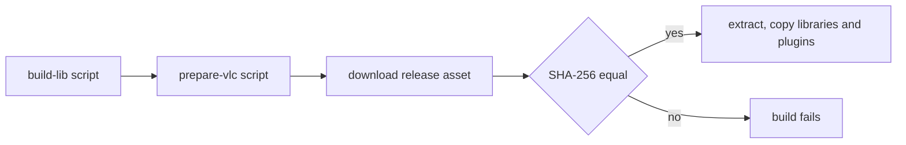

# Desktop VLC 3.0.24

## Change

- prepare-vlc-linux.sh, prepare-vlc-mac.sh, prepare-vlc-windows.sh:
  - release `v3.0.24-simplex` of simplex-chat/vlc;
  - the SHA-256 of each asset, checked before extraction;
  - Linux: the extracted libraries and plugins made readable by all users, as `--appimage-extract` of the release's AppImage runtime creates its directories with mode 700.
- Windows:
  - prepare-vlc-windows.sh copies libvlccore.dll and libvlc.dll;
  - Main.kt loads these two, as the release contains axvlc.dll and no npvlc.dll.

| Asset | SHA-256 |
|---|---|
| vlc-linux-x86_64.appimage | cdcd71c6bbd35bb4fddadf7cd9aeff25078df79d5d9c6a5e03b8fb196f82ee91 |
| vlc-linux-aarch64.appimage | 8a4ca4617cd1a16e09f09f0a1e34162cf5fbfd3048e67cccb738a1a476441bbc |
| vlc-macos-aarch64.zip | 69f72b2bb250c07e44a58bbaa6b80b48641d11f5cfe92b9b45656296852a8e47 |
| vlc-macos-x86_64.zip | a74b895d194472249b24eeb27af235ac12d2d7d6c1f9c4e442aa7d6934f03abd |
| vlc-win-x86_64.zip | 0f6fc3e9093bd7359abf3ec9361d2291b87c1013025102e9800c2bca36dcd597 |

## Verification

- Release: the GitHub digest of each asset equals the script's SHA-256.
- simplex-chat/vlc run of the release commit: each bundle unpacked as the prepare scripts unpack it, its plugins, playback and voice recording checked by scripts/ci/vlc-test.py on Linux, macOS and Windows.
- build.yml: kotlin scope on the draft; the desktop packages of all platforms on the full matrix.
