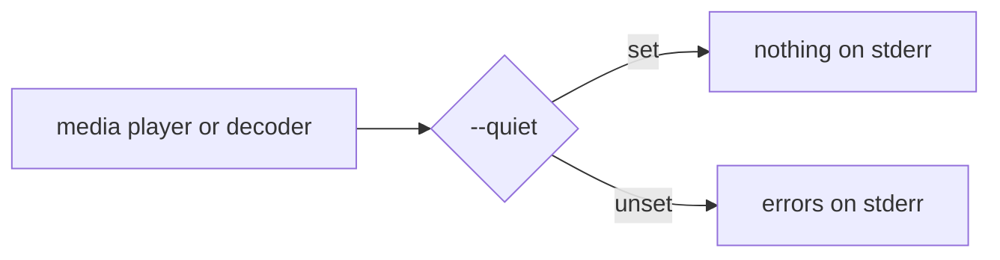

# Desktop VLC output silenced

## Change

- RecAndPlay.desktop.kt: `--quiet` in the arguments of `vlcFactory` and `vlcPreviewFactory`.

| Output to stderr | Source | With `--quiet` |
|---|---|---|
| `option … does not exist`, on each new media player | libVLC console logger: lib/media_player.c inherits options of the marq, logo, adjust, amem and equalizer modules, which the plugin allowlist leaves out | not printed: the console logger opens with verbosity -1 (modules/logger/console.c) |
| `[h264 @ …]` decoder errors | FFmpeg's logger | not printed: VLC sets `AV_LOG_QUIET` (modules/codec/avcodec/avcommon.h) |

Both factories pass `--quiet`, as the FFmpeg log level is global to the process and is set from the options of the factory whose decoder opens.

