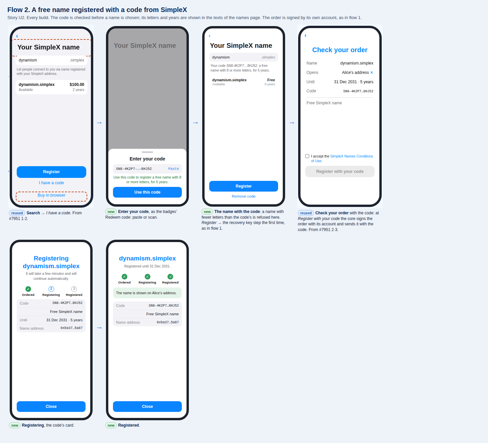
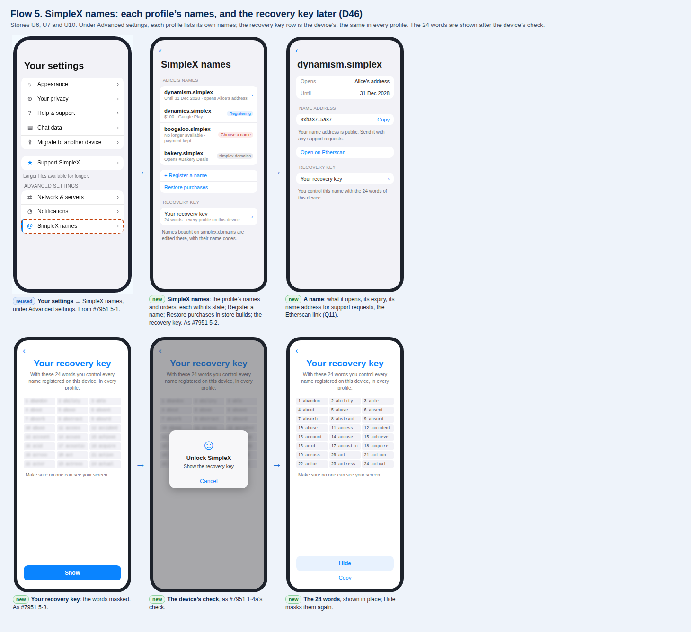
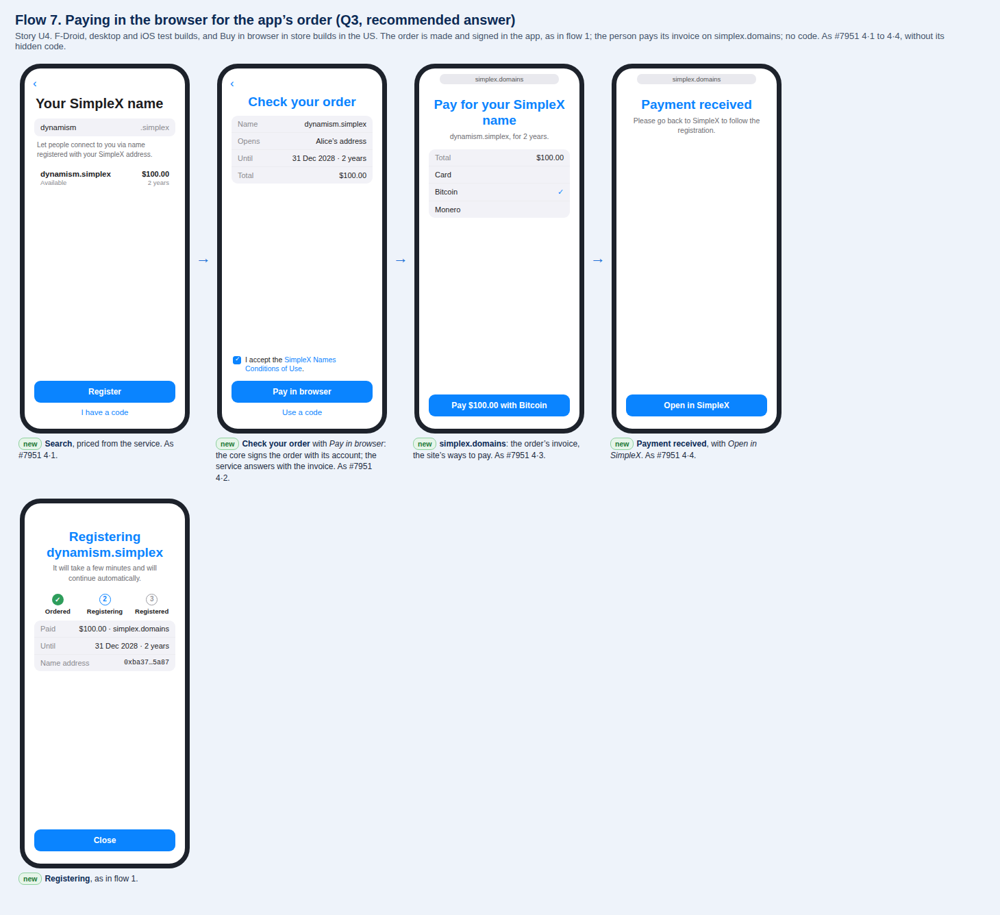
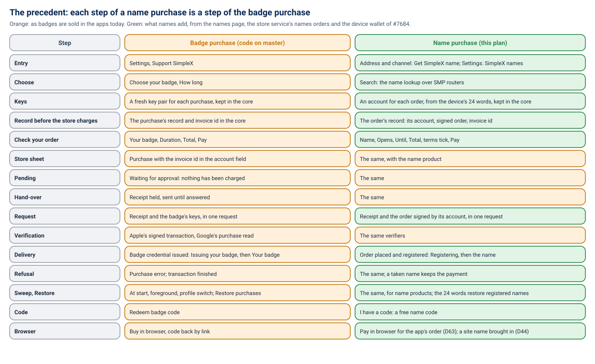
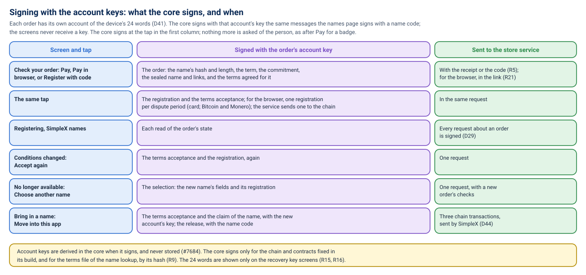
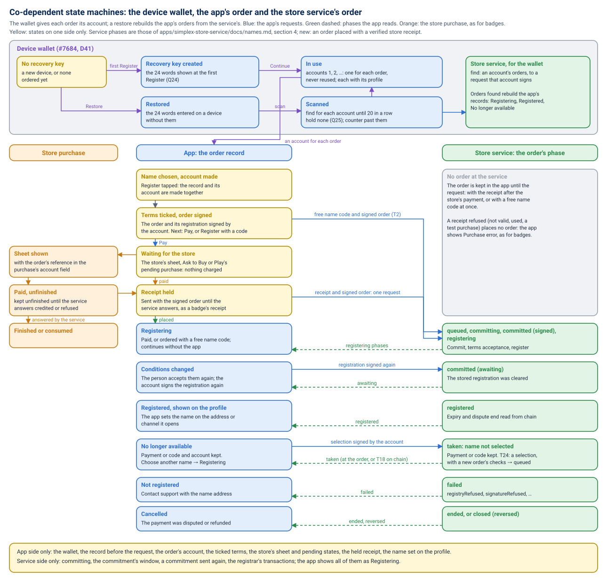

# SimpleX names in the apps

Part 1 of the plan, for people. Decisions: [2-decisions.md](2-decisions.md). Open questions: [questions.md](questions.md). The specification, part 3, follows once this part is approved.

Names are sold in the apps as badges are sold in them today (D3), and controlled with the device wallet of #7684 (D41): one set of 24 words for each device, the recovery key, and one account of it for each name. Each step of the purchase is a step of the badge purchase; what names add comes from the names page, the store service's names orders and the wallet. The screens follow #7951's pictures and the committed sketches where they answer a question (D42 to D52), and the recommended answers of Q2, Q3, Q24 and Q9.

## 1. Problem

A channel or a business can be reached by its SimpleX name, but a person registers a name only on simplex.domains, then sets it in the app by hand. In the app, a person can neither buy a name in the app's store nor register a free name code.

## 2. User stories

| | Who, when | Outcome |
|---|---|---|
| U1 | A person with a SimpleX address or a channel, in a Google Play or App Store build, wants to be found by a short name | Registers a name in the app, paying in the store; the name opens the address or channel and is shown on it |
| U2 | A person with a free name code from SimpleX | Registers a free name with the code in the app |
| U3 | A person who bought a name on simplex.domains | Moves the name into the app with its name code, or shows it on the address or channel it opens |
| U4 | A person in F-Droid, desktop or an iOS test build, or with Buy in browser in the US | Orders the name in the app and pays for it in the browser |
| U5 | A person whose chosen name is registered by someone else first | Chooses another name; the payment or code stays with the order |
| U6 | A person who registers the first name on a device | Writes down the 24 words once; with them the person controls every name the device registers |
| U7 | A person with a question about an order | Sends support the name address and the order reference, never the 24 words |
| U8 | A person whose store purchase of a name did not reach the store service: the app was closed, or the phone replaced | The purchase is used for a name in the app, as an unfinished badge purchase is |
| U9 | A person with a new device, or one that lost its data | Enters the 24 words and gets back the names registered in the app |
| U10 | A person with names on several profiles | Sees each profile's names, their state, and the recovery key in one place |

## 3. Product surface


## 4. Flows










Screens marked "reused" are #7951's, which build on #7684: 1·1, 1·2, 1·5, 1·5a, 1·9, 2·3 and 5·1; their dashed outlines are #7951's marks of its own changes. Screens marked "new" are drawn as #7951's screens they name, with texts that follow the owner's rules: the names page's approved texts, or proposed texts where the page has no such situation (Q18).

## 5. Principles and rules

| | Rule |
|---|---|
| R1 (U1, U2, U6) | One order, one name, one account. The core creates the order's account from the device's 24 words when Register is tapped, and keeps it with the order; an account is never used for a second order. |
| R2 (U1, U2) | A free name code is used to register a name; it is never a payment. A store purchase is the order's payment. |
| R3 (U1) | A name costs $100 for 2 years, any length; the store shows the product's price in its currency. |
| R4 (U1, U8) | As for a badge, the app records the order before the store charges, puts the order's reference in the purchase's account field, and keeps the store transaction unfinished until the store service answers it credited or refused. |
| R5 (U1, U2) | The app sends the store service the receipt, or the free name code, with the order signed by its account, its signed registration and its terms acceptance, in one request; the registration continues without the app. |
| R6 (U5) | When the name is taken first, the payment or code and the account stay with the order; another name is an ordinary order with its own checks, signed by the same account (D47). |
| R7 (U1, U2) | Search answers are read from the name lookup. A name the service does not sell is shown as available; its order is refused with "<name> is no longer available." (D17, D47) |
| R8 (U1, U2, U4) | As for badges: store payment in Google Play builds and in builds the App Store serves; in store builds, Buy in browser in the US and the code button elsewhere; both in other builds. After Register, Renew or Re-register in a name alert, the app shows its own flow (D49). |
| R9 (U1, U2) | The core signs only for the chain, contracts, namespace, term and dispute days fixed in its build, and for terms whose hash it checked. |
| R10 (U5, U7, U9) | Every request about an order is signed with its account's key (D29). The core signs; the screens never receive an account key. |
| R11 (U6, U7) | A name's screen shows its name address, the address of its account. Support requests include the name address and the order reference, never the 24 words. |
| R12 (U1 to U10) | The same situation uses the names page's approved text; only people act in texts; a title says what the person can do. |
| R13 (U1, U8) | One open store purchase of a name per profile at a time, as for badges; unfinished name purchases are included in Restore purchases (D50). |
| R14 (U9, D40) | An order found by its account stays readable after a change of the deployment's resolver address. |
| R15 (U1, U2, U6) | The 24 words are made at the first Register on the device, never at start, and shown before Check your order; the step is skipped for later orders (D51). The person ticks "I have saved my recovery key" (Q24). |
| R16 (U6, U10) | Later, from SimpleX names or a name's screen, the 24 words are shown only after the device's check (D46). |
| R17 (U9) | Restore from the 24 words is offered on a device without them, and in all builds in this release (D42). The app asks the name lookup what each account holds, until 20 accounts in a row hold none, adds the names to the active profile, and moves the device's account counter past them (D45). |
| R18 (U10) | Each profile lists its own names and orders in Settings, Advanced settings, SimpleX names, with the device's recovery key (D46); a hidden profile's names are listed only while it is shown (Q9). |
| R19 (U3) | The site's Open in SimpleX opens the app with the name code. The person moves the name into a new account of the device, by three chain transactions that SimpleX sends, or shows it on the address or channel, as today (D44). |
| R20 (U1, U2) | A name may be registered to open nothing, with the ✕ on Opens (D48). |
| R21 (U4) | In builds without store payment, and with Buy in browser, the app makes and signs the order as in R5, and the person pays the order's invoice on simplex.domains; no code is involved (Q3). |

## 6. System design








- The core holds the device wallet of #7684: the 24 words, stored as entropy, and the accounts, each with the profile it belongs to. An order's account is created when Register is tapped.
- The core signs an order's messages with its account's key, the messages the names page signs with a name code.
- The app reaches the store service over SMP, as badge requests do; name requests go to the same address.
- The store service verifies a name's store receipt as it verifies a badge's, then places the order as its names orders are placed for the names page.
- For a restore, the app asks the name lookup over SMP routers which names each account holds (D45); an order still under way is read from the store service's find, signed by its account.
- A move into the app is three chain transactions that the store service sends: signed with the name code, then with the new account's key (D44).
- A browser payment pays the invoice of the order the app placed over SMP (Q3).
- The name search is the name lookup over SMP routers; searches are sent to the routers only.

## 7. Core types

From #7684 (1b329f41f), restored on `ep/names-wallet` (D41):

```haskell
data WalletAddress = WalletAddress {accountIndex :: AccountIndex, keyPath :: Text, address :: Address}

data WalletInfo = WalletInfo {accountIndexes :: [AccountIndex], nextAccountIndex :: Word32}

data ChatCommand
  = ...
  | APIGetWallet {userId :: UserId}
  | APICreateWallet
  | APICreateWalletAccount {userId :: UserId}
  | APIExportWalletMnemonic
  | APIDeleteWallet
```

Moved from the store service into the chat library, so that the app and the service share them: `RegistrationView`, `PhaseView`, `NameRefusal`, the signed order and reveal requests, and the registration encoding.

Added by this plan:

```haskell
data NameOrder = NameOrder
  { account :: WalletAddress,
    request :: NameOrderRequest,
    stage :: OrderStage
  }

data NameOrderRequest = NameOrderRequest
  { order :: SentOrder,
    reveal :: RevealRequest
  }

data OrderStage
  = OSDraft
  | OSStorePurchase {invoiceId :: Text}
  | OSReceiptHeld {invoiceId :: Text, payment :: ServicePayment}
  | OSPlaced {registrationId :: RegistrationId, view :: RegistrationView}
  | OSRefused {refusal :: NameOrderRefusal}

data ChatCommand
  = ...
  | APIRestoreWallet {mnemonic :: Text}
  | APIFindWalletNames {userId :: UserId}

data StoreServiceCommand
  = ...
  | STCPurchaseName {payment :: ServicePayment, order :: SentOrder, reveal :: RevealRequest}
  | STCOrderNameWithCode {code :: NamePrepaidCode, order :: SentOrder, reveal :: RevealRequest}
  | STCCheckNameCode {code :: NamePrepaidCode}
  | STCGetNameOrder {registrationId :: RegistrationId, signed :: OrderSignature}
  | STCSelectName {registrationId :: RegistrationId, fields :: SignedFields, reveal :: RevealRequest}
  | STCFindNameOrders {owner :: Address, signed :: FindSignature}
  | STCOrderNameToPay {order :: SentOrder, reveal :: RevealRequest, method :: Text}
  | STCMoveName {release :: SignedRelease, acceptance :: SignedAcceptance, claim :: SignedClaim}

data StoreServiceResponse
  = ...
  | STPNameOrder {registration :: RegistrationView}
  | STPNameOrders {registrations :: [FoundOrder]}
  | STPNameCode {codeState :: CodeState}
  | STPNameInvoice {registration :: RegistrationView, invoiceLink :: Text}

data PaidWith = PWInvoice {method :: Text} | PWStore {provider :: PaymentProvider} | PWCode
```

| Type | Its precedent |
|---|---|
| `NameOrder` | the badge purchase's record in the core, its keys replaced by the order's account |
| `OSStorePurchase`, `OSReceiptHeld`, `OSRefused` | the badge receipt's states: recorded before the store charges, held, refused |
| `APIRestoreWallet` | #7684's RFC, "Recovery": one core command, allowed only on a device without a wallet |
| `APIFindWalletNames` | #7951's scan (its section 6.10): the name lookup of the names an account holds, account after account |
| `STCFindNameOrders` | the names page's find: an address's orders, to a request that address signs |
| `STCOrderNameToPay`, `STPNameInvoice` | the names page's order with an invoice (D12), placed by the app (Q3) |
| `STCMoveName` | #7951's move (its `v1-parts.svg`, row 4): the name code releases, the account accepts the terms and claims |
| `STCPurchaseName` | `STCPurchaseBadge`, with the order signed by its account in place of the badge's keys |
| `STCOrderNameWithCode`, `STCCheckNameCode`, `STCGetNameOrder`, `STCSelectName` | the names page's requests: the code order, the code check, the order's view, the selection after a take |
| `PaidWith` | the service's type; `PWStore` is its one new constructor |

The type names of this plan are illustrative; part 3 fixes them.
