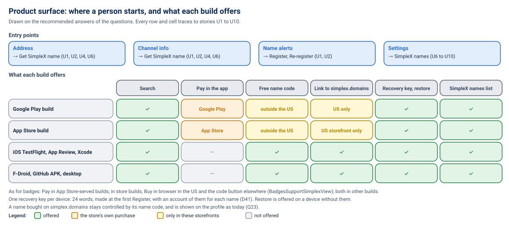
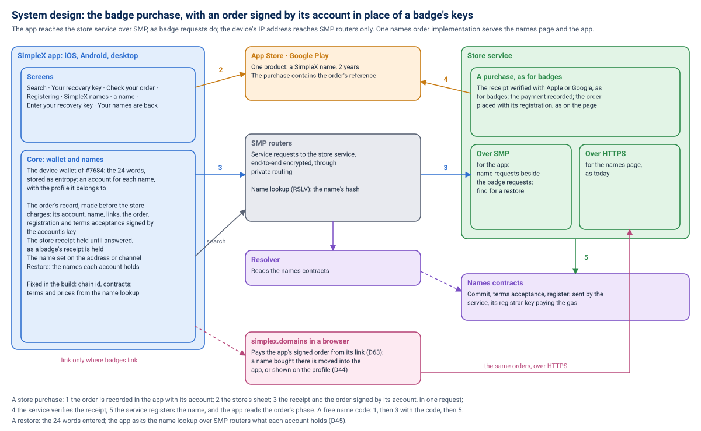
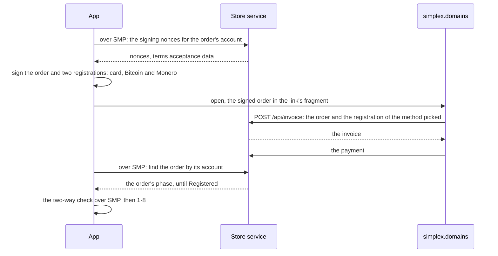

# SimpleX names in the apps

Part 1 of the plan, for people. Decisions: [2-decisions.md](2-decisions.md). Open questions: [questions.md](questions.md). The specification, part 3, follows once this part is approved.

Names are sold in the apps as badges are sold in them today (D3), and controlled with the device wallet of #7684 (D41): one set of 24 words for each device, the recovery key, and one account of it for each name. The screens are #7951's, with its numbers and words (D56), changed only by the owner's decisions in part 2.

## 1. Problem

A channel or a business can be reached by its SimpleX name, but a person registers a name only on simplex.domains, then sets it in the app by hand. In the app, a person can neither buy a name nor register one with a free name code.

## 2. User stories

| | Who, when | Outcome |
|---|---|---|
| U1 | A person with a SimpleX address or a channel, in a Google Play or App Store build, wants to be found by a short name | Registers a name in the app, paying in the store; the name opens the address or channel and is shown on it |
| U2 | A person with a free name code from SimpleX | Registers a free name with the code in the app |
| U3 | A person who bought a name on simplex.domains | Moves the name into the app with its name code, or shows it on the address or channel it opens |
| U4 | A person in an F-Droid, desktop or iOS test build, or in a US store build who pays by card, Bitcoin or Monero | Orders the name in the app and pays for it in the browser, with no code and no move |
| U5 | A person whose chosen name is registered by someone else first | Chooses another name; the payment or code stays with the order |
| U6 | A person who registers the first name on a device | Gets a recovery key of 24 words, saves it now or later; the key controls every name the device registers |
| U7 | A person with a question about an order | Sends support the order reference and the name address, never the 24 words |
| U8 | A person whose store purchase of a name did not reach the store service: the app was closed, or the phone replaced | The purchase is used for a name in the app, as an unfinished badge purchase is |
| U9 | A person with a new device, or one that lost its data | Enters the 24 words and gets back the names registered in the app |
| U10 | A person with names on several profiles | Sees each profile's names, their state, and the recovery key in one place |

## 3. Product surface



## 4. Flows

Each screen has #7951's number. Arrows in the captions name where each control leads.


## 5. Principles and rules

| | Rule |
|---|---|
| R1 (U1, U2, U6) | One order, one name, one account. The core creates the order's account from the device's 24 words when Register is tapped, and keeps it with the order; an account is never used for a second order. |
| R2 (U1, U2) | A free name code is used to register a name; it is never a payment. A code is entered only on 1·2, with I have a code; no checkout takes a code (D57). |
| R3 (U1) | A name costs $100 for 2 years, any length; the store shows the product's price in its currency. |
| R4 (U1, U8) | As for a badge, the app records the order before the store charges, puts the order's reference in the purchase's account field, and keeps the store transaction unfinished until the store service answers it credited or refused. |
| R5 (U1, U2) | The app sends the store service the receipt, or the free name code, with the order signed by its account, its signed registration and its terms acceptance, in one request; the registration continues without the app. |
| R6 (U5) | When the name is taken first, the payment or code and the account stay with the order; another name is an ordinary order with its own checks, signed by the same account (D47). |
| R7 (U1, U2) | Search answers are read from the name lookup. A name the service does not sell is shown as available; its order is refused with "<name> is no longer available." (D17, D47) |
| R8 (U1, U2, U4) | Store payment in Google Play builds and in builds the App Store serves. Pay in browser: under Pay on 1·5 in US store builds; the main button of 4·2 in builds that can't pay; nowhere in store builds outside the US, as for badges (D58). After Register, Renew or Re-register in a name alert, the app shows its own flow (D49). |
| R9 (U1, U2, U4) | The core signs only for the chain and contracts fixed in its build. Terms and prices come from the name lookup's answer; the app shows that terms file and signs its hash. The term (2 years, or a code's years) and the dispute days come from the store service; the contract bounds the dispute days (D62). |
| R10 (U5, U7, U9) | Every request about an order is signed with its account's key (D29). The core signs; the screens never receive an account key. |
| R11 (U7) | Support messages include the order reference and the name address, never the 24 words. The screens show the name address only with Developer tools on, on 1·7 and 1·8 (D61). |
| R12 (U1 to U10) | The same situation uses the names page's approved text; only people act in texts; a title says what the person can do. |
| R13 (U1, U8) | One open store purchase of a name per profile at a time, as for badges; unfinished name purchases are included in Restore purchases (D50). |
| R14 (U9, D40) | An order found by its account stays readable after a change of the deployment's resolver address. |
| R15 (U1, U2, U6) | The 24 words are made at the first Register on the device, never at start, before Check your order; the step is skipped for later orders (D51). Saving them is optional: Show and Copy on 1·4a, and a reminder until Copy or Show (D66). |
| R16 (U6, U10) | Later, from SimpleX names or a name's screen, the 24 words are shown only after the device's check (D46). |
| R17 (U9) | Restore from the 24 words is offered on a device without them, and in all builds in this release (D42). The app asks the name lookup what each account holds, until 20 accounts in a row hold none, adds the names to the active profile, and moves the device's account counter past them (D45). |
| R18 (U10) | Each profile lists its own names and orders in Settings, Advanced settings, SimpleX names, with the device's recovery key (D46). A hidden profile can't register a name (D67). |
| R19 (U3) | The site's Open in SimpleX opens the app with the name code. The person moves the name into a new account of the device, by three chain transactions that SimpleX sends, or shows it on the address or channel, as today (D44). |
| R20 (U1, U2) | A name may be registered to open nothing, with the ✕ on Opens (D48). |
| R21 (U4) | In the browser, the app's own order is paid. The app signs the order and one registration for each dispute period, card or Bitcoin and Monero, and opens simplex.domains with them in the link's fragment. The page offers the methods and requests the invoice for the one picked; it keeps no key and adds nothing to Your names (D63, D65). |
| R22 (U1 to U5) | The registration stages are Ordering → Ordered, Waiting, Registering → Registered. A stage's circle holds its number until the stage starts, is blue while it runs, green with ✓ once done, red with ✕ when it failed (D59). |
| R23 (U1 to U5) | Before a name is shown as registered or moved, the app checks it both ways over SMP: the name resolves to the address or channel, and its link data names the name. The app links to no explorer (D53, D60). |
| R24 (U1 to U10) | The app sends every request to the store service over SMP, as badge requests go (D63). |
| R25 (U1) | A store refund is followed by hand: SimpleX tracks the dispute and ends the name's registration; nothing ends it automatically (D54). |
| R26 (U4) | The page opened from the app is adjusted to app users: it shows the app's order and its payment only (D55). |

## 6. System design





- The core holds the device wallet of #7684: the 24 words, stored as entropy, and the accounts, each with the profile it belongs to. An order's account is created when Register is tapped.
- The core signs an order's messages with its account's key, the messages the names page signs with a name code.
- The app reaches the store service over SMP, as badge requests do; name requests go to the same address.
- The store service verifies a name's store receipt as it verifies a badge's, then places the order as its names orders are placed for the names page.
- A browser payment: the app reads the signing nonces over SMP, signs, and opens the page with the signed order in the link's fragment; the page requests the invoice with the existing `POST /api/invoice`; the app finds the order by its account over SMP and follows it (D63).
- For a restore, the app asks the name lookup over SMP routers which names each account holds (D45); an order still under way is read from the store service's find, signed by its account.
- A move into the app is three chain transactions that the store service sends: signed with the name code, then with the new account's key (D44).
- The name search is the name lookup over SMP routers; searches go to the routers only. Its answer for an available name includes the prices and the terms (D62).



## 7. Core types

From #7684 (1b329f41f), restored on `ep/names-wallet` (D41):

```haskell
data WalletAddress = WalletAddress {accountIndex :: AccountIndex, keyPath :: Text, address :: Address}

data WalletInfo = WalletInfo {accountIndexes :: [AccountIndex], nextAccountIndex :: Word32}

data ChatCommand
  = ...
  | APIGetWallet {userId :: UserId}
  | APICreateWallet
  | APICreateWalletAccount {userId :: UserId}
  | APIExportWalletMnemonic
  | APIDeleteWallet
```

Moved from the store service into the chat library, so that the app and the service share them: `RegistrationView`, `PhaseView`, `NameRefusal`, the signed order and reveal requests, and the registration encoding.

Added by this plan:

```haskell
data NameOrder = NameOrder
  { account :: WalletAddress,
    request :: NameOrderRequest,
    stage :: OrderStage
  }

data NameOrderRequest = NameOrderRequest
  { order :: SentOrder,
    reveal :: RevealRequest
  }

data OrderStage
  = OSDraft
  | OSStorePurchase {invoiceId :: Text}
  | OSReceiptHeld {invoiceId :: Text, payment :: ServicePayment}
  | OSBrowser
  | OSPlaced {registrationId :: RegistrationId, view :: RegistrationView}
  | OSRefused {refusal :: NameOrderRefusal}

data BrowserOrder = BrowserOrder
  { order :: SentOrder,
    reveal :: RevealRequest,
    cardSignature :: Signature,
    cryptoSignature :: Signature
  }

data ChatCommand
  = ...
  | APIRestoreWallet {mnemonic :: Text}
  | APIFindWalletNames {userId :: UserId}

data StoreServiceCommand
  = ...
  | STCPurchaseName {payment :: ServicePayment, order :: SentOrder, reveal :: RevealRequest}
  | STCOrderNameWithCode {code :: NamePrepaidCode, order :: SentOrder, reveal :: RevealRequest}
  | STCCheckNameCode {code :: NamePrepaidCode}
  | STCGetNameSigning {labelHash :: LabelHash, owner :: Address}
  | STCGetNameOrder {registrationId :: RegistrationId, signed :: OrderSignature}
  | STCSelectName {registrationId :: RegistrationId, fields :: SignedFields, reveal :: RevealRequest}
  | STCFindNameOrders {owner :: Address, signed :: FindSignature}
  | STCMoveName {release :: SignedRelease, acceptance :: SignedAcceptance, claim :: SignedClaim}

data StoreServiceResponse
  = ...
  | STPNameSigning {toSign :: ToSign}
  | STPNameOrder {registration :: RegistrationView}
  | STPNameOrders {registrations :: [FoundOrder]}
  | STPNameCode {codeState :: CodeState}

data PaidWith = PWInvoice {method :: Text} | PWStore {provider :: PaymentProvider} | PWCode
```

| Type | Its precedent |
|---|---|
| `NameOrder` | the badge purchase's record in the core, its keys replaced by the order's account |
| `OSStorePurchase`, `OSReceiptHeld`, `OSRefused` | the badge receipt's states: recorded before the store charges, held, refused |
| `OSBrowser`, `BrowserOrder` | the names page's order and its reveal (`orderRequest`, `signedReveal` in `webapp/src/flow.ts`), with one registration signature for each dispute period |
| `APIRestoreWallet` | #7684's RFC, "Recovery": one core command, allowed only on a device without a wallet |
| `APIFindWalletNames` | #7951's scan (its section 6.10): the name lookup of the names an account holds, account after account |
| `STCGetNameSigning`, `STPNameSigning` | the names page's read of what an order's account signs (`GET /api/name/<labelHash>/sign`, `ToSign`) |
| `STCFindNameOrders` | the names page's find: an address's orders, to a request that address signs |
| `STCMoveName` | #7951's move (its `v1-parts.svg`, row 4): the name code releases, the account accepts the terms and claims |
| `STCPurchaseName` | `STCPurchaseBadge`, with the order signed by its account in place of the badge's keys |
| `STCOrderNameWithCode`, `STCCheckNameCode`, `STCGetNameOrder`, `STCSelectName` | the names page's requests: the code order, the code check, the order's view, the selection after a take |
| `PaidWith` | the service's type; `PWStore` is its one new constructor |

The type names of this plan are illustrative; part 3 fixes them.
