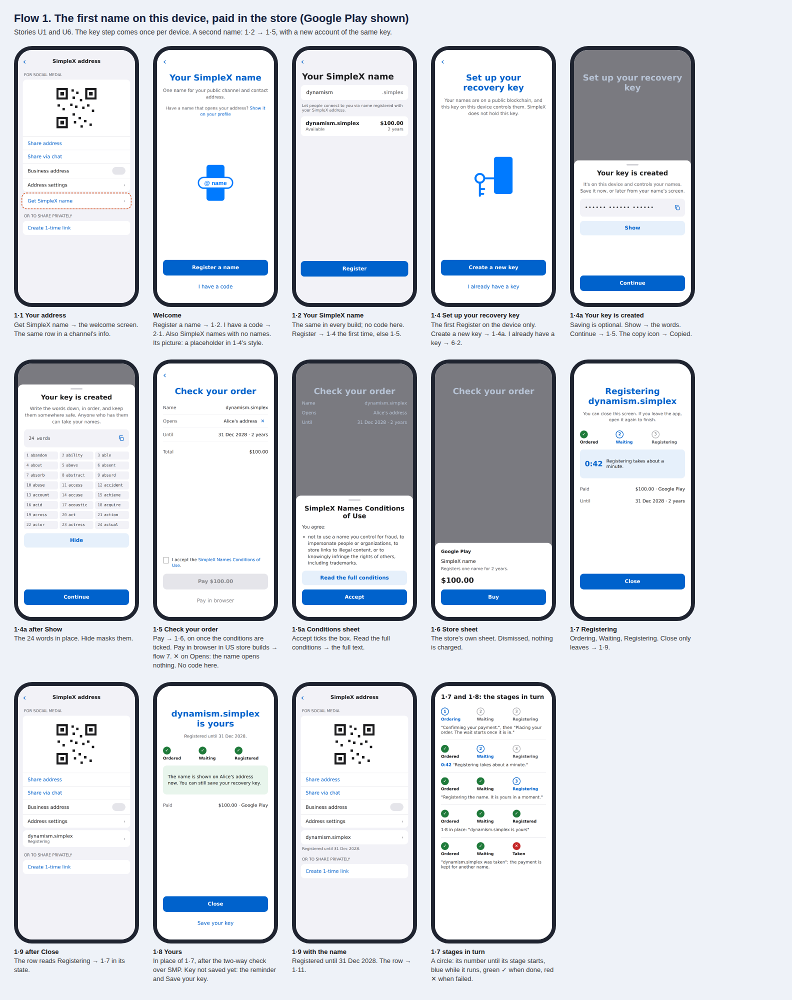
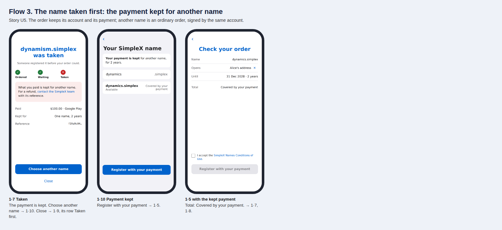
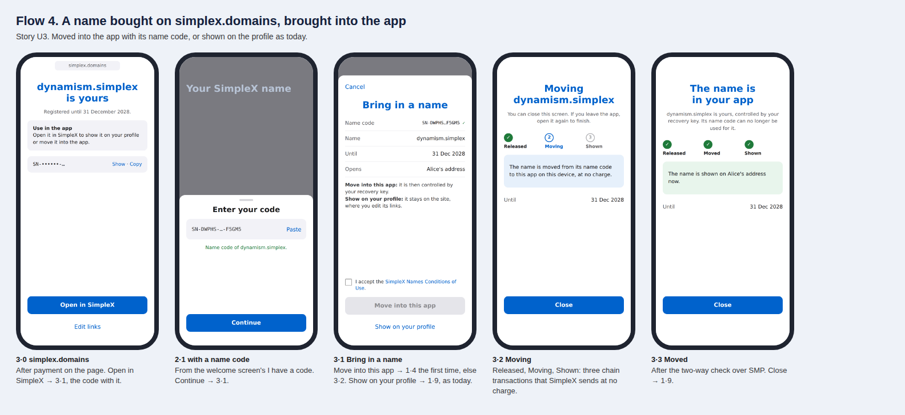
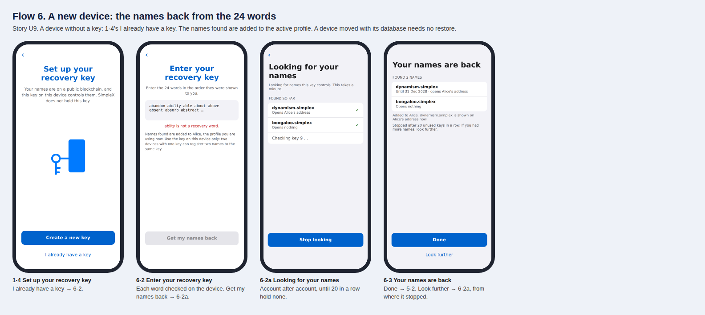
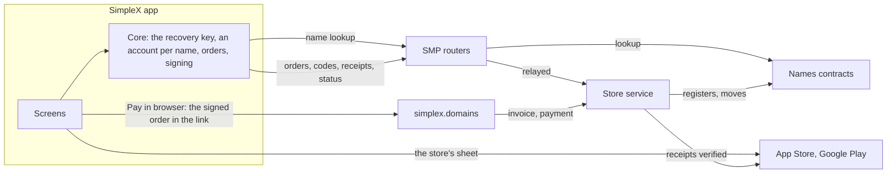

# SimpleX names in the apps

Part 1 of the plan, for people. Decisions: [2-decisions.md](2-decisions.md). Open questions: [questions.md](questions.md). The specification, part 3, follows once this part is approved.

Names are sold in the apps as badges are sold in them today (D3), and controlled with the device wallet of #7684 (D41): one set of 24 words for each device, the recovery key, and one account of it for each name. The screens are #7951's, with its numbers and words (D56), changed only by the owner's decisions in part 2.

## 1. Problem

A channel or a business can be reached by its SimpleX name, but a person registers a name only on simplex.domains, then sets it in the app by hand. In the app, a person can neither buy a name nor register one with a code.

## 2. User stories

| | Who, when | Outcome |
|---|---|---|
| U1 | A person with a SimpleX address or a channel, in a Google Play or App Store build, wants to be found by a short name | Registers a name in the app, paying in the store; the name opens the address or channel and is shown on it |
| U2 | A person with a code from SimpleX | Registers a name with the code, seeing what the code registers and no price |
| U3 | A person who bought a name on simplex.domains | Moves the name into the app with its name code, or shows it on the address or channel it opens |
| U4 | A person in an F-Droid, desktop or iOS test build, or in a US store build who pays by card, Bitcoin or Monero | Orders the name in the app and pays for it in the browser, with no code and no move |
| U5 | A person whose chosen name is registered by someone else first | Chooses another name; the payment or code stays with the order |
| U6 | A person who registers the first name on a device | Gets a recovery key of 24 words, saves it now or later; the key controls every name the device registers |
| U7 | A person with a question about an order | Sends support the order reference and the name address, never the 24 words |
| U8 | A person whose store purchase did not reach the store service because the app closed | The purchase is used at the next start, as an unfinished badge purchase is |
| U9 | A person with a new device, or one that lost its data | Enters the 24 words and gets back the names registered in the app |
| U10 | A person with names on several profiles | Sees each profile's names and the recovery key in one place |

## 3. Product surface


## 4. Flows

Each screen has #7951's number. Arrows in the captions name where each control leads.












## 5. Principles and rules

Principles:

| | Principle |
|---|---|
| P1 | Names are sold as badges are sold: where the badge purchase has a step, the name purchase takes the same step (D3). |
| P2 | The keys of names exist only on the device; SimpleX, the stores and the page never receive them (D41, D65). |
| P3 | A code has no money value: nothing presents a code as a price, a discount or a payment (D7). |
| P4 | People see what they sign: the app signs only terms it shows, for contracts its build fixes (D62). |
| P5 | A registration is confirmed inside SimpleX, over SMP, never by an outside site (D53, D60). |
| P6 | The app's requests reach SimpleX's services only over SMP (D63). |
| P7 | One release, with no screen that depends on a version (D42). |
| P8 | Only people act in texts, and a title says what the person can do (D19, D22). |
| P9 | App users and page users differ (D55). |

Rules, against which each screen and each request is checked:

| | Rule |
|---|---|
| R1 (P2) | One order, one name, one account of the device's key; an account never serves a second name (D9, D41). |
| R2 (P3) | A code is entered before a name is chosen, and a code's path shows no price (D57, D68). |
| R3 | A name costs $100 for 2 years, any length; a store shows its price in its currency (D5, D52). |
| R4 (P1) | A store payment is verified by the store service, as a badge payment is; the store transaction stays unfinished until the service answers. |
| R5 (P1, P2) | A purchase is consumed once credited; nothing is restored from the store (D69). |
| R6 | A paid order, or an order with a code, completes without the app (D12). |
| R7 | A taken name leaves the payment or the code with the order, for another name (D10, D47). |
| R8 | Search answers come from the name lookup; a name SimpleX does not sell shows as available and is refused at the order (D17). |
| R9 (P1) | The app links to the site only where badges link to it (D58). |
| R10 (P4) | The build fixes only the chain and the contracts; terms and prices come from the name lookup; the term and the dispute days come from the store service, within the contract's bounds (D62). |
| R11 (P2) | Every request about an order is signed with its account's key (D29). |
| R12 (P2) | The recovery key is made on the device at its first registration; saving it is optional and reminded until saved; it is shown again only after the device's own check (D46, D51, D66). |
| R13 (P5) | A name is shown as registered only once it resolves to its address or channel, and that address or channel names it (D60). |
| R14 | Each profile lists its own names; the recovery key is the device's; a hidden profile can't register a name (D46, D67). |
| R15 (P7) | A restore from the 24 words is in this release and adds the names found to the active profile (D42, D45). |
| R16 | A name bought on the site is moved into a new account of the device, or shown on the profile as today (D44). |
| R17 | A name may open nothing (D48). |
| R18 (P1) | A disputed or refunded payment is ended by people, never automatically (D54). |
| R19 (P2) | Support receives the order reference and the name address, never the key (D24). |
| R20 (P2, P9) | The page keeps nothing of an app order: no key, and nothing in Your names (D65). |
| R21 (P3) | Outside the stores, the page pays the app's own signed order; no code is bought (D63). |
| R22 | An order stays findable by its account after the deployment's resolver address changes (D40). |
| R23 (P8) | The same situation has the names page's approved text (D21). |

## 6. System design



| Choice | Taken | Other options and their cost |
|---|---|---|
| Paying outside the stores | The page pays the app's signed order (D63) | Buying on the site, then moving: three chain transactions per name, and a code to keep. A hidden prepaid code (#7951): a payment for a code, and a card payment held to the code's 14 dispute days. |
| What the app pins | The chain and the contracts; terms and prices from the name lookup (D62) | Pinning all: an app release for each change of terms or prices. Taking all from the service: the person may sign terms the app never checked. |
| Saving the key | Optional, reminded (D66) | A required tick before paying: a step before every first purchase. |
| Store purchases | Consumed once credited (D69) | Restore purchases: an unfinished purchase belongs to an order signed with a device's key, which another device lacks. |
| Confirming a registration | The two-way check over SMP (D60) | An explorer link: people sent to an outside site. |
| Finding a device's names after a restore | Open: Q31 | |
| Delivery | Open: Q32, phases into a feature branch | One pull request: too large to review and land. |

The specification's diagrams wait for part 3: the badge steps, the system's messages, the order states and the signatures (`images/3-01` to `3-04`).

## 7. Core types

From #7684 (1b329f41f), restored on `ep/names-wallet` (D41):

```haskell
data WalletAddress = WalletAddress {accountIndex :: AccountIndex, keyPath :: Text, address :: Address}

data WalletInfo = WalletInfo {accountIndexes :: [AccountIndex], nextAccountIndex :: Word32}

data ChatCommand
  = ...
  | APIGetWallet {userId :: UserId}
  | APICreateWallet
  | APICreateWalletAccount {userId :: UserId}
  | APIExportWalletMnemonic
  | APIDeleteWallet
```

Moved from the store service into the chat library, so that the app sends what the page sends: `SentOrder` (`StoreService/Names/Orders.hs`), `RevealRequest` (`StoreService/Names/Reveal.hs`, the JSON of the page's `RevealBody`), `RegistrationView`, `PhaseView`, `NameRefusal` and the registration encoding.

Added by this plan:

```haskell
data NameOrder = NameOrder
  { account :: WalletAddress,
    request :: NameOrderRequest,
    stage :: OrderStage
  }

data NameOrderRequest = NameOrderRequest
  { order :: SentOrder,
    reveal :: RevealRequest
  }

data OrderStage
  = OSDraft
  | OSStorePurchase {invoiceId :: Text}
  | OSReceiptHeld {invoiceId :: Text, payment :: ServicePayment}
  | OSBrowser
  | OSPlaced {registrationId :: RegistrationId, view :: RegistrationView}
  | OSRefused {refusal :: NameOrderRefusal}

data BrowserOrder = BrowserOrder
  { order :: SentOrder,
    reveal :: RevealRequest,
    cardSignature :: Signature,
    cryptoSignature :: Signature
  }

data ChatCommand
  = ...
  | APIRestoreWallet {mnemonic :: Text}
  | APIFindWalletNames {userId :: UserId}

data StoreServiceCommand
  = ...
  | STCPurchaseName {payment :: ServicePayment, order :: SentOrder, reveal :: RevealRequest}
  | STCOrderNameWithCode {code :: NamePrepaidCode, order :: SentOrder, reveal :: RevealRequest}
  | STCCheckNameCode {code :: NamePrepaidCode}
  | STCGetNameOrder {registrationId :: RegistrationId, signed :: OrderSignature}
  | STCSelectName {registrationId :: RegistrationId, fields :: SignedFields, reveal :: RevealRequest}
  | STCFindNameOrders {owner :: Address, signed :: FindSignature}
  | STCMoveName {release :: SignedRelease, acceptance :: SignedAcceptance, claim :: SignedClaim}

data StoreServiceResponse
  = ...
  | STPNameOrder {registration :: RegistrationView}
  | STPNameOrders {registrations :: [FoundOrder]}
  | STPNameCode {codeState :: CodeState}

data PaidWith = PWInvoice {method :: Text} | PWStore {provider :: PaymentProvider} | PWCode
```

| Type | Its precedent |
|---|---|
| `NameOrder` | the badge purchase's record in the core, its keys replaced by the order's account |
| `OSStorePurchase`, `OSReceiptHeld`, `OSRefused` | the badge receipt's states: recorded before the store charges, held, refused |
| `OSBrowser`, `BrowserOrder` | the names page's order and its reveal (`orderRequest`, `signedReveal` in `webapp/src/flow.ts`), with one registration signature for each dispute period |
| `APIRestoreWallet` | #7684's RFC, "Recovery": one core command, allowed only on a device without a wallet |
| `APIFindWalletNames` | the names a restored key's accounts hold, account after account (Q31) |
| `STCFindNameOrders` | the names page's find: an address's orders, to a request that address signs |
| `STCMoveName` | #7951's move (its `v1-parts.svg`, row 4): the name code releases, the account accepts the terms and claims |
| `STCPurchaseName` | `STCPurchaseBadge`, with the order signed by its account in place of the badge's keys |
| `STCOrderNameWithCode`, `STCCheckNameCode`, `STCGetNameOrder`, `STCSelectName` | the names page's requests: the code order, the code check, the order's view, the selection after a take |
| `PaidWith` | the service's type; `PWStore` is its one new constructor |

The type names of this plan are illustrative; part 3 fixes them.
