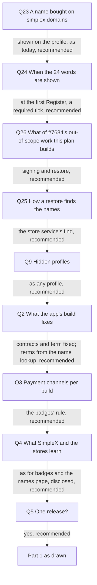

# SimpleX names in the apps: open questions

Principles first, as a decision tree; then details. Each entry: what is open, the decisions around it, the options with what people see in each, the closest precedent in the badge purchase, the current names code or the device wallet of #7684, and a recommendation. Part 1 is drawn on the recommended answers.

The base is decided: the apps build on the #7684 device wallet, one set of 24 words per device and one account of it for each name (D41). The other earlier work is material of equal standing, and none of it is a decision: spaced4ndy's and spaced4ndy-agents' pull requests (#7951, #8222, #8223, #8248, #8249, #8251), brenzi's #7530, brenzi-agent's #8026, and brenzi's wallet and in-app wallet branches (`ab/names-gui`, `ab/names-purchase-and-management`, `ab/wallet*`). Where the material departs from the owner's decisions or from the badge purchase, the departure is a question with its options: Q9, Q10, Q16, Q21, Q22, Q23, Q25.

## Principles

### Q23. A name bought on simplex.domains

- Open: how a person uses in the app a name the names page registered with its own name code, where the app controls names with the device's 24 words (D41).
- Around it:
  - the names page gives each buyer a name code, and the person controls the name with it (D24);
  - #7684's RFC: "Every key the device uses is derivable again from the master phrase alone"; "importing an account key that the master does not derive" is outside its scope;
  - today the app shows a name bought on the site once the person sets it on the address (`APISetUserDomain`), as the page's card says: "In SimpleX, open Your SimpleX address, tap Set SimpleX name and enter …";
  - a name code entered where a free name code is asked is told apart, as on the page (D25).
- Options:
  - a. Moved on chain into a new account of the device: "Bring it into the app", then "Move into this app" (#7951 row 3, screens 3·1 to 3·3; #8026's answers). The person then controls it with the 24 words and gets it back with them on a new device, and no longer controls it with its name code. The move is three chain transactions that the store service sends; transfers are new work in the store service (#7951, section 3.3: designed, unbuilt).
  - b. Added as its own name code, with no move: the app keeps the code beside the 24 words and signs requests about its order with the code's key, as the page does. The person keeps both the 24 words and the code; a restore from the 24 words leaves this name out. Departs from objective 1 of #7684's RFC. Material: the RFC on brenzi's older `ab/wallet`, the base of `ab/wallet-scan`, reserves a mark for an imported account key and builds no import.
  - c. Shown on the profile, as today: the person sets it on the address or channel; it stays controlled by its name code, and its links are edited on simplex.domains. SimpleX names lists it as on simplex.domains. Precedent: the app and the page's card at master.
- Recommendation: c. The app and the page are used as they are, and every key the app holds is restored from the 24 words. Option a stays open for a later release with transfers.

### Q24. When the 24 words are shown, and whether saving them is required

- Open: the moment the person first sees the 24 words, and whether the order waits until they are written down.
- Around it:
  - in #7684 the 24 words are made only by an explicit command, never at start, and an account on first use, when a name is bought (its RFC, "Profiles and accounts");
  - the names page asks for its name code to be saved before paying, with a required tick (D21, the page's approved texts);
  - the badge purchase asks buyers to save no key: its private keys stay in the core, and the screens show only its public key, in developer tools.
- Options:
  - a. At the first Register on the device, before Check your order: "Set up your recovery key", then the 24 words with a required tick "I have written down the 24 words"; the step is skipped for later orders on the device. Precedent: the page's required tick; #7951's 1·4.
  - b. The same moment, with saving optional and a reminder until the words are shown or copied: #7951's 1·4 and 1·4a.
  - c. After the first name is registered, with a reminder until marked saved: brenzi's `ab/names-gui` ("You will get a recovery key when you get your first name.").
- Recommendation: a.
  - A1. Shown later, from SimpleX names or a name's screen, after the app's authentication, as Stop SimpleX and changes of SimpleX Lock ask for it (`DatabaseView.swift`, `PrivacySettings.swift`) (recommended); or without it.

### Q26. Which of the work #7684 left out this plan builds

- Open: #7684 holds the 24 words and the accounts. Out of scope in its RFC: buying a name, the names protocol, the registrar, signing, recovery from the phrase, importing an account key that the master does not derive, more than one master, and stealth keys.
- Around it: names sold as badges are (D3); one release is Q5.
- Options:
  - a. Buying, signing with the account keys, and restore from the 24 words with its scan, in this plan; imported keys, more than one master and stealth keys stay out. From the first release, a person gets back every name bought in the app from the 24 words.
  - b. Buying and signing; restore later, as #7951's stage 2. Until then the keys are restored from the 24 words only in another wallet (#7684's RFC, known limit 2).
  - c. As a, with imported keys, which Q23's option b needs.
- Recommendation: a.

### Q25. How a restore finds the names of the 24 words

- Open: how the app learns which accounts hold names, on a new device or after a database import.
- Around it:
  - recovery is planned in #7684's RFC as "one core command, allowed only on a device without a wallet: the core imports the phrase, sends each account to a service in a separate request, records the accounts in use and sets the counter past them";
  - every request about an order is signed with its key (D29);
  - the store service's find, `POST /api/registration/find` (`Web/Names/Owner.hs`), answers an address's orders to a request that address signs.
- Options:
  - a. The store service's find, one request for each account, signed by it, until 20 accounts in a row have no order, the gap of brenzi's #7561. Every name ordered in the app is found, also an order still registering or one whose payment is kept for another name. Precedent: the find route at master; badges' Restore purchases asks the store service.
  - b. The resolver's lookup of the names an address owns, over SMP routers: brenzi's #7561 (`ab/wallet-scan`) and #7566 (`ab/wallet-names`), on an older `ab/wallet` with the same key layout as #7684. They need the owned-names lookup of simplexmq #1875 (brenzi, draft). Only registered names are found, also names moved in by Q23's option a.
  - c. Both.
- Recommendation: a; b joins it if Q23 is answered a.
  - A1. The profile the names found go to: the active profile, as in brenzi's #7561 (recommended); or a choice for each name.
  - A2. After a database import, the scan runs before the next order, so that each new order gets an unused account (recommended).

### Q9. Hidden profiles

- Open: whether a hidden profile registers names, and where its accounts come from.
- Around it: in #7684 an account is created for a hidden profile as for any other profile, from the same 24 words (its RFC, "Profiles and accounts"); a hidden profile can hold a badge, and set a name on its address today (`APISetUserDomain` checks no hidden state).
- Options:
  - a. As any profile, as in #7684: its names are listed only while it is shown, as its badge is; a restore brings its names back with the others (Q25, A1).
  - b. Its accounts in a subtree reached with a secret, as in brenzi's #7509 (`ab/wallet-hidden`, on an older `ab/wallet` with a key for each name at `m/44'/60'/0'/0/k`): they are left out of a listing of the device's names, and the secret is needed for a restore too.
  - c. Refused, as #7951 proposes: "A hidden profile can't register a name."
- Recommendation: a.

### Q2. What the person signs for, and who can change it

- Open: which values the app takes from its build, and which from the network.
- Around it: the page holds the contracts, chain, terms, prices and dispute days, changed only with a reviewed release (D28); any paid price off the list is refused (D30).
- Options:
  - a. The build fixes the chain id, contract addresses, namespace, term and dispute days; the terms come from the name lookup, read from the chain by the resolver, and are checked against their link's hash. A terms change needs no app release. Precedent: the build fixes the badge issuer keys and the store service's address; the name lookup's answer includes the terms.
  - b. As a, and the terms' hash fixed in the build, as the page holds it. A terms change needs an app release, and an app not updated cannot order until it is updated. Precedent: the page (D28).
  - c. All values from the store service. Precedent: the page before its hardening.
- Recommendation: a. With a router older than the terms field of the name lookup, ordering waits, with the approved "Names can't be ordered right now. Please try again later."

### Q3. Payment channels per build

- Open: which builds pay in the store, link to simplex.domains, and offer the code button.
- Around it: in-app payments (D2); names sold as badges are (D3); badge purchases only in App Store-served builds (D35).
- Options:
  - a. The badges' rule: Pay in Google Play builds and App Store-served builds; in store builds, Buy on simplex.domains in the US and I have a code elsewhere; both in F-Droid, desktop and iOS test builds; the recovery key and restore everywhere. Precedent: the badges' support screen.
  - b. As a, with I have a code in every build. Precedent: the names page offers codes to every buyer.
  - c. #7951's browser payment for a hidden code in builds without store payment. Precedent: none; a code bought with money contradicts D7.
- Recommendation: a.
  - A1. The store price: $100 in each store's tier, the store's fee paid by SimpleX (recommended, D5).
  - A2. The stores' policies for names: settled with Apple and Google before the release (recommended).

### Q4. What SimpleX and the stores learn

- Open: what the Privacy Policy states for names bought in the app.
- Around it: one request with everything signed (D12); the service learning names of unpaid orders was accepted for the page (D13).
- Options:
  - a. As for badges and the names page: the store learns that a "SimpleX name" was bought, not which; the service links the store transaction to the order, its name and links, and its name address; during a restore it receives one find request for each account (Q25); searches reach SMP routers only; the Privacy Policy states these. With R5 the service receives an order only with its receipt or code.
  - b. Blind-signed codes. Precedent: none.
- Recommendation: a, with the Privacy Policy text approved by the owner before release.

### Q5. One release, or several

- Open: whether people see the whole feature at once.
- Around it: #7951 proposes stages: codes, then payments, then v1.1 with the restore.
- Options:
  - a. One app release with search, store payment, free name code, the recovery key, restore and SimpleX names. One earlier release is needed and invisible to people: Q19.
  - b. #7951's releases: codes, then payments, then a v1.1 and later stages.
- Recommendation: a.

## Details

### Q6. A paid order that the service cannot place

- Open: what happens to a verified store payment when its order is refused: the name taken or held, a name the service does not sell (D17), changed terms.
- Around it: a take keeps the payment with the order (D10); unspent money is spent on one name or refunded (D10).
- Options:
  - a. The payment is recorded and the order kept, with its account, and its name not selected; the person chooses another name, or asks for a refund: the App Store's refund request on iOS, support on Android. Closest precedent: the names service sets a paid order taken when its payment settles while another order holds the name (names.md, T4).
  - b. The receipt is refused, the transaction finished, and the person asks the store for a refund. Precedent: the badges' refused receipt.
- Recommendation: a.

### Q7. Dispute days for store payments, and store refunds after registration

- Open: the dispute days signed for a store payment, and how a store's refund reaches the service.
- Around it: the signed registration covers its payment's dispute days, 120 for a card and 14 for crypto and codes; a disputed or refunded card payment ends the registration within its period (names.md, 3.12). For a one-time badge the service sees a refund only in a receipt presented to it; for a subscription it asks the store before each month; Play's voided purchases are not read (the service's README).
- Options:
  - a. 120 days, as for a card; the service reads the stores' refund notifications and ends a refunded registration within its period. Closest precedent: the card dispute webhook.
  - b. 14 days, and refunds found only in presented receipts, as for one-time badges.
- Recommendation: a.

### Q8. Search answers for a name another order holds

- Open: the app's search reads the chain through the name lookup, so a name a paid order holds shows as available until it is registered; the page shows it as taken.
- Around it: names the service does not sell show as available, refused at order (D17). Material: brenzi's TODO on #7530 (2026-09-22) quotes review feedback, without naming its author, that the search is a screen of results where several names are tried and a taken name shows what uses it one tap away; #7951's search follows it.
- Options:
  - a. The name lookup only; the order is refused with "<name> is no longer available." Precedent: today's name lookup in the app; D17.
  - b. The app asks the service at search too. Precedent: the page's search.
- Recommendation: a.

### Q10. A name that opens nothing

- Open: #7951's ✕ on Opens registers a name with no link.
- Around it: the page's Links step has "Skip for now".
- Material: `ab/names-gui`'s Buy a name has the switch "Point this name at my profile"; off, "The name will point nowhere. Buy it this way if it is for someone else" (`BuyNameView.swift`).
- Options: a. every app order opens the address or channel it started from (recommended: every entry point has one). b. the ✕, as the page skips.

### Q11. The Etherscan link in the app

- Around it: the page links to the name on Etherscan (D26).
- Options: a. the same link on the name's screen (recommended, D21). b. only on the page.

### Q12. The way back from simplex.domains

- Open: how a person who bought a name on the site comes back to the app.
- Around it: the page's card tells the buyer to set the name in the app by hand; badges come back from their page by a link that holds the code, which the app opens on a confirmation screen (`simplexchat:///badge/code/`). Depends on Q23.
- Options:
  - a. The page's card as today: the person opens the app and sets the name (recommended with Q23's option c).
  - b. A link that holds the name, opening the app's name screen for it, as the badges' link opens their confirmation; a page text for approval.
  - c. With Q23's option a or b, a link that holds the name code, as for badges.
- Recommendation: a.

### Q13. Today's name links in store builds

- Open: the name alerts' Register, Renew and Re-register and the name screen link to simplex.domains in every storefront today; badges link only in the US.
- Options: a. these open the app's search, and the site link follows the badges' rule (recommended). b. keep them.
- Also: today's name screen reads "Update the app to register a SimpleX domain" after 12 December 2026, 18:00 UTC; kept until this release (recommended).

### Q14. Purchase terms

- Open: #7951 proposes a purchase section in the Names Conditions.
- Around it: the names terms are conditions of use, decoupled from purchase terms (D31).
- Options: a. separate purchase terms, linked at checkout (recommended). b. a section in the Names Conditions, which contradicts D31.

### Q15. Restore purchases for names

- Open: what Restore purchases does with an unfinished name purchase.
- Around it: badges' Restore hands over the store's unfinished transactions to the active profile.
- Options:
  - a. As for badges: an unfinished name purchase is handed to this profile, which chooses a name for it, with a new account; a purchase whose order reached the service is answered with that order, read with its account's key once the 24 words are on the device.
  - b. Names out of Restore purchases.
- Recommendation: a.

### Q16. Link edits, renewal, transfers, another profile

- Open: their scope.
- Around it: link edits are on the page today; renewal reads "not implemented yet" on the page; first expiries are at the end of 2028.
- Material:
  - `ab/names-gui`'s name screen: "Point at this profile", "Extend this name", "Add expiry to my calendar", "Give this name away", and "Changes left", the count of link edits SimpleX pays the chain fee for, 10 for each year bought (`NameDetailView.swift`; brenzi's RFC `docs/rfcs/2026-08-05-simplex-names-v2.md`, section 6);
  - gifts to a profile's stealth address: brenzi's #7519 (`ab/wallet-stealth`), and "Names sent to you" (`IncomingNamesView.swift`);
  - giving a name to another profile of the device, which rebinds its account (#7951, section 6.10);
  - the contract's renewal rules, read from the code in brenzi-agent's #8026.
- Options: a. out of this release (recommended). b. link edits in this release.

### Q17. Tests

- Around it: views tested on data, one minimal end-to-end case per platform (D39).
- Options: a. views tested on the core's recorded responses, as name lookups are; one end-to-end case per platform on #8249's backend (recommended). b. #7951's runner cases per pull request.

### Q18. Texts for store states and for the recovery key

- Open: Ask to Buy, Play's pending purchase, a purchase cancelled in the store, a receipt not confirmed, a refund, the 24 words and the restore: the page has no such states.
- Options: a. the badges' texts where they exist ("Waiting for approval", "Nothing has been charged."), #7951's texts for the recovery key and the restore as drafts, the rest drafted by the page's rules, and all reviewed as one set (recommended).

### Q19. Badge code that names need changed

- Open: #8248 makes the iOS badge sweep leave other products' transactions unfinished; on master it finishes them. #8223 makes badge requests read a store service address a test build can set.
- Around it: names work leaves badge-only code unchanged; shared code is reviewed for badge buyers (D34).
- Options:
  - a. Keep both, each with a review of its effect on badge buyers; #8248 ships in a release before name products go on sale, so that other devices of a buyer leave a name purchase unfinished.
  - b. Revert them.
- Recommendation: a.

### Q21. Answers recorded in brenzi's and brenzi-agent's plans without the owner's words

- Open: two plans record answers as the owner's, without quoting them; until confirmed they are material, not decisions.
- brenzi's #7530, `plans/2026-09-28-name-registration-core-cli.md`, "Answered by the owner on 2026-09-28":
  - codes first, in-app purchase after the badges' store receipts: consistent with D3;
  - names belong to the profile that registered them, through the wallet's account binding: consistent with D41;
  - the core drives the registration, commit, wait and reveal: replaced by D12;
  - the core sets the name on the address and the channel on success: part 1, flow 1;
  - names over SMP service requests, versioned as badges are: consistent with D3.
- brenzi-agent's #8026, `plans/2026-11-04-names-in-app-delivery.md`, "Answers of 2026-11-04", which names no one:
  - the CLI first, then Kotlin, then Swift;
  - the scan for a phrase's names in the first release: Q26;
  - a desktop build links to simplex.domains, which answers with a name code: consistent with R8;
  - every build imports a name code by moving the name on chain into the device wallet: Q23's option a.
- Recommendation: the owner confirms or drops each; the confirmed ones become decisions with their date.

### Q22. Where brenzi's in-app wallet design departs from the decisions or from the badge purchase

- Open: which parts of `ab/names-gui` (#7382) and its design document, `docs/rfcs/2026-08-05-simplex-names-v2.md` at 8daa0f472, the apps take; its account for each profile is replaced by an account for each name (D41).
- Agreeing with part 1 and the badge purchase:
  - the store purchase first, then one request with the receipt (the RFC, section 7.2: "IAP purchase, 1-10 years", then "register(name, ownerAddr, years, receipt)"), as a badge's receipt is sent after payment, and as R5 sends it;
  - a profile's names in Settings, SimpleX names (Q27);
  - a saved mark on the key, "I have saved it" (Q24).
- Departures, each with its options:

| Departure | Where | Decision or precedent | Options |
|---|---|---|---|
| A term of 1 to 10 years, bought once | the RFC, section 5: "Payment is a one-time purchase for 1–10 years"; `BuyNameView.swift`, a stepper of 1 to 10 years | D5: $100 for 2 years | a. 2 years, as D5 (recommended). b. a choice of terms, which needs the owner's new decision |
| The service makes the commitment and registers with the person's address | the RFC, section 7.2: the service runs `commit(...)` and `registerWithCredit(...)` after the receipt | D12: the app sends the commitment and the signed registration with the order | a. D12, as R5 (recommended). b. the RFC's request |
| The key shown after the first name | `NameRecoveryKeyView.swift`: "You will get a recovery key when you get your first name." | the names page: the name code saved before paying | Q24 |
| Ownership words | `BuyNameView.swift`: "The name is yours", "%@ now belongs to you."; `NameDetailView.swift`: "%@ is yours for another year." | D20: "Correct word is "controls""; D21: the page's texts approved | a. the page's approved texts, under D20 and D21 (recommended). b. the screens' texts, which needs the owner to change D20 |
| Gifts, names sent to a profile, sponsored link edits | `GiveNameView.swift`, `IncomingNamesView.swift`, `NameDetailView.swift` | outside the badge purchase | Q16 |

- Recommendation: take the agreeing parts as material for part 3; keep each departure on its recommended option until the owner answers.

### Q27. Where names are listed

- Open: where a person sees a profile's names, their orders and the recovery key.
- Around it: badges are per profile, in Settings, Support SimpleX; #7684 binds each account to a profile.
- Options:
  - a. Settings, SimpleX names: the active profile's names and orders, Register a name, Restore purchases in store builds, and the device's recovery key (recommended). Material: #7951's 5·1 and 5·2, under Advanced settings; brenzi's `ab/names-gui`, in Settings.
  - b. Only on the address and channel screens.
- Recommendation: a.
