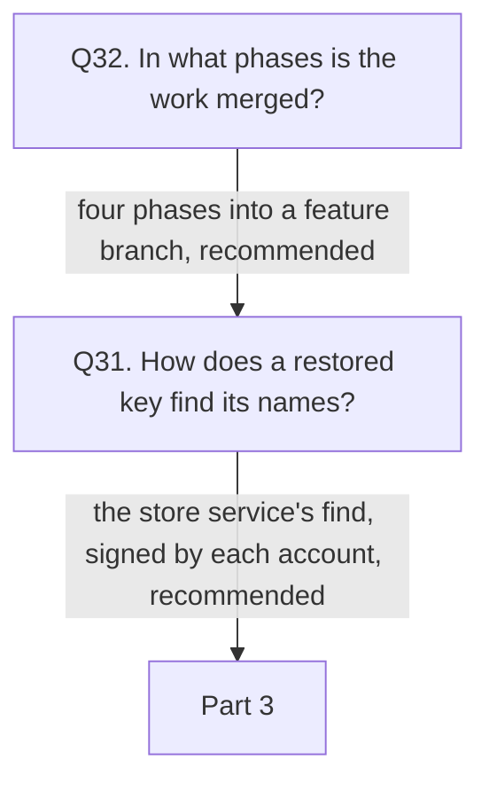

# SimpleX names in the apps: open questions

Two questions are open: how a restored key finds its names, and the phases of the work. One detail waits for a check, and five details have defaults that apply unless the owner objects. Each entry ends with its sources, for the agents.

## Open

### Q32. In what phases is the work merged?

- Problem: the feature is too large for one pull request; a feature merged in one go did not land before.
- Proposal: a feature branch from master; the wallet of #7684 comes back as its first commit (`ep/names-wallet`: master and a revert of c194aefb9); master is merged into it as master moves; it merges into master once phase 4 passes (D42, one release).
  1. Core and service: the wallet, orders signed by accounts, the store service's names commands over SMP, a name registered with a code from the command line, core tests against the service.
  2. Apps and store payments: the welcome screen, search, the recovery key, the checkout, registering and the name on the address or channel, codes, a taken name, Google Play and App Store purchases verified by the service, the two-way check; app tests on the core's recorded responses.
  3. The browser and the site: Pay in browser with the page's route for app orders (simplex.domains), a site name moved into the app.
  4. SimpleX names and restore: the names list, the recovery key shown later, a restore from the 24 words (Q31).
- Each phase is one pull request into the feature branch, tested on its own.
- Recommendation: these four phases.
- Sources: D3, D42; #7951 section 8.

### Q31. How does a restored key find its names?

- Problem: a restore asks which names each account of the key holds. The SMP name lookup answers by name or by label hash only (`NameQuery`: `NQDomain`, `NQHash`, simplexmq `Protocol.hs`), not by owner.
- Options:
  - a. The store service's find, signed by each account, as the names page finds orders (`POST /api/registration/find`): no protocol change; the service learns that the accounts asked belong to one device.
  - b. A new lookup by owner over SMP routers, answered from the chain: changes to simplexmq and the resolver; the routers and the resolver see the addresses asked.
- Recommendation: a; the service already holds each account's orders.
- Sources: D45; #7951 section 6.10.

## Details

### Q30. Does the deployed resolver fill the terms in its answer?

- Problem: the name lookup's answer for an available name has an optional `nameTerms` field (simplexmq #2003, routers from v24). The SMP router passes on what its resolver returns (`resolveName`, `Server/Names.hs`); the resolver's code is not in the repositories this plan was checked against, and the simplexmq tests send the field empty.
- Default: the app uses `nameTerms` from the answer; where an answer lacks it, the app uses the store service's terms for the name, as #7951 planned before routers filled it.
- Sources: D62; #7951 section 6.3, "A name's kind before paying".

### Q16. Which changes to a name can people make in this version?

- Problem: a name opens an address or channel and lasts 2 years. A name bought in the app can be changed only from the app: what it opens, which profile shows it, its renewal and its transfer.
- Default: people can change what a name opens and which profile shows it in this version; renewal and transfer to another person are added before the first names expire, at the end of 2028.
- Other option: all changes in a later version; what a name opens stays as set at purchase until then.
- Sources: D42; #7951 `names-life.svg` and its stage 3; the lookup sketch, 4c.

### Q18. Where do texts for new purchase and recovery screens come from?

- Problem: some screens, such as waiting for a parent's approval or the recovery words, have no text on the website to copy.
- Default: #7951's texts, with the names page's approved text for the same situation; a text where an address or a key acts is reworded so that only people act.
- Sources: D19, D21, D56.

### Q19. May the badge purchase code change so name purchases work?

- Problem: on an iPhone, the app finishes every App Store purchase it does not recognise, so a name bought on another device of the same account must be left open. With two prepared changes to the badge code, the app leaves it open, and test versions can use a test server.
- Default: keep both, check each for badge buyers, and release them before names go on sale.
- Other option: undo both; another way is then needed to keep name purchases open on iPhones.
- Sources: D34; #8248, #8223.

### Q21. In what order are the apps built?

- Problem: names are added to the command-line client, to Android and desktop, and to iPhone. Earlier plans recorded an order without the owner's confirmation.
- Default: the command-line client first, then Android and desktop, then iPhone; names reach people in all of them in one release.
- Sources: D42; #8026; #7951's D8.

### Q22. What do we take from brenzi's app screens for names?

- Problem: brenzi drew app screens for names with other rules: 1 to 10 years, one key for all of a profile's names, and ownership wording. Those rules differ from the ones already chosen.
- Default: their layouts are a reference; the chosen rules stay.
- Sources: D5, D12, D20, D21, D41, D51; `ab/names-gui`, #7382.

## Closed

For the agents: each closed question and the decision that records its answer.

| Question | Answer | Picture or file |
|---|---|---|
| Q1 The key | D41 | the owner's words, items 16289 to 16318 |
| Q2 What the app pins | D62 | items 17765, 17782, 17797 |
| Q3 Paying without Apple or Google | D63 | items 17815 to 17826 |
| Q4 What SimpleX and the stores learn | D43 | #7951 section 11, Q6; section 2, non-goals |
| Q5 One release | D42 | `owner-decisions.md`, Process |
| Q6 A paid order that cannot be placed | D47 | #7951 1·7 Taken, 1·10; `names-life.svg` |
| Q7 A store refund | D54 | item 17582 |
| Q8 Search for a name another order holds | D47 | the lookup sketch, 2c; #7951 1·5's re-check |
| Q9 A hidden profile | D67 | #7951 1·2 |
| Q10 A name that opens nothing | D48 | #7951 "1·5 · Opens nothing"; 5·2 |
| Q11 An explorer link | D53 | items 17591, 17597 |
| Q12 The way back from simplex.domains | D44 | #7951 3·0 "Open in SimpleX"; the badge sketch, A5 |
| Q13 Today's name links | D49 | the lookup sketch's footnote; 4c, 4d; #7951 1·1 |
| Q14 Purchase terms | D31 | D31 |
| Q15 Restore purchases | D69 | item 17954 |
| Q17 Tests | D39 | D39 |
| Q23 A name bought on simplex.domains | D44 | #7951 3·1 to 3·3 |
| Q24 Saving the 24 words | D66 | #7951 1·4a and its D12 |
| Q25 How a restore finds the names | D45 | #7951 6·2a, 6·3; section 6.10 |
| Q26 What this plan builds beyond #7684 | D42 | #7951 6·1 to 6·3; `names-life.svg` |
| Q27 Where names are listed | D46 | #7951 5·1, 5·2 |
| Q28 The 24 words shown again | D46 | #7951 5·3; section 6.6, 1·4a |
| Q29 Which profile restored names join | D45 | #7951 6·2, 6·3; `restore.svg` |
