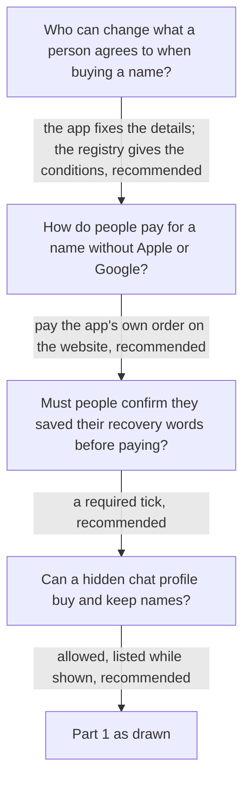

# SimpleX names in the apps: open questions

Four questions are open: two principles and two about screens. Each option is drawn in `present/img/` and listed in `present/questions.json`. Seven details follow, each with a default that applies unless the owner objects. The existing pictures answer every other question; the table at the end names them. Each entry ends with its sources, for the agents.

## Principles

### Q2. Who can change what a person agrees to when buying a name?

- Problem: when a person buys a name, the app signs for them the conditions of use, the 2-year term and the public registry the name goes into. If SimpleX's server supplies these, the person may sign what the app never checked; if the app holds them, any change needs an app update.
- Already settled: the website holds these details in its own code and changes them only in a reviewed release.
- Options:
  - a. The app fixes the details, and reads the conditions from the public registry, checking them against their published copy. People get new conditions without an app update.
  - b. The app fixes everything, the conditions included. Each change of conditions needs an app update before people can buy again.
  - c. SimpleX's server sends the sale details, as spaced4ndy's plan draws it; the app compares the server's conditions with the registry's before signing.
- Recommendation: a.
- Sources: D28, D30; `owner-decisions.md`, Process; #7951's D6.

### Q3. How do people pay for a name without Apple or Google?

- Problem: the F-Droid, desktop and test versions of the app cannot take payment through Apple or Google, and in the US, a link to the website is also offered in store versions. These people need a way to pay that still lets them restore the name from the app's 24 recovery words.
- Already settled: names are sold like badges; a code never has a money value; a name bought on the website can be brought into the app.
- Options:
  - a. Buy on the website, then move the name into the app. The person saves the website's code, then moves the name in.
  - b. The website sells a code that the app keeps hidden, as spaced4ndy's plan draws it. The screens look the same, but the person pays for a code, against SimpleX's rule.
  - c. Pay the app's own order on the website. The app makes and signs the order; the person pays its bill on simplex.domains; no code.
- Recommendation: c.
- Also: the store policies for a name product are settled with Apple and Google before the release.
- Sources: D3, D7, D12, D44, D52; #7951 rows 3 and 4; the badge sketch, screens A1 to A6.

## Screens

### Q24. Must people confirm they saved their recovery words before paying?

- Problem: at the first name bought on a phone, the app creates 24 recovery words: with them a person controls their names and gets them back on a new phone, and without them the names are lost with the phone. The app can insist they are saved before paying, or only remind.
- Already settled: the words are shown at the first purchase on a phone, before the order is checked.
- Options:
  - a. A required tick before paying: the person cannot continue until ticking "I have saved my recovery key", as on simplex.domains.
  - b. Optional, with a reminder, as spaced4ndy's plan draws it: the person can pay without saving; a reminder stays until the words are viewed.
- Recommendation: a.
- Sources: D21, D51; #7951 1·4a and its D12.

### Q9. Can a hidden chat profile buy and keep names?

- Problem: a person can hide a chat profile behind a password. The app must know whether such a profile may buy names, and where its names appear.
- Already settled: hidden profiles get keys from the app's recovery words, as any profile does.
- Options:
  - a. Allowed: its names appear in the names list only while the profile is shown.
  - b. Not allowed, as spaced4ndy's plan draws it: a hidden profile sees "A hidden profile can't register a name."
- Recommendation: a.
- Sources: D41; #7684's RFC, "Profiles and accounts"; #7951 1·2 and 6·3.

## Details

Each default applies unless the owner objects.

### Q7. What happens to a name when Apple or Google refunds it?

- Problem: a store can refund a payment after the name is registered. Without a rule, a refunded name stays registered.
- Default: for 120 days after the payment, SimpleX ends the name's registration after a store refund, as for a disputed card payment today.
- Other option: SimpleX notices a refund only when the purchase is shown again, with 14 days, as for one-time badges.
- Sources: names.md, 3.12.

### Q11. Should the app link to the name's public record on Etherscan?

- Problem: each name is recorded on the Ethereum blockchain, and Etherscan, an independent site, shows that record. The website links to it; the app may too.
- Default: the name's screen has a link to Etherscan.
- Other option: only on simplex.domains.
- Sources: D26.

### Q16. Which changes to a name can people make in this version?

- Problem: a name opens an address or channel and lasts 2 years. A name bought in the app can be changed only from the app: what it opens, which profile shows it, its renewal and its transfer.
- Default: people can change what a name opens and which profile shows it in this version; renewal and transfer to another person are added before the first names expire, at the end of 2028.
- Other option: all changes in a later version; what a name opens stays as set at purchase until then.
- Sources: D42; #7951 `names-life.svg` and its stage 3; the lookup sketch, 4c.

### Q18. Where do texts for new purchase and recovery screens come from?

- Problem: some screens, such as waiting for a parent's approval or the recovery words, have no text on the website to copy.
- Default: the badge purchase's texts where they exist; the rest drafted by the website's rules and reviewed together.
- Sources: D19, D21.

### Q19. May the badge purchase code change so name purchases work?

- Problem: on an iPhone, the app finishes every App Store purchase it does not recognise, so a name bought on another device of the same account must be left open. With two prepared changes to the badge code, the app leaves it open, and test versions can use a test server.
- Default: keep both, check each for badge buyers, and release them before names go on sale.
- Other option: undo both; another way is then needed to keep name purchases open on iPhones.
- Sources: D34; #8248, #8223.

### Q21. In what order are the apps built?

- Problem: names are added to the command-line client, to Android and desktop, and to iPhone. Earlier plans recorded an order without the owner's confirmation.
- Default: the command-line client first, then Android and desktop, then iPhone; names reach people in all of them in one release.
- Sources: D42; #8026; #7951's D8.

### Q22. What do we take from brenzi's app screens for names?

- Problem: brenzi drew app screens for names with other rules: 1 to 10 years, one key for all of a profile's names, and ownership wording. Those rules differ from the ones already chosen.
- Default: their layouts are a reference; the chosen rules stay.
- Sources: D5, D12, D20, D21, D41, D51; `ab/names-gui`, #7382.

## Closed by the existing pictures

For the agents: each closed question, the decision that records its answer, and the picture or file it follows from.

| Question | Answer | Picture or file |
|---|---|---|
| Q1 The key | D41 | the owner's words, items 16289 to 16318 |
| Q4 What SimpleX and the stores learn | D43 | #7951 section 11, Q6; section 2, non-goals |
| Q5 One release | D42 | `owner-decisions.md`, Process |
| Q6 A paid order that cannot be placed | D47 | #7951 1·7 Taken, 1·10; `names-life.svg` |
| Q8 Search for a name another order holds | D47 | the lookup sketch, 2c; #7951 1·5's re-check |
| Q10 A name that opens nothing | D48 | #7951 "1·5 · Opens nothing"; 5·2 |
| Q12 The way back from simplex.domains | D44 | #7951 3·0 "Open in SimpleX"; the badge sketch, A5 |
| Q13 Today's name links | D49 | the lookup sketch's footnote; 4c, 4d; #7951 1·1 |
| Q14 Purchase terms | D31 | D31 |
| Q15 Restore purchases | D50 | #7951 5·2; section 6.5; `restore.svg` |
| Q17 Tests | D39 | D39 |
| Q23 A name bought on simplex.domains | D44 | #7951 3·1 to 3·3 |
| Q25 How a restore finds the names | D45 | #7951 6·2a, 6·3; section 6.10 |
| Q26 What this plan builds beyond #7684 | D42 | #7951 6·1 to 6·3; `names-life.svg` |
| Q27 Where names are listed | D46 | #7951 5·1, 5·2 |
| Q28 The 24 words shown again | D46 | #7951 5·3; section 6.6, 1·4a |
| Q29 Which profile restored names join | D45 | #7951 6·2, 6·3; `restore.svg` |
| Q24, when the words are shown | D51 | #7951 1·4, 1·4a |
| Q3, the store product | D52 | #7951 section 6.2; D5 |
