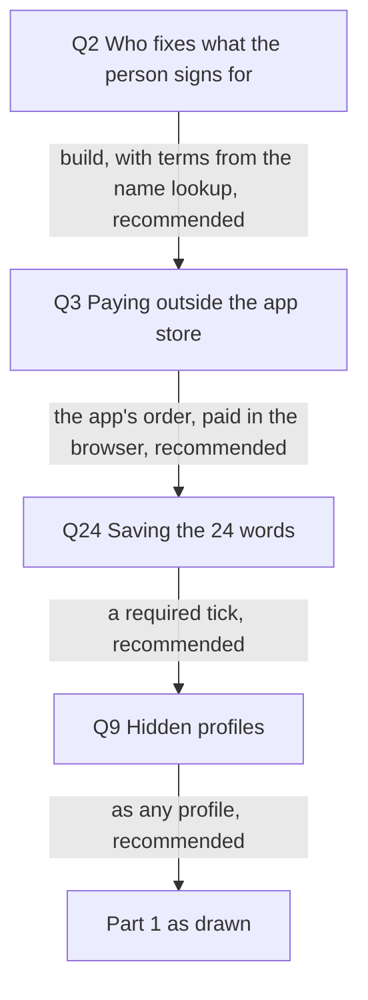

# SimpleX names in the apps: open questions

Four questions stay open: two principles and two of UX, each drawn per option in `present/img/` and listed in `present/questions.json`. The details below them apply as written unless the owner objects. The existing pictures answer the rest (D42 to D52); the table at the end names each picture.

## Principles

### Q2. Who fixes the values the person signs for

- Open: which values the app takes from its build, and which from the network.
- Around it: the page holds the contracts, chain, terms, prices and dispute days, changed only with a reviewed release (D28); any paid price off the list is refused (D30); a version-dependent UI is bad UX (`owner-decisions.md`, Process).
- Options:
  - a. The build fixes the chain id, contract addresses, namespace, term and dispute days; the terms come from the name lookup, read from the chain by the resolver, and are checked against their link's hash. A terms change needs no app release.
  - b. As the page (D28): the build fixes the terms' hash too. A terms change needs an app release, and an app not updated cannot order until it is updated.
  - c. As #7951 (its D6): the sale's state, the product and the term start are read from the store service's catalog; the app compares the catalog's terms hash with the resolver's before it signs.
- Recommendation: a. With a router older than the terms field of the name lookup, ordering waits, with the approved "Names can't be ordered right now. Please try again later."

### Q3. Paying for a name outside the app store

- Open: how a person pays in F-Droid, desktop and iOS test builds, and with Buy in browser in store builds in the US, for a name that the device's 24 words control.
- Around it:
  - names are sold as badges are (D3); the badge sketch's non-store lane: a code that the buyer never sees is sold on the page, and the app is opened with it by a link (screens A1 to A6);
  - a free name code has no monetary value (D7);
  - a name bought on simplex.domains is brought in by its name code (D44);
  - one request places the order, then the invoice is paid, then the app follows the order (D12).
- Options:
  - a. Buy on simplex.domains, then bring it in: the page's name code, then Move into this app, three chain transactions, or Show on your profile (#7951 row 3).
  - b. #7951 row 4: the app's order; with Pay in browser the person pays for a prepaid code that the app keeps hidden, and the name is registered with it. Contradicts D7: a code bought with money.
  - c. The app's order, signed by its account; with Pay in browser the person pays that order's invoice on simplex.domains; no code. Precedent: D12's request, invoice and payment; #7951's screens 4·2 to 4·4 without the code.
- Recommendation: c.
- Also: the stores' policies for a name product are settled with Apple and Google before the release (D52).

## UX

### Q24. Saving the 24 words

- Open: whether the first order waits until the person ticks that the 24 words are saved.
- Around it: the words are shown at the first Register, before Check your order (D51); the names page asks for its name code to be saved before paying, with the tick "I have saved my name code" (D21).
- Options:
  - a. A required tick, "I have saved my recovery key", before Continue, as on the names page.
  - b. Optional, with a reminder until the words are shown or copied: #7951's 1·4a, its decision D12.
- Recommendation: a.

### Q9. Hidden profiles

- Open: whether a hidden profile registers names.
- Around it: in #7684 an account is created for a hidden profile as for any other profile (its RFC, "Profiles and accounts"; D41); #7951 draws a refusal: "A hidden profile can't register a name." (its 1·2 states, and 6·3); a hidden profile can hold a badge, and set a name on its address today (`APISetUserDomain` checks no hidden state).
- Options:
  - a. As any profile, as in #7684: its names are listed only while it is shown, as its badge is.
  - b. Refused, as #7951 draws it.
- Recommendation: a.

## Details

Each applies as written unless the owner objects.

### Q7. Dispute days for store payments

- Default: 120 days, as for a card; the service reads the stores' refund notifications and ends a refunded registration within its period, as a disputed card payment ends one (names.md, 3.12).
- Other option: 14 days, and refunds found only in presented receipts, as for one-time badges.

### Q11. The Etherscan link

- Default: the name's screen has a link to the name on Etherscan, as the page has (D26).
- Other option: only on the page.

### Q16. Link edits, giving to another profile, renewal, transfers

- Default: link edits and giving a name to another profile of the device are in this release (#7951 `names-life.svg`, its v1.1 items; D42, one release); renewal and transfers to another person are in a later release, before the first expiry at the end of 2028 (#7951 stage 3; the lookup sketch, 4c "then renews here").
- Other option: all four in a later release; links set at the order cannot be changed until then.

### Q18. Texts for store states and for the recovery key

- Default: the badges' texts where they exist ("Waiting for approval", "Nothing has been charged."), #7951's texts for the recovery key and the restore as drafts, the rest drafted by the page's rules, and all reviewed as one set.

### Q19. Badge code that names need changed

- Default: keep #8248 and #8223, each with a review of its effect on badge buyers (D34); #8248 is released before name products go on sale, so that a name purchase is left unfinished on a buyer's other devices.
- Other option: revert them.

### Q21. Answers recorded in #7530 and #8026 without the owner's words

- Default: the CLI first, then Kotlin, then Swift (#8026; #7951 D8). The other recorded answers are settled: D3, D12, D41, D44 and D45.

### Q22. brenzi's in-app wallet (`ab/names-gui`, #7382)

- Default: its screens are material only. Where it departs, the decisions stand: 2 years (D5), one signed request from the app (D12), the page's approved texts with "controls" in legal texts (D20, D21), an account for each name (D41), the key saved at the first Register (D51, Q24); gifts and sponsored edits are later work (Q16).

## Closed by the existing pictures

| Question | Answer | Picture or file |
|---|---|---|
| Q1 The key | D41 | the owner's words, items 16289 to 16318 |
| Q4 What SimpleX and the stores learn | D43 | #7951 section 11, Q6; section 2, non-goals |
| Q5 One release | D42 | `owner-decisions.md`, Process |
| Q6 A paid order that cannot be placed | D47 | #7951 1·7 Taken, 1·10; `names-life.svg` |
| Q8 Search for a name another order holds | D47 | the lookup sketch, 2c; #7951 1·5's re-check |
| Q10 A name that opens nothing | D48 | #7951 "1·5 · Opens nothing"; 5·2 |
| Q12 The way back from simplex.domains | D44 | #7951 3·0 "Open in SimpleX"; the badge sketch, A5 |
| Q13 Today's name links | D49 | the lookup sketch's footnote; 4c, 4d; #7951 1·1 |
| Q14 Purchase terms | D31 | D31 |
| Q15 Restore purchases | D50 | #7951 5·2; section 6.5; `restore.svg` |
| Q17 Tests | D39 | D39 |
| Q23 A name bought on simplex.domains | D44 | #7951 3·1 to 3·3 |
| Q25 How a restore finds the names | D45 | #7951 6·2a, 6·3; section 6.10 |
| Q26 What this plan builds beyond #7684 | D42 | #7951 6·1 to 6·3; `names-life.svg` |
| Q27 Where names are listed | D46 | #7951 5·1, 5·2 |
| Q28 The 24 words shown again | D46 | #7951 5·3; section 6.6, 1·4a |
| Q29 Which profile restored names join | D45 | #7951 6·2, 6·3; `restore.svg` |
| Q24, when the words are shown | D51 | #7951 1·4, 1·4a |
| Q3, the store product | D52 | #7951 section 6.2; D5 |
