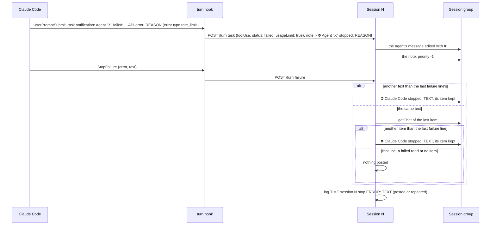

# SimpleX MCP: one Claude Code process per conversation

## Problem

Two Claude Code processes on one conversation, as after a second `claude --continue`, share its SimpleX group: both get each prompt of the group, and both post their answers there.

## Rule

While the Claude Code process of a session's last `/session` runs, the service refuses the requests of another process for that session with status 423 and TEXT:

`Claude Code process PID already uses the SimpleX group of this conversation. Exit that process, or exit this one and start a new conversation.`

| Request of the other process | Sender | Where TEXT is shown |
|---|---|---|
| `POST /title`, applied at once | SessionStart hook | the session start: `SimpleX MCP: TEXT` |
| `POST /title`, held for its session server | SessionStart hook | the service log; the reply comes at once |
| `POST /session` | session server | the result of each SimpleX tool |
| `POST /turn` | turn hook | the hook's stderr |
| `POST /turn` | display hook and status line command | the reply is dropped |
| `POST /ask` | PermissionRequest and Elicitation hooks | the hook's stderr; Claude Code shows its own dialog |

- A process runs while its PID has the start time read at its `/session`; a reused PID has another start time. On Linux the start time includes the boot ID, so a process after a reboot never matches a stored one; without a readable boot ID, it is the ticks alone. On macOS the start time is read in the C locale and UTC. On Windows it is the creation time in UTC file time from PowerShell, within 10 s: its first start took 4.9 s on a GitHub Windows runner, later ones 0.3 s.
- A request without a PID is served, and so is a request while the recorded process has no start time.
- A start time is unknown when its read fails other than by a missing process, as at a timeout of `ps` or PowerShell. A registration with an unknown start time records none, so the refusal check then serves the other process. A failed read of the recorded process at the refusal check, and in the exit watch, counts the process as running.
- When the recorded process changes during the read of its start time, the check runs again, so of two registrations at once only one is served.
- The session server sends `/attach`, `/call` and `/permission` only after a `/session` that succeeded.
- The title of the other process is recorded before the refusal, so its session server resolves to the same session.
- A refused process is mapped to the session for 60 s, longer than the 30 s between registrations of its server, so a held title of a forked ID, as with `--fork-session`, and a title after `/clear` in the refused process resolve to that session and are refused; no session is opened for those IDs.
- A registration that changes the recorded process writes its PID into `session.json` as `claudeProcess`, with its start time when it is known; a new entry starts with them, so the recorded process keeps the session across a service restart.
- The session server registers again at most 30 s apart; its first registration after the first process ended is served.
- Claude posts in the group, in small print: `▶️ Claude Code started (process PID).` at a registration of another process than the recorded one, the first included, with a start time read, after `⏹️ Claude Code ended (process PID).` of the recorded one when it had a start time; and the ended line when the start time of the recorded process changes within 10 s after the last detach, read once a second, which then removes that start time from the entry and the process from `session.json`. A reconnection of the same process and a service restart post neither.

```mermaid
sequenceDiagram
  participant P as Claude Code process P
  participant Q as Claude Code process Q
  participant D as Service
  participant G as Session group
  P->>D: POST /session {id: R, pid: P}
  D->>D: entry R and session.json: pid P, start time of P
  D->>G: ▶️ Claude Code started (process P).
  Q->>D: POST /title {id: R, pid: Q}
  D->>D: P has its start time: refusal of Q for R, 60 s
  D-->>Q: 423 TEXT, shown at the session start
  Q->>D: POST /session {id: X, pid: Q}
  D->>D: X aliased to R; P has its start time
  D-->>Q: 423 TEXT, returned by each SimpleX tool
  Q->>D: POST /turn or /ask {id: R, pid: Q}
  D-->>Q: 423
  Note over P,D: P ends, its attachment closes
  D->>D: the start time of P differs, read within 10 s: removed from entry R, P from session.json
  D->>G: ⏹️ Claude Code ended (process P).
  Q->>D: POST /session {id: X, pid: Q}, at most 30 s later
  D->>D: entry R and session.json: pid Q
  D->>G: ▶️ Claude Code started (process Q).
  D-->>Q: the session
```

## Usage mark

`5 h: N%` and `week: N%` end with `❗️` at 95% or more, in the status line and in the end line of an answer.

## Stops at a usage limit

- A task notification whose summary is `WHAT failed: …API error: REASON (error type rate_limit…` gets the note `⛔ WHAT stopped: REASON`, and its `task` gets `usageLimit: true`. WHAT ends at the last `failed: ` before `API error`.
- The hub posts that note, silent, also for an agent or a workflow whose message shows the end with ❌.
- A teammate's idle notification with `idleReason` `failed`, for any failure, gets the note `⛔ Teammate "NAME" stopped: REASON` from its `failureReason`, before the line of a message in the same prompt.
- A failure line with the text of the last one is posted again when another item follows that line in the group.
- Failures are handled one at a time.
- `service.log` lines:
  - `TIME session N stop ERROR: TEXT (posted)`, or `(repeated)`
  - `TIME session N waiting TYPE: TEXT (posted)`, or `(skipped)`



## Changes

- `src/service.ts`: `Service.refuseOtherProcess`, called by:
  - `onSession`
  - `applyTitle`
  - `onAsk`
  - the `/turn` route
- `src/service.ts`: `refusals`, read by `processSession`.
- `src/service.ts`: `claudeProcess` written by `onSession` and read by `entry`.
- `src/service.ts`: `processStart` adds the boot ID on Linux, runs `ps` with `LC_ALL=C` and `TZ=UTC` on macOS, and PowerShell's `Get-Process` on Windows, with its command runner as a parameter.
- `src/files.ts`: `SessionFile.claudeProcess`.
- `src/service.ts`: the started and ended lines in `onSession`, and `noteExit` after the last detach; `src/hub.ts`: `Session.postNote`.
- `src/status-line.ts`: `limitParts` with `highUsagePercent`.
- `src/hook.ts`: `limitStop`, read by `taskNote` and `taskOf`; `teammateStop`, called by `teammateNote`; `src/protocol.ts`: `TaskEnd.usageLimit`.
- `src/hub.ts`: `Session.onAgents` counts a task with `usageLimit` as not shown; `fail` runs `postFailure` on the `failureItem` chain, with `lineFollowed`; `postFailure` and `waits` log their lines.
- The refusal in:
  - `spec/api.md`, socket protocol
  - `spec/architecture.md`, `onSession`, `processStart`, `SessionFile`
  - `spec/flows.md`, flow 27
  - `REFERENCE.md`, tool approvals, plugin recovery, data folder
  - `TESTING.md`, check 13

## Tests

`test/unit/service.test.ts`:
- A second process: `/title`, `/session` with a startup ID, `/turn` and `/ask` refused with the PID of the first; the hooks of the first process with a new session ID served.
- A second process served after the first ended, and after the PID of the first passed to a later process.
- Two processes that register at once after the first ended: one refused.
- A forked ID's held title from a second process refused after its session server's refusal, with no session for that ID.
- A title of a new ID from a refused process 20 s after its server's refusal: refused, with no session for that ID.
- A second process refused after a service restart, and served once the first ended.
- The start time of a process on Linux begins with the boot ID, and is the ticks alone when the boot ID can't be read.
- The start time of a process on Windows from a stubbed PowerShell: its output when it is a number, with the command, the timeout and no window.
- The started line for the first process and a later one, after the ended line of the one before, and none for a reconnection or after a restart.
- The ended line once, after the last detach of a process that ended, and none for a reattachment.
- No ended line while the start time can't be read.
- The tests of a second registration of a session: the first process ended before it.

`test/unit/sessions.test.ts`:
- A note of the service in small print with priority -1.
- The note of a subagent's stop at a usage limit, posted although its message shows the end.
- A failure line with the text of the last one, posted again once another item follows that line, with the log lines.

`test/unit/hook.test.ts`:
- The note and `usageLimit` of a task notification at a usage limit, also with `failed: ` in the description, and another failure as before.
- The note of a teammate's failed idle notification, also beside its message, and none for one that did not fail.

`test/unit/status-line.test.ts`:
- The usage parts with `❗️` at 95% or more.
