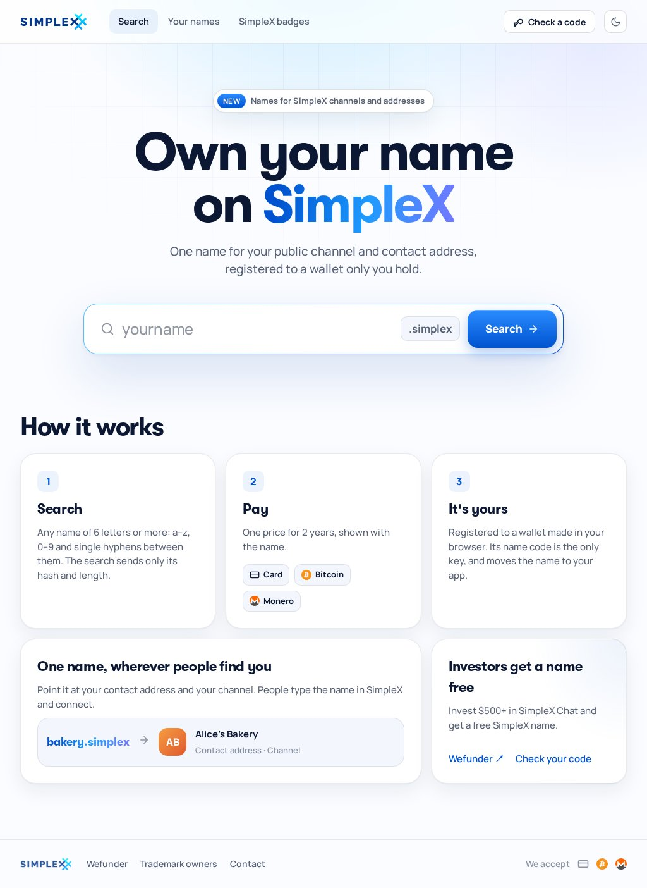
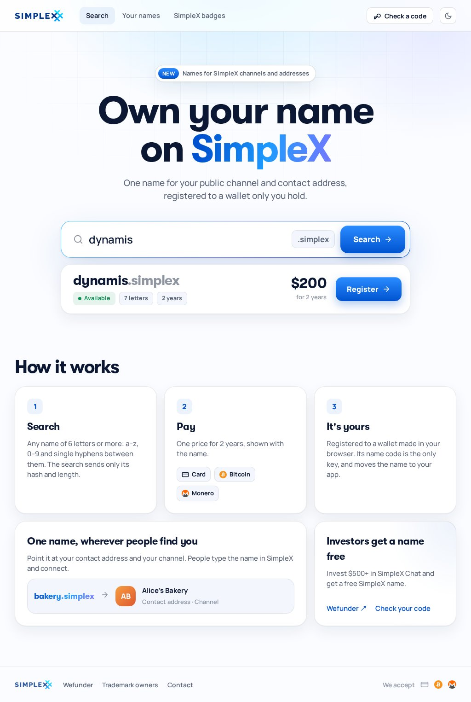
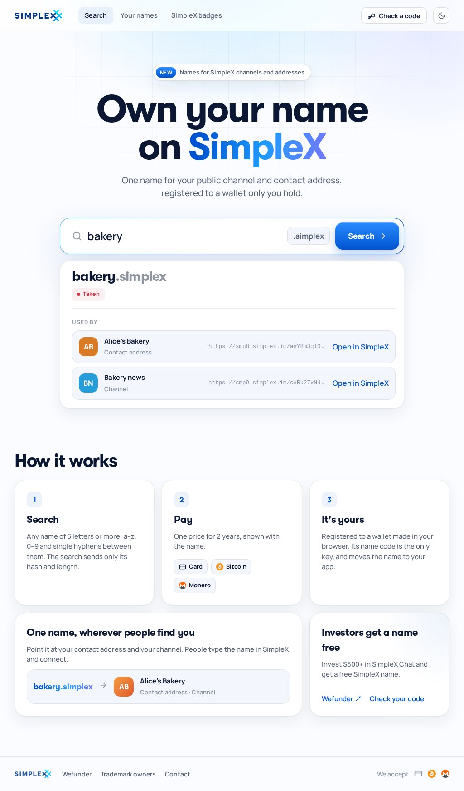
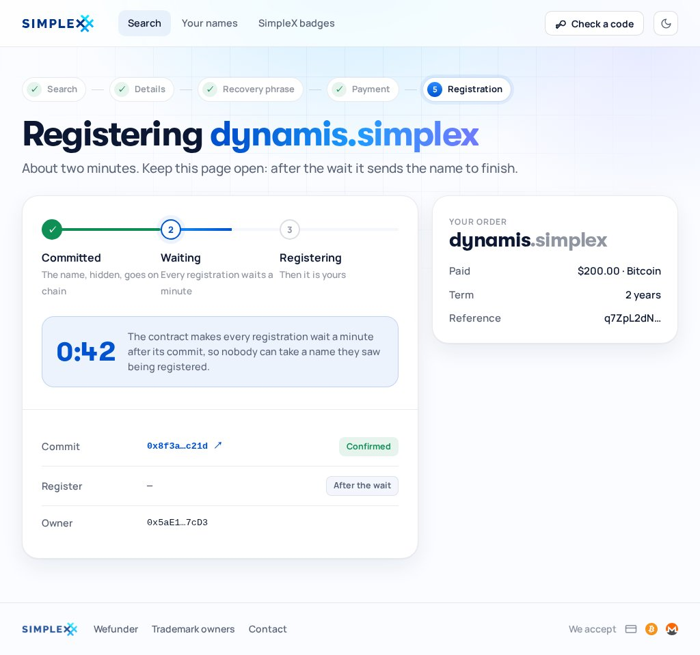
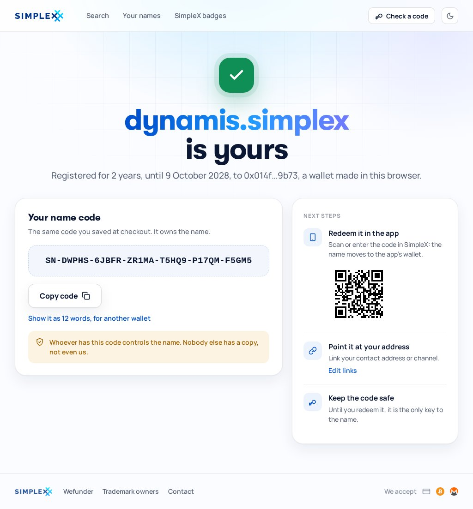
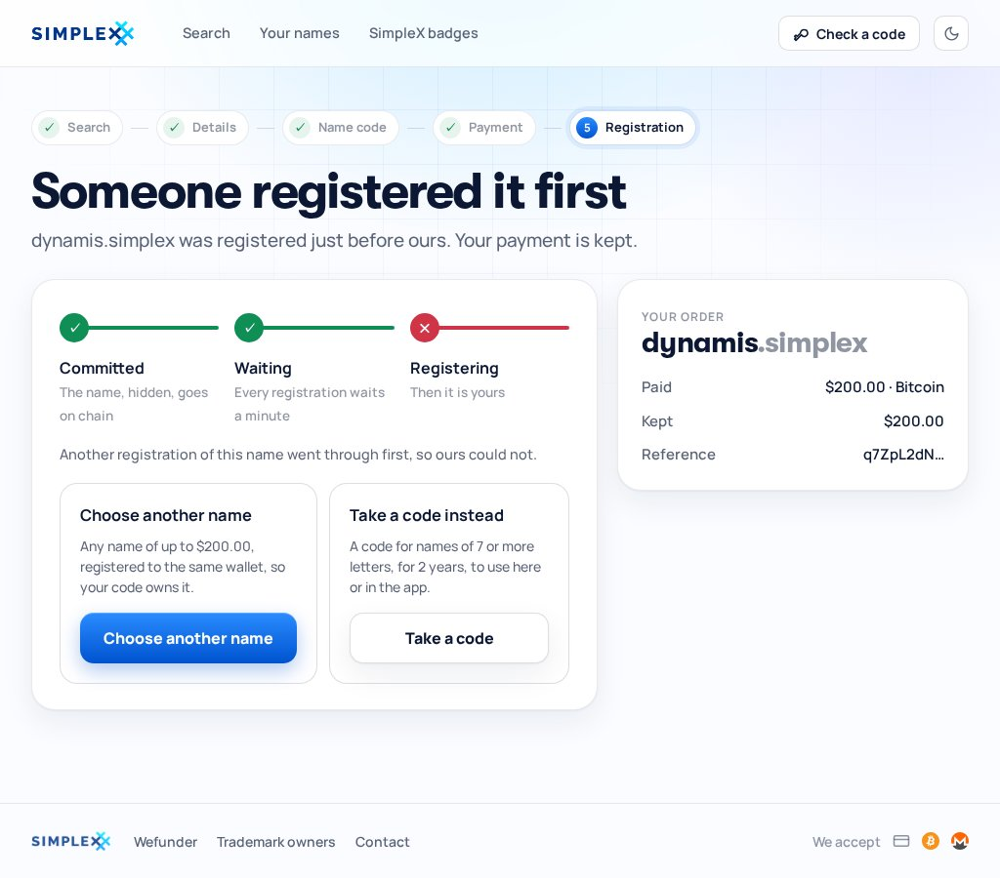
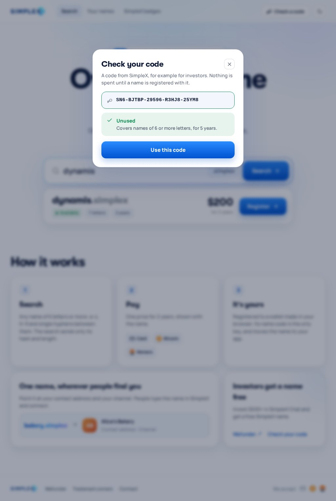
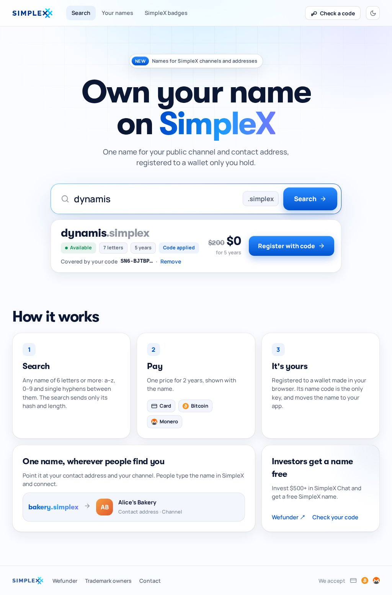
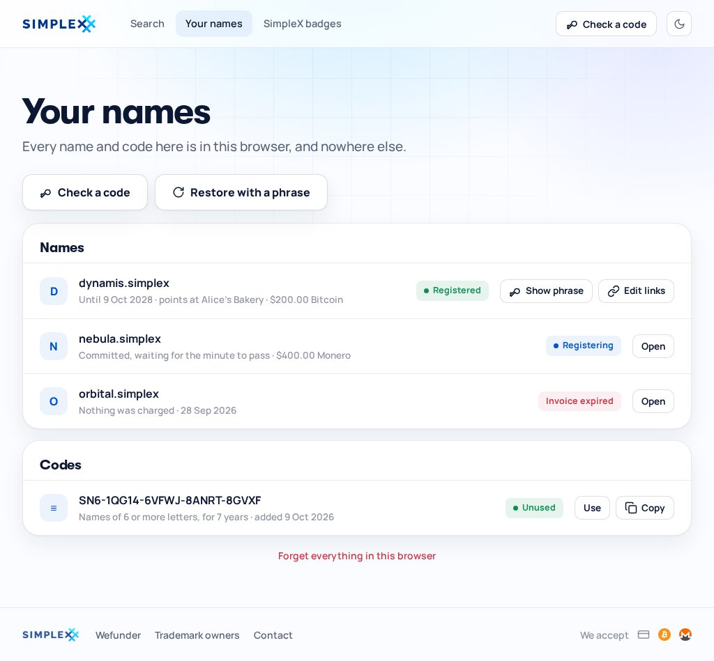

# SimpleX names store: simplex.domains

This is the spec of the names store. The store sells SimpleX names (`<label>.simplex`) at **simplex.domains**. In short:
1. The buyer searches for a name. The page shows whether it is free, and at what price. The price is the chain's.
2. The buyer pays by card, Bitcoin or Monero, or with a prepaid code entered on Check your code. An Ethereum buyer is sent to the dApp.
3. The browser makes the name's wallet. The page shows it as an owner code ("your name code" on the page: `SN-` and 30 characters). The service registers the name to that wallet's address, and pays the fee and the gas.
4. Nothing is held in custody. Redeeming the code in the app moves the name to the app's wallet.

Related documents:
- Badges keep their own store at **badges.simplex.chat**.
- The implementation plan is [`2026-10-09-names-web-store-plan.md`](2026-10-09-names-web-store-plan.md).
- [`2026-10-13-names-sequence.md`](2026-10-13-names-sequence.md) shows every flow as a sequence of calls, with the gaps found.
- [`2026-10-21-store-api.md`](2026-10-21-store-api.md) is the API contract, authoritative for every endpoint, field, error and limit.
- ep's mockup of 2026-10-21 (artifact 86a64565) is the visual reference for every screen; the board below predates it.

The registration primitives (the building blocks for registering on chain) are Alain's `origin/ab/names-registration-primitives-sponsored` (`plans/2026-10-12-names-sponsored-registration.md`). They are written against ens-contracts PR #35 (`SimplexController`, `SimplexSponsor`, `SimplexResolver`). This store is the plumbing and the pages around them.

The app side is separate work:
- Redeeming codes in the app. Owner codes work by transfer (`approveWithSig` and `claimWithSig`, relayed by the service). Prepaid codes are covered by #7530 (`origin/ab/names-actions-api:plans/2026-09-28-name-registration-core-cli.md`).
- Editing a name's records in the app. This is later app work, out of #7530's scope. The web store links them itself (§6).

**The board** shows every screen and how each leads to the next: [`names-flow.svg`](names-flow.svg). It is generated, see [§13](#13-regenerating-the-board). On GitHub, view it from the file view, not "raw". The raw host's Content-Security-Policy blocks the embedded screens.

[](names-flow.svg)

## Contents

- Words used here

1. Scope
2. Two stores
3. Search
4. Price and term
5. The wallet and its owner code
6. Registration
7. Codes
8. Service API
9. Storage
10. Configuration
11. The page
12. Deployment
13. Regenerating the board
14. Open questions

## Words used here

- **Name**: `label.simplex`, a name on Ethereum, registered through the PR #35 contracts (an ENS fork).
- **Owner code**: `SN-` and 30 characters. A 128-bit secret that only the buyer keeps. It is the only key to the name.
- **Owner wallet** (owner address): the Ethereum key and address made from the owner code (BIP-39 seed from its entropy, then `m/44'/60'/0'/0/0`, as the app derives it). The name is registered to this address. The BIP-39 phrase is an internal step: the page never shows it, and there is no 12-word export.
- **Commitment**: a hash of the name, the owner, a secret and the links. It hides the name while it is reserved, so nobody can see it and register it first.
- **Commit, then reveal**: the commit puts the commitment on chain. At least 60 seconds later the page reveals the name, and the register can go through. A commitment lapses after 24 hours.
- **Intent**: the owner's signature (`RegisterName`) that lets the service register the name for the owner.
- **Sponsor**: the `SimplexSponsor` contract. It pays the name's price from an allowance, so the buyer never needs ether.
- **Registrar key**: the service's own Ethereum key. It sends every transaction and pays the gas (the network fee).
- **Nonce**: a counter that stops a signature or transaction being used twice. The sponsor keeps one per owner for intents, the resolver contract one per owner for link edits, and the registrar key has its own transaction nonce.
- **Sealed**: the name and links, encrypted with a key made from the owner code. The service stores it, so the owner code alone can restore an order in another browser.
- **RPC node**: the Ethereum JSON-RPC endpoint the service reads the chain from and sends its transactions to: a reth node with nimbus, or a hosted provider such as Alchemy. The service resolves names itself from the contracts, as the SMP relays and the app do from their own nodes. There is no resolver service.
- **Resolver contract** (`SimplexResolver`, PR #35's `PublicResolver`): the contract that stores a name's links as text records.
- **Links** (records): the SimpleX contact and channel links stored on a name.
- **Prepaid code**: a code such as `SN7-…` that pays for a name of a given length or longer, for its years, instead of money.
- **Term start** (`termStart`): 1 January 2027. A name's paid years count from it; the days before it are free.
- **Phase**: where a registration is: `unpaid` → `queued` → `committing` → `committed` → `registering` → `registered`, or `taken`, `failed`.
- **Long poll**: the page asks the service and the answer waits until something changes.

## 1. Scope

This section lists what the store covers and what it leaves to other work.

**In:**
- The names store: search, checkout by payment or prepaid code, the wallet in the browser, registration with its steps, and the owner code.
- Linking a contact address and channel to the name, at registration and later.
- Check your code, for prepaid codes and name codes.
- Your names, with the names and prepaid codes this browser holds.
- The StoreService side: search, codes, orders, the registration worker, and issuing by the operator.
- The names webapp, and the library it shares with the badges webapp. The webapp lives in the simplex.domains repo, which is a submodule here.
- Deployment.
- The mock.

**Out:**
- The app side (redeeming codes, records in the app). The board draws two app screens in grey (A1, A2).
- The web flow opened from the SimpleX app (`?name=&owner=`, L1–L3 on the board): dropped (owner, 2026-10-21). The app will buy names itself (#7530 §13.6).
- Selling codes on the web.
- Renewals, transfers, in-app purchase.
- Refunds. Support handles them by hand.

## 2. Two stores

Names and badges are sold on two separate sites. The sites share one service and one library.

| | Names | Badges |
|---|---|---|
| Host | simplex.domains | badges.simplex.chat (simplex.chat/badges redirects there today; an iframe embed is supported and drafted on `sh/website-iframe`) |
| First screen | Search (N1) | The badge landing (B0, unchanged but for the link) |
| Cross-link | "SimpleX badges" in the header | "SimpleX names are at simplex.domains" under the landing, opening in a new tab since the badges app supports running in simplex.chat's iframe |
| History | "Your names" (N12) | "Your codes", as today |

There are two webapps and one service:
- The names webapp lives in the simplex.domains repo and uses that site's look (§11). It is a submodule of simplex-chat at `apps/simplex-domains`.
- The badges webapp stays in this repo.
- The two webapps share logic, not screens. The shared logic is the API client, payments, storage, codes and the QR encoder. It lives in the library `packages/simplex-chat-store`, published as `@simplex-chat/store` (as `@simplex-chat/webrtc` is).
- The badges webapp builds on the library from this repo. The names webapp pins a published version. simplex-chat's CI builds the names webapp against the library here.
- StoreService, the renamed badge service, exports both sites.
- Each store keeps its own `localStorage`, because the two hosts are different origins.

## 3. Search

Search tells the buyer whether a name is free and what it costs. The page sends only the name's hash, so the service does not learn the name at this point.

**The search field (N1)** holds the name, a fixed `.simplex` tag and a round search button. Enter searches too.
- The page judges the name when the buyer searches, not while typing.
- The rules line appears only after a mistake (N1b, N1c).

**The name rules.** The characters and hyphens follow simplexmq's `nameLabelP`, which the service reaches by parsing a bare label as `SimplexDomain`. The names app's `names.ts` mirrors it. The length is checked separately (`invalid_name`). A name must have:
- only `a-z`, `0-9` and `-`, after folding case;
- each hyphen between letters or digits, so no leading, trailing or double hyphen;
- at least 6 characters (the controller's `minCharLength`);
- at most 63 characters (simplexmq's label limit).

`nameLabelP` also takes A–Z, and simplexmq lower-cases a name when parsing it (`SimplexDomain`'s `strP`, `labelHash`). The service takes only lower case, so the page folds upper case as the buyer types. #7390's `validLabel` (`origin/ab/names-mvp-edits`, unmerged) refuses `--` only at positions 3–4, so it is not used: such a name would sell but never resolve.

**Searching** works in three steps:
1. The page validates the name and hashes it with keccak256.
2. The page sends `GET /api/name/:hash?length=7`. The length sets the price. A length outside 6–63 is `invalid_name`.
3. The service reads the chain by the hash, over JSON-RPC to its RPC node:
   - the base registrar's `nameExpires(uint256(labelHash))` and `GRACE_PERIOD`, and the controller's `reservedNames(labelHash)`. The name is `registered` while its expiry plus the grace period is not past, else `reserved` when the reservation is set, else `available`;
   - for an available name, its price from the chain (§4);
   - for a registered name, the registry's `owner(node)` and `resolver(node)`, with `node = keccak256(namehash(tld) ‖ labelHash)` and the registry `baseRegistrar.ens()`;
   - when `resolver(node)` is the default resolver contract, its `text(node, "simplex.contact")`, `text(node, "simplex.channel")` and `nonces(owner)`.

What each side learns:
- The request and the chain reads carry only the hash. The RPC node, or the hosted provider, sees which hashes are read. For a registered name the label is on chain anyway (`labelOf`).
- The service learns a name only when a paid or code order reveals it (§6).

**Names being registered here.** The chain still reports a hash as available while a registration here is `registering`: its register is sent but not mined. Then search answers `registered{entities: [], tld}`, with no owner, and orders refuse the name with `name_taken`. The worker sets `registered` only `confirmations` blocks after the register's receipt, so from then on the service's own chain reads show the name. Otherwise the chain is believed, so an expired name is free again.

**Failed chain reads.** Search answers `provider_unavailable` when a chain read fails: the RPC node does not answer, or answers an error.

The order, `/api/name/register` and the `/name` retarget answer a failed chain read with `name_check_unavailable` (503). They create or change nothing. They need their own error because `provider_unavailable` from invoice creation means an unavailable payment method (N3a).

| Answer | The page shows |
|---|---|
| `available` | one row: the name, "$100 / 2 years" and Register; $0 and the code's years when a kept prepaid code covers it, with a line when the name is shorter than the code allows |
| `registered`, with links | one row: the chats the name opens as icons (the app's default icon for a contact, channel, business or bot, or the profile picture), then "Taken", or "Your name" when this browser holds it. Each icon opens a popup modelled on the app's connection-plan alert: picture, display name, `@name.simplex` or `#name.simplex`, full name, a channel's subscriber count, the link's QR on desktop, Open in SimpleX and Copy link |
| `registered`, no links | "Taken" (a name registered without links reads like this until its owner sets them, and so does one this service is registering: for that one the answer has no records, owner, resolver, `recordsNonce` or chain id) |
| `reserved` | N2c: reserved, with "Contact the SimpleX team" |
| no answer, an error | N2d (503) |
| the rate limit | N2e (429) |

**Taken names.** The service opens each short link in the records with its own chat core (`APIConnectPlan`), which reads the link data without connecting. Each chat in the answer has:
- `kind`: `contact`, `business` (the link data's `business`, or the profile's `peerType`), `bot` (`peerType` bot), or `channel` for a channel link;
- the display name, the full name and the picture, if any;
- a channel's subscriber count (`publicMemberCount`);
- the link and its deep link.

Search fetches and link-preview fetches have separate service-wide bounds (4 and 2 at a time), a 3 s timeout each that also bounds the wait for a slot, and a 10-minute cache. The hosts are the link's servers (the authority of an `https://` link, or the server hosts inside a `simplex:/` link). A public IP literal passes, since SimpleX servers may be addressed by IP. Every host of the link is checked before the chat core fetches: an IP literal as it is, a name by resolving it; a private, loopback, link-local, unique-local, CGNAT, unspecified or multicast address, a `.onion` host or an unresolvable name means no fetch. A link with several hosts is fetched only if all pass. A link not fetched stays valid: its profile is `unavailable`. The check is best effort, since the chat core resolves again when it connects (DNS rebinding remains possible); an egress rule in the deployment denies the service's traffic to private ranges. A fetch that fails or gets no slot in time gives `profile: unread`. Without a profile the chat shows with the link's kind and the default icon. The answer also carries `gracePeriod` (the registrar's 90 days), so the page says when an expired name can be registered again.

**The page around the search** is the simplex.domains landing: the headline "Your SimpleX domain" and its subtitle. Every page closes with "Invest in SimpleX Chat and get a free name." and a link to Wefunder.

## 4. Price and term

This section sets how long a name is registered and how its price is chosen.

- **Term.** A paid name is paid for 2 years (the service's `[names] years`), the controller's minimum (730 days, `MIN_REGISTRATION_DURATION`).
  - A prepaid code pays for its own `years`. Investor codes get 5.
  - `years` is at least 2, for the setting and for every code: below 730 days the controller refuses the commitment, and the free days end on 1 January 2027. The service refuses to start with less, and the operator's commands refuse to issue such a code.
  - The term starts on 1 January 2027 (owner, 2026-10-20), to give time to build the app's import. The contract registers for a duration from the block's time, so the page adds the days until then: `duration = years × 365 days + max(0, termStart − now)`. The flat 30 bonus days are gone.
  - A year on chain is 365 days (31,536,000 seconds, as simplexmq's `protocol/simplex-messaging.md` and the price oracle count it). The page shows the real end: for an order before 1 January 2027, 2 years end on 31 December 2028, 5 years on 31 December 2031 (owner, 2026-10-21).
  - The service owns `termStart` (`[names] term_start`), gives it in the search answer, and checks every order's duration within an hour of `max(0, termStart − now)`.
  - The duration is inside the commitment, so a name registered later than its order ends later by that delay.
  - Check your order shows the term, "Free until 1 January 2027" with the days left, and the end date `max(termStart, now) + years × 365 days`. Once registered, the page shows the view's `expiresAt`, later by the time from the order to the register.
- **Price.** Prices come from the chain (owner, 2026-10-20). `SimplexPriceOracle` holds cents a year per label length, with a base for the lengths it does not list. The controller exposes it as `rentPriceUSD(label, duration)`, prorated by the second.
  - The service quotes `rentPriceUSD` for the paid years only, with a placeholder label of the name's length: the oracle reads only the length, and the RPC node never sees the label before the reveal.
  - The launch list (owner, 2026-10-21), set with `setPrices`: base 5000 cents a year, 7 letters 10000, 6 letters 20000. So $100 for 8+ letters, $200 for 7 and $400 for 6, for 2 years. There are no per-name prices.
  - The free days cost the buyer nothing. The sponsor's allowance pays their prorated price at registration.
- **The order** carries the shown price. The service reads the chain's again. If it moved, it answers `catalog_changed` with the new price (N3b). Once the order exists, its price is fixed.

## 5. The wallet and its owner code

The browser makes a new wallet for each order. Its owner code is the only key to the name. This section says how the page builds the wallet, keeps the code safe, and what the service sees.

On the name code step, after Links and before Check your order, the browser makes the name's wallet:

1. It takes 128 bits from `crypto.getRandomValues`.
2. It makes the owner code: `SN-` and 30 Crockford base32 characters. They hold the entropy and the first 22 bits of its SHA-256 (WebCrypto). The code is shown in six groups of five, e.g. `SN-DWPHS-6JBFR-ZR1MA-T5HQ9-P17QM-F5GM5`.
3. It makes the BIP-39 seed: the BIP-39 phrase with that entropy, then PBKDF2-SHA512, 2048 rounds, no passphrase (WebCrypto). The phrase is only this internal step and is never shown. The derivation must stay as it is, because the app derives the same wallet from the code.
4. It derives the key by BIP-32 to `m/44'/60'/0'/0/0`. HMAC-SHA512 comes from WebCrypto, and secp256k1 from vendored `@noble/secp256k1`.
5. It makes the EIP-55 address, with keccak-256 from vendored `@noble/hashes`.
6. It derives the commitment secret, `secret = HMAC-SHA256(seed, "simplex.domains commitment " + label)` (WebCrypto). So the code and the name are enough to reveal.
7. It derives the sealing key, `HMAC-SHA256(seed, "simplex.domains sealed")`.
   - The page encrypts the JSON `{label, contact, channel}` with AES-256-GCM. Each key holds its link, or "" without one.
   - The page sends the result with the order as `sealed` (unpadded base64url). So the code alone rebuilds the commitment in another browser.
   - The service refuses a `sealed` longer than 11095 characters with `bad_request`. That is the size of a 63-character label and two values at the link bound.
   - The order, register, retarget and reveal endpoints read bodies up to 16384 bytes, above today's 8192.

How the code and the address are handled:

- **One live order per wallet and name, disclosed only to its owner** (contract sections 1 and 5).
  - Every order is signed by the owner code's key (EIP-191 over `simplex.domains order <labelHash> <length> <duration> <commitment> <sha256(sealed)> <timestamp>`), so nobody orders in another wallet's name.
  - An exact resend, every field equal to the stored order (including `sealed`, the method and price, or the code), gets that order. This covers a lost response, however late.
  - Any other order that meets a live order of the same commitment, or of the same owner and label hash, gets `409 order_exists`, which names nothing. The page then finds its order with the signed `find` and opens it. A commitment is public on chain once committed, so it alone proves nothing.
  - A registration is live while it has an open invoice, or is past `unpaid` and not `registered` or `taken`. Orders run one at a time per label hash, and unique constraints back the rule.
  - The buyer uses Get a new invoice when the card form does not load or the payment details are unavailable. It cancels the old invoice first. The page orders again only after the cancel succeeds, with the current duration, so with a new commitment. The cancel answers lead to:
    - `funded`: the page keeps the old order.
    - `not_open`, a `200` `paid`, or a `200` `expired` with payment marks: the page re-reads the invoice. Paid, with its registration past `unpaid`: the page shows its order. Paid, with the registration still `unpaid`: the page orders again. Otherwise an invoice holding a payment is kept, and one expired with nothing received orders again.
    - a `200` still `open`: the page shows `CANCEL_STILL_OPEN` and keeps the old order.
    - `provider_unavailable`: the page keeps the old order. The service also answers this when Stripe refuses to cancel a card already processing.
  - A crypto payment the service has not yet read when the cancel goes through is a late payment once reported: it is credited to that order's balance.
  - These checks run before the chain read. So a resend never meets its own registration as `name_taken`.
- **One order at a time (N3e).** This browser's open order may have a submitted card payment awaiting confirmation. Then Check your order's Pay is off until the payment settles or expires. The badge checkout refuses a second order in the same case (it shows no Pay button). An open invoice not yet paid only shows a link to the waiting order, and Continue stays on.
- **Before paying (N3h).** The name code step comes before Check your order, for paid and prepaid-code orders alike. It shows the code hidden, with Show and Copy, "Private windows and Tor Browser forget it when closed", and a checkbox, "I have saved my name code", which enables Continue. The order is created only from Check your order. After this point, a crash or cleared storage loses nothing that the code cannot rebuild.
- **The code** is also stored in this browser before the order is created. When storage is unavailable, the name code step warns: "This browser will not keep your name code" (N3f). The badge checkout does the same for codes. N7a then reminds the buyer that the saved copy is the only one.
- **Restoring (N7c).**
  - An order link opened where the code is not stored (N7b) asks for the code.
  - Check your code takes a name code too. It finds the code's orders (the 50 newest) with `POST /api/registration/find`, signed by the code's key, names them ("Name code of alicebakery.simplex") and adds them to Your names. It does not ask for the name. There is no separate Restore screen.
  - The page then:
    1. derives the owner and the sealing key;
    2. checks that the owner matches the registration;
    3. opens `sealed` for the label and the links;
    4. derives the secret from the label, rebuilds the commitment with the view's `duration` and checks that it matches;
    5. carries on. It reveals if the registration waits for that. For a `taken` paid order it shows its balance. Otherwise it shows the registered name.
- **What the service gets.**
  - With the order: the address, the name's hash and length, the commitment, and `sealed` (which it cannot open).
  - Only at the reveal (§6): the name, the commitment secret, any links, and the owner's `RegisterName` signature.
  - Never the code.
- **The path** is #7475's account 0. Tests pin the `abandon … about` vector to #7475's address for account 0, `0x9858EfFD…aEda94`. Tests also pin the branch's owner code vectors.

**After registration (N7)** the page shows "alicebakery.simplex is yours", the end date, and "Use in the app": the steps that work in the app today (set the name in Your SimpleX address, or in the channel's profile). Below them, the name code, hidden until shown, with Copy: it owns the name and edits its links.

The page offers no other form of the code: no 12-word phrase, and no import into another wallet. Your names keeps the code, behind "Name code".

**Redeeming in the app** (A1, A2) is not built here. The app reads the code. The name then moves to the app's wallet on the base registrar (EIP-712 domain `SimplexNames`) in two steps:
1. The code's wallet signs `ApproveName(from, to, tokenId, ephemeralPubKey, viewTag, nonce, deadline)` with `nonce = nonces(from)`, an empty key and a zero tag. The service relays `approveWithSig`.
2. The app's wallet signs `ClaimName(from, to, tokenId, offer, nonce, deadline)` for `offer = offers(tokenId)`, with `nonce = nonces(to)`. The service relays `claimWithSig`.

After the move:
- The registry node follows the token. The records stay.
- The app finds a code's names on chain. The registrar is enumerable (`balanceOf`, `tokenOfOwnerByIndex`, `labelOf`, `nameExpires`).
- Moving the name still needs the recipient to claim it. PR #35's `transferFrom` reverts `RecipientMustBeCaller` unless the recipient or a registrar controller calls.

**One wallet per order.**
- A taken order's balance spent on another name (N8a, `/spend`), and a failed order moved to another name (`/name`), keep its address. So the same code owns the new name.
- Get a new invoice after an expired one also reuses the address, with a new commitment. So `find` can list that expired `unpaid` registration too. The page opens the registration that is not `unpaid`, or else the newest.

## 6. Registration

This section follows a name from the order to the chain. The service commits, waits for the page to reveal the name, then registers it to the buyer's address. It also covers a name that is taken and a step that fails. The terms used are in [Words used here](#words-used-here).

1. **Orders.** The page sends the name's hash and length, never the name. With them it sends the duration, the owner and a commitment it builds itself: `makeCommitment(Registration{label, owner, duration, secret, resolver, data = one setText call per key that has a link (empty without links), reverseRecord = 0, referrer = 0})`.
   - The secret is derived from the owner code (§5).
   - `duration` is `years × 365 days + max(0, termStart − now)`, for the paid years or the prepaid code's (§4). The service checks it within an hour, stores it and returns it in the registration view.
   - The resolver contract comes from the search answer.
   - This is the contract's struct, as the branch's `registrationTuple` encodes it from its `Registration` (label, TLD, owner, duration, secret, resolver, contact and channel links).

   The two kinds of order:
   - Paid: `POST /api/invoice {kind: "name", labelHash, length, duration, price, method, owner, commitment, sealed, timestamp, signature}`. Settlement moves the registration to `queued` only while it is still live. A new order from the same wallet and name closes an overdue one (its invoice past its expiry time) in its own transaction, and a payment that then arrives for the closed one is a late payment, refunded by support.
   - By prepaid code: `POST /api/name/register {labelHash, length, duration, owner, commitment, sealed, code}`, with no invoice. The page sends it from Check your order for a code kept on Check your code. A repeat answers the existing registration. The service finds it as a registration whose `name_prepaid_code_id` is this code, with the same owner and commitment, in any phase. The code is reserved for the registration and spent when the registration succeeds.

   Both kinds refuse:
   - a length outside 6–63, with `invalid_name`;
   - with `name_taken`, a name the chain shows registered or reserved;
   - with `name_taken`, a hash the chain shows available while a registration here is `registering` (§3);
   - with `name_check_unavailable`, a failed chain read;
   - with `bad_request`, a duration outside the hour's slack.

   **Closed invoices.** An invoice that expires or is canceled leaves its registration `unpaid`.
   - A late payment of that invoice does not queue the registration. What arrived is credited to that order's balance (owner, 2026-10-22), which Your names shows and which buys a name or is refunded by support on request. This is because a new order of the same wallet for the name may have been paid meanwhile.
   - Get a new invoice, on an expired invoice, makes a new order for the same name and wallet.
   - A canceled invoice offers Order the name again instead. It leads to the name's search result, where the buyer orders anew and chooses how to pay. Nothing is ordered until then.

   **Cleanup.** 30 days after its invoice closed, an `unpaid` registration is deleted with its `name_invoices` and `invoices` rows, in one transaction.
   - A registration whose invoice received any payment, partial or late, is not deleted. It stays for support.
   - The cleanup first reads the invoice from the provider itself (`pReadInvoice`, then settlement as for any read). The poller and the provider list pass read an invoice only within about 72 hours of its creation (`settleWindow`). After that, only a webhook brings a payment.
   - Today's BTCPay handler acts only on `InvoiceProcessing`, `InvoiceSettled`, `InvoiceExpired` and `InvoiceInvalid`. It gains `InvoiceReceivedPayment` and `InvoicePaymentSettled` as read hints for a payment into a closed invoice.
   - The cleanup's read is the backstop. A payment whose webhook was lost is still recorded and alerted. If the provider does not answer, the registration is kept until the next daily run.
2. **No hold.** The service cannot hold a name it has not seen, so it holds none. Two orders may name the same hash. Whichever registers first wins. The other ends `taken`, with its payment kept as a balance.
3. **The worker.** There is one worker per registration, resumed after a restart. It uses the branch's chain client (`sendCommit`, `sendRegister`):
   - JSON-RPC to the RPC node, `[chain] rpc_url`: a reth node, or a hosted provider such as Alchemy. The same node serves the service's chain reads (#7530's decision D5 named the reth node on the resolver host);
   - a dry run of every transaction;
   - EIP-1559 fees;
   - transactions signed by the registrar key.

The worker's phases, what happens in each, and the page that shows it:

| Phase | What happens | Page |
|---|---|---|
| `queued` (paid, or prepaid code reserved) → `committing` | Send `commit(commitment)`, the page's commitment, from the registrar key | N6 |
| `committed` | Mined: a commit's outcome (its dry run, or its receipt's `status`) is checked against `commitments(commitment)`, since before the reveal there is no label: a commit that reverts, in its dry run (nothing sent) or mined with `status` 0, while its commitment is live (`UnexpiredCommitmentExists`) makes the registration `committed`, with the reveal times from `commitments()`. One that reverts with no live commitment (out of gas, or a commitment that lapsed by the read) is sent (again, if it was mined), a second later when the read falls at `commitments(commitment)` plus `maxCommitmentAge` itself, as the retry path waits at `revealBefore`; when the commitment had lapsed, `label`, `secret`, `records`, `intent_*`, `error`, the transaction hashes and blocks, `reveal_after` and `reveal_before` are also cleared before the new commit is signed, as retry does after `revealBefore`, so the page signs again. Then wait `minCommitmentAge`, read from the controller (60 s in PR #35's deployment), and the page's reveal, `POST /api/registration/:id/reveal {label, secret, records, nonce, deadline, signature}` | N6a |
| `registering` | Send `registerWithCredit(registration, nonce, deadline, signature)` to the sponsor, which spends the registrar's allowance; from now search answers `registered` for this hash. A register reverting `InvalidNonce` (another registration by the same owner spent the nonce first) clears `label`, `secret`, `records` and `intent_*` and returns to `committed`, so the page signs again with the next nonce | N6b |
| `registered` | A receipt with `status` 1 and `ownerOf(tokenId) == owner`, + 3 blocks; `registered_at` and `expires_at` recorded. On `status` 0 the worker reads `ownerOf(labelHash)` first (the owner holding it is `registered`), then `available(label)` to choose `taken` or `failed` | N7 |
| `taken` | The name is no longer available: a register that reverts, in its dry run (nothing sent) or mined with `status` 0, with `NameNotAvailable` or `NameReserved` decoded, or with any other revert while `available(label)` is false, unless `ownerOf(labelHash)` is the owner, which means this registration already went through (a resumed worker or a duplicate send) and is `registered`, recording `registered_at` and `expires_at` and spending its prepaid code (the sponsor checks the intent and the allowance before availability, so a taken name can revert with those first) | N8 |
| `failed` | Any other failure after the service's retries (an `InsufficientAllowance` among them, which also alerts the operator), or a commitment not revealed in time; Try again, `POST /api/registration/:id/retry` (only from `failed`, else `bad_request`), goes in order: a lost confirmation (a mined `register_tx`, any of its hashes, with `status` 1, or `ownerOf(labelHash)` being the owner; a revert counts as not) makes it `registered`, recording `registered_at` and `expires_at` and spending its prepaid code (the operator is alerted if the sweep gave that code to another registration meanwhile); a released code now used, revoked, expired or held elsewhere answers that code error and leaves it `failed`; otherwise it requeues at no charge, re-reserving a released code, clearing `failed_at`, `error` and the register's transaction hashes and blocks, and `label`, `secret`, `records` and `intent_*` when the owner's sponsor nonce has moved, so the page reveals again. A commitment reading 0 is committed again (one still pending is waited for, and a commit reverting `UnexpiredCommitmentExists` means `committed`, with the reveal times from `commitments()`); otherwise, with `revealBefore` as `commitments(commitment)` plus `maxCommitmentAge` (`reveal_before` may be null), with at least `revealMargin` left before `revealBefore` (time for the reveal and the register) the commitment is reused, going to `committed` with the reveal times from `commitments(commitment)`, and `label`, `secret`, `records`, `intent_*` and the commit's transaction hashes and blocks are cleared when the commitment's time is not the block time of a commit of ours that mined with `status` 1, since anyone can commit a lapsed commitment again; with less, the worker waits until a second after `revealBefore` and goes on as after it; at it the worker waits a second; after it `label`, `secret`, `records`, `intent_*`, `error`, the transaction hashes and blocks, `reveal_after` and `reveal_before` are cleared and then the commitment is committed again, so the page signs again | N9 |

- **The reveal** gives the service the name, the links and the owner's signed intent.
  - It is accepted in `committed` while `label` is null.
  - Once `label` is set, an identical repeat answers 200, in that or any later phase. A different body is `bad_request`.
  - The intent is EIP-712 `RegisterName(string label,address owner,uint256 duration,address resolver,bytes[] data,uint256 nonce,uint256 deadline)` under the `SimplexSponsor` domain, signed with the owner code's key.
  - `nonce` is `SimplexSponsor.nonces(owner)`, which is 0 for a new owner code.
  - `deadline` is the view's `revealBefore`, when the commitment lapses anyway.

  The service checks, in order, that:
  - the label is valid, hashes to `labelHash` and has `length`, with at most one link per key. So its price is the registration's `price`, fixed at order or retarget (or the prepaid code covers it);
  - the resolver contract is the default one, and `data` rebuilt from the sent links and the commitment rebuilt with the stored duration equal the stored commitment;
  - `verifyRegisterIntent`: the owner signed, the deadline has not passed, the secret is 32 bytes;
  - low s, with a check of its own. `recoverPublicKey` accepts high s, and the sponsor's `SignatureChecker` rejects it. The signature is read as exactly 65 bytes `r ‖ s ‖ v`, with `v` 27 or 28, as OpenZeppelin requires. The recovery id is `v − 27`;
  - `nonce == SimplexSponsor.nonces(owner)`, read from the chain;
  - last, each link is a SimpleX short link of its kind within the link bound, else `invalid_link`.

  Any other failed check answers `bad_request` and changes nothing. A page that built the order itself never meets it. The one write a failed reveal makes is recording a links refusal at the last check: only the committed links, signed by the owner, can be refused there, so nobody records one on purpose to unlock `/name`. Recording it bumps `version` and wakes the polls.
  - The intent signs the duration (contracts PR #36). The service rebuilds the commitment with the registration's stored duration, checked against the paid years and `termStart` when the order was made.
  - The page must be open after the wait. Reopening the link within 24 hours (`maxCommitmentAge` in PR #35's deploy) finishes the reveal. In this browser the page uses storage. In another browser it uses the code (N7b).
  - A commitment not revealed within the controller's `maxCommitmentAge` lapses to `failed`.
- **All phases.** `unpaid` (its invoice not settled while open) → `queued` (paid, or prepaid code reserved) → the rows above.
  - `taken` is final: a paid order keeps its `price` as a balance (Taken, below).
  - A prepaid-code order ends at `taken`, with its code released.
  - A prepaid code is reserved from `queued` until the registration is `registered` (code spent) or `taken` (code released).
  - `failed` keeps the code for Try again, for 30 days, then releases it.
  - A later retry reserves the code again if it is still unused. Otherwise it answers `code_used`, `code_invalid` (revoked) or `code_expired`, or `code_reserved` when another registration holds it.
  - N9 shows these errors as:
    - `code_used`: "Your code was used for another name";
    - `code_reserved`: "Your code is held by another registration; try again later";
    - `code_invalid`: "This code is not valid";
    - `code_expired`: "This code has expired".
- **Ownership from the start.** `makeCommitment` hashes the `Registration` rather than `msg.sender`. The sponsor registers the name to the struct's owner once the owner has signed the intent (PR #35). So the name belongs to the buyer's address from the start, and the registrar key never holds a name.
- **Links at registration (N3g).** The Links step, before the name code, asks "What should your name open?": one field that takes a contact address or a channel link, its kind detected, and "Add a channel link" (or a contact address) for a second field of the other kind. Skip for now is a link.
  - One SimpleX short link per key: a contact address (`/a#`) or a channel (`/c#`). A full link is refused (`invalid_link`), since the app reads only the first short link of a key.
  - The page checks each link against the link bound, 4096 bytes of UTF-8.
  - The page previews each link (its chat, as on the taken-name answer) through `POST /api/link/preview`. That endpoint checks the bound too. So a typo shows before paying.
  - Check your order shows the links read-only. Nothing inside an order changes them.
  - The page puts `setText` calls for `simplex.contact` and `simplex.channel` on the name's node into the `Registration`'s `data`. So the commitment covers them.
  - The links reach the service only with the reveal, which carries them as `records`. The register transaction sets them.
  - Without links, the name is registered with none.
- **Links later (N12b).** "Your names" lets the owner change the links after registration.
  - **When it is offered.** "Your names" has Edit links once the phase is `registered`, except for a registered answer with an `owner` and null `records` (a name on another resolver contract or none).
  - **Signing.** For each changed key, the page signs EIP-712 `SetText(bytes32 node,string key,string value,uint256 nonce,uint256 deadline)` under the `SimplexResolver` domain, with the name's key. `POST /api/name/records` relays `SimplexResolver.setTextWithSig`, and the service pays the gas. A `ClearRecords` signature, relayed as `clearRecordsWithSig`, clears every record at once.
  - **The nonce** is `SimplexResolver.nonces(owner)`, one counter for all of the owner's edits. The registered search answer carries it with the chain id.
  - **Checks.** The service:
    - recovers each edit's signer, requiring low s as `SignatureChecker` does (65 bytes, `v` 27 or 28, as for the reveal);
    - answers an identical repeat of an edit it sent from that edit, by signer and nonce matched on `body_hash`. Only sent edits are stored, so a refused request's repeat is checked anew;
    - requires the deadline to be ahead of the latest block, the signer to be the name's owner, and the nonce to be the owner's on chain; otherwise `bad_request`;
    - then applies the per-name cap: 10 relayed edits an hour. Only sent edits count, so nobody but the owner can use up a name's cap.
  - **Reverts and restarts.** Three cases are re-checked against the nonce and the record: a revert, an expiry, and a restart that finds an edit's registrar nonce used with no receipt. For a clear, the record check is both keys reading "". The re-check is needed because anyone can relay a signed edit, and a pruned node can lose a receipt.
    - An edit is applied when one of its own sent transactions has a status-1 receipt; it answers that hash. Without a known receipt, it is applied when the owner's nonce has passed it and the record holds its value; it answers `{tx: null}`, since the applying transaction is unknown. A passed nonce with another value means another body took the nonce: `record_reverted` with `InvalidNonce`.
    - Otherwise a revert or an expiry answers `record_reverted`.
    - A chain that does not answer in time answers 504 `edit_pending`: the edit may still be mined, so the page says so and does not offer to send it again.
    - A chain that fails before the edit goes out (its dry run, gas estimate or nonce read) sends nothing and answers 503 `provider_unavailable`; the page offers to save again.
    - Otherwise the restart case is signed again under a new registrar nonce, while its deadline is ahead.
  - **One edit at a time.** The service accepts an edit only when its nonce is the on-chain one. It answers once the edit is mined. The page signs the next edit after that answer. It uses the next nonce after a mined edit, and the same nonce after `record_reverted`. After any `bad_request`, the page re-reads the nonce from the search answer.
  - **Limits.** PR #35 has no edit credits. So the service bounds edits with its own rate limit and the per-name cap.
  - **After redeeming**, the app's wallet owns the name and edits from the app. Your names hides Edit links once the search answer carries an owner other than the code's address.
  - **The record format.** An edit sets a key to one short link, or to "" to remove it. A record set elsewhere may hold several links joined with `;`; readers split on it, and an edit replaces the whole record.
- **Progress.** Each change of a registration is published to the long poll (`GET /api/invoice/:id` or `GET /api/registration/:id`).
  - The view carries `version`, which grows with every change: phase, label, intent, transactions, reveal times, error. The poll holds a name invoice or a registration while its `version` is the page's `seenVersion`. It holds an invoice also while its status and payment marks are unchanged.
  - A failed chain read for the view's `intentNonce` leaves the field null and named in `unread`; the page reads again without `seenVersion` after 5 s, then 15 s, then every 30 s. The view itself never fails for it. A balance change leaves `version` as it is; the page reads the view for it.
  - Every write to a registration is a compare-and-set on its `version`, and the reveal runs one at a time per label hash with orders, `/name` and `/retry`. A write that loses the race, on any endpoint, changes nothing and answers `409 registration_changed` with the current view.
  - An invoice paid after it closed (`paid` with phase `unpaid`) is answered at once.
  - The page stops at `registered`, `taken`, and at `unpaid` once the invoice is paid after it closed. It keeps following an expired invoice, so a payment that arrives late shows at once instead of the page offering a new invoice. It also keeps following `failed`, since another tab or browser can move or retry the order; each held poll answers only when the phase changes.
  - Today's long poll answers a paid invoice at once and tracks no registration. So a separate map tracks each registration's version. It is keyed by registration id and sits outside the poller's waiting count.
- **Taken.** A name is taken by another registrar, or by another order here that registered first. The order keeps its value. `taken` is final.
  - **A paid order** keeps its `price` as a balance, owned by its name code (owner, 2026-10-22; contract section 8, Balances). There is no code for a taken order: the earlier N8b, a prepaid code instead, was removed on 2026-10-22.
    - Your names shows the balance. **Use** (N8a) buys another name with it: `POST /api/registration/:id/spend {labelHash, length, duration, commitment, sealed, price, balance, method, timestamp, signature}`, where `:id` is the order holding the balance. The new order has the same owner, so the same name code owns the new name.
    - When the balance covers the new price, the price is spent at once and the rest stays as balance. Otherwise all of it pays, and an invoice is made for the difference (card, BTC or XMR); while that invoice is open it holds the balance, settlement spends the hold, and whatever closes the invoice unpaid releases it.
    - **Refund** is a popup: write to chat@simplex.chat with the order's reference. Support records it with the console command `//refund` and pays it back by hand. There is no automatic refund, and a balance never expires.
    - Balances are never merged, across orders or wallets. A new order paid from a balance that ends `taken` gets a balance of its own, its whole `price`.
  - **Another name for a failed order, or for refused links**, at most the order's price at the chain's prices: `POST /api/registration/:id/name {labelHash, length, duration, commitment, sealed, timestamp, signature}`.
    - The service runs the order's checks on the new hash and commitment. As for an order, another live order of the new commitment, or of this owner and the new hash, is refused with `order_exists`, so one wallet never pays twice for one name.
    - It sets the registration's `price` to the new name's price, which caps a further move.
    - It replaces the hash, length, duration, commitment and sealed order.
    - It clears `label`, `secret`, `records`, `intent_*`, the transaction hashes and blocks, `reveal_after`, `reveal_before` and `error`.
    - The registration is then committed and revealed again.
    - A cheaper name adds the difference to the order's balance (manager's ruling, 2026-10-22), which the page says before the buyer chooses. A dearer one is `409 price_too_high`, with its price.
  - **Signatures.** The owner signs `/name` and `/spend`, as for `find`, because anyone holding the order link can read the registration id.
    - The signature is EIP-191, read as for the reveal (65 bytes, `v` 27 or 28).
    - It is over `simplex.domains name <registrationId> <labelHash> <length> <duration> <commitment> <sha256(sealed)> <timestamp>` or `simplex.domains spend <registrationId> <labelHash> <length> <duration> <commitment> <sha256(sealed)> <timestamp>`.
    - `length` and `duration` are in decimal.
    - `labelHash`, `commitment` and `sha256(sealed)` are lowercase `0x` hex. `sha256(sealed)` is the SHA-256 of the `sealed` string's ASCII bytes.
    - `timestamp` is in decimal Unix seconds.
  - **When allowed.** `/name` only for a registration in `failed`, and for a `committed` one whose reveal was refused for its links (`invalid_link`, which the reveal records); never from a healthy `committed` (manager's ruling, 2026-10-21), nor from `taken`. There it corrects the refused links, which are fixed in the commitment, with the same name or another. At most 3 successful moves per order; after the last, `409 move_limit` answers the order's state, and the page shows it with a line to contact SimpleX support and the reference (support refunds a paid order by hand); a body equal to the current fields is a repeat, answered unchanged. A code order's code is checked and reserved again (`code_used` when spent elsewhere after the sweep released it, `code_reserved`, `code_invalid`, `code_expired`), and must cover the new name (`code_not_covering`). A page that lost a `/name` answer re-reads the view. `/spend` only while the order has a balance that no open invoice holds, else `409 balance_changed` with the current balance.
  - **A prepaid-code order:** the code is released, unspent, for another name.
- **Failed.** The page says "Not registered yet". Try again charges nothing. A code order keeps its code reserved for Try again; a daily sweep releases it after 30 days. Refunds are manual.
- **Signing.** simplexmq `4e6f5586` ("add EIP712 (#1941)"), which the primitives branch pins, has `signEip1559Tx`, EIP-712 hashing and signer recovery. It has no EIP-191 helper, so the service hashes the signed messages itself.

## 7. Codes

There are two kinds of `SN` code. The owner code is a name's key. The prepaid code pays for a name. This section defines both, then says how the page checks and applies prepaid codes.

Core holds both kinds in one sum type, so a code's meaning is in its type:

```haskell
data NameCode
  = NCOwner NameOwnerCode     -- "SN-" and 30 characters: the wallet's entropy and 22 bits of its SHA-256
  | NCPrepaid NamePrepaidCode -- "SN<len>-" and 20 characters: pays for one name of len+ letters
```

`parseNameCode` tells them apart by the body's length after `SN`, with separators removed:
- 30 characters is an owner code;
- 21 or 22 characters (the length digits and 20) is a prepaid code.

Digits after `SN` cannot decide it, since an owner code's body may start with one. Both kinds read case-insensitively, with separators optional, `I`/`L` → `1` and `O` → `0`.

| | Owner code | Prepaid code |
|---|---|---|
| Shown | `SN-DWPHS-6JBFR-ZR1MA-T5HQ9-P17QM-F5GM5` | `SN7-BJTBP-29596-R3HJ8-25YM7`; `SN6-…` to `SN9-…` in use |
| Body | 30 characters: 128-bit entropy and 22 bits of its SHA-256 | a 1–2 digit length, then 20 characters, the last a Luhn mod-32 check over the length digits and the 19 payload characters |
| Made by | the page, one per order | the operator (`//issue name <length> [years <Y>] [paid\|unpaid\|free]`, 2 years by default and at least 2; group `/issue name <length> [years <Y>]`, `/bulk name <length> [years <Y>] count <N>`). Not sold on the web, and not made for a taken order (removed 2026-10-22: a taken paid order keeps a balance) |
| Means | the name's key: whoever holds it owns the name until it is redeemed | the right to register one name of that length or more, for the code's years from 1 January 2027 |
| Stored by the service | never | SHA-256 of the canonical form; the `name_prepaid_codes` row (`min_length`, `years`, status) is the truth, the length in the text a convention |
| Use | redeemed in the app, moving the name (§5) | single-use: reserved from `queued` until it is `registered` (spent) or `taken` (released); `failed` keeps it for Try again, for 30 days |

**Check your code** is the one place a code is entered (owner, 2026-10-21). A text link in the top bar (in the menu on a phone) opens it as a whole screen with one code field. There is no code entry at checkout and no code popup.
- The page tells the kinds apart with `parseNameCode`, and a typo fails the check character before any request.
- A **prepaid code** is checked with `POST /api/code/check {code}`. It answers what the code covers (`minLength`, `years`) and whether it is unused, reserved by an unfinished registration, used, revoked, expired or unpaid. It does not spend the code.
- A usable prepaid code is kept in Your names. While kept, a covered name's search answer shows $0 and the code's years, and Check your order offers "Register with your code", which sends `/api/name/register`. A name shorter than the code allows shows its normal price, with a line saying what the code covers. The investor codes on the board are `SN6-` for 5 years.
- A **name code** is never sent. The page signs `find` with its key, opens each order's `sealed` and names them: "Name code of alicebakery.simplex", with Add to Your names (§5, Restoring).

What the screen says for each answer:

| Answer | Line |
|---|---|
| prepaid, `unused` | "Prepaid code: it pays for a name of 8 or more letters, for 5 years." |
| prepaid, `reserved` | This code is being used for a name now |
| prepaid, `used` | This code was already used |
| prepaid, `revoked` | This code is not valid: SimpleX withdrew it |
| prepaid, `expired` | This code has expired |
| prepaid, `unpaid` | This code is not paid for yet |
| prepaid, unknown (`code_invalid`) | This code is not valid: SimpleX did not issue it |
| name code, with orders | Name code of alicebakery.simplex, and Add to Your names |
| name code, no orders (`find` answers `not_found`) | No order was found for this code |
| name code whose order's `sealed` does not open with it, or whose label does not hash to its `labelHash` | This code does not open the order |
| not a code | This is not a SimpleX names code |
| typo | Check it for a mistyped character |
| rate limited | Too many checks just now, with the wait |
| no answer | The code could not be checked. Try again in a moment. |

**When a kept code is spent.** An order or Try again may meet a code another tab or browser has spent meanwhile. The refusal (`code_used`, `code_reserved`, `code_invalid`, `code_expired`, `payment_pending`, `code_not_covering`) shows on that page, and the name shows its price again.

## 8. Service API

The API contract [`2026-10-21-store-api.md`](2026-10-21-store-api.md) defines every endpoint, field, answer, error and limit, for the service and the webapp's mock. This section lists the endpoints and what the page does with their errors.

| Endpoint | Does | Limit |
|---|---|---|
| `GET /api/name/:hash?length=N` | search: `available` with the chain price, `years` and `termStart`; `registered` with its chats, raw records, owner, resolver contract, records nonce and expiry; `reserved` | search |
| `POST /api/link/preview {link}` | a link's chat, as in search | preview |
| `POST /api/code/check {code}` | what a prepaid code covers and its state | code |
| `POST /api/invoice {kind: "name", …}` | a paid order, signed by the owner | create |
| `POST /api/name/register {…, code}` | an order paid with a prepaid code, signed by the owner | code |
| `POST /api/invoice/:id/cancel` | cancel an open invoice | create |
| `GET /api/invoice/:id?wait=&seenVersion=&seenPaid=&seenFull=` | the paid order, long-polled | read |
| `GET /api/registration/:id?seenVersion=` | the registration, long-polled | read |
| `POST /api/registration/:id/reveal` | the name, links and signed intent | read |
| `POST /api/registration/find` | a name code's orders, signed | find |
| `POST /api/registration/:id/name` | another name, or other links, for a failed order or one whose links were refused, signed | create |
| `POST /api/registration/:id/spend` | another name paid from this order's balance, with an invoice for any difference, signed | create |
| `POST /api/registration/:id/retry` | Try again | create |
| `POST /api/name/records` | a signed link edit, relayed | records |

The examples use the launch configuration, `tld = simplex`. Until `.simplex` is deployed, the service answers `testing`.

```json
GET /api/name/<keccak256("alicebakery") as 0x and 64 lowercase hex>?length=11
200 {"status": "available", "price": 10000, "currency": "usd", "years": 2, "termStart": 1798761600,
     "resolver": "0x…", "sponsor": "0x…", "chainId": 1, "tld": "simplex"}

GET /api/name/<keccak256("bakery") hex>?length=6
200 {"status": "registered", "entities": [
      {"type": "address", "kind": "contact", "displayName": "Alice's Bakery", "fullName": "Sourdough and pastries, Lisbon",
       "image": "data:image/jpeg;base64,…", "subscribers": null, "link": "https://smp8.simplex.im/a#…", "deepLink": "simplex:/a#…"},
      {"type": "channel", "kind": "channel", "displayName": "Bakery news", "fullName": "Daily bakes and opening hours",
       "image": null, "subscribers": 1204, "link": "https://smp9.simplex.im/c#…", "deepLink": "simplex:/c#…"}],
     "records": {"contact": "https://smp8.simplex.im/a#…", "channel": "https://smp9.simplex.im/c#…"},
     "owner": "0x…", "resolver": "0x…", "recordsNonce": 0, "expiresAt": 1861833600, "gracePeriod": 7776000, "chainId": 1, "tld": "simplex"}

POST /api/invoice {"kind": "name", "labelHash": "0x…", "length": 11, "duration": 69292800, "price": 10000, "method": "btc",
                   "owner": "0x014F…9b73", "commitment": "0x…", "sealed": "…", "timestamp": 1792828800, "signature": "0x…"}
200 {"invoiceId": "q7ZpL2dN9xWc4KfR8tYb1A", "status": "open", "amount": 10000, "currency": "usd", "expiresAt": "…",
     "kind": "name", "registration": {"id": "…", "version": 1, "phase": "unpaid", "years": 2, "duration": 69292800, "price": 10000, …},
     "address": "bc1q…", "cryptoAmount": "0.00156", "cryptoCurrency": "btc"}
```

- **Errors.** New on HTTP, with statuses in the contract's Appendix B: `invalid_name`, `name_taken`, `order_exists` (an order meeting another live order; it names nothing), `price_too_high`, `balance_changed` (a spend whose balance changed or is held; it carries the current balance), `name_check_unavailable` (a failed chain read during an order, register or retarget), `invalid_link`, `record_reverted` (with `revert`), `edit_pending`, `code_not_covering`, `code_reserved`, and the chat protocol's code errors `code_invalid` (unknown), `code_used`, `code_expired` and `payment_pending` (an unpaid code). `catalog_changed` carries the chain's price.
- **On the page.**
  - `name_taken` from an order goes back to search and shows its new answer.
  - Code errors show on Check your code, or on the page whose order or Try again spent the code.
  - `order_exists` runs the signed `find` and opens the order found.
  - `name_check_unavailable` and anything else before the order exists is N3d.
  - After the order exists, the order page shows the error with the reference, and the payment is kept.
- **The registration id** is a random 128-bit token, like order ids. Whoever holds it can follow the registration and send its reveal and retry.
- **Chain reads.** A failed chain read answers `provider_unavailable` (503) and changes nothing, except in orders, register and retarget, which answer `name_check_unavailable`. A revert that is the answer, as `ownerOf` for a name not held, is not a failure. A null receipt counts as not mined; once its registrar nonce is used, the chain state decides. The worker's and the sender's reads are retried, with the registration or edit kept as it is.
- **Formats.** `owner` must be a checksummed address. `labelHash`, `commitment` and `secret`, in bodies and as `:hash`, are `0x` and 64 lowercase hex. Anything else is `bad_request`. `codeHash` stays the badge codes' unpadded base64url.

## 9. Storage

This section lists the new database tables. They sit beside the badge tables and change none of them.

Migration `20261010_names` runs in SQLite and Postgres. The badge tables (`sx_badge_service_badge_codes`, `sx_badge_service_badge_code_invoices`, …) are untouched, so there is no table rebuild.

- **`sx_badge_service_name_prepaid_codes`:**
  - Columns: `name_prepaid_code_id`, `code_hash` (unique), `min_length`, `years`, `code_payment_status`, `reserved_by`, `reserved_at`, `spent_at`, `revoked_at`, `expires_at`, `created_at`.
  - `reserved_by` is the registration holding the code, unique when set. `reserved_at` says when, for the operator.
  - A daily sweep releases codes whose registration is still `failed`, with a `failed_at` 30 days old.
  - Each failure sets `failed_at`, and a requeue clears it.
- **`sx_badge_service_name_registrations`:**
  - Columns: `registration_id`, `label_hash`, `length`, `label`, `secret`, `records`, `intent_nonce`, `intent_deadline`, `intent_signature`, `sealed`, `owner`, `commitment`, `phase`, `version`, `live`, `order_hash`, `moves`, `links_refused_at`, `reveal_after`, `reveal_before`, `years`, `duration`, `expires_at`, `price`, `name_prepaid_code_id`, `balance_source`, `balance_used`, `registered_at`, `failed_at`, `error`, `created_at`, `updated_at`.
  - `intent_nonce`, `intent_deadline` and `intent_signature` are null until the reveal.
  - Transactions: every one sent, fee-bumped replacements included, is a `sx_badge_service_name_transactions` row, saved with its raw signed transaction once signed and before it is sent.
  - `version` grows with every change; `live` marks an open invoice, or a phase past `unpaid` other than `registered` and `taken`; `order_hash` covers the order's fields, for exact resends. Unique `commitment` and unique `(owner, label_hash)` among live rows.
  - `reveal_after` and `reveal_before`: the commit's block time plus the controller's ages, read at the commit.
  - `duration`: the term in seconds the commitment was built with.
  - `price`: what the order is worth in cents, the chain's price when ordered, replaced at retarget. 0 when paid by code. There is no price table. A taken paid order's balance is credited with it.
  - `name_prepaid_code_id`: the code paying. Null when paid.
  - `balance_source`, `balance_used`: the order whose balance paid for this one, and the cents it paid when the order was made.
  - Balances: `sx_badge_service_name_balances`, one row per order holding one: `registration_id`, `amount` (cents left), `credited`, `refunded`, `reserved_by` (the order whose open invoice holds it, unique), `refunded_at`. Every hold, spend and refund is one conditional write on the row, in the balance's turn.
  - The invoice links through `name_invoices.registration_id`.
  - Indexes: by `label_hash` with `phase` (search and orders), and by `owner` (find).
  - **Restarts.** A restart rebroadcasts each saved raw transaction that has no receipt. It rebroadcasts it again after a timeout, while the node does not know it and its registrar nonce is unused.
  - Once that nonce is used, the worker reads the effect on chain before signing again. This is because a pruned node also shows a mined transaction as unknown.
    - A commit counts as mined when `commitments(commitment)` plus `maxCommitmentAge` is still ahead. The registration then becomes `committed`, with the reveal times from `commitments()`. The worker sends a commit only when the commitment reads 0 or has lapsed, and a lapsed one keeps its old time.
    - A register counts as mined when `ownerOf` is the owner.
- **`sx_badge_service_name_record_edits`:**
  - Columns: `label_hash`, `owner`, `nonce`, `key`, `value`, `deadline`, `signature`, `body_hash`, transaction hashes, `state`, `created_at`.
  - `owner` is the recovered signer. `value` is null for the clear form.
  - Transactions: every one sent, each a `sx_badge_service_name_transactions` row, saved with its raw signed transaction once signed and before it is sent. Only sent edits are rows.
  - `state`: `pending`, `mined`, `reverted` and the revert.
  - Unique on owner and nonce among pending and mined rows.
  - A row found applied on chain with no receipt for any of its hashes is `mined`, with no hash known to have mined.
  - The service answers identical repeats from the table after a restart. The per-name cap counts its rows of the last hour.
- **`sx_badge_service_name_transactions`:** the registration or edit, `kind` (commit, register, edit), `raw`, `tx_hash`, `registrar_nonce`, `sent_at`, `mined_block`, `status`. The sender resumes from the rows with no receipt.
- **`sx_badge_service_name_invoices`:** `invoice_id`, `registration_id`, `provider_ref`.
  - Today's invoice queries are badge-only. So each of these gains this table: `GET /api/invoice/:id`, cancel, settlement, the poller's unpaid and overdue scans and its expiry update, and the lookups by `provider_ref`.
  - Settling a name invoice queues its registration, instead of requiring a code hash. This happens in the transaction that marks the invoice paid; the invoice's and the registration's changes are published to the long poll only after that commit. It applies only to an invoice still open.
  - An invoice settled after it expired or was canceled leaves its registration `unpaid` and credits what arrived to that order's balance. Its order page and history row say "Paid after the invoice closed; kept as your balance", with Use and Refund.
  - The lookups by `provider_ref` cover both this table and `sx_badge_service_badge_code_invoices`.
  - As in `Web/Server.hs` today, a row whose provider differs from the webhook's is ignored. This guards against a collision between providers.
  - A ref must also be unique across the two tables. The lookup checks both and refuses a ref found in both.

## 10. Configuration

The service reads these new settings from its ini file, `store_service.ini` (mounted at `/etc/simplex-store-service/store_service.ini`; the example is `apps/simplex-store-service/store_service.ini.example`). The comments say what each one is for.

```ini
[listener]
; the built names site in the image, and where it is exported at boot with the publishable key
names_static_dir = /srv/names
names_export_dir = /srv/webapp-names
; hosts that get the names site when this service serves the webapps itself (serve_webapp = on)
names_hosts = simplex.domains

[names]
; simplex once that namespace is deployed
tld = testing
; the paid years of a name, and when every term starts (the days before are free)
years = 2
term_start = 2027-01-01T00:00:00Z
; how far an order's duration may be from years × 365 days + max(0, term_start − now)
term_slack_seconds = 3600
; the least time before revealBefore for which Try again reuses a live commitment
reveal_margin_seconds = 900
; how many times one order may move to another name or other links (/name)
max_order_moves = 3

[chain]
; the RPC node for every chain read and transaction: a local reth node with nimbus, or a hosted provider such as Alchemy
rpc_url = http://127.0.0.1:8545
chain_id = 1
; SimplexController: commit, the commitment ages, reservedNames and rentPriceUSD
controller = 0x…
; SimplexSponsor: the EIP-712 domain of RegisterName, and registerWithCredit
sponsor = 0x…
; BaseRegistrarImplementation: available and ownerOf, approveWithSig and claimWithSig when redeeming (the controller does not expose it), and the registry, as its ens()
base_registrar = 0x…
; the default resolver contract (SimplexResolver), the one each Registration may name: text records, nonces and setTextWithSig
resolver = 0x…
; the registrar key: pays gas only, the sponsor's allowance pays the fee
service_key = replace-me
confirmations = 3
; the highest gas limit a dry run may ask for: a register with two records at the link bound needs about 6.7M
gas_limit_cap = 8000000
```

## 11. The page

This section describes the names webapp: its routes, its code, its wording and its look.

**Routes on simplex.domains:**
- `/`: search;
- `#/checkout/links`, `#/checkout/code`, `#/checkout`: Links, Your name code, Check your order;
- `#/names`: Your names;
- `#/code`: Check your code;
- `?order=<id>`: payment, registration, the owner code, and a taken order's balance (N8);
- `?balance=<registrationId>` on the search: another name paid from that order's balance (N8a);
- `?registration=<id>`: a registration paid with a code.

**The app** lives in the simplex.domains repo (`apps/simplex-domains` here).
- It is a TypeScript build that emits a static site.
- It pins `@simplex-chat/store` and uses the vendored `@noble` libraries.
- Like the badges webapp after stage 5b of the plan, it copies the library into its hashed assets and rewrites the bare specifiers. It must, because the page has no bundler and its CSP allows no inline import map.

Its parts:
- `wallet.ts`: the crypto (§5);
- `names.ts`: rules, the `Registration` encoding, the commitment, and the `RegisterName`, `SetText` and `ClearRecords` digests;
- the views, from ep's mockup of 2026-10-21 and the redesign spec ([`2026-10-19-webapp-redesign.md`](2026-10-19-webapp-redesign.md));
- the Stripe publishable key, injected into the shell when the service exports the site.

**Naming.** The UI calls the owner code "your name code" and a prepaid code a "prepaid code" ("Check your code" takes both). Prose and code say owner code and prepaid code.

**The look** follows ep's mockup (artifact 86a64565):
- simplex.domains' fonts (GT Walsheim and Manrope), logos, brand blue, light and dark.
- The landing's header: the logo, then "Check your code", "Your names" and the theme icon; on a phone, the symbol logo and a full-screen menu.
- Home: the headline "Your SimpleX domain", its subtitle, and one search field. The answer is one 72 px row; the headline and field never move when it appears.
- The purchase steps (Links, Your name code, Check your order, payment, Registering, is yours) share one frame: the heading row at the same height, the main button at the same place, Back to the left of the heading.
- Cards are flat, with a 1 px line. Endings are one screen each, with one notice and one button.
- Every page closes with the investor line and its Wefunder link.

The board's frames below predate the mockup: the checkout's "I have a code" (N3, K4) and the app-opened flow (L1–L3) are gone.

| | | |
|---|---|---|
|  |  |  |
| **N1** search | **N2** available, with its price | **N2a** taken: what uses it |
|  |  |  |
| **N6a** the registration track | **N7** yours, with the owner code | **N8** someone was faster |
|  |  |  |
| **K1** check your code | **K2** covered: $0 | **N12** your names and codes |

## 12. Deployment

This section says how production changes so that one service serves both sites.

Production is the split deployment in `scripts/store-service/`. Today:
- Caddy serves the one folder the service exports at boot (`compose.yml` mounts `./web` as `/srv/webapp`, the ini's `webapp_export_dir`). It proxies `/api` and `/webhooks` on badges.simplex.chat.
- The service runs with `+client_postgres` and host networking, with `store_service.ini` mounted read-only at `/etc/simplex-store-service/`.

What changes:
- **Build:** `Dockerfile.dockerignore` lets `packages/simplex-chat-store` and `apps/simplex-domains` into the build context. The web stage copies them in the repo's layout, builds the badges webapp on the library, and builds the names submodule.
- **Export:** both sites are exported, each with the Stripe publishable key in its shell. `compose.yml` mounts the second folder.
- **Caddy:** one Caddy serves both sites.
  - `badges.simplex.chat` serves the badges folder, and `simplex.domains` the names folder.
  - Both proxy `/api/*`, so each site calls the API on its own origin.
  - `/webhooks/*` (`/webhooks/btcpay`, `/webhooks/stripe`) stays on badges.simplex.chat only, as today. BTCPay and Stripe send every event there, names payments included.
  - `apps/simplex-store-service/README.md` gains the host blocks.
  - The names site gets a CSP like the badges one, with `data:` added to its `img-src` (`'self' data: https://*.stripe.com`) for the link profiles' pictures.
  - Stripe.js runs on simplex.domains itself, in the document that holds the codes in `localStorage`. Accepted by the owner (2026-10-20): no Checkout redirect and no separate card origin.
  - No inline styles are allowed. So the views move the mockups' `style` attributes into classes or set them through `node.style`.
- **All-in-one mode** picks the site by `Host` against `names_hosts`.
- **Chain:** the service needs only the RPC node. A reth node with nimbus on the same host listens on loopback (`:8545`). The SMP relays and the app read the chain from their own nodes; there is no resolver service (owner, 2026-10-21). A hosted provider such as Alchemy is reached over HTTPS; its URL carries an API key, so it stays in the mounted ini.
- **Unchanged:** the database `badge_service` and the `sx_badge_service_` prefix.

## 13. Regenerating the board

The board is generated from the mockups. This section says which files draw it and how to rebuild it.

- The names screens are built in the browser by `mockups/domains.js` on `mockups/domains.css`, with simplex.domains' fonts and logos. They are prototypes for the names app.
- `mockups/screens.js` on `mockups/mockups.css` draws the other frames: the badges landing on the compiled badges webapp, and the app and operator frames.
- `mockups/fixtures.js` holds the data both use.
- `mockups/layout.mjs` holds the captions, positions and arrows.
- `mockups/board.mjs` reads the badges build from `apps/simplex-store-service/web/dist/assets`. It reads simplex.domains from a checkout beside this repo or from `$SIMPLEX_DOMAINS`. It renders each frame with Playwright into `screens/<tag>.jpg` (JPEG at quality 85) and writes `names-flow.svg`.

To rebuild, run from the repo root:

```
cd apps/simplex-store-service/web && npm install && npm run build && cd ../../..
npm install --prefix /tmp/pw playwright && npx --prefix /tmp/pw playwright install chromium
PLAYWRIGHT=/tmp/pw/node_modules/playwright/index.mjs node plans/names-codes/mockups/board.mjs
```

## 14. Open questions

These points are not decided yet.

1. **Funding and cost.** `registerWithCredit` spends the registrar's allowance on `SimplexSponsor`, so the fee is not paid in ETH. The registrar key pays gas, while the buyer paid a fixed USD price. So a gas spike is the service's loss. The allowance also pays the free days until 1 January 2027.
2. **The primitives branch** (`ab/names-registration-primitives-sponsored`) has to land in `names`. Its simplexmq pin, `4e6f5586`, already has EIP-712, signer recovery and transaction signing.
3. **Coordination with #7530.**
   - The StoreService rename: #7530 proposes `SHC`/`SHP`/`SHE`, and this plan uses `STC`/`STP`/`STE`.
   - Codes in the app, and the app buying names itself (#7530 §13.6), which replaces the dropped web flow opened from the app.
   - Four code decisions that differ from #7530 §6/§9:
     - the `SN7-` format, without years in the text;
     - a table of their own instead of a kind column;
     - no codes sold on the web;
     - the service's table, not the text, decides what a code covers. So the app cannot check one offline.
4. **Coordination with Alain's branch.**
   - Its `NameCode` becomes `NameOwnerCode` under the `NameCode` sum type (§7).
   - Its `RegisterName` intent carries PR #35's nonce since `965046fe1`, and the duration since `f85d53e91` (simplex-chat PR #7693, for ens-contracts PR #36). The service checks the nonce against `SimplexSponsor.nonces(owner)`. simplexmq's `EIP712` test vector (PR #1941) is a generic one, still the old type under a `SimpleX`/`2` domain; the live intent is checked against viem in `NameRegistrationTests`.
   - The StoreService rename moves its `BadgeService/Names/` modules.
5. **The library's releases.** The names webapp pins a published `@simplex-chat/store`. A library change that names needs is published before the submodule bumps its pin.
6. **Payment methods.** The store offers card, Bitcoin and Monero. Ethereum buyers are sent to the dApp from Check your order; its host (`app.simplex.domains`) is not yet confirmed. In-app purchase is deferred in #7530.
7. **Fetching link profiles** puts a load on the service that grows with searches. The cache, a timeout and a concurrency bound of its own limit it.
8. **Editing links later** costs the service a relayed transaction per changed key. No on-chain credits meter it. PR #35 has `setTextWithSig` and `clearRecordsWithSig`, not the edit credits of the names v2 RFC (`origin/ab/names-gui:docs/rfcs/2026-08-05-simplex-names-v2.md`). The service's own cap bounds it.
9. **The link separator** inside one `simplex.contact`/`simplex.channel` record is `;`. The page and the service write one link per key; readers (the service, the app's `firstNameLink`, the dApp's `SIMPLEX_LINK_SEPARATOR`) split on `;`, so a record written elsewhere with several links still reads.
10. **"Use in the app"** describes the app's menu path for setting the name; the exact path is to be confirmed with the app owners.
