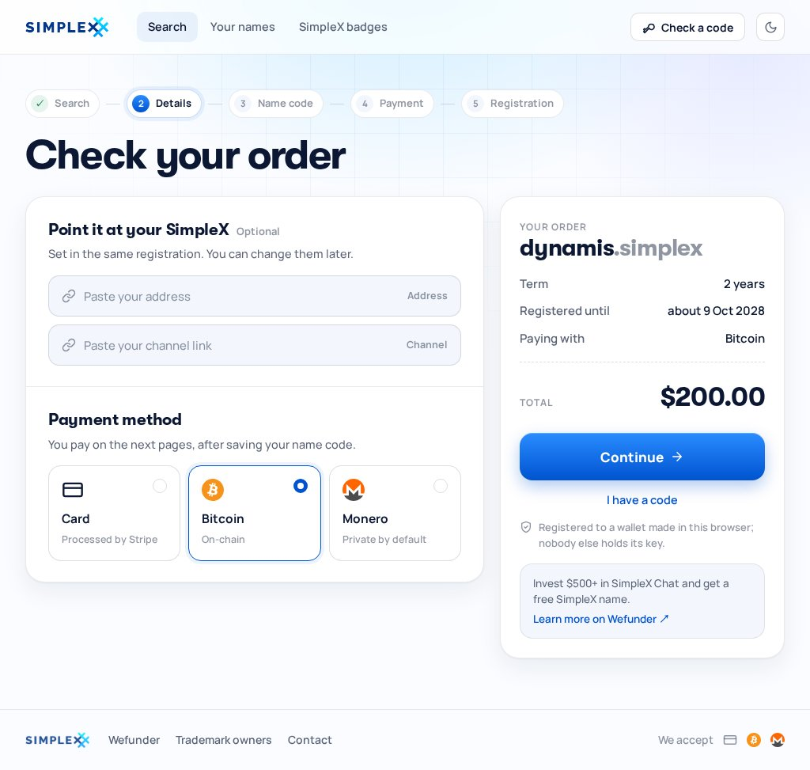
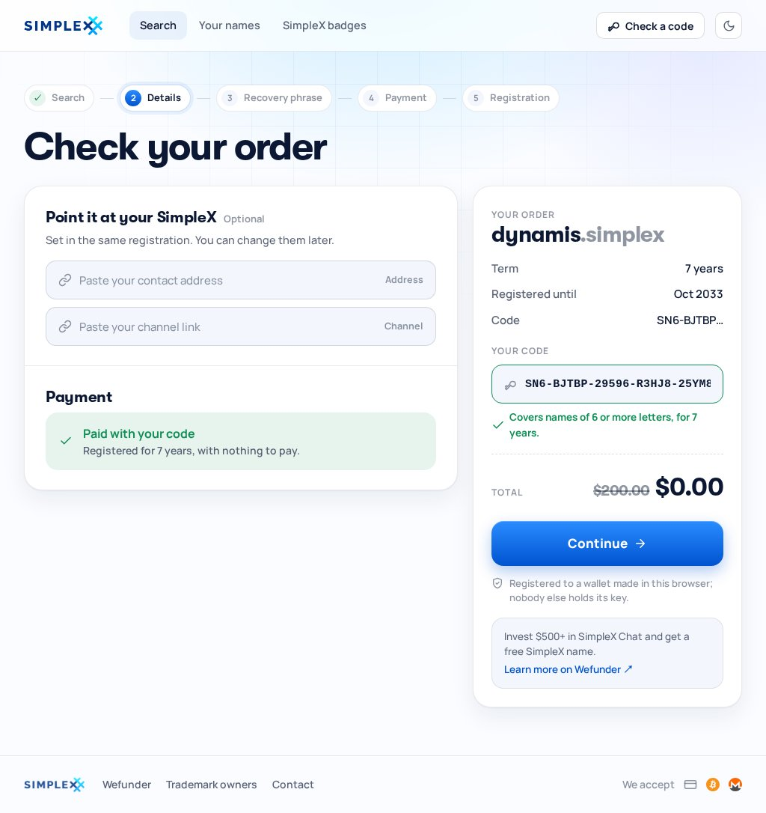
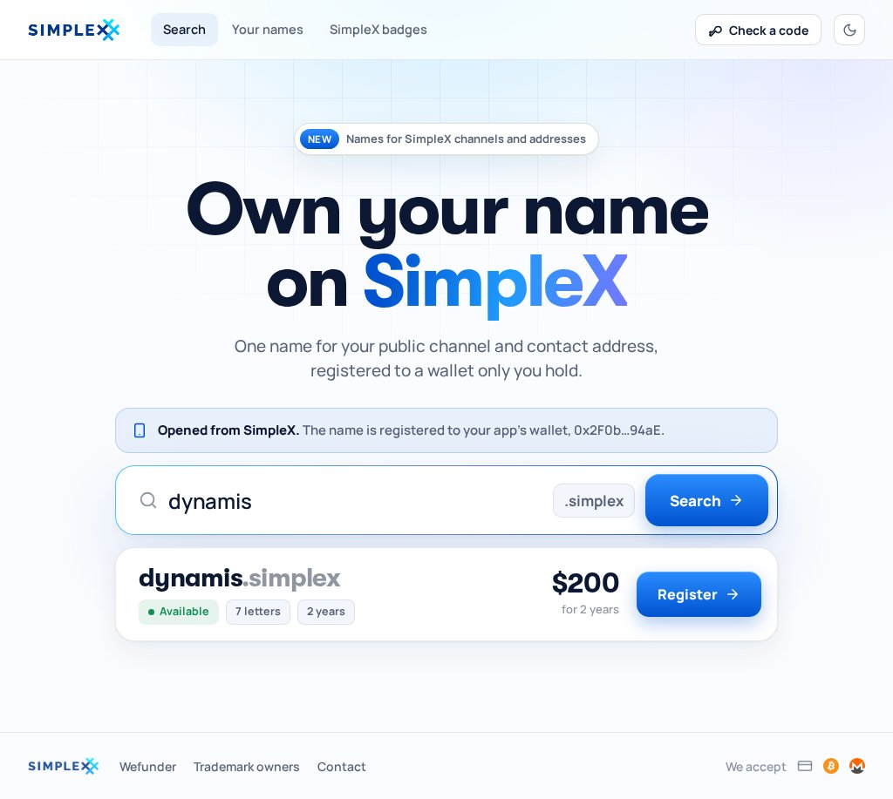

# SimpleX names store: simplex.domains

The names store sells SimpleX names (`<label>.simplex`) at **simplex.domains**:
1. The buyer searches a name and sees whether it is free, and at what price.
2. The buyer pays by card, Bitcoin or Monero, or redeems a code.
3. The browser makes the name's wallet, shown as an owner code ("your name code" on the page: `SN-` and 30 characters), and the service registers the name to that wallet's address, paying the fee and gas.
4. Nothing is held in custody. Redeeming the code in the app moves the name to the app's wallet.

Badges keep their own store at **badges.simplex.chat**. The implementation plan is [`2026-10-09-names-web-store-plan.md`](2026-10-09-names-web-store-plan.md). Every flow as a sequence of calls, with the gaps found, is in [`2026-10-13-names-sequence.md`](2026-10-13-names-sequence.md).

The registration primitives are Alain's `origin/ab/names-registration-primitives-sponsored` (`plans/2026-10-12-names-sponsored-registration.md`), against ens-contracts PR #35 (`SimplexController`, `SimplexSponsor`, `SimplexResolver`). This store is the plumbing and the pages around them.

The app side:
- redeeming codes in the app: owner codes by transfer (`approveWithSig` and `claimWithSig`, relayed by the service), prepaid codes by #7530 (`origin/ab/names-actions-api:plans/2026-09-28-name-registration-core-cli.md`);
- editing a name's records in the app is later app work, out of #7530's scope; the web store links them itself (§6).

**The board**, every screen and how each leads to the next: [`names-flow.svg`](names-flow.svg). It is generated, see [§13](#13-regenerating-the-board). View it on GitHub from the file view, not "raw": the raw host's Content-Security-Policy blocks the embedded screens.

[](names-flow.svg)

## Contents

1. Scope
2. Two stores
3. Search
4. Price and term
5. The wallet and its owner code
6. Registration
7. Codes
8. Service API
9. Storage
10. Configuration
11. The page
12. Deployment
13. Regenerating the board
14. Open questions

## 1. Scope

**In:**
- The names store: search, checkout by payment or prepaid code, the wallet in the browser, registration with its steps, and the owner code.
- Linking a contact address and channel to the name, at registration and later.
- The flow opened from the app.
- History with "Add a code".
- The StoreService side: search, codes, orders, the registration worker, operator issuing.
- The names webapp (in the simplex.domains repo, a submodule here) and the library it shares with the badges webapp.
- Deployment.
- The mock.

**Out:**
- The app side (redeeming codes, records in the app). The board draws two app screens in grey (A1, A2).
- Selling codes on the web.
- Renewals, transfers, in-app purchase.
- Refunds (manual, by support).

## 2. Two stores

| | Names | Badges |
|---|---|---|
| Host | simplex.domains | badges.simplex.chat (simplex.chat/badges redirects there today; an iframe embed is supported and drafted on `sh/website-iframe`) |
| First screen | Search (N1) | The badge landing (B0, unchanged but for the link) |
| Cross-link | "SimpleX badges" in the header | "SimpleX names are at simplex.domains" under the landing, opening in a new tab since the badges app supports running in simplex.chat's iframe |
| History | "Your names" (N12) | "Your codes", as today |

Two webapps and one service. The names webapp lives in the simplex.domains repo, in that site's look (§11), and is a submodule of simplex-chat at `apps/simplex-domains`; the badges webapp stays here. They share logic, not screens: the API client, payments, storage, codes and the QR encoder, in the library `packages/simplex-chat-store`, published as `@simplex-chat/store` (as `@simplex-chat/webrtc` is). The badges webapp builds on the library from this repo; the names webapp pins a published version, and simplex-chat's CI builds it against the library here. StoreService, the renamed badge service, exports both sites. Each store keeps its own `localStorage`, since the two hosts are different origins.

## 3. Search

**The search bar (N1):** a search icon, the name, a fixed `.simplex` tag and a Search button; Enter searches too. The name is judged when searching, not while typing, and the rules line appears only after a mistake (N1b, N1c). The characters and hyphens follow #7390's `validLabel` (`Simplex.Chat.Names.Protocol` on `origin/ab/names-mvp-edits`, not yet merged where the service builds), mirrored by the names app's `names.ts`, and the length is checked separately (`invalid_name`):
- `a-z`, `0-9` and `-` after folding case, each hyphen between letters or digits, so no leading, trailing or double hyphen (simplexmq's `nameLabelP`, which also takes A–Z and lower-cases after; #7390's `validLabel` refuses `--` only at positions 3–4 and is tightened to this, since such a name would never resolve);
- at least 6 characters (the controller's `minCharLength`);
- at most 63 (simplexmq's label limit).

simplexmq lower-cases a name when parsing it (`SimplexDomain`'s `strP`, `labelHash`) and `validLabel` admits only a–z, so the page folds upper case as the buyer types.

**Searching:** the page validates the name, hashes it with keccak256 and sends `GET /api/name/:hash?length=7`; the length sets the price, and one outside 6–63 is `invalid_name`. The service asks `GET {resolver_url}/v2/resolve/[<hash as 64 lowercase hex, no 0x>].<tld>`. Neither request carries the name; for a registered name the resolver still knows which name it was. The service learns a name only when a paid or code order reveals it (§6). For a hash the resolver reports available while a registration here is `registering`, or `registered` with `registered_at` within the last hour (a margin for the resolver's node lagging the chain, since the resolver itself reads `latest` with no cache; after that the resolver is believed, so an expired name is free again), search answers `registered{entities: [], tld}`, with no owner, and orders refuse it with `name_taken`. The resolver's 502 `labelNotRecorded` (a label the base registrar never recorded) cannot occur on PR #35, where every registration records its label; search would answer it `provider_unavailable`, as it answers the resolver's other errors (502 `upstreamError` for a failed status, owner or resolver read or a lost RPC connection (a reverted text or address read it answers empty instead), 400 `tldNotConfigured`, 502 `unknown` without the registrar address, and 502 `noPriceOracle` without a readable price oracle or premium), a resolver that does not answer, and a failed chain read. The order, `/api/name/register` and the `/name` retarget answer the same resolver failures with `name_check_unavailable` (503) and create or change nothing, since `provider_unavailable` from invoice creation means an unavailable payment method (N3a).

| Answer | The page shows |
|---|---|
| `available` | N2: available, its price for 2 years (or $0 when an applied code covers it, K2), and Register |
| `registered`, with links | N2a: "Used by", one card per `simplexContact`/`simplexChannel` link, with picture, display name, link and Open in SimpleX (deep link) |
| `registered`, no links | N2b: taken, pointing nowhere (a name registered without links reads like this until its owner sets them, and so does one this service is registering or registered within the last hour: for that one the answer has no records, owner, resolver, `recordsNonce` or chain id, and Edit links takes the nonce, chain id and resolver from the registration view, only once it is `registered`) |
| `reserved` | N2c: reserved, with "Contact the SimpleX team" |
| no answer, an error | N2d (503) |
| the rate limit | N2e (429) |

**Taken names:** the service opens each link with its own chat core. `APIConnectPlan` returns the link's display name and picture from its link data without connecting, for short links; a full link has no profile, so its card shows the link only. Each fetch has a 3 s timeout, its own rate limit and a short cache.

**Below the search:** how it works, what a name does (a name pointing at an address and a channel), and the investor card: Wefunder's sentence and link with a names amount (a placeholder for now), and **Check your code** (§7).

## 4. Price and term

- **Term:** 2 years for a paid name, fixed: the controller's minimum (730 days, `MIN_REGISTRATION_DURATION`), and nothing is charged for years whose price cannot be known yet. A code registers for its own `years`; investor codes get 5 or 3, as simplex.domains says today. A year on chain is 365 days (31,536,000 seconds, as simplexmq's `protocol/simplex-messaging.md` prices it), so the duration is `years × 365` days from registration: 9 October 2028 for a name registered on 10 October 2026.
- **Price:** the service's answer for the searched name; no price list is shown.
  - The rule is internal: a seeded per-length table that per-name entries, keyed by the name's hash, can override, insert-only.
  - The starting values are $100 for 8+ letters, $200 for 7 and $400 for 6, for the 2 years, in `Catalog.defaultNamePrices`.
- **Checkout** carries the shown price. The service prices again and answers `catalog_changed`, with the new price, if it moved (N3b).

## 5. The wallet and its owner code

At checkout (N3), the browser makes the name's wallet:

1. 128 bits from `crypto.getRandomValues`.
2. The owner code: `SN-` and 30 Crockford base32 characters, the entropy and the first 22 bits of its SHA-256 (WebCrypto), in six groups of five, e.g. `SN-DWPHS-6JBFR-ZR1MA-T5HQ9-P17QM-F5GM5`.
3. The BIP-39 phrase with that entropy, and its seed: PBKDF2-SHA512, 2048 rounds, no passphrase (WebCrypto).
4. BIP-32 to `m/44'/60'/0'/0/0`: HMAC-SHA512 from WebCrypto, secp256k1 from vendored `@noble/secp256k1`.
5. The EIP-55 address, with keccak-256 from vendored `@noble/hashes`.
6. The commitment secret, `secret = HMAC-SHA256(seed, "simplex.domains commitment " + label)` (WebCrypto), so the code and the name are enough to reveal.
7. The sealing key, `HMAC-SHA256(seed, "simplex.domains sealed")`: the page encrypts the JSON `{label, contact, channel}` (each key's record value, links joined with `;`, "" without links) with AES-256-GCM and sends it with the order as `sealed` (unpadded base64url), so the code alone rebuilds the commitment on another browser. The service refuses one longer than 11095 characters with `bad_request` (a 63-character label and two values at the link bound). The order, register, retarget and reveal endpoints read bodies up to 16384 bytes, above today's 8192.

How the code and address are handled:
- **One open invoice per commitment:** an order whose commitment already has an open invoice gets that invoice when it matches it (a resend after a lost response) and `400 {"error": "bad_request", "invoiceId": "…"}` otherwise, which the page opens, and Get a new invoice from the card form not loading or the payment details unavailable cancels the old invoice first, ordering again only after the cancel succeeds (`funded` keeps the old order, `not_open`, a `200` `paid` or a `200` `expired` with payment marks re-reads it: paid with its registration past `unpaid` shows its order, paid with it still `unpaid` orders again, otherwise one holding a payment is kept, and one expired with nothing received orders again; on a `200` still `open` the page shows `CANCEL_STILL_OPEN` and keeps the old order; `provider_unavailable` keeps it, which the service also answers when Stripe refuses to cancel a card already processing); a crypto payment the service has not yet read when the cancel goes through becomes a refund case the poller alerts on; an order whose commitment already has a registration past `unpaid` (paid, or by code) gets that registration's order instead, (`invoiceId` null and the registration for a code one), and `/api/name/register` does the same, refusing with the same `bad_request` and `invoiceId` while the commitment has an open invoice; both checks run before the resolver, so a resend never meets its own registration as `name_taken`.
- **One order at a time (N3e):** as the badge checkout refuses a second order then (it shows no Pay button), while this browser's open order has a submitted card payment awaiting confirmation, checkout's Continue is off until it settles or expires; an open invoice not yet paid only shows a link to the waiting order, and Continue stays on.
- **Before paying (N3h):** Continue at checkout, paid or by prepaid code, first shows the code with Copy and a checkbox, "I have saved my code", which enables Continue. Only then is the order created. A crash or cleared storage after this point loses nothing that the code cannot rebuild.
- **The code** is also stored in this browser before the order is created. Checkout warns when storage is unavailable ("This browser will not keep your name code", N3f), as the badge checkout does for codes; N7a then reminds that the saved copy is the only one.
- **Restoring (N7c):** an order link opened where the code is not stored (N7b) asks for it; "Your names" offers "Restore with a name code", which finds the code's orders with `POST /api/registration/find`, signed by the code's key, without asking for the name. The page derives the owner, secret and sealing key, checks the owner matches the registration, opens `sealed` for the label and links, rebuilds the commitment and checks it matches, and carries on: it reveals if the registration waits for that, re-derives and shows the taken code for a `code_issued` one, or shows the registered name.
- **What the service gets:** the address, the name's hash and length, the commitment and `sealed` (which it cannot open) with the order; the name, the commitment secret, any links and the owner's `RegisterName` signature only at the reveal (§6). Never the code.
- **The path** is #7475's account 0. Tests pin the `abandon … about` vector to #7475's address for account 0, `0x9858EfFD…aEda94`, and the branch's owner code vectors.

N7 shows the code again, with Copy, a QR for the app to scan, and "Show it as 12 words, for another wallet" (its BIP-39 phrase), and says plainly that it owns the name and that nobody else has a copy. History keeps it, behind "Show code".

**Redeeming in the app** (A1, A2) is not built here. The app reads the code, and the name moves to the app's wallet on the base registrar (EIP-712 domain `SimplexNames`): the code's wallet signs `ApproveName(from, to, tokenId, ephemeralPubKey, viewTag, nonce, deadline)` with `nonce = nonces(from)`, an empty key and a zero tag, and the service relays `approveWithSig`; then the app's wallet signs `ClaimName(from, to, tokenId, offer, nonce, deadline)` for `offer = offers(tokenId)` with `nonce = nonces(to)`, and the service relays `claimWithSig`. The registry node follows the token; the records stay. The app finds a code's names on chain: the registrar is enumerable (`balanceOf`, `tokenOfOwnerByIndex`, `labelOf`, `nameExpires`). A BIP-44 wallet importing the code's BIP-39 phrase holds the name and can edit its records, paying gas; moving it still needs the recipient to claim it, since PR #35's `transferFrom` reverts `RecipientMustBeCaller` unless the recipient or a registrar controller calls.

**One wallet per order:** a taken order retargeted to another name (N8a) keeps its address, so the same code owns the new name; Get a new invoice after an expired one also reuses it, so `find` can list that expired `unpaid` registration too, and the page opens the one that is not `unpaid`, or the newest.

**Opened from the app (L1–L3):** the app's link carries the name and the app's own owner address, `simplex.domains/#/?name=<label>&owner=<address>`. The page shows that address on the search and at checkout, so a crafted link cannot pass unnoticed. It makes no wallet, so the order carries no `sealed`, offers no links and no "I have a code" (the app sets links and redeems codes itself), and ends with "Back to SimpleX". Open: the `RegisterName` intent must be signed by the owner, the app's wallet (§14).

## 6. Registration

1. **Orders:** the page sends the name's hash and length, never the name, with the owner and a commitment it builds itself: `makeCommitment(Registration{label, owner, duration, secret, resolver, data = one setText call per key that has links, its links joined with ";" (empty without links), reverseRecord = 0, referrer = 0})`, the secret derived from the owner code (§5), `duration` 2 years or the prepaid code's years at 365 days a year, and the resolver contract from the search answer. This is the contract's struct, as the branch's `registrationTuple` encodes it from its `Registration` (label, TLD, owner, duration, secret, resolver, contact and channel links).
   - Paid: `POST /api/invoice {kind: "name", labelHash, length, price, method, owner, commitment, sealed}`; settlement moves the registration to `queued`.
   - By prepaid code: `POST /api/name/register {labelHash, length, owner, commitment, sealed, code}`, with no invoice; a repeat, found as a registration whose `name_prepaid_code_id` is this code, with the same owner and commitment in any phase, answers that registration. The code is reserved for the registration and spent when it succeeds.
   - Both refuse a length outside 6–63 with `invalid_name`, and with `name_taken` a name the resolver reports registered or reserved, or a hash the resolver reports available while a registration here is `registering`, or `registered` with `registered_at` within the last hour (a margin for the resolver's node lagging the chain, since the resolver itself reads `latest` with no cache; after that the resolver is believed, so an expired name is free again). An invoice that expires or is canceled leaves its registration `unpaid`, and a late payment of it does not queue it (support refunds it), since Get a new invoice reuses the commitment; Get a new invoice makes a new order for the same name and wallet, and an `unpaid` registration is deleted with its `name_invoices` and `invoices` rows in one transaction 30 days after its invoice closed, unless the invoice received any payment, partial or late, which stays for support; the cleanup first reads the invoice from the provider itself (`pReadInvoice`, then settlement as for any read), since the poller and the provider list pass read an invoice only within about 72 hours of its creation (`settleWindow`), after which only a webhook brings a payment. Today's BTCPay handler acts only on `InvoiceProcessing`, `InvoiceSettled`, `InvoiceExpired` and `InvoiceInvalid`; it gains `InvoiceReceivedPayment` and `InvoicePaymentSettled` as read hints for a payment into a closed invoice. The cleanup's read is the backstop: a payment whose webhook was lost is still recorded and alerted, and the registration is kept until the next daily run if the provider does not answer.
2. **No hold:** the service cannot hold a name it has not seen, so it holds none. Two orders may name the same hash; whichever registers first wins, and the other ends `taken` with its payment kept.
3. **The worker**, one per registration, resumed after a restart. It uses the branch's chain client (`sendCommit`, `sendRegister`: JSON-RPC to an RPC URL, the reth node on the resolver host by #7530's decision D5, a dry run of every transaction, EIP-1559 fees, signed by the registrar key):

| Phase | What happens | Page |
|---|---|---|
| `queued` (paid, or prepaid code reserved) → `committing` | Send `commit(commitment)`, the page's commitment, from the registrar key | N6 |
| `committed` | Mined: a commit's outcome (its dry run, or its receipt's `status`) is checked against `commitments(commitment)`, since before the reveal there is no label: a commit that reverts, in its dry run (nothing sent) or mined with `status` 0, while its commitment is live (`UnexpiredCommitmentExists`) makes the registration `committed`, with the reveal times from `commitments()`. One that reverts with no live commitment (out of gas, or a commitment that lapsed by the read) is sent (again, if it was mined), a second later when the read falls at `commitments(commitment)` plus `maxCommitmentAge` itself, as the retry path waits at `revealBefore`; when the commitment had lapsed, `label`, `secret`, `records`, `intent_*`, `error`, the transaction hashes and blocks, `reveal_after` and `reveal_before` are also cleared before the new commit is signed, as retry does after `revealBefore`, so the page signs again. Then wait `minCommitmentAge`, read from the controller (60 s in PR #35's deployment), and the page's reveal, `POST /api/registration/:id/reveal {label, secret, records, nonce, deadline, signature}` | N6a |
| `registering` | Send `registerWithCredit(registration, nonce, deadline, signature)` to the sponsor, which spends the registrar's allowance; from now search answers `registered` for this hash | N6b |
| `registered` | A receipt with `status` 1 and `ownerOf(tokenId) == owner`, + 3 blocks; `registered_at` and `expires_at` recorded. On `status` 0 the worker reads `ownerOf(labelHash)` first (the owner holding it is `registered`), then `available(label)` to choose `taken` or `failed` | N7 (or L3) |
| `taken` | The name is no longer available: a register that reverts, in its dry run (nothing sent) or mined with `status` 0, with `NameNotAvailable` or `NameReserved` decoded, or with any other revert while `available(label)` is false, unless `ownerOf(labelHash)` is the owner, which means this registration already went through (a resumed worker or a duplicate send) and is `registered`, recording `registered_at` and `expires_at` and spending its prepaid code (the sponsor checks the intent and the allowance before availability, so a taken name can revert with those first) | N8 |
| `failed` | Any other failure after the service's retries (an `InsufficientAllowance` among them, which also alerts the operator), or a commitment not revealed in time; Try again, `POST /api/registration/:id/retry` (only from `failed`, else `bad_request`), goes in order: a lost confirmation (a mined `register_tx`, any of its hashes, with `status` 1, or `ownerOf(labelHash)` being the owner; a revert counts as not) makes it `registered`, recording `registered_at` and `expires_at` and spending its prepaid code (the operator is alerted if the sweep gave that code to another registration meanwhile); a released code now used, revoked, expired or held elsewhere answers that code error and leaves it `failed`; otherwise it requeues at no charge, re-reserving a released code, clearing `failed_at`, `error` and the register's transaction hashes and blocks, and `label`, `secret`, `records` and `intent_*` when the owner's sponsor nonce has moved, so the page reveals again. A commitment reading 0 is committed again (one still pending is waited for, and a commit reverting `UnexpiredCommitmentExists` means `committed`, with the reveal times from `commitments()`); otherwise, with `revealBefore` as `commitments(commitment)` plus `maxCommitmentAge` (`reveal_before` may be null), with at least `revealMargin` left before `revealBefore` (time for the reveal and the register) the commitment is reused, going to `committed` with the reveal times from `commitments(commitment)`, and `label`, `secret`, `records`, `intent_*` and the commit's transaction hashes and blocks are cleared when the commitment's time is not the block time of a commit of ours that mined with `status` 1, since anyone can commit a lapsed commitment again; with less, the worker waits until a second after `revealBefore` and goes on as after it; at it the worker waits a second; after it `label`, `secret`, `records`, `intent_*`, `error`, the transaction hashes and blocks, `reveal_after` and `reveal_before` are cleared and then the commitment is committed again, so the page signs again | N9 |

- **The reveal**, accepted in `committed` while `label` is null (once `label` is set, an identical repeat answers 200 in that or any later phase, and a different body is `bad_request`), gives the service the name, the links and the owner's signed intent: EIP-712 `RegisterName(string label,address owner,address resolver,bytes[] data,uint256 nonce,uint256 deadline)` under the `SimplexSponsor` domain, signed with the owner code's key; `nonce` is `SimplexSponsor.nonces(owner)`, 0 for a new owner code, and `deadline` is the view's `revealBefore`, when the commitment lapses anyway. It checks that the label is valid, hashes to `labelHash`, has `length`, so its price is the registration's `price_id` row, fixed at order or retarget (or it is covered by the prepaid code), that each link is a SimpleX link of its kind and within the link bound, that the resolver is the default one, and rebuilds `data` and the commitment; then `verifyRegisterIntent` (owner signed, deadline not passed, secret 32 bytes), plus a low-s check of its own, since `recoverPublicKey` accepts high s and the sponsor's `SignatureChecker` rejects it (the signature is read as exactly 65 bytes `r ‖ s ‖ v` with `v` 27 or 28, as OpenZeppelin requires, the recovery id being `v − 27`), and `nonce == SimplexSponsor.nonces(owner)`, read from the chain. Otherwise `bad_request`, which a page that built the order itself never meets. The intent does not sign the duration, so the service sets it from what was paid. The page must be open after the wait; reopening the link within 24 hours (`maxCommitmentAge` in PR #35's deploy) finishes it, in this browser from storage and in another from the code (N7b). A commitment not revealed within the controller's `maxCommitmentAge` lapses to `failed`.
- **All phases:** `unpaid` (its invoice not settled while open) → `queued` (paid, or prepaid code reserved) → the rows above. From `taken` a paid order goes back to `queued` with its new label hash, or ends `code_issued`; a prepaid-code order ends at `taken` with its code released. A prepaid code is reserved from `queued` until it is `registered` (spent) or `taken` (released); `failed` keeps it for Try again, for 30 days, then releases it; a later retry reserves it again if it is still unused, or answers `code_used`, `code_invalid` (revoked) or `code_expired`, or `code_reserved` when another registration holds it. N9 shows `code_used` as "Your code was used for another name", `code_reserved` as "Your code is held by another registration; try again later", `code_invalid` as "This code is not valid" and `code_expired` as "This code has expired".
- **Ownership from the start:** `makeCommitment` hashes the `Registration` rather than `msg.sender`, and the sponsor registers to the struct's owner once the owner has signed the intent (PR #35). So the name belongs to the buyer's address from the start, and the registrar key never holds a name.
- **Links at registration (N3g):** checkout offers "Point it at your SimpleX", a contact address and/or a channel link, one per key. Each is checked against the link bound (4096 bytes of UTF-8 per record value, a key's links joined with `;`) on the page and previewed (display name and picture, as on the taken-name cards) through `POST /api/link/preview`, which checks the bound too, so a typo shows before paying. The page puts `setText` calls for `simplex.contact` and `simplex.channel` on the name's node into the `Registration`'s `data`, so they are covered by the commitment; the links reach the service only with the reveal, which carries them as `records`, and the register transaction sets them. Without links the name is registered with none.
- **Links later (N12b):** "Your names" has Edit links, except for a registered answer with an `owner` and null `records` (a name on another resolver or none); during the lag the answer has neither, and Edit links takes the values from the order's links in `sealed`, or from this browser's last mined edit of that key (a mined clear setting both to ""), and the nonce, chain id and resolver from the registration view, and is offered only once its phase is `registered`. For each changed key the page signs EIP-712 `SetText(bytes32 node,string key,string value,uint256 nonce,uint256 deadline)` under the `SimplexResolver` domain with the name's key, and `POST /api/name/records` relays `SimplexResolver.setTextWithSig`, the service paying the gas; a `ClearRecords` signature, relayed as `clearRecordsWithSig`, clears every record at once. The nonce is `SimplexResolver.nonces(owner)`, one counter for all of the owner's edits, which the registered search answer carries with the chain id, or the registration view while search lags. The service recovers each edit's signer (looking repeats up by signer and nonce and matching them by `body_hash`), requires low s as `SignatureChecker` does (the signature read as for the reveal: 65 bytes, `v` 27 or 28), and requires the signer to be the name's owner and the deadline ahead of the latest block (else `bad_request`). Repeats are answered right after the signature check, before the deadline, cap, owner and nonce checks. A revert, an expiry, or a restart that finds an edit's registrar nonce used with no receipt is re-checked against the nonce and the record (for a clear, both keys reading ""), since anyone can relay a signed edit and a pruned node can lose a receipt; an edit found applied that way answers `{tx: null}`, the applying transaction being unknown. Otherwise a revert or an expiry answers `record_reverted`, and the restart case is signed again under a new registrar nonce while its deadline is ahead. Several edits go one at a time: the service accepts an edit only when its nonce is the on-chain one and answers once it is mined, and the page signs the next after that answer, with the next nonce after a mined edit and the same nonce after `record_reverted`; after any `bad_request` it re-reads the nonce from where it first read it. PR #35 has no edit credits, so the service bounds edits with its own rate limit and a per-name cap. After redeeming, the app's wallet owns the name and edits from the app; Your names hides Edit links once the search answer carries an owner other than the code's address. A record holds its links joined with `;`: removing one of several rewrites the joined value, and clearing a key sets it to "".
- **Progress:** each phase is published to the long poll (`GET /api/invoice/:id` or `GET /api/registration/:id`), which holds a name invoice or a registration while its phase is the page's `seenPhase` (an invoice also while its status and payment marks are unchanged), except an invoice paid after it closed (`paid` with phase `unpaid`), answered at once; the page stops at `registered`, `code_issued`, `taken`, `failed`, and at `unpaid` once the invoice is no longer open; today's long poll answers a paid invoice at once and tracks no phase, so a separate phase map, keyed by registration id and outside the poller's waiting count, tracks it.
- **Taken:** by another registrar, or by another order here that registered first. The order keeps its value:
  - paid: another name at most its price, searched on the order's own page, `POST /api/registration/:id/name {labelHash, length, commitment, sealed, timestamp, signature}` (N8a). It runs the order's checks on the new hash, replaces the registration's `price_id` with the new name's price row, replaces the hash, length, commitment and sealed order, and clears `label`, `secret`, `records`, `intent_*`, the transaction hashes and blocks, `reveal_after`, `reveal_before` and `error`; the registration is then committed and revealed again. A cheaper name refunds nothing, and a dearer one is `bad_request`. Or the buyer takes a prepaid code for the registration's current length (8+ for longer names), for 2 years, paid and without expiry: `POST /api/registration/:id/code {codeHash, timestamp, signature}` (N8b). Both are signed by the owner, as `find` is, since anyone holding the order link can read the registration id: EIP-191, the signature read as the reveal's (65 bytes, `v` 27 or 28), over `simplex.domains name <registrationId> <labelHash> <length> <commitment> <sha256(sealed)> <timestamp>` or `simplex.domains code <registrationId> <codeHash> <timestamp>` (`length` in decimal, `labelHash`, `commitment` and `sha256(sealed)`, the SHA-256 of the `sealed` string's ASCII bytes, as lowercase `0x` hex, `codeHash` as the badge codes' unpadded base64url SHA-256 of the canonical code, `timestamp` in decimal Unix seconds). Both are only for a paid registration in `taken`, else `bad_request`, except that an identical `/code` repeat is answered 200 again; a page that lost a `/name` answer re-reads the view. The page derives the code from the owner code's seed (payload from `HMAC-SHA256(seed, "simplex.domains taken code " + registrationId)`) and sends only its hash, so the owner code recovers it and a repeat sends the same hash (a hash another code has is `code_conflict`, as for badges, unreachable in practice for a derived code). An order opened from the app can use neither `/name` nor `/code` (gap 10 in the sequence doc);
  - by prepaid code: the code is released, unspent, for another name.
- **Failed:** "Paid, not registered". Try again charges nothing, and refunds are manual.
- **Signing:** `signRecoverable` and `signEip1559Tx` in simplexmq #1887, on `names` (not `master`); EIP-712 hashing and signer recovery in simplexmq `ab/name-registration-primitives-sponsored`, a PR into `names`.

## 7. Codes

Two kinds of `SN` code, one sum type in core, so a code's meaning is in its type:

```haskell
data NameCode
  = NCOwner NameOwnerCode     -- "SN-" and 30 characters: the wallet's entropy and 22 bits of its SHA-256
  | NCPrepaid NamePrepaidCode -- "SN<len>-" and 20 characters: pays for one name of len+ letters
```

`parseNameCode` tells them apart by the body's length after `SN`, separators removed: 30 characters is an owner code, 21 or 22 (the length digits and 20) a prepaid code; digits after `SN` cannot decide it, since an owner code's body may start with one. Both read case-insensitively, with separators optional, `I`/`L` → `1` and `O` → `0`.

| | Owner code | Prepaid code |
|---|---|---|
| Shown | `SN-DWPHS-6JBFR-ZR1MA-T5HQ9-P17QM-F5GM5` | `SN7-BJTBP-29596-R3HJ8-25YM7`; `SN6-…`, `SN20-…` |
| Body | 30 characters: 128-bit entropy and 22 bits of its SHA-256 | a 1–2 digit length, then 20 characters, the last a Luhn mod-32 check over the length digits and the 19 payload characters |
| Made by | the page, one per order | the operator (`//issue name <length> [years <Y>] [paid\|unpaid\|free]`, 2 years by default and at least 2; group `/issue name <length> [years <Y>]`, `/bulk name <length> [years <Y>] count <N>`), the app (an owner decision; #7530 defers in-app purchase), and the page for a taken order (N8b), derived from the owner code, sending only its hash. Not sold on the web |
| Means | the name's key: whoever holds it owns the name until it is redeemed | the right to register one name of that length or more, for the code's years |
| Stored by the service | never | SHA-256 of the canonical form; the `name_prepaid_codes` row (`min_length`, `years`, status) is the truth, the length in the text a convention |
| Use | redeemed in the app, moving the name (§5) | single-use: reserved from `queued` until it is `registered` (spent) or `taken` (released); `failed` keeps it for Try again, for 30 days |

The rest of this section is about prepaid codes.

**Check your code** (K1), on the investor card and as Check a code in the header, opens a popup. `POST /api/code/check {code}` answers what the code covers (`minLength`, `years`) and whether it is unused, reserved by an unfinished registration, used (K5), revoked, expired or unpaid, without spending it. A typo fails the check character before any request (K6).

**A name code where a prepaid code goes:** `parseNameCode` tells the kinds apart, so an owner code typed into the popup, the checkout entry or Add a code is answered on the page, sending nothing: "This is a name code. Restore it in Your names."

**Use this code** applies it: a covered name shows $0 and the code's term (K2, where Remove drops it), Register with code leads to a $0 checkout (K3), and the name registers for the code's years (K8). The board's example is an investor code, `SN6-` for 5 years. A name the applied prepaid code does not cover shows its normal price, with a line saying what the code covers.

The popup's answer per state, drawn for unused, used and a typo:

| State | Line |
|---|---|
| `unused` | ✓ Unused, and what it covers (K1) |
| `reserved` | This code is being used for a name now |
| `used` | This code was already used (K5) |
| `revoked`, unknown | This code is not valid |
| `expired` | This code has expired |
| `unpaid` | This code is not paid for yet |
| typo | This code is not valid, check it for a mistyped character (K6): the check character fails before any request |

**I have a code** sits under Continue in the checkout's order card and opens the entry there (K4). A code that does not cover the name says so (K7), and the buyer can still pay.

**History:** "Add a code" (N12a) asks the same question and adds the code to the list, where Use applies it.

## 8. Service API

The examples show the launch configuration, `tld = simplex`; until `.simplex` is deployed the service answers `testing`.

```json
GET /api/name/<keccak256("dynamis") as 0x and 64 lowercase hex>?length=7
200 {"status": "available", "price": 20000, "currency": "usd", "years": 2,
     "resolver": "0x…", "sponsor": "0x…", "chainId": 1, "tld": "simplex"}

GET /api/name/<keccak256("bakery") hex>?length=6
200 {"status": "registered", "entities": [
      {"type": "address", "displayName": "Alice's Bakery", "image": "data:image/jpeg;base64,…",
       "link": "https://smp8.simplex.im/a#…", "deepLink": "simplex:/a#…"},
      {"type": "channel", "displayName": "Bakery news", "image": "data:image/jpeg;base64,…",
       "link": "https://smp9.simplex.im/c#…", "deepLink": "simplex:/c#…"}],
     "records": {"contact": "https://smp8.simplex.im/a#…", "channel": "https://smp9.simplex.im/c#…"},   (raw record values read from the default resolver on chain, links joined with ";", null with recordsNonce for a name on another resolver or none; the resolver's split links feed only the cards; the reveal's records are arrays)
     "owner": "0x…", "resolver": "0x…", "recordsNonce": 0, "chainId": 1, "tld": "simplex"}

GET /api/name/<keccak256("support") hex>?length=7   200 {"status": "reserved"}
GET /api/name/<hash>?length=5   400 {"error": "invalid_name"}
GET /api/name/<hash of a name this service is registering>?length=7   200 {"status": "registered", "entities": [], "tld": "simplex"}

POST /api/code/check {"code": "SN7-BJTBP-29596-R3HJ8-25YM7"}
200 {"minLength": 7, "years": 2, "state": "unused"}
    state: unused | reserved | used | revoked | expired | unpaid; an unknown code is 400 {"error": "code_invalid"} (not 404, which the transport reads as not_found whatever the body)

POST /api/invoice        {"kind": "name", "labelHash": "0x…", "length": 7, "price": 20000, "method": "btc", "owner": "0x014f…9b73", "commitment": "0x…", "sealed": "…"}   (sealed: null for an order opened from the app)
200 {"invoiceId": "q7ZpL2dN9xWc4KfR8tYb1A", …the badge invoice's common fields (amount, currency, expiresAt, payment fields), flat, "kind": "name", "registration": {"id": "…", "phase": "unpaid", …}}
POST /api/name/register  {"labelHash": "0x…", "length": 7, "owner": "0x7a3C…e51D", "commitment": "0x…", "sealed": "…", "code": "SN7-BJTBP-29596-R3HJ8-25YM7"}
200 {"registrationId": "t2Jk8RmQ4vXw9NcP3yLb6g"}   (plus "invoiceId" when the commitment's registration was paid, so the page opens ?order=<invoiceId>)
POST /api/invoice for a commitment whose registration is by code: 200 {"invoiceId": null, "kind": "name", "registration": {…the view}}, no payment fields; the page opens ?registration=<id>
POST /api/invoice or /api/name/register for a commitment with a different open invoice: 400 {"error": "bad_request", "invoiceId": "q7ZpL2dN9xWc4KfR8tYb1A"}; the page opens that order

GET  /api/invoice/:id?wait=<status>&seenPhase=<phase>  … plus "registration": {id, phase, labelHash, label (null until the reveal), owner, commitment, sealed, resolver, sponsor, chainId, tld, years, commitTx, registerTx (each, among the hashes kept since they were last cleared, the one that mined with `status` 1, else the latest sent, and null when judged mined from chain state with no hash known to have mined with `status` 1), revealAfter, revealBefore, intentNonce, recordsNonce (once registered, for Edit links before search has the owner), expiresAt, error}
GET  /api/registration/:id?seenPhase=<phase>  the same registration object, long-polled: the invoice holds while its status, payment marks and (for a name invoice) phase are the ones seen, except one paid after it closed, the registration while its phase is the one seen
POST /api/registration/:id/reveal {"label": "dynamis", "secret": "0x…",
                                   "records": {"contact": ["https://smp8.simplex.im/a#…"], "channel": []},
                                   "nonce": 0, "deadline": 1791727200, "signature": "0x…"}
200 {}
POST /api/registration/:id/name {"labelHash": "0x…", "length": 7, "commitment": "0x…", "sealed": "…", "timestamp": 1791642000, "signature": "0x…"}
200 the registration object, phase queued
POST /api/registration/:id/retry
200 the registration object, phase queued, or registered after a lost confirmation
POST /api/registration/:id/code {"codeHash": "…", "timestamp": 1791642000, "signature": "0x…"}
200 {}

POST /api/registration/find {"owner": "0x014f…9b73", "timestamp": 1791641400, "signature": "0x…"}
    signature: EIP-191 over "simplex.domains find <owner as lowercase 0x hex> <timestamp in decimal Unix seconds>", 65 bytes r ‖ s ‖ v with v 27 or 28
200 {"registrations": [{"registrationId": "m8Tk3WqZ5nRc2YpJ7vLd4g", "invoiceId": "q7ZpL2dN9xWc4KfR8tYb1A", "phase": "committed", "createdAt": "2026-10-10T13:30:00Z"}]}
    newest first
    one per registration of that owner, retargeted ones included; invoiceId (the order link's id): null for a prepaid-code registration
404 {"error": "not_found"} when the owner has no registration

POST /api/link/preview {"link": "https://smp8.simplex.im/a#…"}
200 {"type": "address", "displayName": "Alice's Bakery", "image": "data:image/jpeg;base64,…"}

POST /api/name/records {"labelHash": "0x…", "key": "simplex.channel", "value": "https://smp9.simplex.im/c#…",
                        "nonce": 0, "deadline": 1791727200, "signature": "0x…"}
POST /api/name/records {"labelHash": "0x…", "clear": true, "nonce": 1, "deadline": 1791730800, "signature": "0x…"}
    key: simplex.contact | simplex.channel; deadline: signing time + 1 hour; a link not of the key's kind or a value over the link bound is invalid_link, a new edit past the per-name cap rate_limited
200 {"tx": "0x…"} once mined ({"tx": null} when it was found applied on chain with the applying transaction unknown: another relayer's, or the service's own with its receipt pruned), or 409 {"error": "record_reverted", "revert": "SignatureExpired"} and the like (null for a mined revert other than an expired deadline, whose receipt carries no reason, or a dry-run revert whose node returns no data); an identical repeat (the same body on any row) waits for the same transaction while pending, answers its tx once mined (null again for an edit found applied that way), or record_reverted again for a reverted edit; only a body on no row is new, and with a nonce whose edit is pending or mined it is bad_request; after record_reverted the nonce is free again for a new body; the nonce must equal SimplexResolver.nonces(owner) on chain, else bad_request, so edits go one at a time
```

- **Errors:** new on HTTP: `invalid_name`, `name_taken`, `name_check_unavailable` (the resolver failing during an order, register or retarget), `invalid_link`, `record_reverted`, `code_not_covering`, `code_reserved`, and the chat protocol's code errors `code_invalid` (unknown or revoked), `code_used`, `code_expired` and `payment_pending` (an unpaid code). `catalog_changed` carries the new price.
- **On the page:** `name_taken` from an order goes back to search and shows its new answer (N2a or N2b, or N2c when reserved); code errors from the service show where the code was entered, the popup (K5) or the checkout entry (K7), and a typo is caught on the page (K6); a `bad_request` carrying an `invoiceId` opens that order; `name_check_unavailable` and anything else at checkout is N3d; after the order exists, the order page shows the error with the reference, and the payment is kept.
- **The registration id** is a random 128-bit token, like order ids; whoever holds it can act on the registration.
- **Chain reads:** in search, the reveal (not counted as its `bad_request`), the records relay (not counted toward the cap), the registration view (whose `intentNonce` is read only in `committed` and `recordsNonce` only in `registered`, null otherwise) and `/retry`, a failed chain read answers `provider_unavailable` (503) and changes nothing. A revert that is the answer, as `ownerOf` for a name not held, is not a failure; a null receipt counts as not mined (pending or pruned), and once its registrar nonce is used the chain state decides (`commitments` for a commit, `ownerOf` for a register, the nonce and the record for an edit), while an RPC error is a failed read. Every re-read by the sender for an edit, after a dry-run or mined revert, an expiry or a used registrar nonce, is retried until it succeeds, the edit kept `pending`, and the worker's reads are retried with the registration kept in its phase.
- **Rate limits:** `/api/name`, `/api/link/preview`, `/api/code/check`, `/api/registration/find` and `/api/name/records` each have their own, taken after route and method matching and before any other check, as `limited` does today; the profile fetch for a taken name's links has its own, applied per fetch; `/api/name/register` shares the code check's, since it too reveals a code's state; `GET /api/registration/:id` and the reveal take the read limit, like the invoice long poll, and each `bad_request` from the reveal counts against it; `/name`, `/code` and `/retry` on a registration take the create limit.
- **`owner`** must be a checksummed address; `labelHash`, `commitment` and `secret`, in bodies and as `:hash`, are `0x` and 64 lowercase hex, else `bad_request` (`codeHash` stays the badge codes' unpadded base64url).

## 9. Storage

Migration `20261010_names`, in SQLite and Postgres. The badge tables (`sx_badge_service_badge_codes`, `sx_badge_service_badge_code_invoices`, …) are untouched, so there is no table rebuild.

- **`sx_badge_service_name_prepaid_codes`:** `name_prepaid_code_id`, `code_hash` (unique), `min_length`, `years`, `code_payment_status`, `reserved_by` (the registration holding it, unique when set) and `reserved_at` (when, for the operator), `spent_at`, `revoked_at`, `expires_at`, `created_at`. A daily sweep releases codes whose registration is still `failed` with a `failed_at` 30 days old; each failure sets `failed_at` and a requeue clears it.
- **`sx_badge_service_name_prices`:** `price_id`, `min_length`, `label_hash` (null for a length rule), `price`, `currency`, `status`, `created_at`.
- **`sx_badge_service_name_registrations`:** `registration_id`, `label_hash`, `length`, `label`, `secret`, `records`, `intent_nonce`, `intent_deadline` and `intent_signature` (null until the reveal), `sealed`, `owner`, `commitment`, `phase`, transaction hashes (every one sent, fee-bumped replacements included, each saved with its raw signed transaction once signed and before it is sent) and blocks, `reveal_after` and `reveal_before` (the commit's block time plus the controller's ages, read at the commit), `years`, `expires_at`, `price_id` (the price paid for, replaced at retarget; null when paid by code), `name_prepaid_code_id` (the code paying, null when paid), `issued_code_id` (the code taken instead of a taken name), `registered_at`, `failed_at`, `error`, `created_at`, `updated_at`. The invoice links through `name_invoices.registration_id`. Indexed by `label_hash` with `phase` (search and orders) and by `owner` (find). A restart rebroadcasts each saved raw transaction that has no receipt, and rebroadcasts it again after a timeout while the node does not know it and its registrar nonce is unused. Once that nonce is used, the worker reads the effect on chain before signing again, since a pruned node also shows a mined transaction as unknown: a commit counts as mined when `commitments(commitment)` plus `maxCommitmentAge` is still ahead (the worker sends a commit only when the commitment reads 0 or has lapsed, and a lapsed one keeps its old time), and the registration becomes `committed` with the reveal times from `commitments()`; a register counts as mined when `ownerOf` is the owner.
- **`sx_badge_service_name_record_edits`:** `label_hash`, `owner` (the recovered signer), `nonce`, `key`, `value` (null for the clear form), `deadline`, `signature`, `body_hash`, transaction hashes (every one sent, each saved with its raw signed transaction once signed and before it is sent), `state` (`pending`, `mined`, `reverted` and the revert), `created_at`; unique on owner and nonce among pending and mined rows; a row found applied on chain with no receipt for any of its hashes is `mined` with no hash known to have mined. The service answers identical repeats from the table after a restart, and the per-name cap counts its rows.
- **`sx_badge_service_name_invoices`:** `invoice_id`, `registration_id`, `price_id`, `provider_ref`.
  - Today's invoice queries are badge-only, so `GET /api/invoice/:id`, cancel, settlement, the poller's unpaid and overdue scans and its expiry update, and the lookups by `provider_ref` each gain this table; settling a name invoice queues its registration instead of requiring a code hash, in the transaction that marks it paid, with both publishes after the commit, but only an invoice still open; one settled after it expired or was canceled leaves its registration `unpaid` and alerts the operator to refund; its order page and history row say "Paid after the invoice closed; support refunds it", with the reference. The lookups by `provider_ref` cover both this table and `sx_badge_service_badge_code_invoices`. As in `Web/Server.hs` today, a row whose provider differs from the webhook's is ignored (a guard against a collision between providers). A ref must also be unique across the two tables: the lookup checks both and refuses one found in both.

## 10. Configuration

```ini
[listener]
; the built names site in the image, and where it is exported at boot with the publishable key
names_static_dir = /srv/names
names_export_dir = /srv/webapp-names
; hosts that get the names site when this service serves the webapps itself (serve_webapp = on)
names_hosts = simplex.domains

[names]
resolver_url = http://127.0.0.1:8000
; simplex once that namespace is deployed
tld = testing

[chain]
rpc_url = http://127.0.0.1:8545
chain_id = 1
controller = 0x…
; SimplexSponsor: the EIP-712 domain of RegisterName, and registerWithCredit
sponsor = 0x…
; BaseRegistrarImplementation: approveWithSig and claimWithSig when redeeming (the controller does not expose it), and the registry, as its ens()
base_registrar = 0x…
; the default resolver, the one each Registration may name
resolver = 0x…
; the registrar key: pays gas only, the sponsor's allowance pays the fee
service_key = replace-me
confirmations = 3
```

## 11. The page

**Routes on simplex.domains:**
- `/`: search;
- `#/checkout`;
- `#/names`: history;
- `#/?name=&owner=`: opened from the app;
- `?order=<id>`: payment, registration, the owner code, and another name's search after `taken` (N8a);
- `?registration=<id>`: a registration paid with a code.

**The app**, in the simplex.domains repo (`apps/simplex-domains` here): a TypeScript build emitting a static site, with `@simplex-chat/store` pinned and the vendored `@noble` libraries. Like the badges webapp after stage 5b of the plan, it copies the library into its hashed assets and rewrites the bare specifiers, since the page has no bundler and its CSP allows no inline import map.
- `wallet.ts`: the crypto (§5);
- `names.ts`: rules, the `Registration` encoding, the commitment, and the `RegisterName`, `SetText` and `ClearRecords` digests;
- the views, from `mockups/domains.js` and `mockups/domains.css`;
- the Stripe publishable key, injected into the shell when the service exports the site.

**Naming:** the UI calls the owner code "your name code" and a prepaid code just "code" ("Check your code", "I have a code"); prose and code say owner code and prepaid code.

**The look** takes simplex.domains' fonts (GT Walsheim and Manrope), logos, brand blue, and a light/dark switch as simplex.domains has, with the store's own icons and a palette of its own in the same spirit, light and dark, laid out as a modern registrar. A frosted header holds the store's tabs (Search, Your names, SimpleX badges), Check a code and the toggle. The first page is a large headline over one search bar with a `.simplex` tag and Search, then a "how it works" grid and the investor card. Checkout and the pages after it carry a five-step tracker (search, details, name code, payment, registration; opened from the app it has no name-code step, and a prepaid code has no payment step) and a sticky order card. Endings are single centred cards.

| | | |
|---|---|---|
|  |  |  |
| **N1** search | **N2** available, with its price | **N3** checkout, I have a code |
|  |  |  |
| **N6a** the registration track | **N7** yours, with the owner code | **N2a** taken: what uses it |
|  |  |  |
| **K1** check your code | **K2** covered: $0 | **K4** a code at checkout |
|  |  |  |
| **L1** opened from the app | **N12** your names and codes | **N8** someone was faster |

## 12. Deployment

Production is the split deployment in `scripts/badge-service/` (`scripts/store-service/` after the rename). Today:
- Caddy serves the one folder the service exports at boot (`compose.yml` mounts `./web` as `/srv/webapp`, the ini's `webapp_export_dir`) and proxies `/api` and `/webhooks` on badges.simplex.chat.
- The service runs with `+client_postgres` and host networking, with its ini mounted read-only.

What changes:
- **Build:** `Dockerfile.dockerignore` lets `packages/simplex-chat-store` and `apps/simplex-domains` into the build context; the web stage copies them in the repo's layout, builds the badges webapp on the library, and builds the names submodule.
- **Export:** both sites are exported, each with the Stripe publishable key in its shell; `compose.yml` mounts the second folder.
- **Caddy:** one Caddy serves both sites.
  - `badges.simplex.chat` serves the badges folder and `simplex.domains` the names folder;
  - both proxy `/api/*`, so each site calls the API on its own origin;
  - `/webhooks/*` (`/webhooks/btcpay`, `/webhooks/stripe`) stays on badges.simplex.chat only, as today; BTCPay and Stripe send every event there, names payments included;
  - `apps/simplex-badge-service/README.md` (`apps/simplex-store-service/` after the rename) gains the host blocks, and the names site gets a CSP like the badges one, with `data:` added to its `img-src` (`'self' data: https://*.stripe.com`) for the link profiles' pictures; with no inline styles allowed, the views move the mockups' `style` attributes into classes or set them through `node.style`.
- **All-in-one mode** picks the site by `Host` against `names_hosts`.
- **Chain:** the resolver (`:8000`) and reth (`:8545`) on loopback when they share the host.
- **Unchanged:** the database `badge_service` and the `sx_badge_service_` prefix.

## 13. Regenerating the board

The names screens are built in the browser by `mockups/domains.js` on `mockups/domains.css`, with simplex.domains' fonts and logos; they are prototypes for the names app. `mockups/screens.js` on `mockups/mockups.css` draws the other frames: the badges landing on the compiled badges webapp, and the app and operator frames. `mockups/fixtures.js` holds the data both use. `mockups/layout.mjs` holds the captions, positions and arrows. `mockups/board.mjs` reads the badges build from `apps/simplex-badge-service/web/dist/assets` (a path that follows the stage 1 rename) and simplex.domains from a checkout beside this repo or `$SIMPLEX_DOMAINS`. It renders each frame with Playwright into `screens/<tag>.jpg` (JPEG at quality 85) and writes `names-flow.svg`.

```
cd apps/simplex-badge-service/web && npm install && npm run build && cd ../../..
npm install --prefix /tmp/pw playwright && npx --prefix /tmp/pw playwright install chromium
PLAYWRIGHT=/tmp/pw/node_modules/playwright/index.mjs node plans/names-codes/mockups/board.mjs
```

## 14. Open questions

1. **Opened from the app (L1–L3):** the `RegisterName` intent must be signed by the owner, here the app's wallet. Either the app signs it (the page hands the app the registration to sign, then reveals with the app's signature), or the flow waits until the app buys names itself.
2. **Funding and cost:** `registerWithCredit` spends the registrar's allowance on `SimplexSponsor`, so the fee is not paid in ETH; the registrar key pays gas while the buyer paid a fixed USD price, so a gas spike is the service's loss.
3. **Signing and the primitives:** simplexmq `names` (#1887) and `ab/name-registration-primitives-sponsored` (EIP-712, signer recovery) have to reach the simplexmq the service builds against, and the primitives branch (`ab/names-registration-primitives-sponsored`) has to land; its `cabal.project` still points at a local simplexmq.
4. **Coordination with #7530:** the StoreService rename (#7530 proposes `SHC`/`SHP`/`SHE`; this plan uses `STC`/`STP`/`STE`), codes in the app, and four code decisions that differ from #7530 §6/§9: the `SN7-` format without years in the text, a table of their own instead of a kind column, no codes sold on the web, and the service's table rather than the text deciding what a code covers, so the app cannot check one offline.
5. **Coordination with Alain's branch:** its `NameCode` becomes `NameOwnerCode` under the `NameCode` sum type (§7); its `RegisterName` intent carries PR #35's nonce since `965046fe1`, and the service checks it against `SimplexSponsor.nonces(owner)`, but simplexmq's `EIP712` test vector on its branch still hashes the type without the nonce under a `SimpleX`/`2` domain and needs updating; and the StoreService rename moves its `BadgeService/Names/` modules.
6. **The investor amount** on the investor card, $500+ as on simplex.domains today, is a placeholder.
7. **The library's releases:** the names webapp pins a published `@simplex-chat/store`; a library change that names needs is published before the submodule bumps its pin.
8. **Payment methods:** the current simplex.domains page lists In-app, Bitcoin and Monero; this design offers card, Bitcoin and Monero. In-app purchase is deferred in #7530.
9. **Fetching link profiles** puts a load on the service that grows with searches. The cache, a timeout and a rate limit of its own bound it.
10. **simplex.domains today** is a countdown page; the store replaces it at launch, in the same fonts and brand colour. The mockups' headline is "Own your name on SimpleX" where today's page says "Your SimpleX domain".
11. **Editing links later** costs the service a relayed transaction per changed key, with no on-chain credits to meter it (PR #35 has `setTextWithSig` and `clearRecordsWithSig`, not the edit credits of the names v2 RFC, `origin/ab/names-gui:docs/rfcs/2026-08-05-simplex-names-v2.md`); the service's own cap bounds it.
12. **The link separator** inside one `simplex.contact`/`simplex.channel` record is `;`, the `LINK_SEPARATOR` that `snrc-resolve.py` splits on and that must match the dApp's `SIMPLEX_LINK_SEPARATOR`; the page and the service encode with it.
