# SimpleX names store: the flows, step by step

This document shows every flow of the names store as a sequence of calls. Its purpose is to check each step and find what is missing.

- The spec is [`2026-10-09-name-codes.md`](2026-10-09-name-codes.md), and the plan is [`2026-10-09-names-web-store-plan.md`](2026-10-09-names-web-store-plan.md).
- The words used here (owner code, commitment, intent, sponsor, RPC node, resolver contract and others) are defined in the spec, under [Words used here](2026-10-09-name-codes.md#words-used-here).
- The API contract [`2026-10-21-store-api.md`](2026-10-21-store-api.md) is authoritative for every request and answer shown here.

## The whole flow at a glance

Three parts talk to each other:
- the **webapp** in the browser;
- the **service** (StoreService);
- the **RPC node**: the Ethereum JSON-RPC endpoint, a reth node (with nimbus as its consensus client) or a hosted provider such as Alchemy. The service reads names and sends transactions through it directly.

The payment provider only takes the money. Sections 1–13 below show every step in detail. This diagram is the happy path for one paid name.

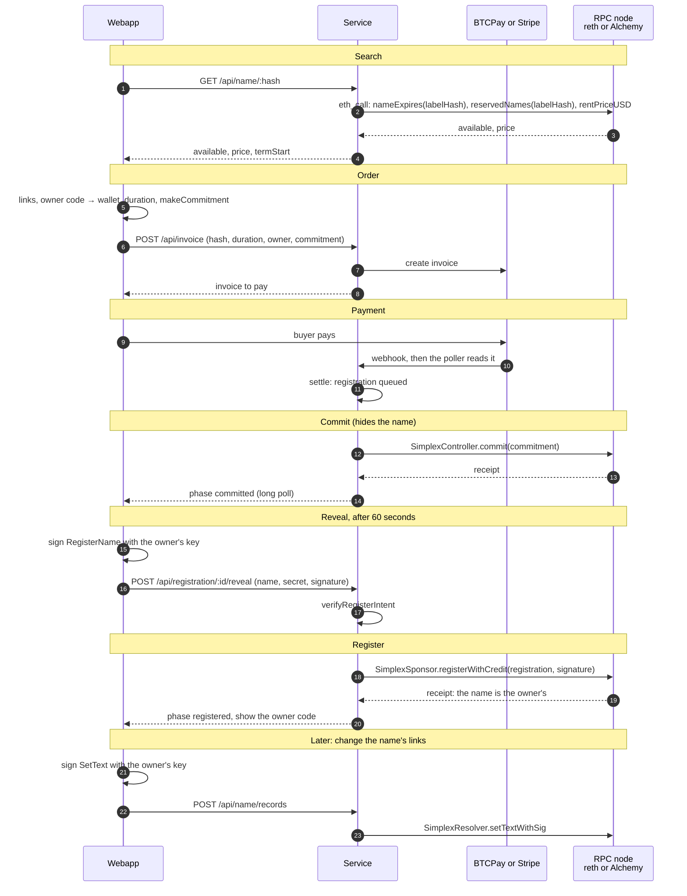

- The service pays the gas for every transaction from its own key, the registrar key.
- The sponsor's allowance pays the name's price. So the buyer's wallet never needs ether.
- The owner code is the only key to the name.
- Moving the name into the SimpleX app later uses `approveWithSig` and `claimWithSig` (section 12).

Function names:
- **†** exists on `origin/ab/names-registration-primitives-sponsored` (Alain's primitives) or its simplexmq branch;
- **‡** exists in this repo today;
- unmarked names are proposed here.

Participants, the same in every diagram:
- **Webapp**: the names webapp in the browser (`wallet.ts`, `names.ts`, the library's `api.ts` and `store.ts`).
- **Service**: StoreService. This is its web API, its registration worker with the one transaction sender, and its database.
- **BTCPay or Stripe**: the payment provider.
- **RPC node**: reth (with nimbus) or a hosted provider such as Alchemy, and the PR #35 contracts behind it (`SimplexController`, `SimplexSponsor`, `SimplexResolver`, the base registrar, the registry). The service reads every name and sends every transaction through it. The SMP relays and the app read the chain from their own nodes too; there is no resolver service (owner, 2026-10-21).
- **SimpleX app**: the app. It redeems names. The web flow opened from the app is dropped (owner, 2026-10-21): the app will buy names itself (#7530 §13.6).

Each section shows the calls first. The bullets under it hold the exact rules.

## Contents

0. The whole flow at a glance (above)
1. Search
2. Checkout, owner code and order
3. Payment and settlement
4. Commit
5. Reveal: the owner signs the registration
6. Register and confirm
7. A prepaid code
8. Taken: another name, or a prepaid code
9. Failed, retried, lapsed
10. A name code on Check your code
11. Links: preview before the order, edit later
12. Redeem in the app
13. Gaps found

## 1. Search

The buyer types a name, and the page sends only its hash and length. The service answers whether the name is available, and at what price.

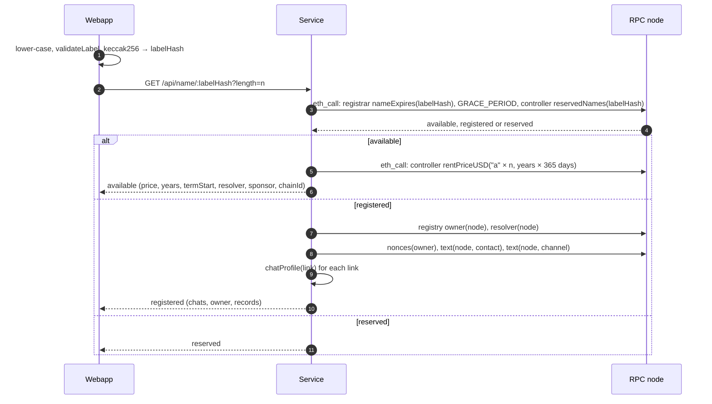

- **The page's check:** the page folds the name to lower case first. Then `validateLabel` in `names.ts` checks it, mirroring simplexmq's `nameLabelP`, which the service reaches by parsing the label as `SimplexDomain`.
- **Checks first:** the service checks the search rate limit, then the length. The length must be 6–63, else the answer is `invalid_name`.
- **The price:** the chain's, `rentPriceUSD(…).base / 10^16` in cents for the paid `years`. The placeholder label of the same length works because the oracle prices by length only, and keeps the label from the RPC node. Launch list: $100 for 8+ letters, $200 for 7, $400 for 6, for 2 years.
- **Hash formats:** `:labelHash` is `0x` + 64 lowercase hex.
- **The status:** `registered` while `nameExpires + GRACE_PERIOD` is not past the latest block; else `reserved` when `reservedNames(labelHash)` is set; else `available`.
- **Being registered here:** the chain still says available while our own registration (`registrationByHash(labelHash)`) is `registering`, its register sent but not mined.
  - Then the answer is `registered{entities: [], tld}`, with no owner.
  - The worker sets `registered` only `confirmations` blocks after the receipt, so from then on the chain reads show the name.
- **The answers:**
  - `available{price, currency, years, termStart, resolver, sponsor, chainId, tld}`;
  - `registered{entities, records, owner, resolver, recordsNonce, expiresAt, chainId, tld}`.
- **Owner and records:**
  - `node = keccak256(namehash(tld) ‖ labelHash)`, and the registry is `baseRegistrar.ens()`.
  - `owner` and `resolver` are the registry's `owner(node)` and `resolver(node)`.
  - `records` and `recordsNonce` are read on the default resolver contract.
  - They are read only when `resolver(node)` is the default resolver contract. Otherwise they are null.
- **The chats:** for each short link of its key's kind in the `simplex.contact` and `simplex.channel` records, split on ";", `chatProfile` uses `APIConnectPlan` ‡. Each chat has its `kind` (contact, business, bot or channel), display name, full name, picture if any, a channel's subscriber count, the link and its deep link. A fetch has a 3 s timeout, at most 4 run at once, and a 10-minute cache; a failed one gives the chat with no profile.
- **Failures:** a failed chain read answers `provider_unavailable`: the RPC node does not answer, or answers an error.

## 2. Checkout, owner code and order

The buyer chooses the links, saves the name code, then checks the order and pays. The page makes the owner code, the owner wallet and the commitment in the browser. The order carries the name's hash, the duration, the commitment and the sealed copy, not the name itself.

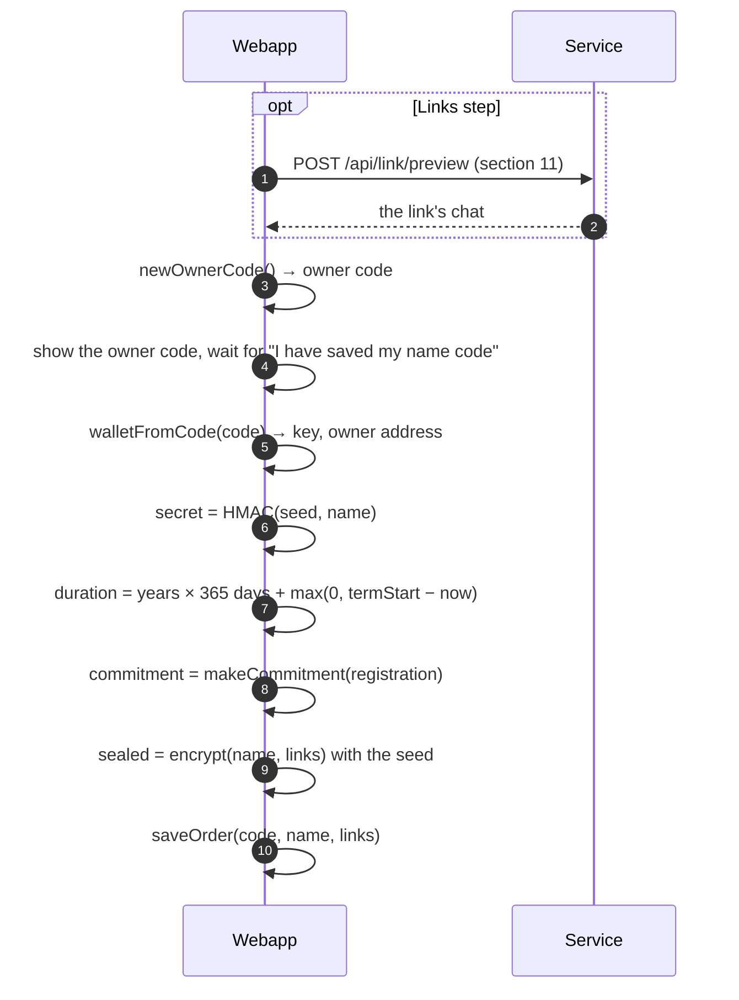

Then the order itself:

```mermaid
sequenceDiagram
  autonumber
  participant W as Webapp
  participant S as Service
  participant E as RPC node
  participant P as BTCPay or Stripe
  W->>W: sign "simplex.domains order …" with the owner key
  W->>S: POST /api/invoice (labelHash, length, duration, price, method, owner, commitment, sealed, timestamp, signature)
  S->>S: validate, check the signature, existing orders for the name, the duration (one at a time per label hash)
  S->>E: is the name still free? nameExpires, reservedNames; rentPriceUSD
  E-->>S: available, price
  S->>S: chain price = price?
  S->>P: create invoice
  P-->>S: invoice
  S->>S: save registration (unpaid) and invoice
  S-->>W: invoice and registration (unpaid)
  W->>W: saveOrder(orderId = invoiceId, registrationId)
```

- **Before paying:** if this browser has an open order whose card payment awaits confirmation, Pay is off (N3e). Check your order, the page before payment, shows the links read-only, the term, "Free until 1 January 2027" and the end date (`max(termStart, now) + years × 365 days`: 31 December 2028 for 2 years ordered before 2027), and the dApp line for Ethereum buyers (ep, 2026-10-21 08:43, recorded in the owner decisions).
- **Page-side functions:**
  - `newOwnerCode` works as `randomNameCode` †. It takes 128 bits of entropy. The code is `SN-` + the entropy + 22 bits of SHA-256.
  - `walletFromCode` works as the test mock †. It makes a BIP-39 seed from the entropy, the key at `m/44'/60'/0'/0/0`, and its address, as the app derives them. The BIP-39 phrase is an internal step and is never shown.
- **Registration fields:**
  - `secret = HMAC-SHA256(seed, "simplex.domains commitment " + label)`.
  - One short link per key, within 4096 bytes.
  - `registration = {label, owner, duration (years × 365 days + max(0, termStart − now)), secret, resolver, data = recordCalls(registration) †}`.
  - `makeCommitment` is †.
- **Sealing:** `sealed = AES-256-GCM(HMAC-SHA256(seed, "simplex.domains sealed"), {label, contact, channel})`.
- **The service's checks, in order:**
  1. the create rate limit;
  2. the owner address, the length (`invalid_name`), `sealed` present and within its bound (`bad_request`);
  3. the order signature, EIP-191 over `simplex.domains order <labelHash> <length> <duration> <commitment> <sha256(sealed)> <timestamp>`, recovering the owner (`bad_request`);
  4. existing orders for the name (below);
  5. the timestamp within 600 s, and the duration within an hour of `years × 365 days + max(0, termStart − now)`, else `bad_request`;
  6. the chain: registered or reserved is `name_taken`. A failed chain read is `name_check_unavailable`, and nothing is created;
  7. being registered here: our own registration `registering` is `name_taken`;
  8. the chain's price must equal the price, else `catalog_changed{price}`.
- **Existing orders for the name** (a live order of the same commitment, or of the same owner and label hash; manager's ruling, 2026-10-21):
  - An exact resend, every field equal to the stored order including `sealed`, the method and the price, is answered with that order, in any phase and however late.
  - A live order of the same wallet and name whose invoice has passed its expiry time is closed inside the new order's transaction (invoice `expired`, `live` cleared, the provider's cancel after, best effort); the new order then goes on.
  - Anything else gets `409 order_exists`, which names nothing. The page then runs the signed `find` (section 10) and opens its order. A commitment is public on chain once committed, so it alone proves nothing.
  - Orders, `/name`, `/code` and `/retry` run one at a time per label hash; unique constraints back it.
- **Storage:** the service inserts `name_registrations` (phase `unpaid`), `name_invoices` and `invoices` ‡.

## 3. Payment and settlement

The buyer pays the provider. The service then reads the invoice itself and settles it, which queues the registration.

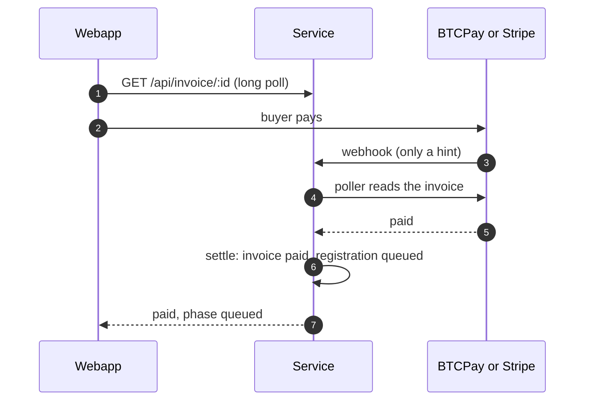

- **Webhooks:** they arrive at `POST badges.simplex.chat/webhooks/{btcpay,stripe}` ‡.
  - A webhook only triggers a read (`queueReadHint` ‡).
  - The poller carries the authority, as for badges today.
- **Name invoices in today's code:** `getInvoiceByProviderRef` ‡, the poller's scans, its expiry update and `GET /api/invoice/:id` all gain a name side.
- **Settlement** is one database transaction:
  - the invoice becomes paid;
  - the registration goes `unpaid` → `queued`, only while it is still live. A payment for an order that was closed (cancelled, expired, or closed by a newer order of the same wallet and name) is a late payment.
  - Both changes are published to the long poll after the commit.
- **Late payment:** an invoice paid after it expired or was canceled leaves the registration `unpaid`. The operator is alerted to refund it (gap 26).
- **The long poll** carries `wait` and `seenVersion`, so it also wakes on every change of the registration (its `version`).

**Get a new invoice.** The old invoice may still be open when the card form does not load, or the payment details are unavailable. The page then cancels it before ordering again:

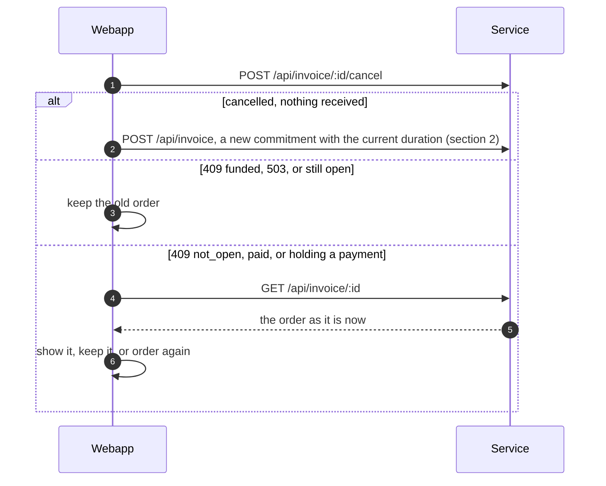

- **The cancel** uses the create rate limit.
- **A `200` that is still `open`:** the page shows `CANCEL_STILL_OPEN`.
- **After the re-read:**
  - paid, with the registration past `unpaid`: show the order;
  - paid, with the registration still `unpaid` (paid after it closed): order again;
  - otherwise holding a payment: keep the order;
  - expired with nothing received: order again.
- **The new order** keeps the wallet and the links, and builds a new commitment, since the free days until 1 January 2027 shrink each day. The service finds the old order by owner and label hash.

## 4. Commit

The service puts the commitment on chain. This reserves the name without showing it, so nobody can see the name and register it first.

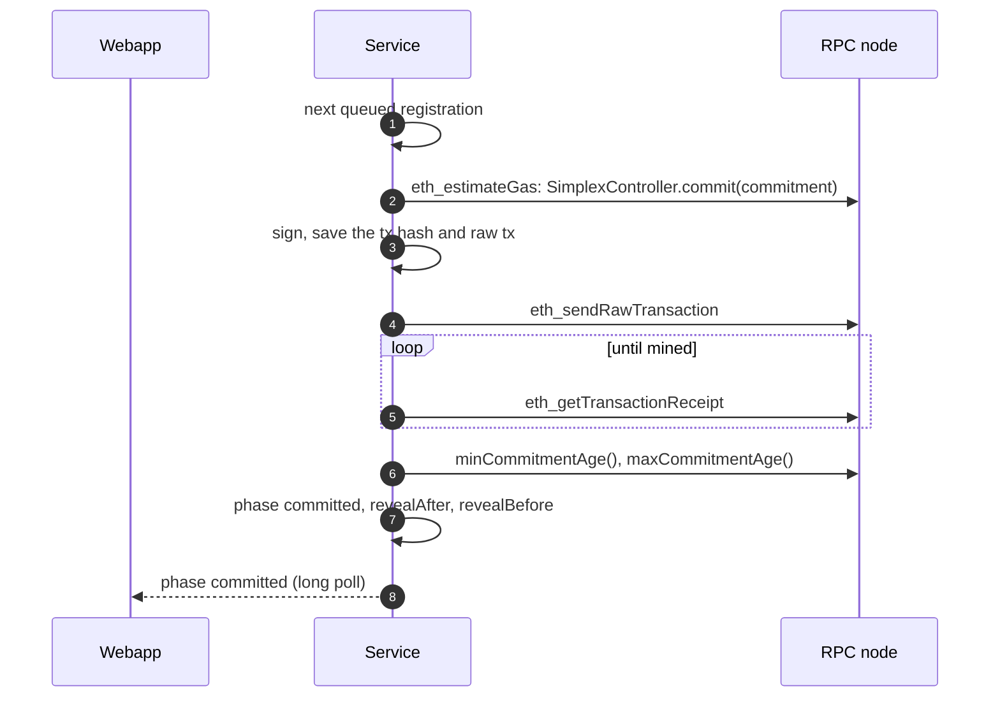

- **One sender:** the worker and the records relay share one sender for the registrar key.
  - The sender assigns the transaction nonce.
  - It saves each hash and raw transaction before sending.
  - `sendCommit` † is split so it signs first.
- **Stored hash:** the commit's hash is `commit_tx`. The view shows it as `commitTx`.
- **The ages** are read with `SimplexController.minCommitmentAge()` and `maxCommitmentAge()`.
- **Reveal window:**
  - `reveal_after` is the commit's block time + `minCommitmentAge`.
  - `reveal_before` is the block time + `maxCommitmentAge`.
- **A commit that reverts**, in its dry run or mined with status 0:
  - **The commitment is already live:** `commitments()` + `maxCommitmentAge` is still ahead. This is `UnexpiredCommitmentExists`. The registration becomes committed, with the times from `commitments()`.
  - **No live commitment** (out of gas, or it lapsed by the read): the commit is sent again. When the read falls exactly at the lapse second, the worker waits a second first.
  - **The commitment had lapsed:** before committing again, the service clears `label`, `secret`, `records`, `intent_*`, `error`, the tx hashes and blocks, and `reveal_after`/`reveal_before`. The page then signs again.

## 5. Reveal: the owner signs the registration

Once `revealAfter` has passed, the page reveals the name and signs the intent. The intent lets the service register the name for the owner.

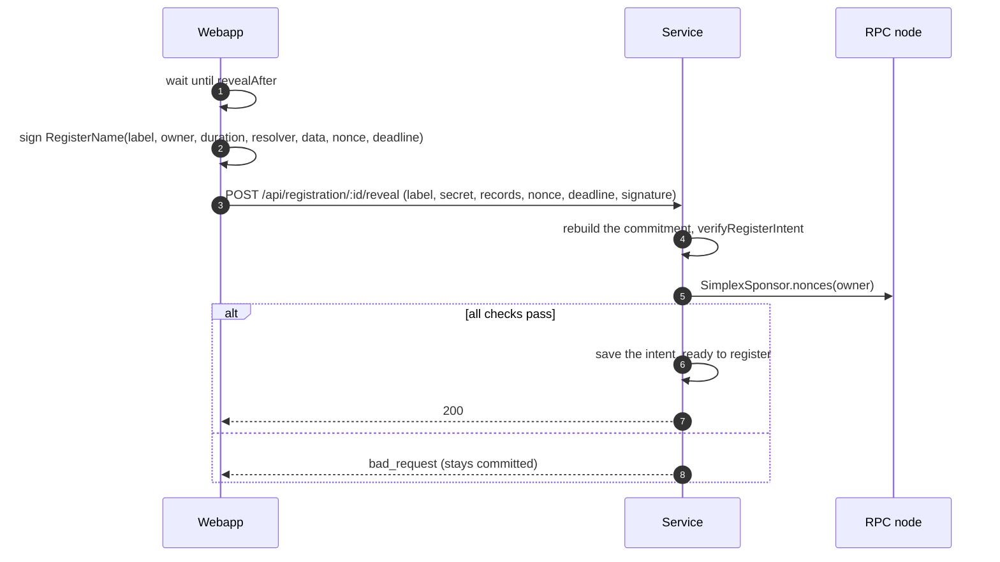

- **The signature:**
  - `nonce` is the view's `intentNonce` (0 for a new code).
  - `deadline` is `revealBefore`.
  - The digest uses `sponsorDomain(chainId, sponsor)` †. The page signs it with `@noble/secp256k1`.
- **The service's checks:**
  - **Rate limit:** the read limit. Every request counts, whatever its outcome.
  - **Phase:** the registration must be `committed`, with `label` null.
    - Once `label` is set, an identical repeat answers 200 in any phase.
    - A different body is `bad_request`.
  - **The name:**
    - `validLabel` (simplexmq's `SimplexDomain` parser, lower case, 6–63);
    - `keccak256(label)` = `labelHash`, and the length matches;
    - the price is the registration's `price`, fixed at the order, or the prepaid code covers the length.
  - **Links and resolver contract:** at most one link per key; the resolver contract is the default one. The links' kind and bound are checked last (below).
  - **The commitment:** `data = recordCalls(registration)` †, the registration's stored `duration`, and `makeCommitment(registration)` † must equal the stored commitment. The intent signs that duration (PR #36).
  - **The intent:**
    - `verifyRegisterIntent` † checks the 32-byte secret, the deadline, and that the signer is the owner;
    - the service then checks for low s itself, because the sponsor's `SignatureChecker` rejects high s;
    - the nonce must equal `SimplexSponsor.nonces(owner)`.
  - **The links, last:** each is a SimpleX short link of its kind within 4096 bytes, else `invalid_link`.
  - **A failed chain read** answers `provider_unavailable`.
  - **Links refused** (`invalid_link`) cannot be revealed again, since they are in the commitment. The service records the refusal, the one write a failed reveal makes, and only after the commitment and intent checks passed, so the refused links are the committed ones and the owner signed them. Recording it bumps `version` and wakes the polls. The page offers `/name` with the same name and corrected links (section 8), allowed only after such a refusal.
  - **Serialization:** the reveal runs one at a time per label hash with orders, `/name` and `/retry`, and writes by compare-and-set on the `version` it read. A write that loses the race, here or on any endpoint, changes nothing and answers `409 registration_changed` with the current view.

## 6. Register and confirm

The service sends the register, which gives the name to the owner. It shows the name as registered only after the receipt and 3 more blocks.

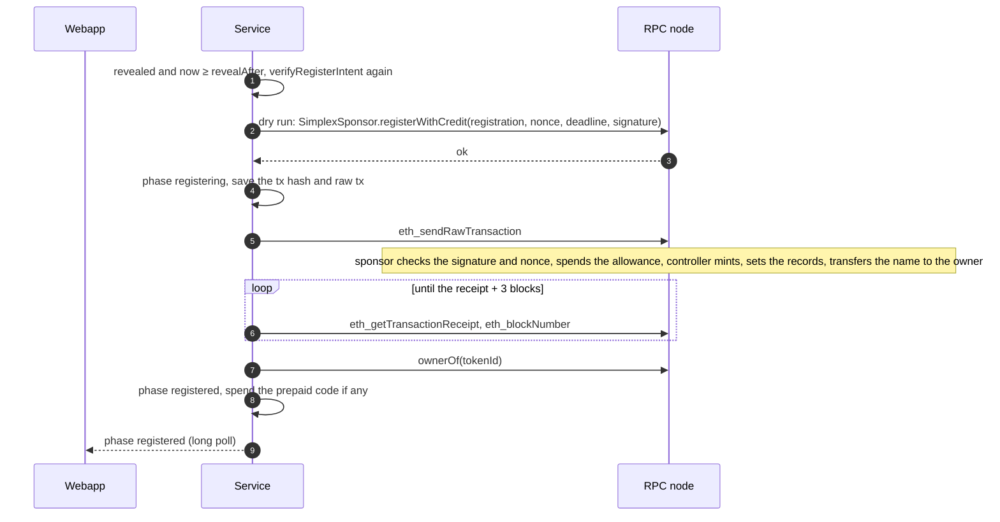

When the dry run or the mined transaction reverts:

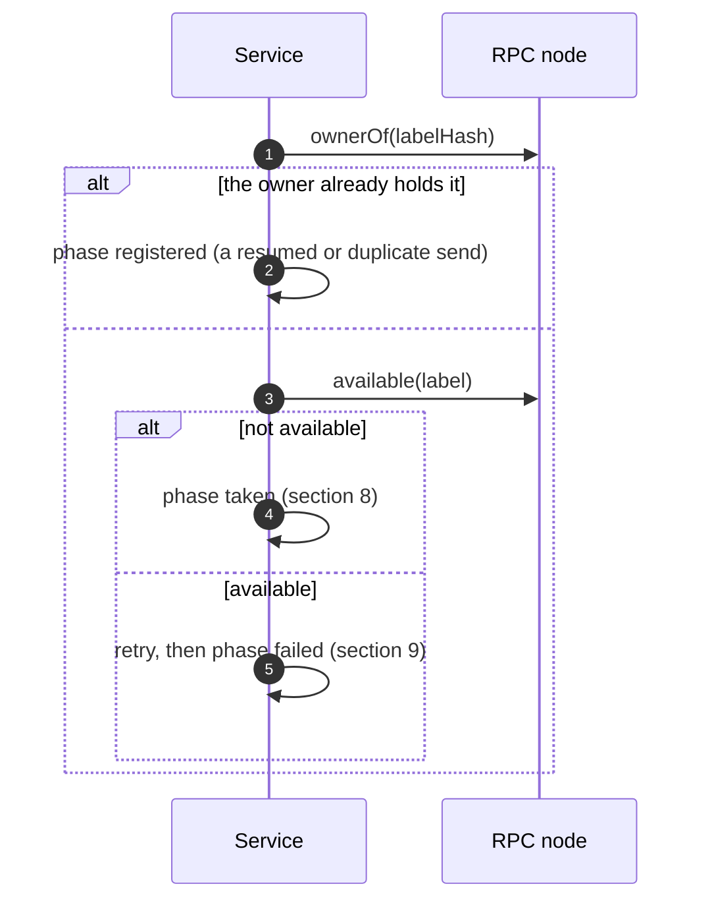

- **Inside the register:**
  1. `SimplexSponsor` checks the signature and nonce, and spends the allowance.
  2. It then calls `SimplexController.registerSponsored`.
  3. The controller mints the name to itself, applies the records with `multicallWithNodeCheck`, and transfers the name to the owner.
- **The dry run** is the first step of `sendRegister` †.
- **Past the deadline:** `verifyRegisterIntent` fails, because the commitment has lapsed too.
  - The registration goes to `failed`.
  - Retry commits again, or reuses a live re-commit (section 9).
- **Reading reverts:**
  - The dry run decodes `NameNotAvailable` or `NameReserved` as taken.
  - Any other revert while `available(label)` is false is taken too.
- **Revert order:** the sponsor checks the intent and the allowance before the name's availability. So a taken name can revert with one of those first.
- **On taken:** a prepaid code is released.
- **On registered:** `registered_at` and `expires_at` are recorded.

## 7. A prepaid code

The buyer pays with a prepaid code instead of money. Codes are entered only on Check your code, in the top bar (owner, 2026-10-21). The page checks the code there, keeps it, and registers without an invoice from Check your order.

```mermaid
sequenceDiagram
  autonumber
  participant W as Webapp
  participant S as Service
  W->>W: Check your code: parseNameCode(text) → prepaid code
  W->>S: POST /api/code/check (code)
  S-->>W: minLength, years, state
  W->>W: keep the code in Your names; covered names show $0 and the code's years
  W->>W: Links, name code and commitment as section 2, duration = code years × 365 days + max(0, termStart − now)
```

Then the registration, from Check your order's "Register with your code":

```mermaid
sequenceDiagram
  autonumber
  participant W as Webapp
  participant S as Service
  participant E as RPC node
  W->>S: POST /api/name/register (labelHash, length, duration, owner, commitment, sealed, code, timestamp, signature)
  S->>S: validate, check the signature; an exact resend? answer it
  S->>S: other live orders for the name? order_exists; check the duration
  S->>E: is the name still free? nameExpires, reservedNames
  E-->>S: available
  S->>S: code usable and covers the length? reserve it (one at a time per code)
  S->>S: registration queued
  S-->>W: registrationId
  Note over W,S: then sections 4 to 6, on ?registration=id
```

- **Parsing:** `parseNameCode` returns `NCPrepaid` or `NCOwner`. The sum type is proposed. The page catches a typo in the check character before any request.
- **A name code entered on Check your code** is not sent to the code check: section 10.
- **The code check:**
  - `POST /api/code/check` looks the code up in `name_prepaid_codes` by `namePrepaidCodeHash`.
  - It answers `minLength`, `years` and `state`: `unused`, `reserved`, `used`, `revoked`, `expired` or `unpaid`.
  - The code covers a name when its length ≥ `min_length`.
  - An unknown code answers `400 code_invalid`.
- **Rate limits:** `/api/name/register` uses the code-check rate limit.
- **The service's checks, in order:**
  1. **Validation:** the owner, `sealed` within its bound (`bad_request`), and the length (`invalid_name`); the code parses and is known (`code_invalid`); the order signature recovers the owner (`bad_request`).
  2. **Existing orders:** an exact resend (every field, the code included) answers its `registrationId`, in any phase, so a lost response is safe. Anything else meeting a live order for the name is `order_exists`.
  3. **The timestamp and the duration**, for the code's years, within their windows (`bad_request`).
  5. **The chain:** registered or reserved is `name_taken`. A failed chain read is `name_check_unavailable`.
  6. **Being registered here:** our own registration `registering` is `name_taken`.
  7. **The code:** its state, then its cover. Reserving is one conditional update in the transaction that creates the registration, one at a time per code.
- **Code errors:** `code_invalid`, `code_used`, `code_reserved`, `code_expired`, `payment_pending` or `code_not_covering`. They show on the page that sent the order, and the name shows its price again.

## 8. Taken: another name, or a prepaid code

The name went to someone else before the register. A paid order can then switch to another name, or take a prepaid code instead.

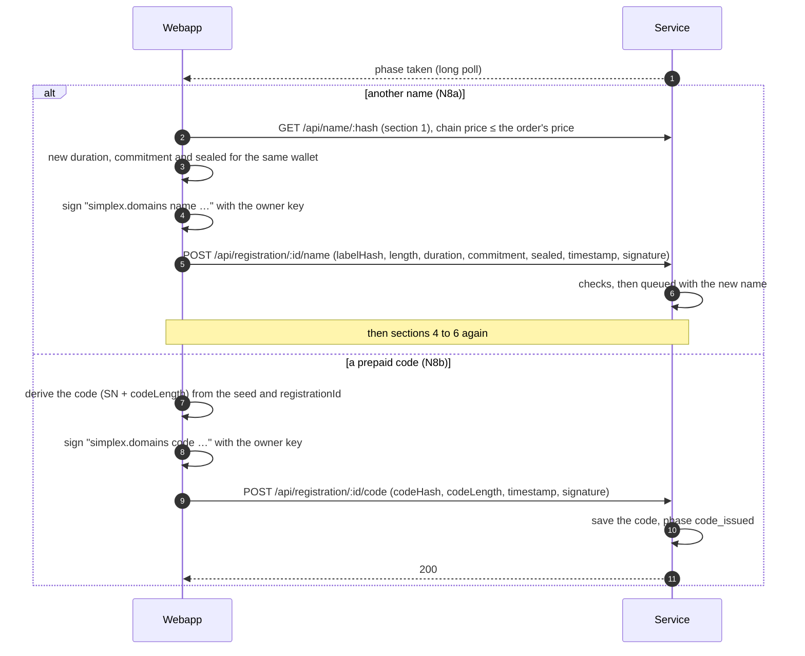

- **Another name (`/name`):** it uses the create rate limit.
  - **Checks, in order:**
    1. the owner's signature and timestamp;
    2. a paid registration in `taken`, or any registration in `failed`, or one in `committed` whose reveal was refused for its links (to correct them; the same name is allowed); never a healthy `committed`. At most 3 successful moves per order; after the last, `409 move_limit` answers the order's state, shown with a support line and the reference; a body equal to the current fields answers the view unchanged. Both label hashes' turns are taken in hash order;
    3. the order's checks: `sealed` within its bound, `invalid_name`, other live orders for the new commitment or this owner and the new hash (`order_exists`), the duration, and `name_taken`. A failed chain read is `name_check_unavailable`, and nothing changes;
    4. a paid order: the new name's chain price must be ≤ the order's `price`, else `409 price_too_high` with that price. A cheaper name refunds nothing, which the page says first. A code order: the code is checked and reserved again under its per-code turn (`code_used` when spent elsewhere after the sweep released it, `code_reserved`, `code_invalid`, `code_expired`) and must cover the new name (`code_not_covering`).
  - **The signed message** includes the duration: `simplex.domains name <registrationId> <labelHash> <length> <duration> <commitment> <sha256(sealed)> <timestamp>`.
  - **On success:**
    - `price` becomes the new name's price, which caps a further move.
    - The registration goes to `queued` with the new hash, length, duration, commitment and `sealed`.
    - `label`, `secret`, `records`, `intent_*`, the tx hashes and blocks, `reveal_after`, `reveal_before` and `error` are cleared.
- **A prepaid code instead (`/code`):** it uses the create rate limit, then checks the owner's signature and timestamp.
  - **The code:** `SN<codeLength>` + a payload from `HMAC-SHA256(seed, "simplex.domains taken code " + registrationId)`. `codeLength` is the shortest length `L` from 6 such that every length from `L` to 63 costs at most the order's price, from the oracle's whole list: the code pays for any name no dearer than the order. The view carries it in `taken` and still in `code_issued`, so the name code recovers the code on any browser. The page keeps it under Your names.
  - **The length moved** since the view was read (a price change): `409 code_length_changed` with the current value, and nothing is issued; the page derives the code again. So the issued row's length always equals the code's text.
  - **No length qualifies** (the prices rose above the order's): `409 code_unavailable`; the view's `codeLength` is null, and the page offers only another name. A failed read is `503 provider_unavailable`.
  - **A repeat:** if `issued_code_id` already has this hash, the answer is 200 again, whatever `codeLength` it carries; this is checked before the length.
  - **Otherwise:** only a paid registration in `taken` qualifies. The service then:
    - inserts the code (`codeLength`, the order's years, paid, no expiry);
    - sets `issued_code_id`;
    - moves the phase to `code_issued`.
  - **Collisions:** a hash that another code already has is `code_conflict`. For a derived code this is unreachable in practice.
- **A prepaid-code order that is taken** ends there. The worker released its code at `taken`.

## 9. Failed, retried, lapsed

A registration that cannot finish goes to `failed`. Retry checks whether it registered after all, then queues it again at no charge. The worker then decides whether the old commitment can be reused.

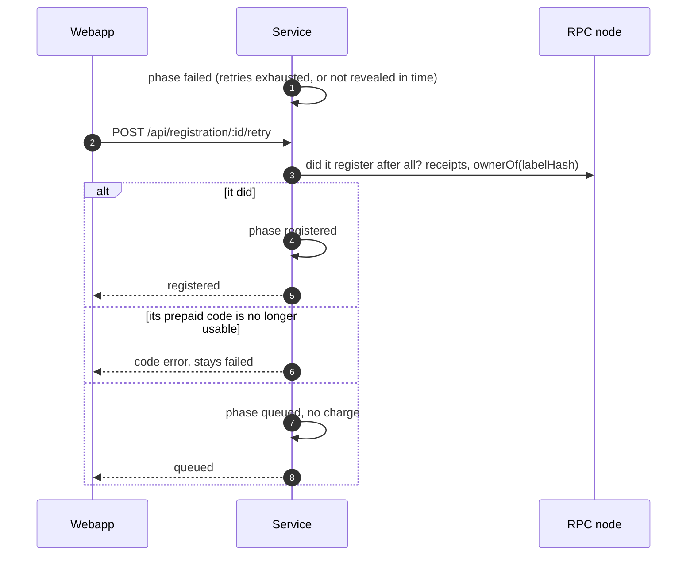

From `queued`, the worker reads the commitment to decide whether to commit again:

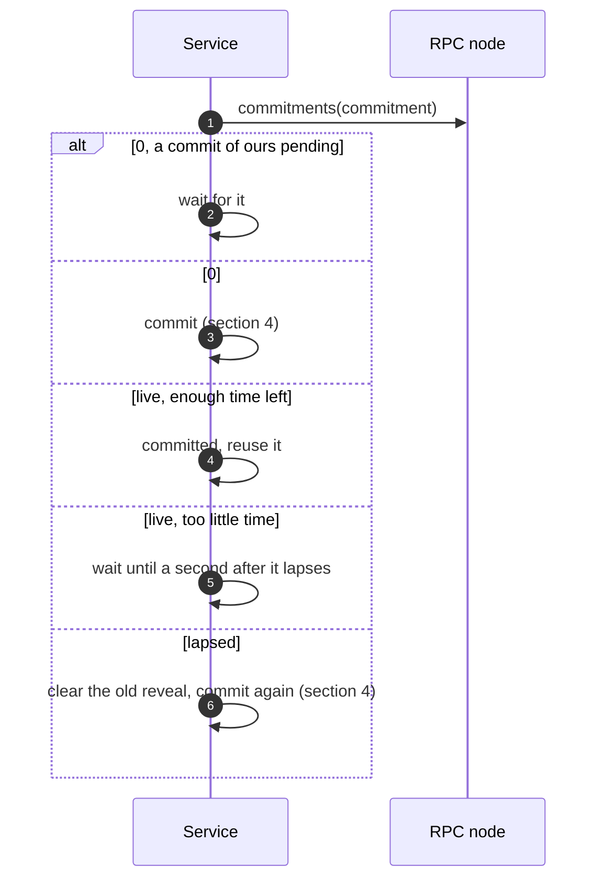

- **Retry rules:** it uses the create rate limit. It works only from `failed`, else `bad_request`.
- **Step 1, did it register after all:**
  - The answer is yes when a `register_tx` of this registration (any hash) mined with status 1.
  - It is also yes when `ownerOf(labelHash)` is the owner. A reverting `ownerOf` counts as no.
  - If yes, it is a lost confirmation. `registered_at` and `expires_at` are recorded, and the prepaid code is spent. If the code was released to another registration meanwhile, the operator is alerted.
  - A failed chain read answers `provider_unavailable` and changes nothing. A null receipt counts as not mined.
- **The released code is no longer usable:**
  - The service answers `code_used`, `code_invalid`, `code_expired` or `code_reserved`.
  - The registration stays `failed`, with `failed_at` unchanged.
  - N9 shows the outcome.
- **Requeue:**
  - **Code:** a released code is reserved again.
  - **Always cleared:** `failed_at`, `error`, and the register's tx hashes and blocks.
  - **Cleared when the sponsor nonce has moved** (`intent_nonce` ≠ `SimplexSponsor.nonces(owner)`): `label`, `secret`, `records` and `intent_*`.
- **The commitment read:**
  - **0** means never committed, not mined yet, or consumed. Step 1 already ruled out a registration this owner holds.
  - **`revealBefore`** is `commitments(commitment)` + `maxCommitmentAge`, because `reveal_before` may be null.
  - **Live, with at least `revealMargin` left:** the commitment is reused. The registration goes to `committed`, with the times from `commitments()`.
    - If the commitment's time is not the block time of a commit of ours mined with status 1, a third party committed it again.
    - Then `label`, `secret`, `records`, `intent_*` and the commit's tx hashes are cleared, so the page signs again.
  - **At `revealBefore` itself:** the worker waits a second.
  - **After `revealBefore`:** the worker first clears `label`, `secret`, `records`, `intent_*`, `error`, the tx hashes and blocks, `reveal_after` and `reveal_before`. Then it commits again.
- **Failure causes:** `InsufficientAllowance` also alerts the operator.

## 10. A name code on Check your code

In another browser, or after losing the order link, the owner code alone finds and reopens the order. Check your code takes it (owner, 2026-10-21); there is no separate Restore screen.

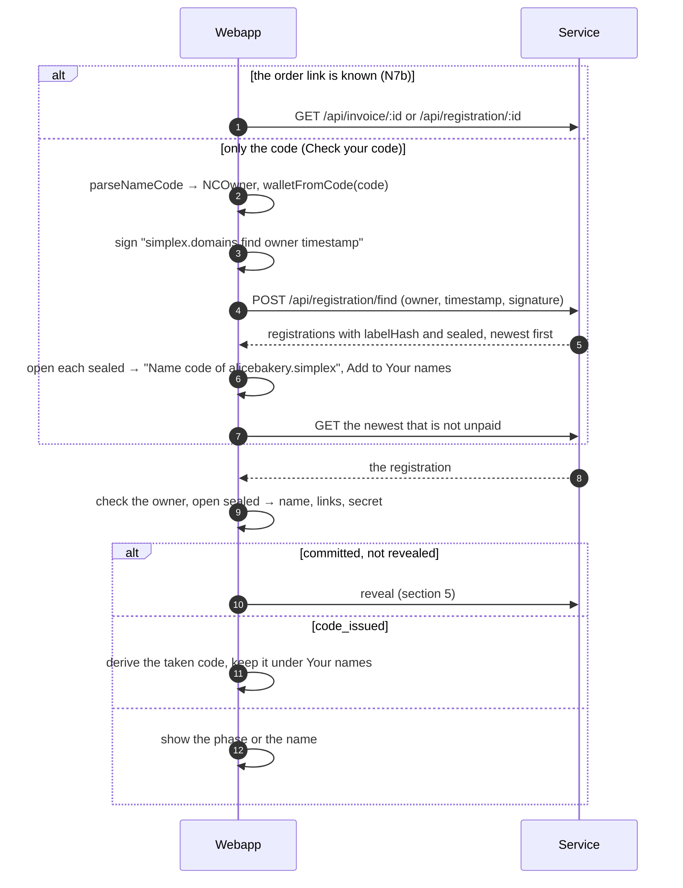

- **The `find` signature:** EIP-191 (`personal_sign`) over `simplex.domains find <owner> <timestamp>`.
  - `owner` is lowercase `0x` hex.
  - `timestamp` is in Unix seconds.
- **`find` checks:** its own rate limit. The signer must be `owner`, and the timestamp must be within 10 minutes.
- **`find` answers:**
  - `{registrations: [{registrationId, invoiceId or null, phase, createdAt, labelHash, sealed}]}`, including retargeted ones, the 50 newest. `labelHash` and `sealed` let the page name every order in one request. Orders are signed by their owner, so only the code's own orders are listed;
  - `404 not_found` when there are none: "No order was found for this code".
- **After `409 order_exists`** the page runs `find` the same way to open the order it already has.
- **Opening a registration:** with the read limit, the page opens:
  - `GET /api/invoice/:invoiceId` when it is set (the order page, with what was paid);
  - else `GET /api/registration/:id`.
- **Checking the code:** the page rebuilds the commitment from `sealed`, the seed and the view's `duration`. It must equal the registration's commitment, else "This code does not open the order".

## 11. Links: preview before the order, edit later

After registration, the owner changes links by signing each edit, and the service relays it and pays the gas.

On the Links step, before the name code, a link is previewed before it goes into the registration. One field takes a contact address or a channel link; its kind is detected, and a second field takes the other kind:

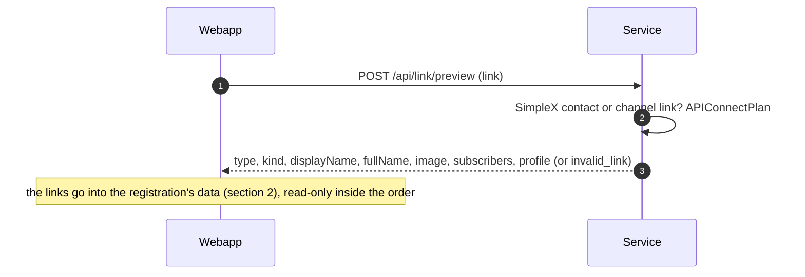

Later, editing a registered name's links:


When an edit reverts, or a restart finds it unresolved:

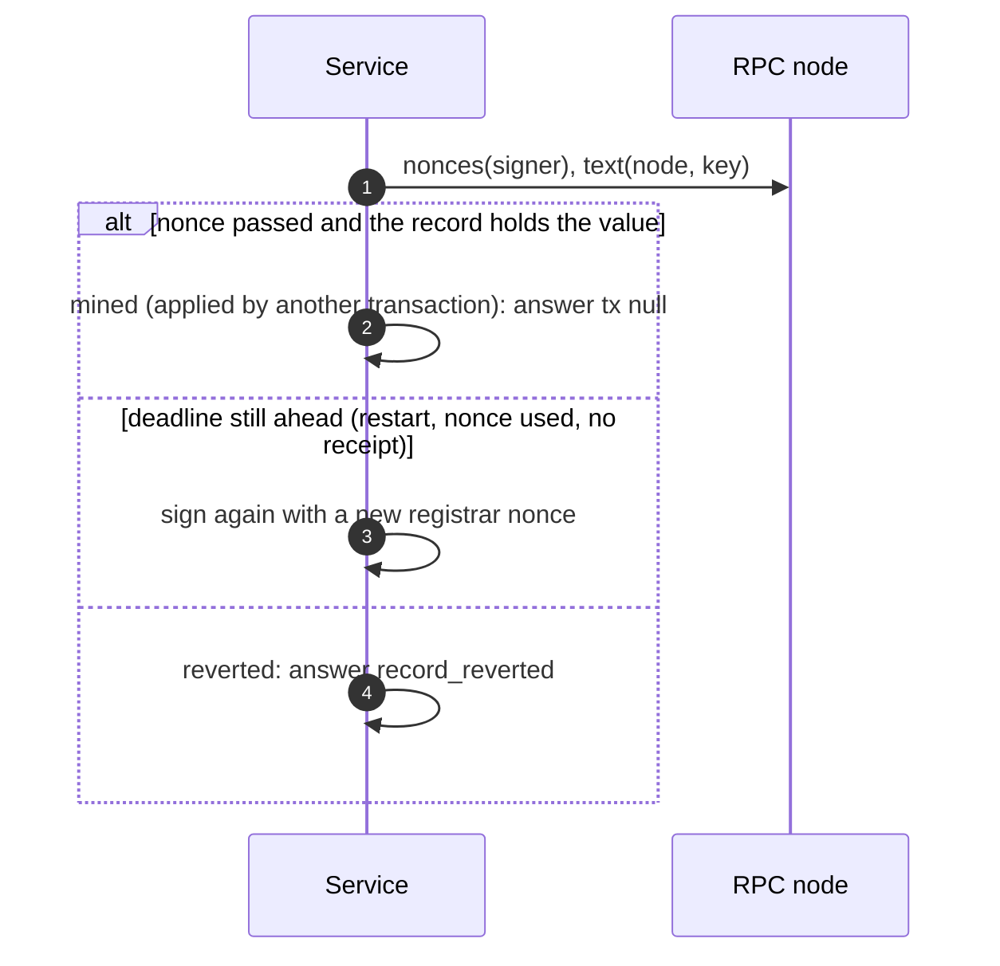

- **Preview:** its own rate limit. The link must be one SimpleX short link of a contact address (`/a#`) or a channel (`/c#`), within 4096 bytes. The hosts are the link's servers (the authority of an `https://` link, or the server hosts inside a `simplex:/` link). A public IP literal passes, since SimpleX servers may be addressed by IP. Every host of the link is checked before the chat core fetches: an IP literal as it is, a name by resolving it; a private, loopback, link-local, unique-local, CGNAT, unspecified or multicast address, a `.onion` host or an unresolvable name means no fetch. A link with several hosts is fetched only if all pass. A link not fetched stays valid: its profile is `unavailable`. The check is best effort, since the chat core resolves again when it connects (DNS rebinding remains possible); an egress rule in the deployment denies the service's traffic to private ranges.
- **How records are stored:**
  - A key holds one short link (gap 35).
  - A record set elsewhere may hold several joined with ";"; readers split on it, and an edit replaces the whole value.
  - Removing a key's link sets it to "".
- **Clearing all records:** the page signs `ClearRecords` instead, and the service relays `clearRecordsWithSig`.
- **When the page offers Edit links:**
  - **Hidden** when the search answer has an owner other than the code's address (the name was redeemed).
  - **Hidden** when the answer has an owner with null records (another resolver contract, or none).
  - **The current values** come from the answer's records.
- **The page's nonce:**
  - **Start:** `recordsNonce` from the search answer.
  - **Next nonce:** +1 after each `{tx}`. The same after `record_reverted`.
  - **Recovery:** re-read it after any `bad_request`.
  - **Deadline:** now + 1 hour.
- **The service's checks, in order:**
  1. **Rate limit:** its own, for every request.
  2. **The record:** the key is `simplex.contact` or `simplex.channel`. The value is one short link of that kind within 4096 bytes, or "", else `invalid_link`.
  3. **The signature:** recover the signer (`recoverAddress` †) and require low s. Otherwise `bad_request`.
  4. **A repeat of a sent edit:** found by signer and nonce, and matched by `body_hash`. This runs before any deadline check. Only sent edits are stored; a refused request leaves nothing, so its repeat is checked anew.
     - An identical repeat waits for the same tx. It answers the tx once mined (tx null when found applied), or answers `record_reverted` again.
     - A different body with a nonce whose edit is pending or mined is `bad_request`.
     - After `record_reverted`, the nonce is free again for a new body.
  5. **For a new edit only:** the deadline must be ahead of the latest block; the signer must be `ENSRegistry.owner(node)`; the nonce must equal `SimplexResolver.nonces(signer)`. Else `bad_request`. A failed read is `provider_unavailable`, and nothing is stored.
  6. **The per-name cap**, after those checks: 10 relayed edits an hour, else `rate_limited`. Only sent edits count, so a non-owner cannot use up a name's cap.
  7. **Concurrency:** the pending row (signer, nonce, body hash) is inserted before signing. Of two concurrent identical requests, one loses the unique insert.
  8. **Sending:** through the registrar's one sender. The hash and raw tx are saved before sending.
- **The revert re-read:** the service re-reads the nonce and the record in these cases:
  - after a revert: an applied edit reverts `InvalidNonce`, or `SignatureExpired` once past its deadline;
  - after a restart's expiry.
  - **The revert's name:** a mined revert's receipt has no data. It is named `SignatureExpired` when past the deadline, else null.
  - **Applied** is decided from the edit's own sent hashes first: a status-1 receipt answers that hash. Only without a known receipt: the owner's nonce passed the edit's and the record holds its value means applied (`{tx: null}`); a passed nonce with another value means `record_reverted` with `InvalidNonce`.

## 12. Redeem in the app

The owner moves the name from the owner wallet into the app's wallet, so the app holds it without the owner code.

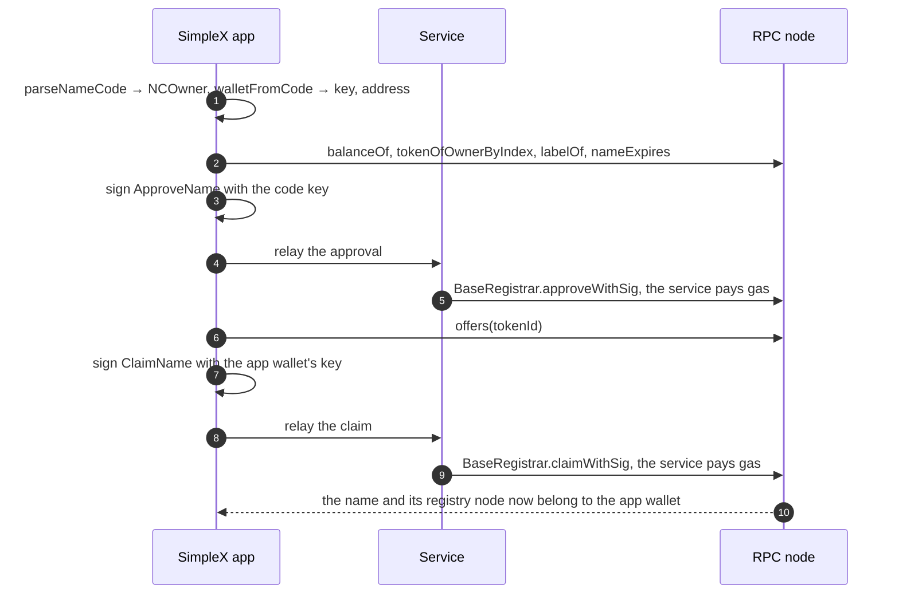

- **`ApproveName`:** from the code address to the app address, with `tokenId`, an empty key, a zero tag, a nonce and a deadline.
- **`ClaimName`:** from, to, `tokenId`, the offer, a nonce and a deadline. The approval increments `offers(tokenId)`.
- **The relay endpoints** are not specified yet (gap 9).
- **Afterwards** the owner code no longer controls the name.

## 13. Gaps found

Each gap says what the problem is, why it matters, and what is decided, or that it is still open. Gaps marked "Resolved" are settled and kept for the record.

1. **The page cannot build the sponsor's EIP-712 domain.**
   - Problem: `sponsorDomain(chainId, sponsor)` † needs the chain id and the `SimplexSponsor` address. The search answer carries only `resolver`.
   - Why it matters: the intent's digest uses that domain (section 5), so the page cannot sign.
   - Decided: the answer is `available{…, years, termStart, resolver, sponsor, chainId, tld}`. The TLD (`[names] tld`) builds the records' node; `termStart` builds the duration.
2. **The intent can expire before it is sent.**
   - Problem: the page signs with a deadline. The register may be sent after it, because of a gas spike, retries or a queue.
   - Why it matters: then `verifyRegisterIntent` fails and the sponsor reverts.
   - Decided: the page signs with `deadline = revealBefore` (the commit's block time + `maxCommitmentAge`).
     - The controller reverts `CommitmentTooOld` from that time. So an expired intent means the commitment it was signed against has lapsed too.
     - A third party may have committed it again since. Section 9 handles that.
     - The registration goes to `failed`. Retry commits again (section 9) before the page signs anew.
3. **The registrar has one nonce for all workers.**
   - Problem: `sendTransaction` † reads the pending nonce for each transaction. It also never replaces a stuck transaction.
   - Why it matters: two registrations sending at once collide.
   - Decided: one sender queue for the registrar key, and replacement with a fee bump after a timeout.
4. **No receipts and no `minCommitmentAge`.**
   - Problem: the branch's client sends and returns a hash. It never reads a receipt or `minCommitmentAge()`.
   - Why it matters: the service cannot know when a transaction mined, or when the reveal may start (section 4).
   - Decided: add `waitReceipt`, `confirmations` and `minCommitmentAge` reads (sections 4 and 6). The branch's section 7 lists the receipt and the `minCommitmentAge` wait.
5. **Telling taken from failed.**
   - Problem: the sponsor calls the controller without catching. So a taken name's revert data, `NameNotAvailable(label)` or `NameReserved(label)`, reaches the caller. The data carries the controller's selector, which is not in the sponsor's ABI.
     - In process, `e2e/StoreE2E.test.ts` sees `NameNotAvailable` in the error text only because Hardhat names errors from every compiled contract. That is not decoding.
     - Over JSON-RPC, `hardhat node` 3.1.4 (the PR's version) answered every revert we sent with `-32603 Internal error` and no data. This explains the loss Alain's plan reports.
     - Hardhat 3.19.0 and anvil return the data.
   - Why it matters: a taken name must go to `taken`, while other reverts lead to retry and `failed` (section 6).
   - Decided: decode the revert data against the sponsor's, controller's and base registrar's errors together, as `e2e/LocalChain.test.ts` does over HTTP on anvil. On any revert:
     1. Read `ownerOf(labelHash)` first. The owner holding it means this registration went through.
     2. Otherwise, a decoded `NameNotAvailable` or `NameReserved` means taken or reserved. So does any other revert while `available(label)` is false.
     - The sponsor checks the intent's signature, nonce and deadline, and spends the allowance, before the controller checks availability. So a taken name can first revert `SignatureExpired`, `InvalidNonce`, `InvalidSignature` or `InsufficientAllowance`.
   - Open: whether reth's or a hosted provider's `error.data` carries the revert data is unchecked.
6. **The commitment fixes the links and the duration at the order.**
   - Problem: links changed after the order need a new commitment before the commit, or an edit after registration.
   - Why it matters: a change after the order no longer matches the commitment the service holds.
   - Decided: links are set on the Links step before paying and are read-only inside an order (owner, 2026-10-20). The duration is fixed in the commitment too, so a new order of the same wallet builds a new commitment with the current free days.
7. **Resolved: the price may change between order and reveal.**
   - Problem: the chain's price (`rentPriceUSD`, owner 2026-10-20) may change after the order, with `setPrices`.
   - Why it matters: the buyer paid the price shown at the order.
   - Decided: the registration's `price` (cents) fixes the price at order time, or at retarget after its check against what was paid. The reveal and the register compare no price. The sponsor spends the chain's price at registration from the allowance, so a rise between order and register is the service's cost.
8. **Resolved: a lapsed commitment can be committed again.**
   - Problem: a retry after a lapse must know when the same commitment can go on chain again.
   - The contract's rules:
     - `SimplexController.commit` reverts `UnexpiredCommitmentExists` while `commitTime + maxCommitmentAge >= now`.
     - Registering reverts `CommitmentTooOld` once `commitTime + maxCommitmentAge <= now`.
     - So at `revealBefore` itself neither works. From the next second, the same commitment commits again.
   - Tested: `e2e/StoreE2E.test.ts` checks both to the second. At one commitment's `revealBefore`, it reverts `CommitmentTooOld` and cannot be committed again. A commitment one second younger registers in that same second. The first commits again a second later.
   - Decided: a retry needs no new secret.
9. **Redeeming in the app has no service API.**
   - Problem: there is no relay endpoint for `approveWithSig` and `claimWithSig`. There is also no way for the app to learn which name an owner code holds.
   - Why it matters: the app cannot redeem a name (section 12).
   - Decided:
     - The app reads the code's names on chain. The registrar is ERC-721 enumerable, with `labelOf` and `nameExpires`.
     - Add relay endpoints for `approveWithSig`, and then `claimWithSig`.
     - The claim signs `offer = offers(tokenId)`, read after the approval.
10. **Resolved: opened from the app.**
    - Problem: an order opened from the app would need the app's wallet to sign the intent, `/name` and `/code`.
    - Decided: the web flow opened from the app is dropped (owner, 2026-10-21). The app will buy names itself (#7530 §13.6). Every web order has an owner code and `sealed`.
11. **Resolved: editing links later.**
    - Problem: the commitment fixes the links at the order (gap 6), so later changes need a signed edit on chain.
    - The contract: PR #35's `SimplexResolver` has:
      - `setTextWithSig` (EIP-712 `SetText`, domain `SimplexResolver`) and `clearRecordsWithSig` (`ClearRecords`);
      - one nonce counter per owner, shared by both;
      - no edit credits;
      - a `SetText` intent covers one record, and a `ClearRecords` intent all of the name's records;
      - `Multicallable`, which would let the relayer send several signed edits in one transaction.
    - Decided:
      - The page needs that nonce and the chain id. So the registered search answer carries them with the resolver.
      - Several edits go one at a time. The service accepts an edit only when its nonce equals `nonces(owner)` on chain, and answers once it is mined. The page signs the next edit after that answer.
      - A higher nonce sent early would revert `InvalidNonce`, because the contract does not queue intents.
      - The service relays one transaction per edit, by its own choice, and bounds the cost itself.
    - Tested: two consecutive edits, relayed in order, are in `e2e/StoreE2E.test.ts`.
12. **Resolved: search during our own registration.**
    - Problem: while our register is sent but not mined, the chain still says available for a name we are registering.
    - Why it matters: search would offer a name that is already ours.
    - Decided: search uses the index on `name_registrations.label_hash` with `phase`, now in both schemas, and answers `registered` for a hash in `registering`. The service reads the chain itself, so it needs no margin after `registered`.
13. **Resolved: the reveal's rate limit.**
    - Problem: the reveal needed a rate limit.
    - Decided: it takes the read limit, and every request counts against it, whatever its outcome.
14. **Resolved: Alain's encoder carries the intent nonce.**
    - Problem: the encoder must match PR #35's register call and intent.
    - Decided: since `965046fe1` ("adapt contract updates"), `Registration.hs` has:
      - `riNonce`;
      - the `registerWithCredit((…),uint256,uint256,bytes)` selector;
      - the `RegisterName(…,uint256 nonce,uint256 deadline)` typehash.
      - These match PR #35 at `0f882c0`. Since `f85d53e91` (simplex-chat PR #7693) the typehash also has `uint256 duration`, matching ens-contracts PR #36 (`23892cc`).
    - Left for the service: check the nonce against `SimplexSponsor.nonces(owner)` at the reveal (section 5).
15. **Contract details the flow must respect.**
    - Problem: PR #35 sets these rules, each exercised by `e2e/StoreE2E.test.ts`:
      - `reverseRecord` must be 0 (`ReverseRecordNotSupported`);
      - records need a non-zero resolver (`ResolverRequiredWhenDataSupplied`);
      - the duration is at least two years (`DurationTooShort`);
      - the sponsored path is not gated by the public sales switch;
      - the registrar's allowance is in attoUSD (`SimplexSponsor`, as `rentPriceUSD` quotes), and the guardian sets it (`setRegistrarAllowance`);
      - `registerWithCredit` spends the name's list price (`rentPriceUSD`, base + premium) from that allowance.
    - Why it matters: a register that breaks one of them reverts.
    - Decided: the flow follows each rule.
16. **Retry must not re-commit a live commitment.**
    - Problem: `commit` reverts `UnexpiredCommitmentExists` until a second after `revealBefore`. This happens, for example, after a `failed` caused by `InsufficientAllowance`.
    - Why it matters: a retry that commits again would revert.
    - Decided: the worker reads `commitments(commitment)` first. When it is live, the worker goes straight to `committed`.
17. **The allowance is the guardian's, not the service's.**
    - Problem: only `controller.beneficiary()` can call `setRegistrarAllowance`. The call replaces the value. The allowance is spent at list price for the whole duration.
    - Why it matters: when it runs out, registers revert `InsufficientAllowance`, and the service cannot fix that itself.
    - Decided: `InsufficientAllowance` must alert the operator. While `available(label)` is true, it is `failed`, never `taken`.
18. **Prepaid codes under 2 years cannot register.**
    - Problem: registering reverts `DurationTooShort` below 730 days.
    - Why it matters: a shorter code could never be used.
    - Decided: `//issue name … years <Y>` refuses fewer than 2.
19. **The store needs a fresh PR #35 deployment, and a deploy script.**
    - Problem: the approve/claim functions (base registrar) and the registry's one EIP-712 signed operation, `setApprovalForAllWithSig` (`SimplexENSRegistry` domain), are in non-upgradeable contracts. So today's `.testing` does not have them.
    - Problem: the PR's own scripts deploy a plain `PublicResolver`, no `SimplexSponsor`, and a premium price oracle.
    - Why it matters: neither today's `.testing` nor the PR's scripts give the store what it needs.
    - Decided: the plan's context lists the wiring: the fixture's contracts, with the deploy scripts' commitment ages and label cap. `e2e/deployLocal.ts` deploys exactly that to a local anvil and prints the service's config.
    - Open: a mainnet script still has to do the same with real keys.
20. **A transaction can pass its dry run and still revert when mined.**
    - Problem: between the dry run and mining, the deadline can pass, the name can be registered in the same block, or the allowance can run out.
    - Why it matters: a passed dry run does not prove the register worked.
    - Decided:
      - Before `registered`, the worker requires receipt `status` 1 and `ownerOf(tokenId) == owner`.
      - On `status` 0, it reads `ownerOf(labelHash)` first. The owner holding it means `registered`. Then it reads `available(label)` to choose `taken` or `failed`.
      - A commit's receipt is checked by its `status` and `commitments(commitment)`, because before the reveal there is no label.
21. **The registration view carries what the page signs with.**
    - Problem: the page needs values from the service to sign the intent. A browser with only the owner code has nothing else.
    - Decided: the view carries:
      - `intentNonce` (`SimplexSponsor.nonces(owner)`);
      - `revealBefore` (commit block time + `maxCommitmentAge`, 24 h in PR #35's deploy);
      - for a browser with only the owner code: `sealed` (the label and links), `commitment`, `years` and `duration`, `resolver`, `sponsor`, `chainId` and `tld`.
      - That is enough to rebuild the commitment and the intent.
    - Tested: `e2e/StoreE2E.test.ts` registers from only the code and those fields.
22. **Resolved: a consumed commitment also reads 0.**
    - Problem: a successful register deletes its commitment. So by `commitments()` alone, retry cannot tell it from one never committed. When the owner has since redeemed the name, `ownerOf` no longer shows the owner either.
    - Why it matters: retry could commit again for a name that already registered.
    - Decided: retry first reads the registration's own register receipts.
      - `status` 1 on any of them means `registered`, whoever holds the name now.
      - Only after that does a 0 lead to a new commit.
    - What stays undetected:
      - The commitment covers the owner, so any register of it gives the name to this owner. `ownerOf` catches that while the owner holds the name.
      - Only once the name has left the owner (redeemed, transferred or expired) does a register that this registration did not send go undetected.
      - Such a register comes from another registrar holding the signed `RegisterName` intent, or from the owner's own payable `register`. That needs no intent, only the code's secret and open public sales.
23. **Resolved: a fee-bumped replacement mines under a new hash** (gap 3).
    - Problem: a replacement transaction has a new hash.
    - Why it matters: a worker that watches only the first hash would miss a replacement that mined.
    - Decided:
      - The registration keeps every hash it sent for a commit or a register. Both "pending" and "mined" are judged over all of them.
      - Each hash is saved before its transaction is sent. The hash is known once signed, so a crash between the two loses none.
      - The raw signed transaction is saved with its hash.
      - A restart rebroadcasts each saved raw transaction that has no receipt. It rebroadcasts again after a timeout while the node does not know it and its registrar nonce is unused.
      - Once that nonce is used, the worker reads the effect on chain before signing again, because a pruned node also shows a mined transaction as unknown:
        - a commit counts as mined when `commitments(commitment)` plus `maxCommitmentAge` is still ahead. The worker sends a commit only when the commitment reads 0 or has lapsed, and a lapsed one keeps its old time. The registration then becomes `committed`, with the reveal times from `commitments()`;
        - a register counts as mined when `ownerOf` is the owner;
        - an edit counts as applied by its nonce and the record.
24. **Resolved: relayed record edits are stored.**
    - Problem: the relay needs to remember each edit.
    - Why it matters: an identical repeat must be answered after a restart, and the per-name cap must be counted.
    - Decided: `name_record_edits` keeps each edit's signed body hash, every hash sent, and its state.
      - So an identical repeat is answered after a restart with its `{tx}`, or `record_reverted` again.
      - The per-name cap is counted from it.
      - The relay sends through the worker's one sender.
25. **A reth node run `--minimal`**, as simplexmq's `scripts/resolver/docker-compose.yml` ran it for the resolver service, which is no longer used.
    - Problem: as far as known, and not yet checked against reth's source, that mode prunes the hash-to-transaction index fully. It keeps receipts only for about the last 10,000 blocks.
    - Why it matters:
      - `eth_getTransactionReceipt` could fail even for a recent transaction.
      - `/retry`'s step 1 could not read a receipt older than about 10,000 blocks, some 33 hours.
      - It falls back on `ownerOf` when the node answers a pruned receipt with null. An RPC error there is a failed read, so `/retry` answers `provider_unavailable`.
      - On such a node a mined transaction also looks unknown. This is why the rebroadcast rule (gap 23) reads the effect on chain rather than re-signing blindly.
    - Open: check reth's minimal pruning before relying on such a node, or run the service's reth (with nimbus) without `--minimal`, or use a provider that keeps the index and receipts.
26. **A closed name invoice paid late.**
    - Problem: today's settlement marks even an expired invoice paid on a settled signal, with no alert (`Orders.hs`, `Poller.hs`). Get a new invoice orders the same name for the same wallet.
    - Why it matters: a late payment of the closed invoice could queue a second paid registration of one wallet for one name.
    - Decided:
      - The name side checks the invoice's prior state.
      - A late payment of a closed invoice does not queue its registration. That registration stays `unpaid`.
      - The 30-day cleanup never deletes it, because the cleanup spares any invoice that received a payment.
      - The late payment is kept for support to refund.
      - So one wallet never has two paid registrations for one name. The other guards for this, by commitment or by owner and label hash:
        - an exact resend gets its own order; any other order while a live order holds the name is refused with `order_exists`, which names nothing;
        - orders run one at a time per label hash, and unique constraints allow one live registration per owner and label hash;
        - Get a new invoice cancels an open invoice first, and orders again only after the cancel succeeds.
      - The page shows "Paid after the invoice closed; support refunds it" with the reference, in the order and in history.
      - The poller and the provider list pass read an invoice only within about 72 hours of its creation (`settleWindow` ‡). After that, only a webhook brings a payment.
      - The BTCPay handler gains `InvoiceReceivedPayment` and `InvoicePaymentSettled` as read hints. Today it acts only on `InvoiceProcessing`, `InvoiceSettled`, `InvoiceExpired` and `InvoiceInvalid`.
      - Before deleting, the 30-day cleanup reads the invoice from the provider itself (`pReadInvoice`, then settlement). If the provider does not answer, it keeps the registration until the next daily run. So a lost webhook does not lose the payment.
27. **Resolved: a lost answer to `/api/name/register`.**
    - Problem: the answer is lost, but the code may already be reserved for a `queued` registration.
    - Why it matters: the buyer does not have the `registrationId` of a registration that holds the code.
    - Decided:
      - Try again resends the same body. The exact-resend check (every field equal, the signature recovering the owner, the timestamp's age not checked) answers that `registrationId`.
      - A buyer who leaves finds it through Check your code with the name code.
28. **Resolved: concurrent edits with one nonce.**
    - Problem: two requests can arrive at once for the same nonce.
    - Why it matters: both could be signed and sent.
    - Decided:
      - The pending row (signer, nonce, body hash) is inserted before the edit joins the sender. The second request fails the unique insert. It is answered as a repeat or `bad_request`, before any registrar nonce is assigned or signature made.
      - The row keeps the edit itself (key, value or the clear form, deadline, signature), so a restart can send it.
      - After a restart, each pending edit resumes:
        1. If it has no transaction yet and its deadline is ahead, it is sent.
        2. Otherwise its receipt is polled. Its saved raw transaction is rebroadcast while the node does not know it and the registrar nonce is unused.
        3. Once the registrar nonce is used with no receipt found, the edit is checked on chain by its nonce and the record. If applied, it becomes `mined`, with no hash known to have mined. Otherwise it is signed again under a new registrar nonce, while its deadline is ahead.
      - An edit with nothing mined, once a block `confirmations` deep has a timestamp past its deadline, gets the same check:
        - if applied, it becomes `mined`, with no hash known to have mined;
        - otherwise `reverted` (`SignatureExpired`).
        - So an orphaned row never blocks the edit's nonce.
      - Its saved transaction is still rebroadcast until its registrar nonce is used, so the key's later transactions never wait on a gap. If it mines late, it reverts `SignatureExpired` harmlessly.
29. **The new limits have no values.**
    - Problem: these are named but not sized:
      - the search, profile fetch, link preview, code check, find and records rate limits;
      - the per-name edit cap;
      - retry's `revealMargin`, the least time before `revealBefore` for which a live commitment is reused. It must be enough for the page's reveal and the register to mine.
    - Why it matters, given today's code:
      - Today's limits are constants per client in `Web/Server.hs` ‡ (`readLimit` 60 and `createLimit` 5 per minute), not config.
      - A `Limit` can only count per fixed 60 s window (`limitWindow`). A longer window (per hour on code check or find) needs `Limit` and `takeToken` extended.
      - Today's server never sends a `Retry-After` above 60 s, and the new limits would follow that.
      - The cap needs a count and a window over a name's `name_record_edits` rows.
      - All limits share one bucket map capped at `maxBuckets = 8192`, with one bucket per limit and client (`Web/Server.hs`). When full, it first drops buckets older than the window. Then, if more than half are still live, it drops the lowest-count half. So about six new limits may need the cap raised.
      - The client clamps `Retry-After` at 300 s (`RETRY_AFTER_MAX_SECONDS` in `api.ts`). So a per-name cap window over 5 minutes needs the page to show when edits reopen rather than retry, or a larger clamp for it.
    - Decided (2026-10-21, `2026-10-21-store-api.md` section 1): per client per minute, search 30, preview 20, code check 10, find 5, records 10, with the existing read 60 and create 5; one 60-second window for all, so `Limit` needs no change; `maxBuckets` 32768; profile fetches with separate bounds for search (4) and previews (2), a 3 s timeout that also bounds the wait for a slot, and a 10-minute cache; an edit cap of 10 an hour per name, whose real wait the page clamps to 300 s and asks again; `revealMargin` 900 s.
30. **An edit judged applied by its nonce and record can be misjudged.**
    - Problem: the re-read after a revert, an expiry or a lost receipt treats an edit as applied when the signer's nonce has passed it and the record holds its value.
      - A later edit that overwrote the key makes an applied edit answer `record_reverted`.
      - A record that already held the value, while another edit took the nonce, makes an unapplied edit answer `{tx: null}`.
    - Why it matters: the page recovers through its next `bad_request` and nonce re-read, but the outcome it shows is wrong.
    - Decided (2026-10-21): keep the nonce-and-record judgment; the page's next nonce re-read corrects a misjudged outcome. Matching the resolver contract's `TextChanged`/`VersionChanged` logs to a transaction carrying this edit's signature would decide it exactly, and can come later.
      - PR #35's `SimplexResolver` emits `TextChanged` from `setTextWithSig` and `VersionChanged` from `clearRecordsWithSig`.
      - Whether a pruned node keeps those logs is not checked.
31. **Resolved: which resolver serves the fresh deployment to the relays.**
    - Problem: the SMP relays resolved names through simplexmq's resolver service, whose `testing` pointed at the live `.testing` contracts, not the fresh deployment.
    - Decided: there is no resolver service (owner, 2026-10-21). The relays and the app connect to their own node (reth with nimbus) and read the deployment's contracts directly, as the service does.
32. **Alain's prototype makes the commitment secret random.**
    - Problem: simplexmq PR #1942's `names-web` draws a random 32-byte secret. This design derives it: `HMAC-SHA256(seed, "simplex.domains commitment " + label)` (section 2).
    - Why it matters: with a derived secret, the same code, name, links and duration always give the same commitment, which retry reuses, and the owner code alone rebuilds it on another browser with the view's `duration`. A random secret would have to be stored too, for example inside `sealed`.
    - Recommended: keep the derived secret. A random one gains nothing here; the prototype has no restore flow.
    - Open: agree with Alain.
33. **Alain's prototype sets the intent's deadline to now + 1 hour.**
    - Problem: `names-web` signs `RegisterName` with `deadline = now + 3600`. This design uses `revealBefore`, the commitment's expiry (section 5, gap 2).
    - Why it matters: after `revealBefore` the commitment has lapsed, so a later deadline gains nothing and an earlier one only adds failures. One hour is often less than a Bitcoin payment plus the commit takes. Alain's own checklist (PR #7693, §7) adds rules to reject an intent with too little time left and to let the user sign again.
    - Recommended: keep `revealBefore`, which makes both of those rules unnecessary.
    - Open: agree with Alain.
34. **When the owner signs the intent.**
    - Problem: `names-web` signs the intent at checkout, before the commit. This design signs at the reveal, after the commit (section 5).
    - Why it matters:
      - Signing at checkout lets the buyer pay and close the tab; the service then registers alone, which suits slow Bitcoin payments. But the intent carries the name, so the service learns it at checkout.
      - Signing at the reveal keeps the service to the name's hash until after the commit, as decided on 2026-10-12, and as Alain's checklist asks for payment metadata and logs. But the page must be open, or reopened within 24 hours, after the 60-second wait.
    - Decided (2026-10-21): keep signing at the reveal. The mockup's copy ("keep this page open, or reopen its link within 24 hours") and the mock assume it, and the service learns no name before the commit.
35. **One link per key, short links only.**
    - Problem: the earlier design let a key hold several links joined with `;`. `names-web` takes one link per key. The app reads a name with `firstNameLink` (`src/Simplex/Chat/Library/Commands.hs`), which takes the first link that parses as a short link of the right type and ignores the rest. Alain's checklist accepts only a contact short link in `simplex.contact` and a channel short link in `simplex.channel`.
    - Why it matters: extra links do nothing in the app, and a full link never works through a name, while several links per key cost the design editing one link of several and the `;` joining (section 11).
    - Decided: one short link per key, refusing full links with `invalid_link`, as the mock, the redesign (one link field, a second for the other kind) and the app already do. Sections 2 and 11, the spec and the plan follow.
