# SimpleX names store: the flows, step by step

This document shows every flow of the names store as a sequence of calls. Its purpose is to check each step and find what is missing.

- The spec is [`2026-10-09-name-codes.md`](2026-10-09-name-codes.md), and the plan is [`2026-10-09-names-web-store-plan.md`](2026-10-09-names-web-store-plan.md).
- The words used here (owner code, commitment, intent, sponsor, the lag and others) are defined in the spec, under [Words used here](2026-10-09-name-codes.md#words-used-here).

## The whole flow at a glance

Three parts talk to each other:
- the **webapp** in the browser;
- the **service** (StoreService);
- the **chain host**, where the resolver reads names from the Ethereum node (reth, with nimbus as its consensus client).

The payment provider only takes the money. Sections 1–13 below show every step in detail. This diagram is the happy path for one paid name.

```mermaid
sequenceDiagram
  autonumber
  participant W as Webapp
  participant S as Service
  participant P as BTCPay or Stripe
  box Chain host
    participant R as Resolver
    participant E as Ethereum node<br/>reth + nimbus
  end

  Note over W,E: Search
  W->>S: GET /api/name/:hash
  S->>R: GET /v2/resolve/[hash].simplex
  R->>E: eth_call (registry, resolver)
  R-->>S: available
  S-->>W: available, price

  Note over W,E: Order
  W->>W: owner code → wallet, makeCommitment
  W->>S: POST /api/invoice (hash, owner, commitment)
  S->>P: create invoice
  S-->>W: invoice to pay

  Note over W,E: Payment
  W->>P: buyer pays
  P->>S: webhook, then the poller reads it
  S->>S: settle: registration queued

  Note over W,E: Commit (hides the name)
  S->>E: SimplexController.commit(commitment)
  E-->>S: receipt
  S-->>W: phase committed (long poll)

  Note over W,E: Reveal, after 60 seconds
  W->>W: sign RegisterName with the owner's key
  W->>S: POST /api/registration/:id/reveal (name, secret, signature)
  S->>S: verifyRegisterIntent

  Note over W,E: Register
  S->>E: SimplexSponsor.registerWithCredit(registration, signature)
  E-->>S: receipt: the name is the owner's
  S-->>W: phase registered, show the owner code

  Note over W,E: Later: change the name's links
  W->>W: sign SetText with the owner's key
  W->>S: POST /api/name/records
  S->>E: SimplexResolver.setTextWithSig
```

- The service pays the gas for every transaction from its own key, the registrar key.
- The sponsor's allowance pays the name's price. So the buyer's wallet never needs ether.
- The owner code is the only key to the name.
- Moving the name into the SimpleX app later uses `approveWithSig` and `claimWithSig` (section 12).

Function names:
- **†** exists on `origin/ab/names-registration-primitives-sponsored` (Alain's primitives) or its simplexmq branch;
- **‡** exists in this repo today;
- unmarked names are proposed here.

Participants, the same in every diagram:
- **Webapp**: the names webapp in the browser (`wallet.ts`, `names.ts`, the library's `api.ts` and `store.ts`).
- **Service**: StoreService. This is its web API, its registration worker with the one transaction sender, and its database.
- **BTCPay or Stripe**: the payment provider.
- **Resolver**: `snrc-resolve.py` on the chain host. It reads names by hash from the Ethereum node.
- **Ethereum node**: reth (with nimbus) and the PR #35 contracts (`SimplexController`, `SimplexSponsor`, `SimplexResolver`, the base registrar).
- **SimpleX app**: the app. It redeems names, and it opens orders for its own wallet.

Each section shows the calls first. The bullets under it hold the exact rules.

## Contents

0. The whole flow at a glance (above)
1. Search
2. Checkout, owner code and order
3. Payment and settlement
4. Commit
5. Reveal: the owner signs the registration
6. Register and confirm
7. A prepaid code
8. Taken: another name, or a prepaid code
9. Failed, retried, lapsed
10. Restore with the owner code
11. Links: preview at checkout, edit later
12. Redeem in the app
13. Opened from the app
14. Gaps found

## 1. Search

The buyer types a name, and the page sends only its hash and length. The service answers whether the name is available, and at what price.

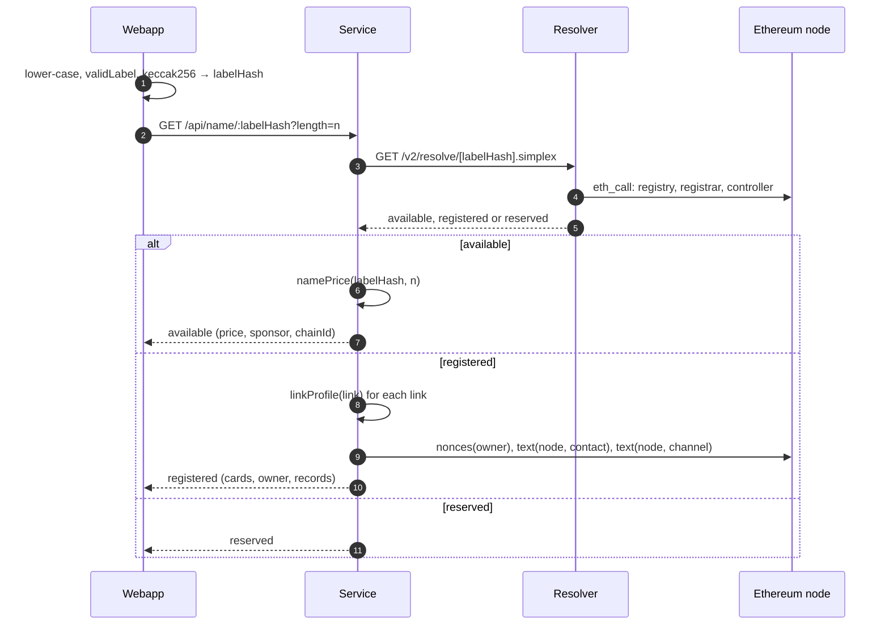

- **The page's check:** the page folds the name to lower case first. Then `validateLabel` in `names.ts` checks it, mirroring `validLabel`.
- **Checks first:** the service checks the search rate limit, then the length. The length must be 6–63, else the answer is `invalid_name`.
- **The price:** `namePrice` is `Catalog.namePrice`.
- **Hash formats:**
  - `:labelHash` is `0x` + 64 lowercase hex.
  - The resolver path takes 64 lowercase hex without `0x`.
- **The lag:** the resolver may say available while our own registration (`registrationByHash(labelHash)`) is `registering`, or `registered` within the last hour.
  - Then the answer is `registered{entities: [], tld}`, with no owner.
  - The page then takes the nonce, chain id and resolver from the registration view.
- **The answers:**
  - `available{price, currency, years, resolver, sponsor, chainId, tld}`;
  - `registered{entities, records, owner, resolver, recordsNonce, chainId, tld}`.
- **Owner and records:**
  - `owner` and `resolver` come from the resolver's answer.
  - `records` and `recordsNonce` are read from the chain, on the default resolver, with `node = keccak256(namehash(tld) ‖ labelHash)`.
  - They are read only when the answer names the default resolver. Otherwise they are null.
- **Link cards:** for each `simplexContact` and `simplexChannel` link, `linkProfile` uses `APIConnectPlan` ‡. It has its own rate limit, a cache and a 3 s timeout.
- **Failures:** any resolver error answers `provider_unavailable`. A failed chain read answers the same. The resolver errors are:
  - `upstreamError`, `tldNotConfigured`, `noPriceOracle`, `unknown`;
  - no answer;
  - `labelNotRecorded`, which cannot happen on PR #35.

## 2. Checkout, owner code and order

The page makes the owner code, the owner wallet and the commitment in the browser, then places the order. The order carries the name's hash, the commitment and the sealed copy, not the name itself.

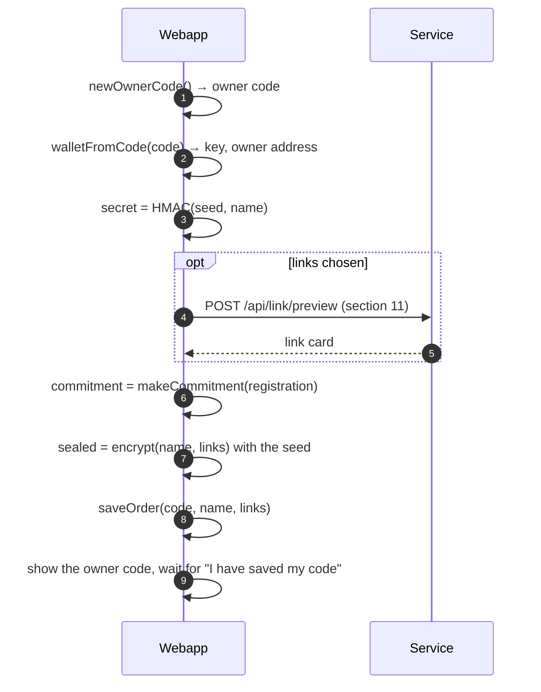

Then the order itself:

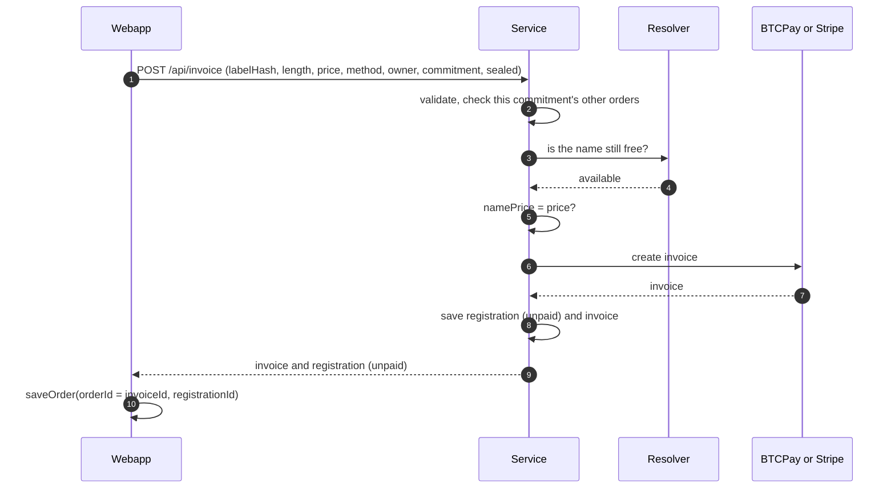

- **Before checkout:** if this browser has an open order whose card payment awaits confirmation, Continue is off (N3e).
- **Page-side functions:**
  - `newOwnerCode` works as `randomNameCode` †. It takes 128 bits of entropy. The code is `SN-` + the entropy + 22 bits of SHA-256.
  - `walletFromCode` works as the test mock †. It makes a BIP-39 seed, the key at `m/44'/60'/0'/0/0`, and its address.
- **Registration fields:**
  - `secret = HMAC-SHA256(seed, "simplex.domains commitment " + label)`.
  - The links of one key are joined with ";". Each value is within 4096 bytes.
  - `registration = {label, owner, duration (2 years × 365 days), secret, resolver, data = recordCalls(registration) †}`.
  - `makeCommitment` is †.
- **Sealing:** `sealed = AES-256-GCM(HMAC-SHA256(seed, "simplex.domains sealed"), {label, contact, channel})`.
- **The service's checks, in order:**
  1. the create rate limit;
  2. the owner address;
  3. the length (`invalid_name`);
  4. `sealed` within its bound (`bad_request`);
  5. this commitment's other orders (below);
  6. the resolver: registered or reserved is `name_taken`. A resolver failure is `name_check_unavailable`, and nothing is created;
  7. the lag: our own registration `registering`, or `registered` within an hour, is `name_taken`;
  8. `namePrice` must equal the price, else `catalog_changed{price}`.
- **This commitment's other orders:**
  - An open invoice for the same order is answered with that invoice.
  - A different order gets `400 {"error": "bad_request", "invoiceId"}`, and the page opens that order.
  - A registration past `unpaid` is answered with its order. For a code registration, `invoiceId` is null, and the page opens `?registration=<id>`.
- **Storage:** the service inserts `name_registrations` (phase `unpaid`), `name_invoices` and `invoices` ‡.

## 3. Payment and settlement

The buyer pays the provider. The service then reads the invoice itself and settles it, which queues the registration.

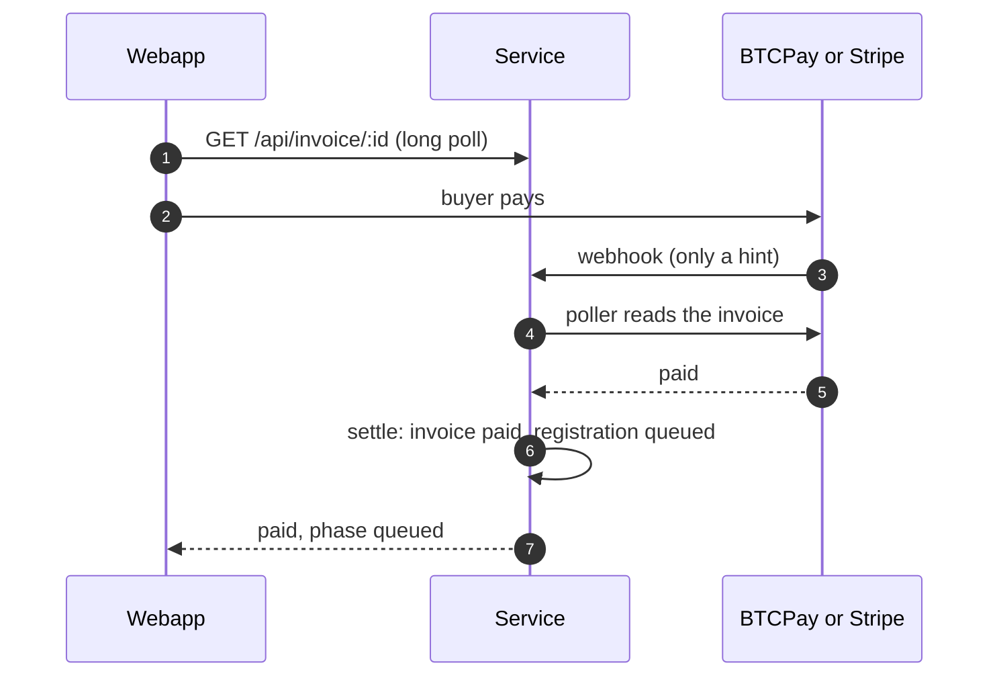

- **Webhooks:** they arrive at `POST badges.simplex.chat/webhooks/{btcpay,stripe}` ‡.
  - A webhook only triggers a read (`queueReadHint` ‡).
  - The poller carries the authority, as for badges today.
- **Name invoices in today's code:** `getInvoiceByProviderRef` ‡, the poller's scans, its expiry update and `GET /api/invoice/:id` all gain a name side.
- **Settlement** is one database transaction:
  - the invoice becomes paid;
  - the registration goes `unpaid` → `queued`.
  - Both changes are published to the long poll after the commit.
- **Late payment:** an invoice paid after it expired or was canceled leaves the registration `unpaid`. The operator is alerted to refund it (gap 26).
- **The long poll** carries `wait` and `seenPhase`, so it also wakes on phase changes.

**Get a new invoice.** The old invoice may still be open when the card form does not load, or the payment details are unavailable. The page then cancels it before ordering again:

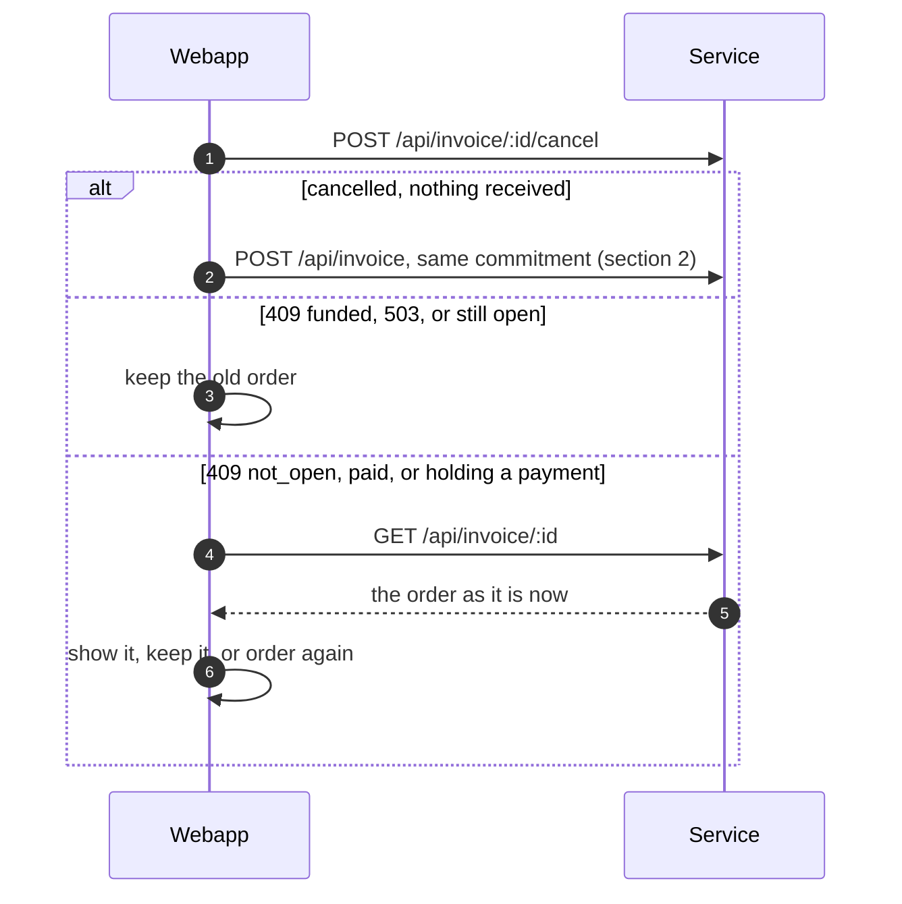

- **The cancel** uses the create rate limit.
- **A `200` that is still `open`:** the page shows `CANCEL_STILL_OPEN`.
- **After the re-read:**
  - paid, with the registration past `unpaid`: show the order;
  - paid, with the registration still `unpaid` (paid after it closed): order again;
  - otherwise holding a payment: keep the order;
  - expired with nothing received: order again.

## 4. Commit

The service puts the commitment on chain. This reserves the name without showing it, so nobody can see the name and register it first.

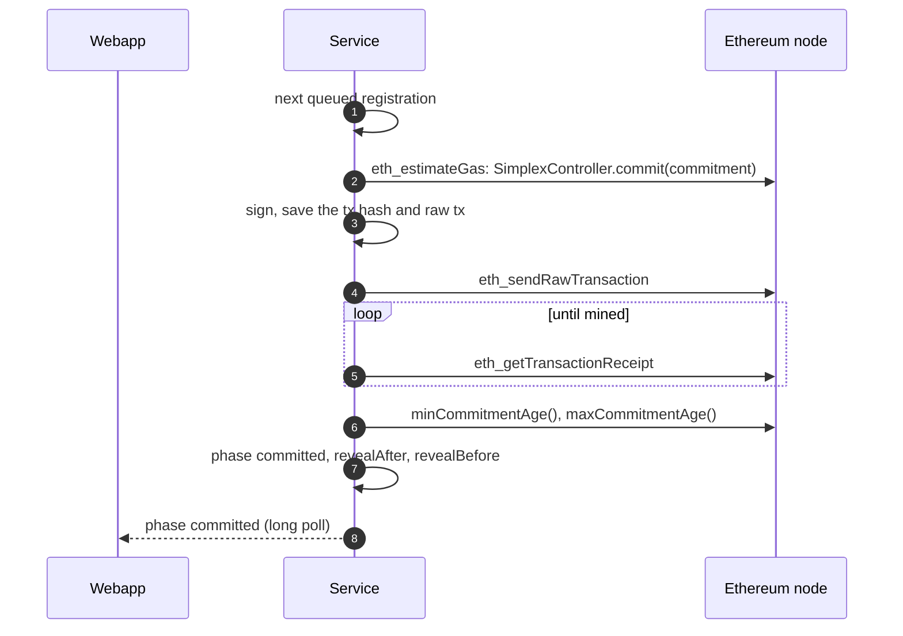

- **One sender:** the worker and the records relay share one sender for the registrar key.
  - The sender assigns the transaction nonce.
  - It saves each hash and raw transaction before sending.
  - `sendCommit` † is split so it signs first.
- **Stored hash:** the commit's hash is `commit_tx`. The view shows it as `commitTx`.
- **The ages** are read with `SimplexController.minCommitmentAge()` and `maxCommitmentAge()`.
- **Reveal window:**
  - `reveal_after` is the commit's block time + `minCommitmentAge`.
  - `reveal_before` is the block time + `maxCommitmentAge`.
- **A commit that reverts**, in its dry run or mined with status 0:
  - **The commitment is already live:** `commitments()` + `maxCommitmentAge` is still ahead. This is `UnexpiredCommitmentExists`. The registration becomes committed, with the times from `commitments()`.
  - **No live commitment** (out of gas, or it lapsed by the read): the commit is sent again. When the read falls exactly at the lapse second, the worker waits a second first.
  - **The commitment had lapsed:** before committing again, the service clears `label`, `secret`, `records`, `intent_*`, `error`, the tx hashes and blocks, and `reveal_after`/`reveal_before`. The page then signs again.

## 5. Reveal: the owner signs the registration

Once `revealAfter` has passed, the page reveals the name and signs the intent. The intent lets the service register the name for the owner.

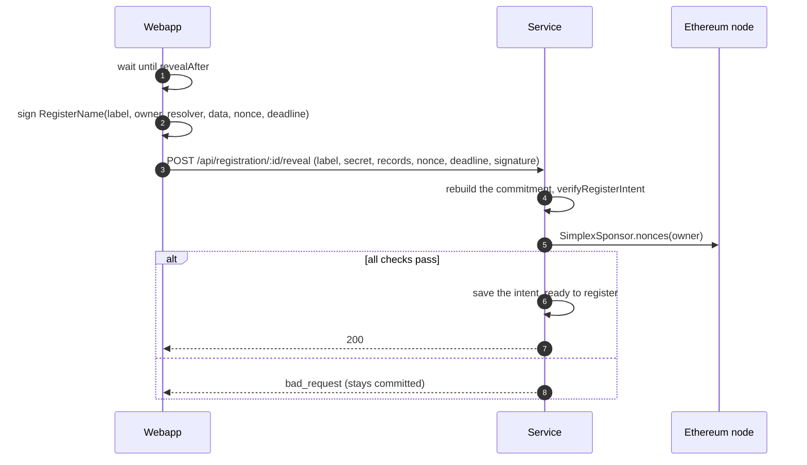

- **The signature:**
  - `nonce` is the view's `intentNonce` (0 for a new code).
  - `deadline` is `revealBefore`.
  - The digest uses `sponsorDomain(chainId, sponsor)` †. The page signs it with `@noble/secp256k1`.
- **The service's checks:**
  - **Rate limit:** the read limit. Each `bad_request` counts against it.
  - **Phase:** the registration must be `committed`, with `label` null.
    - Once `label` is set, an identical repeat answers 200 in any phase.
    - A different body is `bad_request`.
  - **The name:**
    - `validLabel` (#7390, ported and tightened to simplexmq's hyphen rule);
    - `keccak256(label)` = `labelHash`, and the length matches;
    - the price is the registration's `price_id` row, or the prepaid code covers the length.
  - **Links and resolver:**
    - each link is a SimpleX link of its kind;
    - each record is within 4096 bytes;
    - the resolver is the default one.
  - **The commitment:** `data = recordCalls(registration)` †, and `makeCommitment(registration)` † must equal the stored commitment.
  - **The intent:**
    - `verifyRegisterIntent` † checks the 32-byte secret, the deadline, and that the signer is the owner;
    - the service then checks for low s itself, because the sponsor's `SignatureChecker` rejects high s;
    - the nonce must equal `SimplexSponsor.nonces(owner)`.
  - **A failed chain read** answers `provider_unavailable`. It does not count as a `bad_request`.

## 6. Register and confirm

The service sends the register, which gives the name to the owner. It shows the name as registered only after the receipt and 3 more blocks.

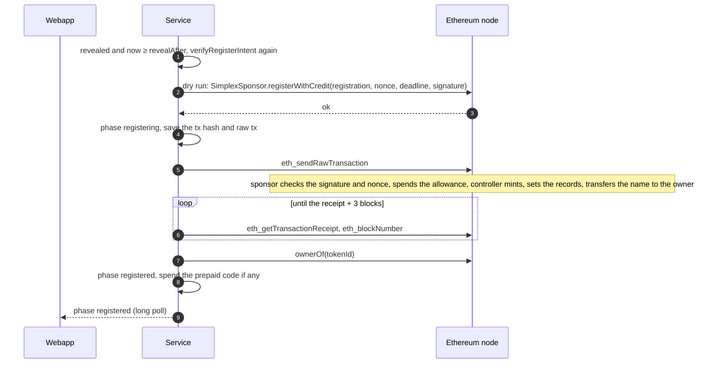

When the dry run or the mined transaction reverts:

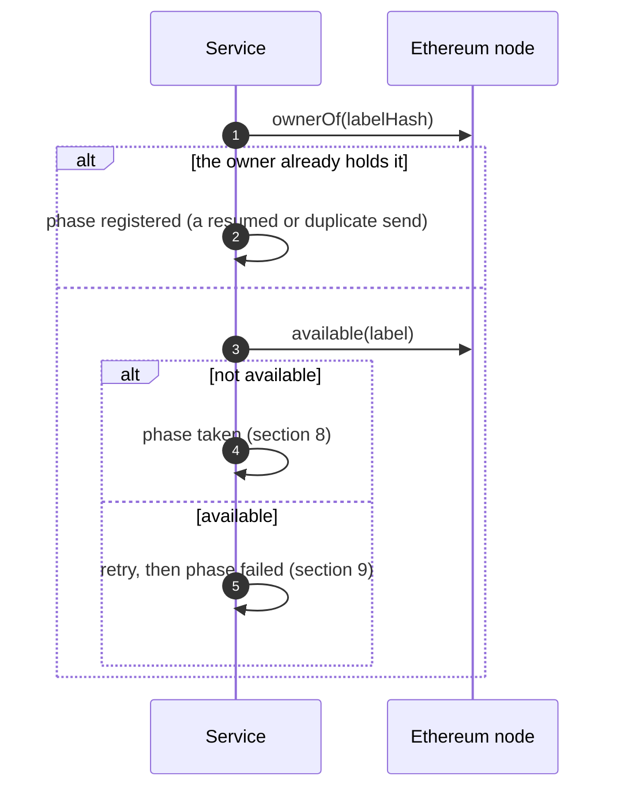

- **Inside the register:**
  1. `SimplexSponsor` checks the signature and nonce, and spends the allowance.
  2. It then calls `SimplexController.registerSponsored`.
  3. The controller mints the name to itself, applies the records with `multicallWithNodeCheck`, and transfers the name to the owner.
- **The dry run** is the first step of `sendRegister` †.
- **Past the deadline:** `verifyRegisterIntent` fails, because the commitment has lapsed too.
  - The registration goes to `failed`.
  - Retry commits again, or reuses a live re-commit (section 9).
- **Reading reverts:**
  - The dry run decodes `NameNotAvailable` or `NameReserved` as taken.
  - Any other revert while `available(label)` is false is taken too.
- **Revert order:** the sponsor checks the intent and the allowance before the name's availability. So a taken name can revert with one of those first.
- **On taken:** a prepaid code is released.
- **On registered:** `registered_at` and `expires_at` are recorded.

## 7. A prepaid code

The buyer pays with a prepaid code instead of money. The page checks the code first, then registers without an invoice.

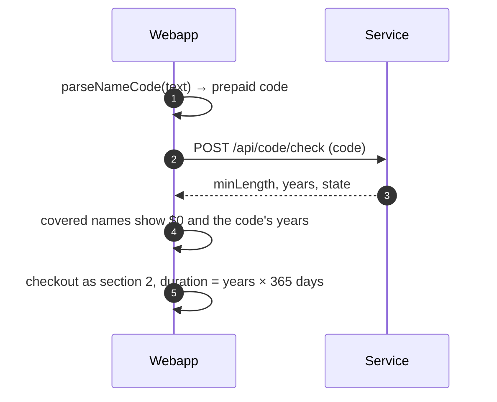

Then the registration:

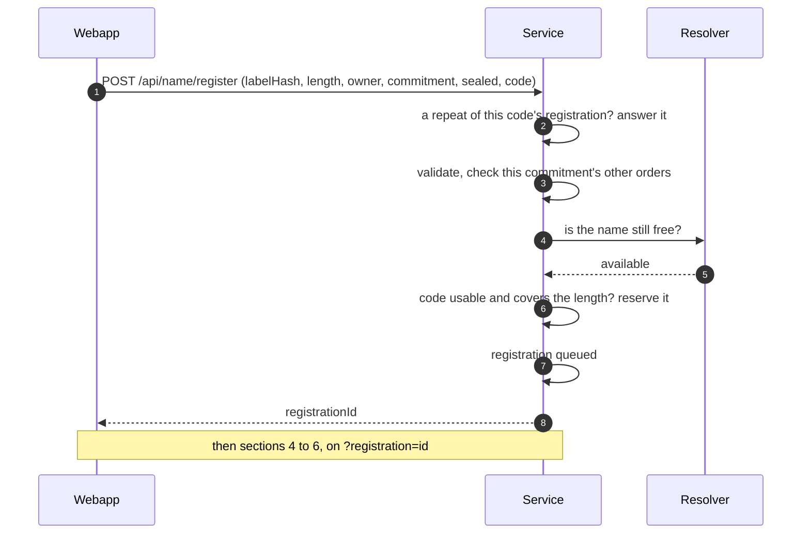

- **Parsing:** `parseNameCode` returns `NCPrepaid` or `NCOwner`. The sum type is proposed. The page catches a typo in the check character (K6).
- **An owner code entered here** sends nothing. The page tells the buyer it is a name code, to restore under Your names.
- **The code check:**
  - `POST /api/code/check` looks the code up in `name_prepaid_codes` by `namePrepaidCodeHash`.
  - The code covers a name when its length ≥ `min_length`.
  - An unknown code answers `400 code_invalid`.
- **Rate limits:** `/api/name/register` uses the code-check rate limit.
- **The service's checks, in order:**
  1. **The repeat check:** a registration paying with this code, with the same owner and commitment, answers its `registrationId`. This keeps a lost response safe.
  2. **Validation:** the owner, `sealed` within its bound (`bad_request`), and the length (`invalid_name`).
  3. **This commitment's other orders:**
     - an open invoice answers `bad_request` with its `invoiceId`. The page cancels that invoice first.
     - a registration past `unpaid` answers its `registrationId`, plus its `invoiceId` when it was paid. The page opens `?order=`.
  4. **The resolver:** registered or reserved is `name_taken`. A failure is `name_check_unavailable`.
  5. **The lag:** our own registration `registering`, or `registered` within the hour, is `name_taken`.
- **Code errors:** `code_invalid`, `code_used`, `code_reserved`, `code_expired`, `payment_pending` or `code_not_covering`. They are shown at checkout (K7), or in the popup (K5).

## 8. Taken: another name, or a prepaid code

The name went to someone else before the register. A paid order can then switch to another name, or take a prepaid code instead.

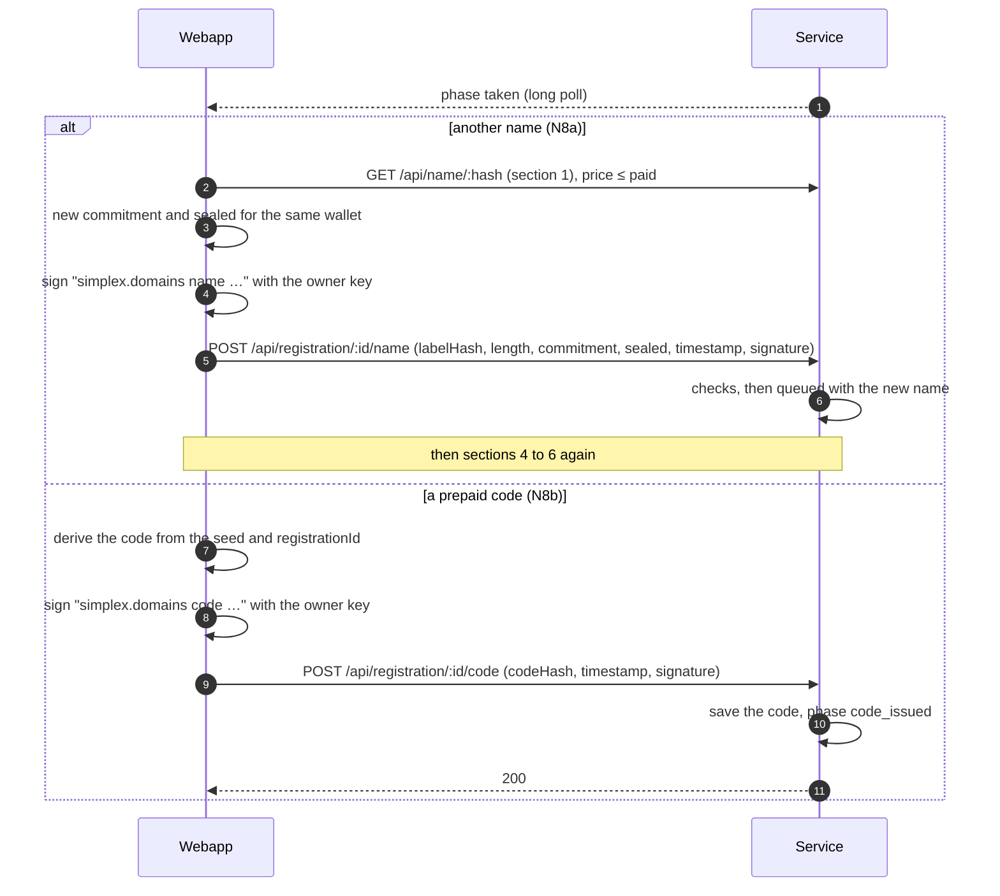

- **Another name (`/name`):** it uses the create rate limit.
  - **Checks, in order:**
    1. the owner's signature and timestamp;
    2. a paid registration in `taken`;
    3. the order's checks: `sealed` within its bound, `invalid_name`, and `name_taken`. A resolver failure is `name_check_unavailable`, and nothing changes;
    4. `namePrice` must be ≤ the amount paid, else `bad_request`.
  - **On success:**
    - `price_id` becomes the new price row.
    - The registration goes to `queued` with the new hash, length, commitment and `sealed`.
    - `label`, `secret`, `records`, `intent_*`, the tx hashes and blocks, `reveal_after`, `reveal_before` and `error` are cleared.
- **A prepaid code instead (`/code`):** it uses the create rate limit, then checks the owner's signature and timestamp.
  - **The code:** `SN<length tier>` + a payload from `HMAC-SHA256(seed, "simplex.domains taken code " + registrationId)`. The page keeps it under Your names.
  - **A repeat:** if `issued_code_id` already has this hash, the answer is 200 again.
  - **Otherwise:** only a paid registration in `taken` qualifies. The service then:
    - inserts the code (current length tier, 2 years, paid, no expiry);
    - sets `issued_code_id`;
    - moves the phase to `code_issued`.
  - **Collisions:** a hash that another code already has is `code_conflict`. For a derived code this is unreachable in practice.
- **A prepaid-code order that is taken** ends there. The worker released its code at `taken`.

## 9. Failed, retried, lapsed

A registration that cannot finish goes to `failed`. Retry checks whether it registered after all, then queues it again at no charge. The worker then decides whether the old commitment can be reused.

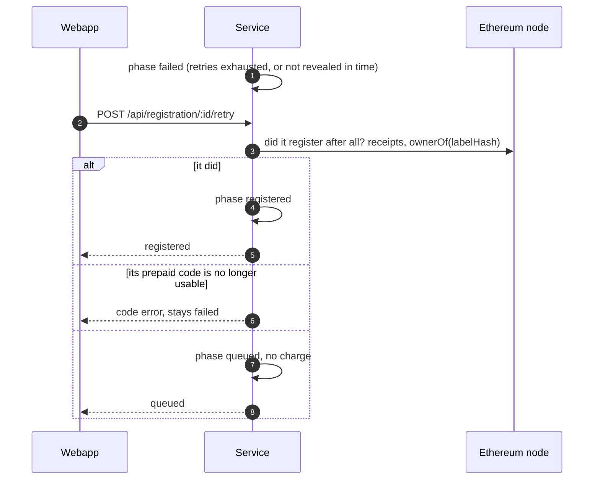

From `queued`, the worker reads the commitment to decide whether to commit again:

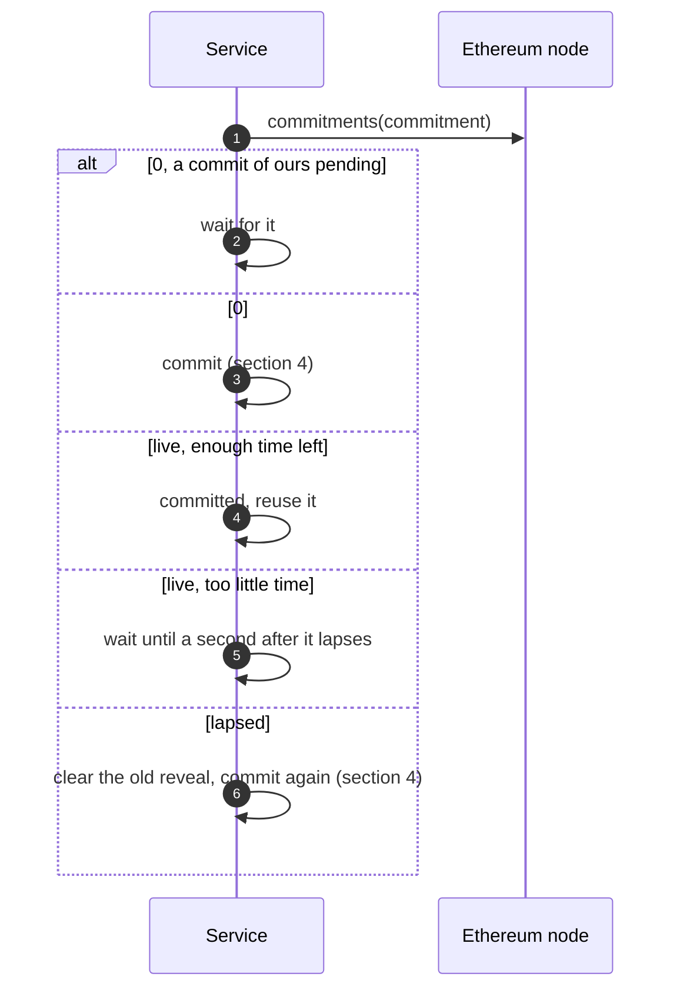

- **Retry rules:** it uses the create rate limit. It works only from `failed`, else `bad_request`.
- **Step 1, did it register after all:**
  - The answer is yes when a `register_tx` of this registration (any hash) mined with status 1.
  - It is also yes when `ownerOf(labelHash)` is the owner. A reverting `ownerOf` counts as no.
  - If yes, it is a lost confirmation. `registered_at` and `expires_at` are recorded, and the prepaid code is spent. If the code was released to another registration meanwhile, the operator is alerted.
  - A failed chain read answers `provider_unavailable` and changes nothing. A null receipt counts as not mined.
- **The released code is no longer usable:**
  - The service answers `code_used`, `code_invalid`, `code_expired` or `code_reserved`.
  - The registration stays `failed`, with `failed_at` unchanged.
  - N9 shows the outcome.
- **Requeue:**
  - **Code:** a released code is reserved again.
  - **Always cleared:** `failed_at`, `error`, and the register's tx hashes and blocks.
  - **Cleared when the sponsor nonce has moved** (`intent_nonce` ≠ `SimplexSponsor.nonces(owner)`): `label`, `secret`, `records` and `intent_*`.
- **The commitment read:**
  - **0** means never committed, not mined yet, or consumed. Step 1 already ruled out a registration this owner holds.
  - **`revealBefore`** is `commitments(commitment)` + `maxCommitmentAge`, because `reveal_before` may be null.
  - **Live, with at least `revealMargin` left:** the commitment is reused. The registration goes to `committed`, with the times from `commitments()`.
    - If the commitment's time is not the block time of a commit of ours mined with status 1, a third party committed it again.
    - Then `label`, `secret`, `records`, `intent_*` and the commit's tx hashes are cleared, so the page signs again.
  - **At `revealBefore` itself:** the worker waits a second.
  - **After `revealBefore`:** the worker first clears `label`, `secret`, `records`, `intent_*`, `error`, the tx hashes and blocks, `reveal_after` and `reveal_before`. Then it commits again.
- **Failure causes:** `InsufficientAllowance` also alerts the operator.

## 10. Restore with the owner code

In another browser, or after losing the order link, the owner code alone finds and reopens the order.

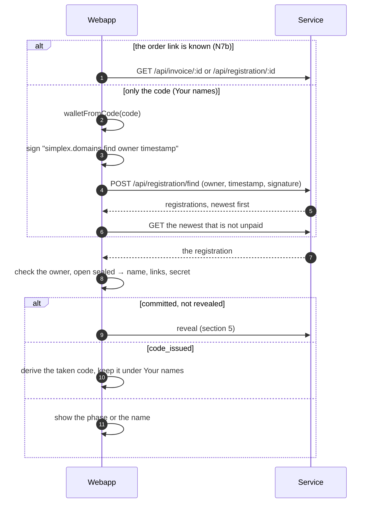

- **The `find` signature:** EIP-191 (`personal_sign`) over `simplex.domains find <owner> <timestamp>`.
  - `owner` is lowercase `0x` hex.
  - `timestamp` is in Unix seconds.
- **`find` checks:** its own rate limit. The signer must be `owner`, and the timestamp must be within 10 minutes.
- **`find` answers:**
  - `{registrations: [{registrationId, invoiceId or null, phase, createdAt}]}`, including retargeted ones;
  - `404 not_found` when there are none.
- **Opening a registration:** with the read limit, the page opens:
  - `GET /api/invoice/:invoiceId` when it is set (the order page, with what was paid);
  - else `GET /api/registration/:id`.
- **Checking the code:** the page rebuilds the commitment from `sealed` and the seed. It must equal the registration's commitment.

## 11. Links: preview at checkout, edit later

After registration, the owner changes links by signing each edit, and the service relays it and pays the gas.

At checkout, a link is previewed before it goes into the registration:

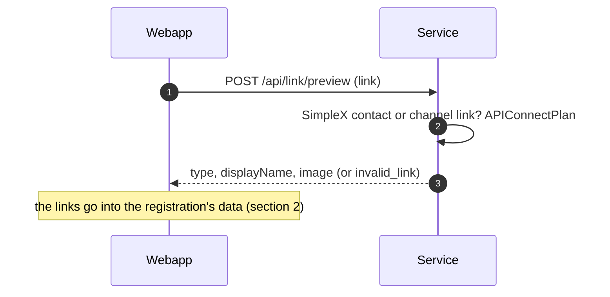

Later, editing a registered name's links:

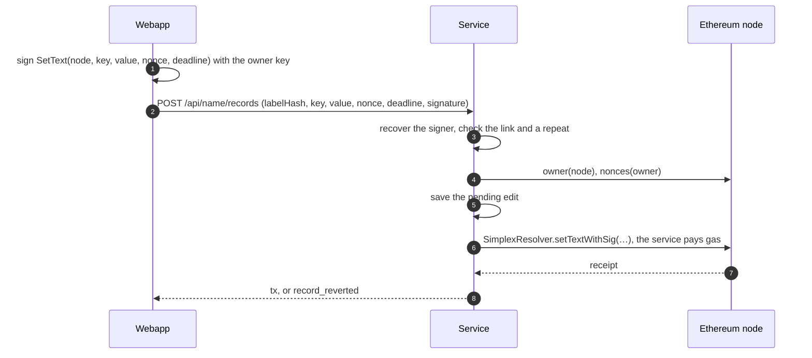

When an edit reverts, or a restart finds it unresolved:


- **Preview:** its own rate limit. The link must be within 4096 bytes.
- **How records are stored:**
  - A key holds its links joined with ";".
  - Removing one of several links rewrites the whole value.
  - Clearing a key sets it to "".
- **Clearing all records:** the page signs `ClearRecords` instead, and the service relays `clearRecordsWithSig`.
- **When the page offers Edit links:**
  - **Hidden** when the search answer has an owner other than the code's address (the name was redeemed).
  - **Hidden** when the answer has an owner with null records (another resolver, or none).
  - **The current values** come from the answer's records.
  - **During the lag**, the values come from the order's links in `sealed`, or from this browser's last mined edit of that key. A mined clear sets both keys to "". The chain id and resolver come from the view. Edit links is offered only once the phase is `registered`.
- **The page's nonce:**
  - **Start:** `recordsNonce` from the search answer or the view.
  - **Next nonce:** +1 after each `{tx}`. The same after `record_reverted`.
  - **Recovery:** re-read it after any `bad_request`.
  - **Deadline:** now + 1 hour.
- **The service's checks, in order:**
  1. **Rate limit:** its own, for every request.
  2. **The record:** the key is `simplex.contact` or `simplex.channel`. Its links are of that kind and within 4096 bytes, else `invalid_link`.
  3. **The signature:** recover the signer (`recoverAddress` †) and require low s. Otherwise `bad_request`, not counted toward the cap.
  4. **A repeat:** found by signer and nonce, and matched by `body_hash`. This runs before any deadline check.
     - An identical repeat waits for the same tx. It answers the tx once mined (tx null when another transaction applied it), or answers `record_reverted` again.
     - A different body with a nonce whose edit is pending or mined is `bad_request`.
     - After `record_reverted`, the nonce is free again for a new body.
  5. **For a new edit only:** the deadline must be ahead of the latest block, else `bad_request`. Then the per-name cap applies (`rate_limited`).
  6. **On chain:** the signer must be `ENSRegistry.owner(node)`, and the nonce must equal `SimplexResolver.nonces(signer)`, else `bad_request`. A failed read is `provider_unavailable`.
  7. **Concurrency:** the pending row (signer, nonce, body hash) is inserted before signing. Of two concurrent identical requests, one loses the unique insert.
  8. **Sending:** through the registrar's one sender. The hash and raw tx are saved before sending.
- **The revert re-read:** the service re-reads the nonce and the record in these cases:
  - after a revert: an applied edit reverts `InvalidNonce`, or `SignatureExpired` once past its deadline;
  - after a restart's expiry.
  - **The revert's name:** a mined revert's receipt has no data. It is named `SignatureExpired` when past the deadline, else null.

## 12. Redeem in the app

The owner moves the name from the owner wallet into the app's wallet, so the app holds it without the owner code.

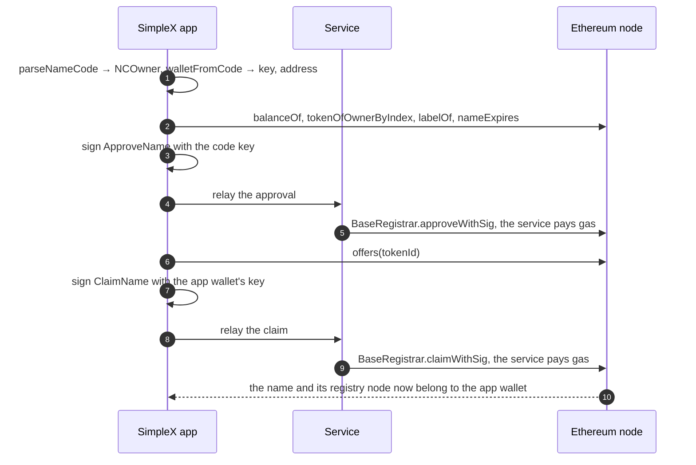

- **`ApproveName`:** from the code address to the app address, with `tokenId`, an empty key, a zero tag, a nonce and a deadline.
- **`ClaimName`:** from, to, `tokenId`, the offer, a nonce and a deadline. The approval increments `offers(tokenId)`.
- **The relay endpoints** are not specified yet (gap 9).
- **Afterwards** the owner code no longer controls the name.

## 13. Opened from the app

The app opens the store for a name that its own wallet will own, so there is no owner code. The link is `simplex.domains/#/?name=<label>&owner=<appAddress>`.

```mermaid
sequenceDiagram
  autonumber
  participant A as SimpleX app
  participant W as Webapp
  participant S as Service
  A->>W: open simplex.domains with name and owner = appAddress
  W->>W: owner = appAddress, shown before paying
  W->>W: random secret, kept in this page
  W->>S: order as section 2, without sealed
  Note over W,S: sections 3 and 4 as usual
  W->>A: the RegisterName intent must be signed by appAddress (gap 10)
```

## 14. Gaps found

Each gap says what the problem is, why it matters, and what is decided, or that it is still open. Gaps marked "Resolved" are settled and kept for the record.

1. **The page cannot build the sponsor's EIP-712 domain.**
   - Problem: `sponsorDomain(chainId, sponsor)` † needs the chain id and the `SimplexSponsor` address. The search answer carries only `resolver`.
   - Why it matters: the intent's digest uses that domain (section 5), so the page cannot sign.
   - Decided: the answer is `available{…, resolver, sponsor, chainId, tld}`. The TLD (`[names] tld`) builds the records' node.
2. **The intent can expire before it is sent.**
   - Problem: the page signs with a deadline. The register may be sent after it, because of a gas spike, retries or a queue.
   - Why it matters: then `verifyRegisterIntent` fails and the sponsor reverts.
   - Decided: the page signs with `deadline = revealBefore` (the commit's block time + `maxCommitmentAge`).
     - The controller reverts `CommitmentTooOld` from that time. So an expired intent means the commitment it was signed against has lapsed too.
     - A third party may have committed it again since. Section 9 handles that.
     - The registration goes to `failed`. Retry commits again (section 9) before the page signs anew.
3. **The registrar has one nonce for all workers.**
   - Problem: `sendTransaction` † reads the pending nonce for each transaction. It also never replaces a stuck transaction.
   - Why it matters: two registrations sending at once collide.
   - Decided: one sender queue for the registrar key, and replacement with a fee bump after a timeout.
4. **No receipts and no `minCommitmentAge`.**
   - Problem: the branch's client sends and returns a hash. It never reads a receipt or `minCommitmentAge()`.
   - Why it matters: the service cannot know when a transaction mined, or when the reveal may start (section 4).
   - Decided: add `waitReceipt`, `confirmations` and `minCommitmentAge` reads (sections 4 and 6). The branch's section 7 lists the receipt and the `minCommitmentAge` wait.
5. **Telling taken from failed.**
   - Problem: the sponsor calls the controller without catching. So a taken name's revert data, `NameNotAvailable(label)` or `NameReserved(label)`, reaches the caller. The data carries the controller's selector, which is not in the sponsor's ABI.
     - In process, `e2e/StoreE2E.test.ts` sees `NameNotAvailable` in the error text only because Hardhat names errors from every compiled contract. That is not decoding.
     - Over JSON-RPC, `hardhat node` 3.1.4 (the PR's version) answered every revert we sent with `-32603 Internal error` and no data. This explains the loss Alain's plan reports.
     - Hardhat 3.19.0 and anvil return the data.
   - Why it matters: a taken name must go to `taken`, while other reverts lead to retry and `failed` (section 6).
   - Decided: decode the revert data against the sponsor's, controller's and base registrar's errors together, as `e2e/LocalChain.test.ts` does over HTTP on anvil. On any revert:
     1. Read `ownerOf(labelHash)` first. The owner holding it means this registration went through.
     2. Otherwise, a decoded `NameNotAvailable` or `NameReserved` means taken or reserved. So does any other revert while `available(label)` is false.
     - The sponsor checks the intent's signature, nonce and deadline, and spends the allowance, before the controller checks availability. So a taken name can first revert `SignatureExpired`, `InvalidNonce`, `InvalidSignature` or `InsufficientAllowance`.
   - Open: whether reth's `error.data` carries the revert data is unchecked.
6. **The commitment fixes the links and the duration at checkout.**
   - Problem: links changed after the order need a new commitment before the commit, or an edit after registration.
   - Why it matters: a change after the order no longer matches the commitment the service holds.
   - Decided: allow editing links only until the order is created.
7. **Resolved: the price may change between order and reveal.**
   - Problem: the catalog price may change after the order.
   - Why it matters: the reveal checks the price (section 5).
   - Decided: the registration's `price_id` fixes the price at order time, or at retarget after its check against what was paid.
     - `name_prices` is insert-only, so that row stays.
     - The reveal compares no price: the label's hash and length make that row its price.
8. **Resolved: a lapsed commitment can be committed again.**
   - Problem: a retry after a lapse must know when the same commitment can go on chain again.
   - The contract's rules:
     - `SimplexController.commit` reverts `UnexpiredCommitmentExists` while `commitTime + maxCommitmentAge >= now`.
     - Registering reverts `CommitmentTooOld` once `commitTime + maxCommitmentAge <= now`.
     - So at `revealBefore` itself neither works. From the next second, the same commitment commits again.
   - Tested: `e2e/StoreE2E.test.ts` checks both to the second. At one commitment's `revealBefore`, it reverts `CommitmentTooOld` and cannot be committed again. A commitment one second younger registers in that same second. The first commits again a second later.
   - Decided: a retry needs no new secret.
9. **Redeeming in the app has no service API.**
   - Problem: there is no relay endpoint for `approveWithSig` and `claimWithSig`. There is also no way for the app to learn which name an owner code holds.
   - Why it matters: the app cannot redeem a name (section 12).
   - Decided:
     - The app reads the code's names on chain. The registrar is ERC-721 enumerable, with `labelOf` and `nameExpires`.
     - Add relay endpoints for `approveWithSig`, and then `claimWithSig`.
     - The claim signs `offer = offers(tokenId)`, read after the approval.
10. **Opened from the app: the intent's signer is the app.**
    - Problem: the page cannot sign for `appAddress`. The page's random secret is lost if the page closes. A taken order cannot sign `/name` or `/code` without the app.
    - Why it matters: the flow in section 13 cannot finish from the page alone.
    - Open, two options:
      - the app builds and keeps the registration and signs the intent, and the page only takes the payment;
      - or defer the flow.
11. **Resolved: editing links later.**
    - Problem: the commitment fixes the links at checkout (gap 6), so later changes need a signed edit on chain.
    - The contract: PR #35's `SimplexResolver` has:
      - `setTextWithSig` (EIP-712 `SetText`, domain `SimplexResolver`) and `clearRecordsWithSig` (`ClearRecords`);
      - one nonce counter per owner, shared by both;
      - no edit credits;
      - a `SetText` intent covers one record, and a `ClearRecords` intent all of the name's records;
      - `Multicallable`, which would let the relayer send several signed edits in one transaction.
    - Decided:
      - The page needs that nonce and the chain id. So the registered search answer carries them with the resolver. The registration view carries the nonce while search lags.
      - Several edits go one at a time. The service accepts an edit only when its nonce equals `nonces(owner)` on chain, and answers once it is mined. The page signs the next edit after that answer.
      - A higher nonce sent early would revert `InvalidNonce`, because the contract does not queue intents.
      - The service relays one transaction per edit, by its own choice, and bounds the cost itself.
    - Tested: two consecutive edits, relayed in order, are in `e2e/StoreE2E.test.ts`.
12. **Resolved: search during our own registration.**
    - Problem: during the lag, the resolver may still say available for a name we are registering.
    - Why it matters: search would offer a name that is already ours.
    - Decided: search uses the index on `name_registrations.label_hash` with `phase`, now in both schemas, and `registered_at` for the resolver's hour of lag.
13. **Resolved: the reveal's rate limit.**
    - Problem: the reveal needed a rate limit.
    - Decided: it takes the read limit, and each `bad_request` from it counts against that limit.
14. **Resolved: Alain's encoder carries the intent nonce.**
    - Problem: the encoder must match PR #35's register call and intent.
    - Decided: since `965046fe1` ("adapt contract updates"), `Registration.hs` has:
      - `riNonce`;
      - the `registerWithCredit((…),uint256,uint256,bytes)` selector;
      - the `RegisterName(…,uint256 nonce,uint256 deadline)` typehash.
      - These match PR #35 at `0f882c0`.
    - Left for the service: check the nonce against `SimplexSponsor.nonces(owner)` at the reveal (section 5).
15. **Contract details the flow must respect.**
    - Problem: PR #35 sets these rules, each exercised by `e2e/StoreE2E.test.ts`:
      - `reverseRecord` must be 0 (`ReverseRecordNotSupported`);
      - records need a non-zero resolver (`ResolverRequiredWhenDataSupplied`);
      - the duration is at least two years (`DurationTooShort`);
      - the sponsored path is not gated by the public sales switch;
      - the registrar's allowance is in attoUSD (`SimplexSponsor`, as `rentPriceUSD` quotes), and the guardian sets it (`setRegistrarAllowance`);
      - `registerWithCredit` spends the name's list price (`rentPriceUSD`, base + premium) from that allowance.
    - Why it matters: a register that breaks one of them reverts.
    - Decided: the flow follows each rule.
16. **Retry must not re-commit a live commitment.**
    - Problem: `commit` reverts `UnexpiredCommitmentExists` until a second after `revealBefore`. This happens, for example, after a `failed` caused by `InsufficientAllowance`.
    - Why it matters: a retry that commits again would revert.
    - Decided: the worker reads `commitments(commitment)` first. When it is live, the worker goes straight to `committed`.
17. **The allowance is the guardian's, not the service's.**
    - Problem: only `controller.beneficiary()` can call `setRegistrarAllowance`. The call replaces the value. The allowance is spent at list price for the whole duration.
    - Why it matters: when it runs out, registers revert `InsufficientAllowance`, and the service cannot fix that itself.
    - Decided: `InsufficientAllowance` must alert the operator. While `available(label)` is true, it is `failed`, never `taken`.
18. **Prepaid codes under 2 years cannot register.**
    - Problem: registering reverts `DurationTooShort` below 730 days.
    - Why it matters: a shorter code could never be used.
    - Decided: `//issue name … years <Y>` refuses fewer than 2.
19. **The store needs a fresh PR #35 deployment, and a deploy script.**
    - Problem: the approve/claim functions (base registrar) and the registry's one EIP-712 signed operation, `setApprovalForAllWithSig` (`SimplexENSRegistry` domain), are in non-upgradeable contracts. So today's `.testing` does not have them.
    - Problem: the PR's own scripts deploy a plain `PublicResolver`, no `SimplexSponsor`, and a premium price oracle.
    - Why it matters: neither today's `.testing` nor the PR's scripts give the store what it needs.
    - Decided: the plan's context lists the wiring: the fixture's contracts, with the deploy scripts' commitment ages and label cap. `e2e/deployLocal.ts` deploys exactly that to a local anvil and prints the service's config.
    - Open: a mainnet script still has to do the same with real keys.
20. **A transaction can pass its dry run and still revert when mined.**
    - Problem: between the dry run and mining, the deadline can pass, the name can be registered in the same block, or the allowance can run out.
    - Why it matters: a passed dry run does not prove the register worked.
    - Decided:
      - Before `registered`, the worker requires receipt `status` 1 and `ownerOf(tokenId) == owner`.
      - On `status` 0, it reads `ownerOf(labelHash)` first. The owner holding it means `registered`. Then it reads `available(label)` to choose `taken` or `failed`.
      - A commit's receipt is checked by its `status` and `commitments(commitment)`, because before the reveal there is no label.
21. **The registration view carries what the page signs with.**
    - Problem: the page needs values from the service to sign the intent. A browser with only the owner code has nothing else.
    - Decided: the view carries:
      - `intentNonce` (`SimplexSponsor.nonces(owner)`);
      - `revealBefore` (commit block time + `maxCommitmentAge`, 24 h in PR #35's deploy);
      - for a browser with only the owner code: `sealed` (the label and links), `commitment`, `years` (the duration), `resolver`, `sponsor`, `chainId` and `tld`.
      - That is enough to rebuild the commitment and the intent.
    - Tested: `e2e/StoreE2E.test.ts` registers from only the code and those fields.
22. **Resolved: a consumed commitment also reads 0.**
    - Problem: a successful register deletes its commitment. So by `commitments()` alone, retry cannot tell it from one never committed. When the owner has since redeemed the name, `ownerOf` no longer shows the owner either.
    - Why it matters: retry could commit again for a name that already registered.
    - Decided: retry first reads the registration's own register receipts.
      - `status` 1 on any of them means `registered`, whoever holds the name now.
      - Only after that does a 0 lead to a new commit.
    - What stays undetected:
      - The commitment covers the owner, so any register of it gives the name to this owner. `ownerOf` catches that while the owner holds the name.
      - Only once the name has left the owner (redeemed, transferred or expired) does a register that this registration did not send go undetected.
      - Such a register comes from another registrar holding the signed `RegisterName` intent, or from the owner's own payable `register`. That needs no intent, only the code's secret and open public sales.
23. **Resolved: a fee-bumped replacement mines under a new hash** (gap 3).
    - Problem: a replacement transaction has a new hash.
    - Why it matters: a worker that watches only the first hash would miss a replacement that mined.
    - Decided:
      - The registration keeps every hash it sent for a commit or a register. Both "pending" and "mined" are judged over all of them.
      - Each hash is saved before its transaction is sent. The hash is known once signed, so a crash between the two loses none.
      - The raw signed transaction is saved with its hash.
      - A restart rebroadcasts each saved raw transaction that has no receipt. It rebroadcasts again after a timeout while the node does not know it and its registrar nonce is unused.
      - Once that nonce is used, the worker reads the effect on chain before signing again, because a pruned node also shows a mined transaction as unknown:
        - a commit counts as mined when `commitments(commitment)` plus `maxCommitmentAge` is still ahead. The worker sends a commit only when the commitment reads 0 or has lapsed, and a lapsed one keeps its old time. The registration then becomes `committed`, with the reveal times from `commitments()`;
        - a register counts as mined when `ownerOf` is the owner;
        - an edit counts as applied by its nonce and the record.
24. **Resolved: relayed record edits are stored.**
    - Problem: the relay needs to remember each edit.
    - Why it matters: an identical repeat must be answered after a restart, and the per-name cap must be counted.
    - Decided: `name_record_edits` keeps each edit's signed body hash, every hash sent, and its state.
      - So an identical repeat is answered after a restart with its `{tx}`, or `record_reverted` again.
      - The per-name cap is counted from it.
      - The relay sends through the worker's one sender.
25. **The resolver host's reth runs `--minimal`** (simplexmq `scripts/resolver/docker-compose.yml`).
    - Problem: as far as known, and not yet checked against reth's source, that mode prunes the hash-to-transaction index fully. It keeps receipts only for about the last 10,000 blocks.
    - Why it matters:
      - `eth_getTransactionReceipt` could fail even for a recent transaction.
      - `/retry`'s step 1 could not read a receipt older than about 10,000 blocks, some 33 hours.
      - It falls back on `ownerOf` when the node answers a pruned receipt with null. An RPC error there is a failed read, so `/retry` answers `provider_unavailable`.
      - On such a node a mined transaction also looks unknown. This is why the rebroadcast rule (gap 23) reads the effect on chain rather than re-signing blindly.
    - Open: check reth's minimal pruning before relying on that node, or point the worker at a node that keeps the index and receipts.
26. **A closed name invoice paid late.**
    - Problem: today's settlement marks even an expired invoice paid on a settled signal, with no alert (`Orders.hs`, `Poller.hs`). Get a new invoice reuses the commitment.
    - Why it matters: a late payment of the closed invoice could queue a second paid registration for the same commitment.
    - Decided:
      - The name side checks the invoice's prior state.
      - A late payment of a closed invoice does not queue its registration. That registration stays `unpaid`.
      - The 30-day cleanup never deletes it, because the cleanup spares any invoice that received a payment.
      - The late payment is kept for support to refund.
      - So one commitment never has two paid registrations. The other guards for this:
        - a different order for a commitment with an open invoice is refused, and a matching resend gets that invoice;
        - an order or a code register for a commitment with a registration past unpaid gets that registration;
        - Get a new invoice cancels an open invoice first, and orders again only after the cancel succeeds.
      - The page shows "Paid after the invoice closed; support refunds it" with the reference, in the order and in history.
      - The poller and the provider list pass read an invoice only within about 72 hours of its creation (`settleWindow` ‡). After that, only a webhook brings a payment.
      - The BTCPay handler gains `InvoiceReceivedPayment` and `InvoicePaymentSettled` as read hints. Today it acts only on `InvoiceProcessing`, `InvoiceSettled`, `InvoiceExpired` and `InvoiceInvalid`.
      - Before deleting, the 30-day cleanup reads the invoice from the provider itself (`pReadInvoice`, then settlement). If the provider does not answer, it keeps the registration until the next daily run. So a lost webhook does not lose the payment.
27. **Resolved: a lost answer to `/api/name/register`.**
    - Problem: the answer is lost, but the code may already be reserved for a `queued` registration.
    - Why it matters: the buyer does not have the `registrationId` of a registration that holds the code.
    - Decided:
      - Try again resends the same body. The repeat check, run right after the rate limit, answers that `registrationId`.
      - A buyer who leaves finds it through Restore with a name code.
28. **Resolved: concurrent edits with one nonce.**
    - Problem: two requests can arrive at once for the same nonce.
    - Why it matters: both could be signed and sent.
    - Decided:
      - The pending row (signer, nonce, body hash) is inserted before the edit joins the sender. The second request fails the unique insert. It is answered as a repeat or `bad_request`, before any registrar nonce is assigned or signature made.
      - The row keeps the edit itself (key, value or the clear form, deadline, signature), so a restart can send it.
      - After a restart, each pending edit resumes:
        1. If it has no transaction yet and its deadline is ahead, it is sent.
        2. Otherwise its receipt is polled. Its saved raw transaction is rebroadcast while the node does not know it and the registrar nonce is unused.
        3. Once the registrar nonce is used with no receipt found, the edit is checked on chain by its nonce and the record. If applied, it becomes `mined`, with no hash known to have mined. Otherwise it is signed again under a new registrar nonce, while its deadline is ahead.
      - An edit with nothing mined, once a block `confirmations` deep has a timestamp past its deadline, gets the same check:
        - if applied, it becomes `mined`, with no hash known to have mined;
        - otherwise `reverted` (`SignatureExpired`).
        - So an orphaned row never blocks the edit's nonce.
      - Its saved transaction is still rebroadcast until its registrar nonce is used, so the key's later transactions never wait on a gap. If it mines late, it reverts `SignatureExpired` harmlessly.
29. **The new limits have no values.**
    - Problem: these are named but not sized:
      - the search, profile fetch, link preview, code check, find and records rate limits;
      - the per-name edit cap;
      - retry's `revealMargin`, the least time before `revealBefore` for which a live commitment is reused. It must be enough for the page's reveal and the register to mine.
    - Why it matters, given today's code:
      - Today's limits are constants per client in `Web/Server.hs` ‡ (`readLimit` 60 and `createLimit` 5 per minute), not config.
      - A `Limit` can only count per fixed 60 s window (`limitWindow`). A longer window (per hour on code check or find) needs `Limit` and `takeToken` extended.
      - Today's server never sends a `Retry-After` above 60 s, and the new limits would follow that.
      - The cap needs a count and a window over a name's `name_record_edits` rows.
      - All limits share one bucket map capped at `maxBuckets = 8192`, with one bucket per limit and client (`Web/Server.hs`). When full, it first drops buckets older than the window. Then, if more than half are still live, it drops the lowest-count half. So about six new limits may need the cap raised.
      - The client clamps `Retry-After` at 300 s (`RETRY_AFTER_MAX_SECONDS` in `api.ts`). So a per-name cap window over 5 minutes needs the page to show when edits reopen rather than retry, or a larger clamp for it.
    - Open: decide them before the service is built.
30. **An edit judged applied by its nonce and record can be misjudged.**
    - Problem: the re-read after a revert, an expiry or a lost receipt treats an edit as applied when the signer's nonce has passed it and the record holds its value.
      - A later edit that overwrote the key makes an applied edit answer `record_reverted`.
      - A record that already held the value, while another edit took the nonce, makes an unapplied edit answer `{tx: null}`.
    - Why it matters: the page recovers through its next `bad_request` and nonce re-read, but the outcome it shows is wrong.
    - Open: matching the resolver's `TextChanged`/`VersionChanged` logs for the node to a transaction carrying this edit's signature would decide it exactly.
      - PR #35's `SimplexResolver` emits `TextChanged` from `setTextWithSig` and `VersionChanged` from `clearRecordsWithSig`.
      - Whether a pruned node keeps those logs is not checked.
31. **Which resolver serves the fresh deployment.**
    - Problem: the resolver knows two TLDs, with one deployment each. Its `testing` defaults to the live mainnet `.testing` contracts (simplexmq `scripts/resolver/service/snrc-resolve.py`, `REGISTRIES`, `REGISTRARS`, `CONTROLLERS`). The SMP relays resolve through it.
    - Why it matters: pointing the shared resolver at the fresh deployment would take the live names from the relays.
    - Options:
      - a fresh PR #35 deployment under `tld = testing` gets its own resolver instance, with `SNRC_REGISTRY_TESTING`, `SNRC_REGISTRAR_TESTING` and `SNRC_CONTROLLER_TESTING` set to it and `resolver_url` pointing there;
      - or `.testing` itself is redeployed.
    - Open: an owner decision, with Alain.
