# SimpleX names store: the flows, step by step

Every flow of the names store as a sequence of calls, to check each step and find what is missing. The spec is [`2026-10-09-name-codes.md`](2026-10-09-name-codes.md), the plan [`2026-10-09-names-web-store-plan.md`](2026-10-09-names-web-store-plan.md).

Function names:
- **†** exists on `origin/ab/names-registration-primitives-sponsored` (Alain's primitives) or its simplexmq branch;
- **‡** exists in this repo today;
- unmarked names are proposed here.

Participants:
- **Page**: the names webapp in the browser (`wallet.ts`, `names.ts`, the library's `api.ts` and `store.ts`).
- **Service**: StoreService's web API.
- **Worker**: StoreService's registration worker and its one transaction sender.
- **DB**: StoreService's database.
- **Resolver**: `snrc-resolve.py`, by hash.
- **Pay**: BTCPay or Stripe.
- **Chain**: the reth node and the PR #35 contracts (`SimplexController`, `SimplexSponsor`, `SimplexResolver`).
- **App**: the SimpleX app.

## Contents

1. Search
2. Checkout, owner code and order
3. Payment and settlement
4. Commit
5. Reveal and the owner's intent
6. Register and confirm
7. A prepaid code
8. Taken: another name, or a prepaid code
9. Failed, retried, lapsed
10. Restore with the owner code
11. Links: preview at checkout, edit later
12. Redeem in the app
13. Opened from the app
14. Gaps found

## 1. Search

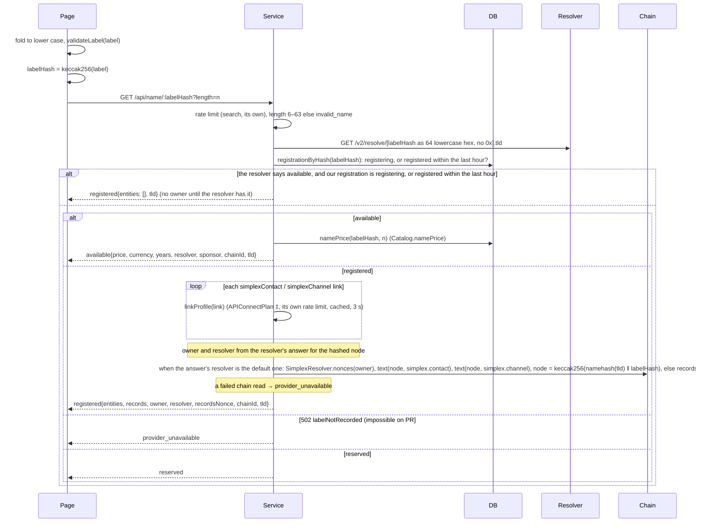

## 2. Checkout, owner code and order

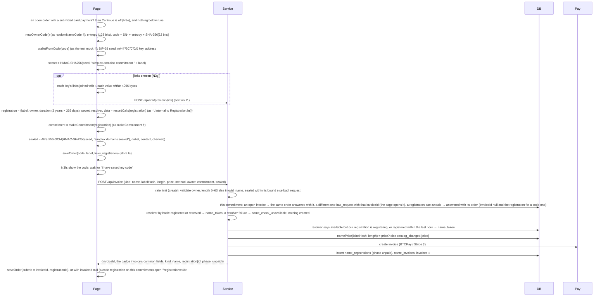

## 3. Payment and settlement

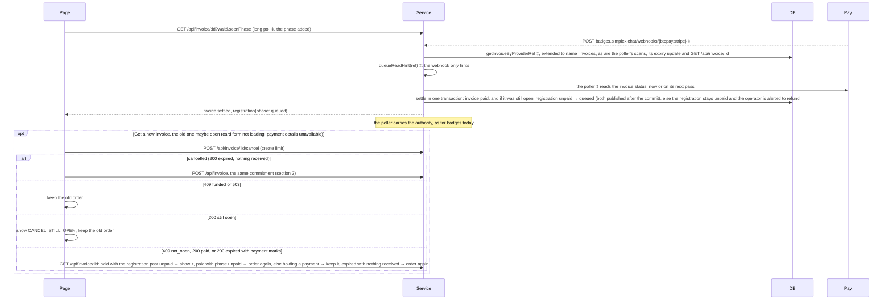

## 4. Commit

```mermaid
sequenceDiagram
  participant Page
  participant Service
  participant Worker
  participant DB
  participant Chain
  Worker->>DB: next queued registration
  Worker->>Worker: enqueue on the registrar's one sender
  Worker->>Chain: sendCommit(commitment) †, split to sign first: eth_estimateGas, nonce, fees, sign, hash = keccak256(raw transaction)
  Worker->>DB: phase committing, commit_tx (that hash and its raw transaction, saved before sending)
  Worker->>Chain: eth_sendRawTransaction
  loop until mined
    Worker->>Chain: eth_getTransactionReceipt(commitTx)
  end
  Note over Worker: a commit reverting, in its dry run (nothing sent) or mined with status 0, with commitments() + maxCommitmentAge still ahead is UnexpiredCommitmentExists, commit's only revert: the commitment is live, so the registration becomes committed with the reveal times from commitments(). A commit reverting with no live commitment (out of gas, or a commitment that lapsed by the read) is sent (again, if it was mined), a second later when the read falls at commitments(commitment) + maxCommitmentAge itself, as the retry path waits at revealBefore. When the commitment had lapsed, label, secret, records, intent_*, error, the tx hashes and blocks, reveal_after and reveal_before are also cleared before the new commit is signed, so the page signs again
  Worker->>Chain: eth_call SimplexController.minCommitmentAge(), maxCommitmentAge()
  Worker->>DB: phase committed, reveal_after = commit block time + minCommitmentAge, reveal_before = commit block time + maxCommitmentAge
  Page->>Service: (long poll with seenPhase, read limit) registration{phase: committed, revealAfter, revealBefore}
```

## 5. Reveal and the owner's intent

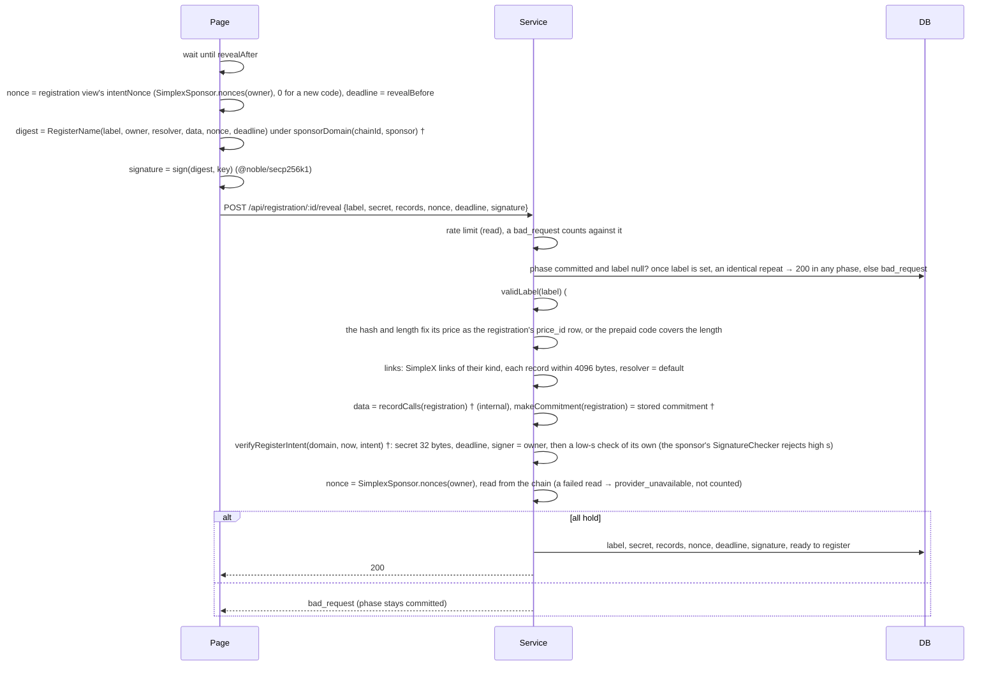

## 6. Register and confirm

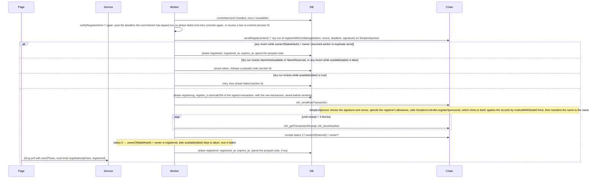

## 7. A prepaid code

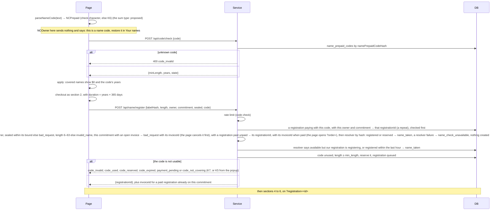

## 8. Taken: another name, or a prepaid code

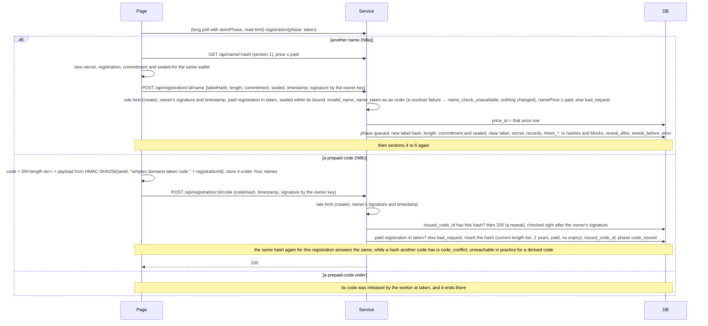

## 9. Failed, retried, lapsed

```mermaid
sequenceDiagram
  participant Page
  participant Service
  participant Worker
  participant DB
  participant Chain
  Worker->>DB: phase failed, failed_at (retries exhausted, or the commitment passed maxCommitmentAge unrevealed)
  Page->>Service: POST /api/registration/:id/retry
  Service->>Service: rate limit (create), phase failed? else bad_request
  Service->>Chain: a register_tx of this registration (any hash) mined with status 1, or ownerOf(labelHash) = owner (a revert counts as no)? then phase registered (a lost confirmation): registered_at, expires_at, spend the prepaid code (alert the operator if released to another), done (a failed read → provider_unavailable, nothing changed)
  alt a prepaid-code registration whose released code is used, revoked, expired or held elsewhere
    Service-->>Page: code_used, code_invalid, code_expired or code_reserved, the registration stays failed, failed_at unchanged
    Note over Page: N9 shows the code's outcome: used, held elsewhere (try later), not valid, or expired
  else
    Service->>DB: a released code is reserved again
    Service->>DB: phase queued, no charge, clear failed_at, error and the register's tx hashes and blocks, and label, secret, records, intent_* when intent_nonce ≠ SimplexSponsor.nonces(owner)
  end
  Note over Worker: from queued, the worker reads commitments(commitment): 0 (consumed by this registration already ruled out) with a commit pending → wait, else section 4, where a commit reverting UnexpiredCommitmentExists → committed with the reveal times from commitments(). Non-zero, with revealBefore = commitments(commitment) + maxCommitmentAge (reveal_before may be null): with at least revealMargin left before revealBefore (time for the reveal and the register) → committed with the reveal times from commitments(), clearing label, secret, records, intent_* and the commit's tx hashes and blocks when the commitment's time is not the block time of a commit of ours mined with status 1 (anyone can commit a lapsed commitment again), with less → wait until a second after revealBefore and go on as after it, at it → wait a second, after it → clear label, secret, records, intent_*, error, tx hashes and blocks, reveal_after, reveal_before, then section 4, so the page signs again
```

## 10. Restore with the owner code

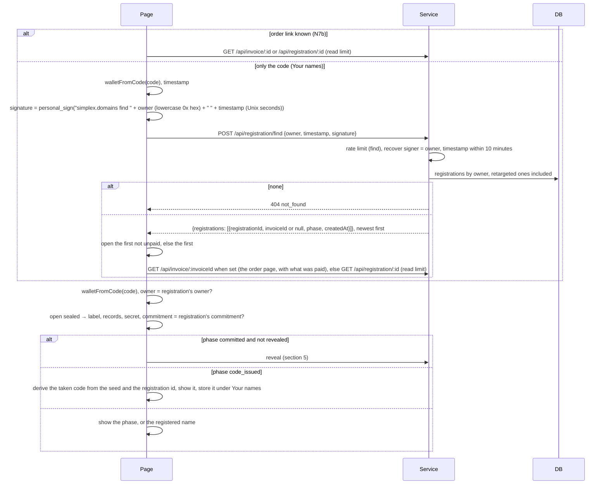

## 11. Links: preview at checkout, edit later

```mermaid
sequenceDiagram
  participant Page
  participant Service
  participant DB
  participant Chain
  Page->>Service: POST /api/link/preview {link}
  Service->>Service: rate limit (preview, its own)
  Service->>Service: parse a SimpleX contact or channel link, within 4096 bytes, linkProfile(link) (APIConnectPlan ‡)
  Service-->>Page: {type, displayName, image} or invalid_link
  Note over Page: the links go into registration.data at checkout (section 2)
  Note over Page: a key holds its links joined with #59;, so removing one of several rewrites the value, and clearing a key sets "". To clear all, the page signs ClearRecords and the service relays clearRecordsWithSig
  loop each changed key (N12b)
    Page->>Page: no Edit links when the answer has an owner other than the code's address (redeemed) or an owner and null records (another resolver or none), else the values from the answer's records or, during the lag (Edit links only once the view is registered), the order's links in sealed, or this browser's last mined edit of that key (a mined clear sets both to ""), with the chain id and resolver from the view, and nonce = recordsNonce from the search answer or the registration view, +1 after each {tx}, the same after record_reverted, re-read after any bad_request, deadline = now + 1 hour, SetText(node, key, value, nonce, deadline) under the SimplexResolver domain, sign
    Page->>Service: POST /api/name/records {labelHash, key, value, nonce, deadline, signature}
    Service->>Service: rate limit (records, its own, every request)
    Service->>Service: key simplex.contact or simplex.channel, links of that kind within 4096 bytes (invalid_link)
    Service->>Service: signer = recoverAddress †(signature, SetText or ClearRecords digest), low s? else bad_request, not counted toward the cap
    Service->>DB: name_record_edits by signer and nonce
    Note over Service: before any deadline check, an identical repeat (the same body on any row) waits for the same tx while pending, answers it once mined (tx null for an edit found applied with the transaction unknown), or record_reverted again for a reverted edit. Only a body on no row is new, and with a nonce whose edit is pending or mined it is bad_request. After record_reverted the nonce is free again for a new body
    Service->>Service: only for a new edit: deadline ahead of the latest block (else bad_request, not counted toward the cap), per-name cap (rate_limited)
    Service->>Chain: signer = ENSRegistry.owner(node), nonce = SimplexResolver.nonces(signer)? else bad_request, not counted toward the cap (a failed read → provider_unavailable)
    Service->>DB: insert the pending edit (signer, nonce, body_hash), unique among pending and mined rows: a concurrent twin loses here, before any signing
    Service->>Service: enqueue on the registrar's one sender (the worker's), which assigns the key's nonce and signs
    Service->>DB: the signed transaction's hash and raw bytes, saved before sending
    Service->>Chain: send setTextWithSig(node, key, value, nonce, deadline, signature), paying gas, until mined
    Service->>DB: the edit's state, mined or reverted
    Note over Service: on any revert (an applied edit reverts InvalidNonce, or SignatureExpired once its deadline has passed) or a restart's expiry, the service re-reads nonces(signer) and the record: nonce past this edit's and the record holding its value (for a clear, both keys "") answers mined with tx null, otherwise record_reverted. A restart that finds the edit's registrar nonce used with no receipt does the same read: applied answers mined with tx null, otherwise the edit is signed again under a new registrar nonce while its deadline is ahead, then the expiry rule applies
    Service-->>Page: {tx}, or record_reverted with the revert's name when known (a mined revert: SignatureExpired past the deadline, else null)
  end
```

## 12. Redeem in the app

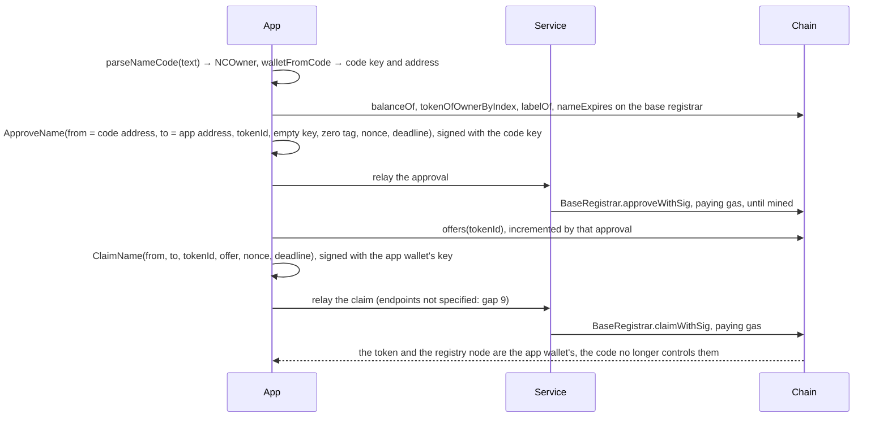

## 13. Opened from the app

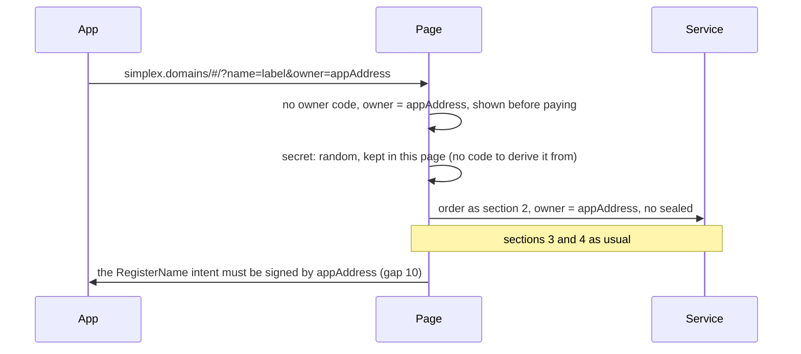

## 14. Gaps found

1. **The page cannot build the sponsor's EIP-712 domain.** `sponsorDomain(chainId, sponsor)` † needs the chain id and the `SimplexSponsor` address, but the search answer carries only `resolver`.
   - Fix: `available{…, resolver, sponsor, chainId, tld}`; the TLD (`[names] tld`) builds the records' node.
2. **The intent can expire before it is sent.** The page signs with a deadline. If the register is sent after it, because of a gas spike, retries or a queue, `verifyRegisterIntent` fails and the sponsor reverts.
   - Fix: the page signs with `deadline = revealBefore` (the commit's block time + `maxCommitmentAge`). The controller reverts `CommitmentTooOld` from that time, so an expired intent means the commitment it was signed against has lapsed (a third party may have committed it again since, which section 9 handles): the registration goes to `failed`, and retry commits again (section 9) before the page signs anew.
3. **The registrar has one nonce for all workers.** `sendTransaction` † reads the pending nonce for each transaction, so two registrations sending at once collide. It also never replaces a stuck transaction.
   - Fix: one sender queue for the registrar key, and replacement with a fee bump after a timeout.
4. **No receipts and no `minCommitmentAge`.** The branch's client sends and returns a hash; it never reads a receipt or `minCommitmentAge()`.
   - Fix: add `waitReceipt`, `confirmations` and `minCommitmentAge` reads (sections 4 and 6); the branch's section 7 lists the receipt and the `minCommitmentAge` wait.
5. **Telling taken from failed.** The sponsor calls the controller without catching, so a taken name's revert data, `NameNotAvailable(label)` or `NameReserved(label)`, reaches the caller. In process, `e2e/StoreE2E.test.ts` sees `NameNotAvailable` in the error text only because Hardhat names errors from every compiled contract; that is not decoding. Over JSON-RPC, `hardhat node` 3.1.4 (the PR's version) answered every revert we sent with `-32603 Internal error` and no data, which explains the loss Alain's plan reports; Hardhat 3.19.0 and anvil return it. The data carries the controller's selector, which is not in the sponsor's ABI. Whether reth's `error.data` carries it is unchecked.
   - Fix: decode the revert data against the sponsor's, controller's and base registrar's errors together, as `e2e/LocalChain.test.ts` does over HTTP on anvil. On any revert, read `ownerOf(labelHash)` first (the owner holding it means this registration went through); otherwise a decoded `NameNotAvailable` or `NameReserved`, or any other revert while `available(label)` is false, means taken or reserved. The sponsor checks the intent's signature, nonce and deadline and spends the allowance before the controller checks availability, so a taken name can first revert `SignatureExpired`, `InvalidNonce`, `InvalidSignature` or `InsufficientAllowance`.
6. **The commitment fixes the links and the duration at checkout.** Links changed after the order need a new commitment before the commit, or an edit after registration.
   - Fix: allow editing links only until the order is created.
7. **Resolved: the price may change between order and reveal.** The registration's `price_id` fixes the price at order time, or at retarget after its check against what was paid; `name_prices` is insert-only, so that row stays. The reveal compares no price: the label's hash and length make that row its price.
8. **Resolved: a lapsed commitment can be committed again.** `SimplexController.commit` reverts `UnexpiredCommitmentExists` while `commitTime + maxCommitmentAge >= now`, and registering reverts `CommitmentTooOld` once `commitTime + maxCommitmentAge <= now`: at `revealBefore` itself neither works, and from the next second the same commitment commits again (`e2e/StoreE2E.test.ts` checks both to the second: at one commitment's `revealBefore` it reverts `CommitmentTooOld` and cannot be committed again, while a commitment one second younger registers in that same second, and the first commits again a second later). A retry needs no new secret.
9. **Redeeming in the app has no service API.** There is no relay endpoint for `approveWithSig` and `claimWithSig`, and no way for the app to learn which name an owner code holds.
   - Fix: the app reads the code's names on chain (the registrar is ERC-721 enumerable, with `labelOf` and `nameExpires`). Add relay endpoints for `approveWithSig` and then `claimWithSig`; the claim signs `offer = offers(tokenId)` read after the approval.
10. **Opened from the app: the intent's signer is the app.** The page cannot sign for `appAddress`. The page's random secret is also lost if the page closes, and a taken order cannot sign `/name` or `/code` without the app.
    - Fix: the app builds and keeps the registration, signs the intent, and the page only takes the payment. Or defer the flow.
11. **Resolved: editing links later.** PR #35's `SimplexResolver` has `setTextWithSig` (EIP-712 `SetText`, domain `SimplexResolver`) and `clearRecordsWithSig` (`ClearRecords`), sharing one nonce counter per owner; there are no edit credits; a `SetText` intent covers one record and a `ClearRecords` intent all of the name's records; `Multicallable` would let the relayer send several signed edits in one transaction. The page needs that nonce and the chain id, so the registered search answer carries them with the resolver, and the registration view carries the nonce while search lags; several edits go one at a time: the service accepts an edit only when its nonce equals `nonces(owner)` on chain and answers once it is mined, so the page signs the next after that answer; a higher nonce sent early would revert `InvalidNonce`, since the contract does not queue intents. The service relays one transaction per edit, its choice, and bounds the cost itself. Two consecutive edits, relayed in order, are in `e2e/StoreE2E.test.ts`.
12. **Resolved: search during our own registration** uses the index on `name_registrations.label_hash` with `phase`, now in both schemas, and `registered_at` for the resolver's hour of lag.
13. **Resolved: the reveal's rate limit.** It takes the read limit, and each `bad_request` from it counts against that limit.
14. **Resolved: Alain's encoder carries the intent nonce.** Since `965046fe1` ("adapt contract updates") `Registration.hs` has `riNonce`, the `registerWithCredit((…),uint256,uint256,bytes)` selector and the `RegisterName(…,uint256 nonce,uint256 deadline)` typehash, matching PR #35 at `0f882c0`. What remains for the service: check the nonce against `SimplexSponsor.nonces(owner)` at the reveal (section 5).
15. **Contract details the flow must respect** (from PR #35, each exercised by `e2e/StoreE2E.test.ts`): `reverseRecord` must be 0 (`ReverseRecordNotSupported`); records need a non-zero resolver (`ResolverRequiredWhenDataSupplied`); the duration is at least two years (`DurationTooShort`); the sponsored path is not gated by the public sales switch; the registrar's allowance is in attoUSD (`SimplexSponsor`, as `rentPriceUSD` quotes) and set by the guardian (`setRegistrarAllowance`); `registerWithCredit` spends the name's list price (`rentPriceUSD`, base + premium) from it.
16. **Retry must not re-commit a live commitment.** `commit` reverts `UnexpiredCommitmentExists` until a second after `revealBefore`, for example after a `failed` caused by `InsufficientAllowance`.
    - Fix: the worker reads `commitments(commitment)` first and, when it is live, goes straight to `committed`.
17. **The allowance is the guardian's, not the service's.** `setRegistrarAllowance` is callable only by `controller.beneficiary()`, replaces the value, and is spent at list price for the whole duration. `InsufficientAllowance` must alert the operator, and while `available(label)` is true it is `failed`, never `taken`.
18. **Prepaid codes under 2 years cannot register:** `DurationTooShort` below 730 days. `//issue name … years <Y>` refuses fewer than 2.
19. **The store needs a fresh PR #35 deployment, and a deploy script.** The approve/claim functions (base registrar) and the registry's one EIP-712 signed operation, `setApprovalForAllWithSig` (`SimplexENSRegistry` domain) are in non-upgradeable contracts, so today's `.testing` does not have them. The PR's own scripts deploy a plain `PublicResolver`, no `SimplexSponsor`, and a premium price oracle; the wiring the store needs is listed in the plan's context: the fixture's contracts with the deploy scripts' commitment ages and label cap. `e2e/deployLocal.ts` deploys exactly that to a local anvil and prints the service's config; a mainnet script still has to do the same with real keys.
20. **A transaction can pass its dry run and still revert when mined** (the deadline passes, the name is registered in the same block, the allowance runs out). The worker requires receipt `status` 1 and `ownerOf(tokenId) == owner` before `registered`, and on `status` 0 reads `ownerOf(labelHash)` first (the owner holding it is `registered`), then `available(label)` to choose `taken` or `failed`; a commit's receipt is checked by its `status` and `commitments(commitment)`, since before the reveal there is no label.
21. **The registration view carries what the page signs with:** `intentNonce` (`SimplexSponsor.nonces(owner)`) and `revealBefore` (commit block time + `maxCommitmentAge`, 24 h in PR #35's deploy), and for a browser with only the owner code, `sealed` (the label and links), `commitment`, `years` (the duration), `resolver`, `sponsor`, `chainId` and `tld`, enough to rebuild the commitment and the intent; `e2e/StoreE2E.test.ts` registers from only the code and those fields.
22. **Resolved: a consumed commitment also reads 0.** A successful register deletes its commitment, so retry cannot tell it from one never committed by `commitments()` alone; when the owner has since redeemed the name, `ownerOf` no longer shows the owner either. Retry first reads the registration's own register receipts: `status` 1 on any of them means `registered`, whoever holds the name now, and only then does a 0 lead to a new commit. The commitment covers the owner, so any register of it gives the name to this owner, and `ownerOf` catches that while the owner holds the name; only once the name has left the owner (redeemed, transferred or expired) does a register this registration did not send go undetected: another registrar holding the signed `RegisterName` intent, or the owner's own payable `register`, which needs no intent but the code's secret and open public sales.
23. **Resolved: a fee-bumped replacement mines under a new hash** (gap 3). The registration keeps every hash it sent for a commit or a register, and both "pending" and "mined" are judged over all of them, so a replacement that mined is never missed. Each hash is saved before its transaction is sent (it is known once signed), so a crash between the two loses none. The raw signed transaction is saved with its hash. A restart rebroadcasts each saved raw transaction that has no receipt, and rebroadcasts it again after a timeout while the node does not know it and its registrar nonce is unused. Once that nonce is used, the worker reads the effect on chain before signing again, since a pruned node also shows a mined transaction as unknown: a commit counts as mined when `commitments(commitment)` plus `maxCommitmentAge` is still ahead (the worker sends a commit only when the commitment reads 0 or has lapsed, and a lapsed one keeps its old time), and the registration becomes `committed` with the reveal times from `commitments()`; a register counts as mined when `ownerOf` is the owner. An edit counts as applied by its nonce and the record.
24. **Resolved: relayed record edits are stored.** `name_record_edits` keeps each edit's signed body hash, every hash sent and its state, so an identical repeat is answered after a restart (its `{tx}`, or `record_reverted` again) and the per-name cap is counted; the relay sends through the worker's one sender.
25. **The resolver host's reth runs `--minimal`** (simplexmq `scripts/resolver/docker-compose.yml`). As far as known, not yet checked against reth's source, that prunes the hash-to-transaction index fully and keeps receipts only for about the last 10,000 blocks, so `eth_getTransactionReceipt` could fail even for a recent transaction, and `/retry`'s step 1 could not read a receipt older than about 10,000 blocks, some 33 hours (it falls back on `ownerOf` when the node answers a pruned receipt with null; an RPC error there is a failed read, so `/retry` answers `provider_unavailable`). Check reth's minimal pruning before relying on that node, or point the worker at a node that keeps the index and receipts. On such a node a mined transaction also looks unknown, which is why the rebroadcast rule (gap 23) reads the effect on chain rather than re-signing blindly.
26. **A closed name invoice paid late.** Today's settlement marks even an expired invoice paid on a settled signal, with no alert (`Orders.hs`, `Poller.hs`); the name side checks the invoice's prior state. Get a new invoice reuses the commitment, so a late payment of the closed invoice must not queue its registration: that registration stays `unpaid` and is never deleted by the 30-day cleanup, which spares any invoice that received a payment, and the late payment is kept for support to refund, so one commitment never has two paid registrations (a different order for a commitment with an open invoice is refused and a matching resend gets that invoice; an order or a code register for a commitment with a registration past unpaid gets that registration; Get a new invoice cancels an open invoice first, ordering again only after the cancel succeeds). The page shows "Paid after the invoice closed; support refunds it" with the reference, in the order and in history. The poller and the provider list pass read an invoice only within about 72 hours of its creation (`settleWindow` ‡), after which only a webhook brings a payment, and the BTCPay handler gains `InvoiceReceivedPayment` and `InvoicePaymentSettled` as read hints, since today it acts only on `InvoiceProcessing`, `InvoiceSettled`, `InvoiceExpired` and `InvoiceInvalid`; the 30-day cleanup reads the invoice from the provider itself (`pReadInvoice`, then settlement) before deleting, and keeps the registration until the next daily run if the provider does not answer, so a lost webhook does not lose the payment.
27. **Resolved: a lost answer to `/api/name/register`.** The code may already be reserved for a `queued` registration. Try again resends the same body, and the repeat check, run right after the rate limit, answers that `registrationId`; a buyer who leaves finds it through Restore with a name code.
28. **Resolved: concurrent edits with one nonce.** The pending row (owner, nonce, body hash) is inserted before the edit joins the sender, so of two concurrent requests the second fails the unique insert and is answered as a repeat or `bad_request` before any registrar nonce is assigned or signature made. After a restart each pending edit resumes: it is sent if it has no transaction yet and its deadline is ahead; otherwise its receipt is polled, its saved raw transaction is rebroadcast while the node does not know it and the registrar nonce is unused, and once the registrar nonce is used with no receipt found, the edit is checked on chain by its nonce and the record: if applied, it becomes `mined` with no hash known to have mined; otherwise it is signed again under a new registrar nonce while its deadline is ahead. One with nothing mined once a block `confirmations` deep has a timestamp past its deadline gets the same check: if applied, it becomes `mined` with no hash known to have mined; otherwise `reverted` (`SignatureExpired`), so an orphaned row never blocks the edit's nonce. Its saved transaction is still rebroadcast until its registrar nonce is used, so the key's later transactions never wait on a gap; mined late, it reverts `SignatureExpired` harmlessly. The row keeps the edit itself (key, value or the clear form, deadline, signature), so a restart can send it.
29. **The new limits have no values.** The search, profile fetch, link preview, code check, find and records rate limits and the per-name edit cap are named but not sized. Today's limits are constants per client in `Web/Server.hs` ‡ (`readLimit` 60 and `createLimit` 5 per minute), not config, and a `Limit` can only count per fixed 60 s window (`limitWindow`), so a longer window (per hour on code check or find) needs `Limit` and `takeToken` extended, and today's server never sends a `Retry-After` above 60 s; the new ones would follow that, and the cap needs a count and a window over a name's `name_record_edits` rows. Retry's `revealMargin`, the least time before `revealBefore` for which a live commitment is reused, needs a value too: enough for the page's reveal and the register to mine. All limits share one bucket map capped at `maxBuckets = 8192` (one bucket per limit and client, `Web/Server.hs`), which, when full, first drops buckets older than the window and then, if more than half are still live, the lowest-count half, so about six new limits may need it raised. The client clamps `Retry-After` at 300 s (`RETRY_AFTER_MAX_SECONDS` in `api.ts`), so a per-name cap window over 5 minutes needs the page to show when edits reopen rather than retry, or a larger clamp for it. Decide them before the service is built.
30. **An edit judged applied by its nonce and record can be misjudged.** The re-read after a revert, an expiry or a lost receipt treats an edit as applied when the signer's nonce has passed it and the record holds its value. A later edit that overwrote the key makes an applied edit answer `record_reverted`, and a record that already held the value while another edit took the nonce makes an unapplied one answer `{tx: null}`. The page recovers through its next `bad_request` and nonce re-read, but the outcome shown is wrong. Matching the resolver's `TextChanged`/`VersionChanged` logs for the node to a transaction carrying this edit's signature would decide it exactly: PR #35's `SimplexResolver` emits `TextChanged` from `setTextWithSig` and `VersionChanged` from `clearRecordsWithSig`; whether a pruned node keeps those logs is not checked.
31. **Which resolver serves the fresh deployment.** The resolver knows two TLDs with one deployment each, and its `testing` defaults to the live mainnet `.testing` contracts (simplexmq `scripts/resolver/service/snrc-resolve.py`, `REGISTRIES`, `REGISTRARS`, `CONTROLLERS`), which the SMP relays resolve through. A fresh PR #35 deployment under `tld = testing` needs its own resolver instance with `SNRC_REGISTRY_TESTING`, `SNRC_REGISTRAR_TESTING` and `SNRC_CONTROLLER_TESTING` set to it and `resolver_url` pointing there, or `.testing` itself redeployed; pointing the shared resolver at it would take the live names from the relays. An owner decision, with Alain.
