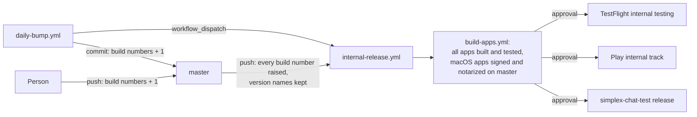

# CI on GitHub's runners

Three workflows build the apps from a branch's own code and test them, only when asked: `ios-sim` (the iOS app in a simulator on a macOS runner), `desktop-linux` (the desktop app on a Linux runner) and `android-emu` (the Android app in an emulator on a Linux runner). Each runs a scripted smoke test and, on request, a Claude session that follows a test plan, and a test backend (relay, directory, names server, peers). Details: [iOS](ios-sim/README.md), [desktop](desktop-linux/README.md), [Android](android/README.md).

## Reduced build

GitHub runs the reduced build of `build.yml` on a dispatch (workflow_dispatch), on each push to a draft pull request and on a push to master or stable in a fork. Once the pull request is marked ready for review, GitHub runs the full matrix, as on a push to master or stable in simplex-chat/simplex-chat.

On a push to master or stable in a fork, the release steps and tests are skipped; build-linux saves the -O0 build caches, and on master the Docker image cache, that the fork's dispatches restore.

On a draft pull request, the tests are selected by a fenced block with the info string `ci-tests` in the description, one hspec match pattern per line; the block is read at each push. `/` runs the whole suite; without a block, the reduced build runs no tests.

### Dispatch

```sh
curl -fsS -X POST \
  -H "Authorization: Bearer $GH_TOKEN" \
  -H "Accept: application/vnd.github+json" \
  https://api.github.com/repos/<owner>/simplex-chat/actions/workflows/build.yml/dispatches \
  -d '{"ref": "<branch>", "inputs": {"tests": "/SimpleX chat client/group tests/\n/Message batching/"}}'
```

Endpoint: https://docs.github.com/en/rest/actions/workflows#create-a-workflow-dispatch-event. Inputs:

| Input | Default | Value |
|---|---|---|
| `tests` | empty | hspec match patterns, one per line (`\n` in JSON); `/` runs the whole suite, and an empty value builds without tests |
| `base` | `master` | the branch that the changes are compared with:<br>`stable` for a branch cut from stable<br>the parent branch for a stacked branch |

When a newer dispatch on the same branch starts build-linux or build-ios, GitHub cancels the unfinished job of the older one (`cancel-in-progress`).

Results:
- Run and jobs: `GET /repos/<owner>/simplex-chat/actions/runs?head_sha=<commit>&event=workflow_dispatch` returns the run id; `GET /repos/<owner>/simplex-chat/actions/runs/<run id>/jobs` returns each step with its start, end and conclusion.
- Job log: `GET /repos/<owner>/simplex-chat/actions/jobs/<job id>/logs` returns a redirect to a text file, valid for 1 minute (https://docs.github.com/en/rest/actions/workflow-jobs#download-job-logs-for-a-workflow-run). The test summary is printed as "Finished in N seconds" and "N examples, N failures".

### Scopes

The reduced build runs one Linux job, build-linux (ubuntu-22.04 x86_64), for every scope except ios, and one macOS job, build-ios (macos-26), for ios.

#### core

- Globs: `BUILD_CHANGES["haskell"]` in packages_release.py.
- CI, in build-linux:
  - Docker image (step "Build and cache Docker image");
  - caches (the steps "Restore ... from cache");
  - `cabal build -j --enable-tests --ghc-options=-O0` (step "Build CLI");
  - simplex-chat-test with the selected tests (step "Run tests"), each attempt limited to 35 minutes by `timeout`; an attempt that reaches the limit fails, and "Attempt <n> timed out." is printed.
- App test fixtures: core tests write the core's responses that the app tests use to tests/fixtures/api (`/names tests/` to tests/fixtures/api/names, `/contact via address/` to tests/fixtures/api/connect), and fail when a response differs from the committed file; the rewritten files are committed, and the kotlin and ios scopes run for them.
- Local:
  ```sh
  cp scripts/cabal.project.local.linux cabal.project.local
  cabal build --enable-tests --ghc-options=-O0
  mkdir -p tests/tmp
  cabal test simplex-chat-test --ghc-options=-O0 --test-option=-m --test-option='/SimpleX chat client/group tests/'
  ```
  The selection runs as in CI with scripts/ci/run-tests.sh, which appends the patterns of `TESTS` to the test binary:
  ```sh
  TESTS='/SimpleX chat client/group tests/' scripts/ci/run-tests.sh "$(cabal list-bin simplex-chat-test --ghc-options=-O0)"
  ```
  `--ghc-options=-O0` matches the reduced build; the library and test-suite stanzas of simplex-chat.cabal set -O2. Test directories are created under tests/tmp (`tmpBracket` in tests/Test.hs).

#### kotlin

- Globs: `BUILD_CHANGES["kotlin"]` in packages_release.py.
- CI: Gradle in the Docker container of build-linux (step "Build and test Kotlin apps", matrix field `kotlin`).
- Local:
  ```sh
  cd apps/multiplatform
  ./gradlew --no-daemon --max-workers=1 :common:desktopTest :desktop:compileKotlinJvm -x :desktop:cmakeBuildAndCopy :android:compileGoogleDebugKotlin :android:testFossDebugUnitTest
  ```
  JDK 17 and an Android SDK in ANDROID_HOME are required, as installed by Dockerfile.build.

#### ios

- Globs:
  - apps/ios/**
  - tests/fixtures/api/**
  - scripts/ci/ios-stub-libs.sh
- CI: build-ios: stub libraries, then xcodebuild for the iOS Simulator without signing (step "Build iOS app"), then the target SimpleX Unit Tests, hosted by the app, in a new simulator (step "Run iOS unit tests"). The stubs of `chat_migrate_init` and `chat_migrate_init_key` return an empty string, so the app opens its database error screen and calls the core no more.
- Local, on macOS: `scripts/ci/ios-stub-libs.sh`, then the commands of the steps "Build iOS app" and "Run iOS unit tests" of build-ios.

#### packages

- Globs:
  - packages/simplex-chat-nodejs/**
  - packages/simplex-chat-client/types/typescript/**
  - packages/simplex-chat-python/**
  - scripts/ci/package-tests.sh
- CI, in build-linux:
  - Node 22 and Python 3.12 (steps "Setup Node.js" and "Setup Python");
  - libsimplex, when `CORE_SOURCES` of packages_release.py also changed (step "Build library");
  - `package-tests.sh build linux-x86_64` and `package-tests.sh test` (step "Package tests (pull request)").
- With libsimplex built, SIMPLEX_LIBS_DIR is set to it for the nodejs tests; the python tests run with it unset (package-tests.sh). Without SIMPLEX_LIBS_DIR, the pinned release libraries are downloaded (packages/simplex-chat-nodejs/src/libs.ts).
- Local:
  ```sh
  scripts/ci/package-tests.sh build linux-x86_64
  scripts/ci/package-tests.sh test
  ```

#### badge-web

- Globs: apps/simplex-badge-service/web/**. These paths are also in the core globs (apps/simplex-badge-service/**), and web/src/catalog.ts is read by core tests (tests/Bots/BadgeService/CatalogTests.hs, WebTests.hs).
- CI, in build-linux: core build and tests, then `scope-tests.sh badge-web` (step "Test changed scopes").
- Selected core tests: `/SimpleX badge service/` and `/SimpleX badge service e2e/`.
- Local:
  ```sh
  cd apps/simplex-badge-service/web
  npm ci
  npm test
  ```

#### ci-scripts

- Globs:
  - scripts/ci/packages_release.py
  - scripts/ci/test_packages_release.py
- CI, in build-linux: `scope-tests.sh ci-scripts` (step "Test changed scopes").
- Local: `python3 scripts/ci/test_packages_release.py`; Python 3.11 or newer is required for tomllib (packages_release.py).

#### website

- Globs:
  - website/src/js/simplex-lib.jsc
  - website/test/**
  - website/package.json
- CI:
  - in build-linux: `scope-tests.sh website` (step "Test changed scopes");
  - on master pushes: build and deploy of website/**, images/**, blog/**, docs/** and PRIVACY.md (web.yml).
- Local:
  ```sh
  cd website
  npm test
  ```

#### mcp

- Globs:
  - packages/simplex-chat-mcp/**
  - packages/simplex-chat-nodejs/**
  - packages/simplex-chat-client/types/typescript/**
- CI:
  - in build-linux: `scope-tests.sh mcp` (step "Test changed scopes"):
    - the types package and the Node.js library built from the branch without the add-on, as package-tests.sh builds them;
    - `npm ci`, then both installed into the MCP package with `npm install --no-save`;
    - `npx tsc` and `npx tsc -p test/tsconfig.json --noEmit`;
    - `npm test`, the unit tests;
    - `npm run test:e2e`, the end-to-end tests. They download libsimplex and the add-on pinned in packages/simplex-chat-nodejs/src/release.ts, and smp-server and xftp-server of the simplexmq release in test/e2e/smpServer.ts;
  - before a publication: the package with its published dependencies, type-checked and unit tested in job `publish` of build.yml (docs/contributing/RELEASES.md, "MCP server release").
- Local: `scripts/ci/scope-tests.sh mcp`.

#### support-bot

- Globs: apps/simplex-support-bot/**.
- CI, in build-linux: `scope-tests.sh support-bot` (step "Test changed scopes"): `npm ci`, `npm run build` and `npm test`, with the published `simplex-chat` and `@simplex-chat/types` of package-lock.json.
- The Docker image (scripts/support-bot/Dockerfile) is not built in CI.
- Local: `scripts/ci/scope-tests.sh support-bot`.

#### support-bot-light

- Globs:
  - apps/simplex-support-bot-light/**
  - packages/simplex-chat-python/**
- CI, in build-linux: `scope-tests.sh support-bot-light` (step "Test changed scopes"): the Python library of the branch and the bot installed in a virtual environment, then ruff, pyright and pytest. The tests use a fake API, without libsimplex.
- Local: `scripts/ci/scope-tests.sh support-bot-light`.

#### build-tool

- Globs:
  - scripts/simplex-chat-build.py
  - scripts/simplex_build/**
- CI, in build-linux: `scope-tests.sh build-tool` (step "Test changed scopes"): the unit tests of the build tool, then mypy 1.18.2 with `--strict` on its modules other than the tests, and ruff 0.14.0 with its default rules.
- Local: `scripts/ci/scope-tests.sh build-tool`; Python 3.12 or newer is required.

#### Scopes lacking CI tests

| Scope | Paths | CI |
|---|---|---|
| types package | packages/simplex-chat-client/types/typescript/** | compile only |
| ts-client | packages/simplex-chat-client/typescript/** | - |
| webrtc | packages/simplex-chat-webrtc/** | - |
| calculator-bot | apps/simplex-calculator-bot/** | - |
| prices | scripts/prices/** | - |
| nft | eth/nft/** | - |

CI coverage of such a scope is added in the pull request that changes it (Adding CI coverage).

### Adding CI coverage

For a scope lacking CI tests, in the pull request that changes it:
1. scripts/ci/packages_release.py: an entry `"<scope>": ["<glob>", ...]` in SCOPE_CHANGES.
2. build.yml, `on.pull_request.paths`: the same globs; the two are compared in `test_build_yml_runs_for_the_paths_of_its_builds` of test_packages_release.py.
3. scripts/ci/scope-tests.sh: a `<scope>)` case with the build and test commands, and the scope name in the usage line.
4. scripts/ci/test_packages_release.py, ChangesTest: a case asserting that the scope is printed in `scopes` for a change to one of its files.
5. This file, "Scopes": a subsection for the scope, in place of its row in "Scopes lacking CI tests".
6. Checks: `python3 scripts/ci/test_packages_release.py`, the new case of scope-tests.sh locally, then a dispatch of the reduced build.

The scope commands run in build-linux after the core tests, with Node 22 and Python 3.12 (steps "Setup Node.js" and "Setup Python"). For a scope that needs other versions, a setup step is added before "Test changed scopes", conditioned on the scope name in `needs.maybe-release.outputs.scopes`. A scope that needs macOS is a BUILD_CHANGES entry with a separate maybe-release output, as ios is, and a step in build-ios; the `if` of build-ios includes that output.

## Starting a run

Pushes start none of the app workflows: a run is started by hand, on any branch, with inputs that are off by default and combine.

| Input | iOS | Desktop | Android |
|---|---|---|---|
| no input | scripted test, the app uploaded | scripted test, the app uploaded | scripted test, the app uploaded |
| `claude` | scripted test, then Claude | scripted test, then Claude | scripted test, then Claude |
| `backend` | also the test backend | also the test backend | also the test backend |
| `release` | — | also the latest release's onboarding, to tell a branch's failure from the runner's | also the latest release's onboarding, to tell a branch's failure from the runner's |
| `armv7a` | — | — | also the core library for 32-bit Arm (armeabi-v7a), built only |

In the Actions tab: `ios-sim`, `desktop-linux` or `android-emu` → Run workflow, choose the branch and tick the inputs. With the GitHub CLI, each input is a field:

```sh
gh workflow run ios-sim.yml --ref <branch>
gh workflow run ios-sim.yml --ref <branch> -f claude=true
gh workflow run desktop-linux.yml --ref <branch> -f claude=true -f backend=true -f release=true
gh workflow run android-emu.yml --ref <branch> -f claude=true
```

A newer run of a workflow on the same branch cancels the older one.

Each run uploads the app it built, for manual tests, as an artifact kept 14 days: `ios-sim-app` (SimpleX.app.tar.gz, for the iOS simulator on an Apple-silicon Mac), `desktop-app` (desktop-app.tar.gz, for Linux x86-64) and `android-app` (the debug APK, arm64-v8a only). The run's page lists it under Artifacts; `gh run download <run id> -n <artifact>` downloads it.

## How long a run takes

| Run | iOS | Desktop | Android |
|---|---|---|---|
| Scripted test, builds reused | about 25 min, plus the wait for a macOS runner, which the team's builds share (minutes to an hour) | about 10 min | about 15 min |
| The core rebuilt, after Haskell changes | 30–45 min more | about 25 min more | about 27 min more |
| With the test backend | 20–45 min more when it is rebuilt, then about 10 min to start | about 30 min more when it is rebuilt, then a few minutes to start | as desktop, whose backend it shares |
| With Claude on the smoke plan | 10–15 min more | about 4 min more | about 5 min more |

## The Claude job

It needs the GitHub environment `app-sim-claude` with the secret `CLAUDE_CODE_OAUTH_TOKEN`, a Claude subscription token. The environment's branch rule alone decides which branches may use it: on a branch it doesn't allow, a run that asks for Claude fails at the Claude job's environment check, and the scripted test runs as usual. Each run spends the subscription's usage limits; the job summary gives its tokens and cost estimated at API prices.

## Builds for signing

`build-apps.yml`, started by hand or by `internal-release.yml`, builds the Android APKs, the Play bundle and the iOS archive of a commit without signing them, and uploads them as artifacts, which are signed outside CI or by `internal-release.yml`: [details](build-apps/README.md).

## Internal releases

`internal-release.yml` releases a master commit to the testers: TestFlight's internal group, Google Play's internal track, and a release of simplex-chat/simplex-chat-test with the desktop apps and the test APKs. `daily-bump.yml` raises the build numbers each day and starts it.



### Start

| Workflow | Starts on | Does |
|---|---|---|
| `daily-bump.yml` | 04:17 UTC<br>a manual run, input `branch`, default master | when the branch has commits after the last change of a build number: commits + 1 to `android.version_code` and `desktop.version_code` (apps/multiplatform/gradle.properties) and to every `CURRENT_PROJECT_VERSION` (apps/ios/SimpleX.xcodeproj/project.pbxproj), pushes with GITHUB_TOKEN, then starts `internal-release.yml` on the branch, as GitHub starts no workflow for that push |
| `internal-release.yml` | a push to master that raises the three build numbers and keeps `android.version_name`, `desktop.version_name` and `MARKETING_VERSION`<br>a manual run | builds the commit with `build-apps.yml` (input `internal-release`), then signs and uploads the apps |

GitHub runs a scheduled workflow only from the default branch, stable, and starts a manual run only of a workflow on the default branch or of one that has run before. So both workflow files are committed to stable too, when they are merged into master and at each change: the schedule runs stable's `daily-bump.yml`, which raises the build numbers of master with master's scripts.

`scripts/ci/internal-release/build-numbers.sh` reads, compares and raises the build numbers. A run waits while an earlier run of the branch is unfinished (`queue: max`).

### Jobs

On master, the macOS jobs of `build-apps.yml` sign and notarize the apps with the repository secrets of build.yml. The jobs `ios`, `android` and `publish` run in the environment `internal-release`, and start after a reviewer approves them, all three at once, when every build and smoke test has passed.

| Job | Secrets | Result |
|---|---|---|
| `build`, `build-apps.yml` | `APPLE_SIMPLEX_*` in the macOS jobs, on master<br>`SIMPLEX_ART_SSH_KEY` in the iOS job | every app; on master, the macOS apps signed with the Developer ID and notarized |
| `ios` | `IOS_*`, `APP_STORE_CONNECT_*` | the archive exported with the Apple Distribution certificate and uploaded for internal testing only (`testFlightInternalTestingOnly`) |
| `android` | `ANDROID_UPLOAD_*`, `GOOGLE_PLAY_SERVICE_ACCOUNT` | the Play bundle signed with the upload key and released to the internal track; while a Play update is in review, the upload fails and the review continues (`changesInReviewBehavior=ERROR_IF_IN_REVIEW`) |
| `publish` | `ANDROID_TEST_*`, `SIMPLEX_CHAT_TEST_TOKEN` | the test APKs signed as `simplex.apk` and `simplex-armv7a.apk`; in simplex-chat-test, a commit of `release.json` with the version names, the build numbers and the commit, and the release `<desktop.version_name>-<desktop.version_code>` with the desktop apps and the APKs |

A step without its secrets skips with a notice, so that the workflow runs in a fork without keys. The `ios` job is skipped with a notice while `MARKETING_VERSION` is not above the version in the App Store, whose TestFlight train is closed.

The msi version of an internal release is `<major>.<minor>.<desktop.version_code>` (`SIMPLEX_INTERNAL_RELEASE` in apps/multiplatform/desktop/build.gradle.kts); public releases keep `<major>.<minor>.<patch>`. jpackage derives the msi's product code from its version, and Windows Installer refuses an msi whose product is installed from another msi. jpackage's msi removes an installed build of any other version, higher or lower, so a public msi replaces an internal one.

### Setup

1. The environment, with a reviewer, for master only:
   ```sh
   gh api -X PUT repos/simplex-chat/simplex-chat/environments/internal-release --input - << EOF
   {"reviewers": [{"type": "User", "id": $(gh api users/<reviewer> --jq .id)}],
    "deployment_branch_policy": {"protected_branches": false, "custom_branch_policies": true}}
   EOF
   gh api -X POST repos/simplex-chat/simplex-chat/environments/internal-release/deployment-branch-policies -f name=master -f type=branch
   ```
2. The secrets of the environment. `gh secret set` reads the value from its standard input, or asks for it:

   | Secret | Value | Command |
   |---|---|---|
   | `IOS_DISTRIBUTION_CERTIFICATE` | the Apple Distribution certificate with its private key, a .p12 file, in base64 | `base64 < distribution.p12 \| gh secret set IOS_DISTRIBUTION_CERTIFICATE --env internal-release` |
   | `IOS_DISTRIBUTION_CERTIFICATE_PASSWORD` | the password of the .p12 file | `gh secret set IOS_DISTRIBUTION_CERTIFICATE_PASSWORD --env internal-release` |
   | `IOS_PROFILE_APP` | the App Store profile of chat.simplex.app, in base64 | `base64 < app.mobileprovision \| gh secret set IOS_PROFILE_APP --env internal-release` |
   | `IOS_PROFILE_NSE` | the App Store profile of chat.simplex.app.SimpleX-NSE, in base64 | `base64 < nse.mobileprovision \| gh secret set IOS_PROFILE_NSE --env internal-release` |
   | `IOS_PROFILE_SE` | the App Store profile of chat.simplex.app.SimpleX-SE, in base64 | `base64 < se.mobileprovision \| gh secret set IOS_PROFILE_SE --env internal-release` |
   | `APP_STORE_CONNECT_KEY` | a team key of App Store Connect with the role Developer, the .p8 file | `gh secret set APP_STORE_CONNECT_KEY --env internal-release < AuthKey_<key id>.p8` |
   | `APP_STORE_CONNECT_KEY_ID` | its key ID | `gh secret set APP_STORE_CONNECT_KEY_ID --env internal-release --body <key id>` |
   | `APP_STORE_CONNECT_ISSUER_ID` | the issuer ID of the team keys | `gh secret set APP_STORE_CONNECT_ISSUER_ID --env internal-release --body <issuer id>` |
   | `ANDROID_UPLOAD_KEYSTORE` | the keystore of the Play upload key, in base64 | `base64 < upload.jks \| gh secret set ANDROID_UPLOAD_KEYSTORE --env internal-release` |
   | `ANDROID_UPLOAD_KEYSTORE_PASSWORD` | its password | `gh secret set ANDROID_UPLOAD_KEYSTORE_PASSWORD --env internal-release` |
   | `ANDROID_UPLOAD_KEY_ALIAS` | the alias of the upload key | `gh secret set ANDROID_UPLOAD_KEY_ALIAS --env internal-release --body <alias>` |
   | `ANDROID_UPLOAD_KEY_PASSWORD` | the password of the upload key | `gh secret set ANDROID_UPLOAD_KEY_PASSWORD --env internal-release` |
   | `GOOGLE_PLAY_SERVICE_ACCOUNT` | the JSON key of a service account with the permission "Release apps to testing tracks" for chat.simplex.app | `gh secret set GOOGLE_PLAY_SERVICE_ACCOUNT --env internal-release < service-account.json` |
   | `ANDROID_TEST_KEYSTORE` | the keystore of the test key, in base64 | `base64 < test.jks \| gh secret set ANDROID_TEST_KEYSTORE --env internal-release` |
   | `ANDROID_TEST_KEYSTORE_PASSWORD` | its password | `gh secret set ANDROID_TEST_KEYSTORE_PASSWORD --env internal-release` |
   | `ANDROID_TEST_KEY_ALIAS` | the alias of the test key | `gh secret set ANDROID_TEST_KEY_ALIAS --env internal-release --body <alias>` |
   | `ANDROID_TEST_KEY_PASSWORD` | the password of the test key | `gh secret set ANDROID_TEST_KEY_PASSWORD --env internal-release` |
   | `SIMPLEX_CHAT_TEST_TOKEN` | a fine-grained token, resource owner simplex-chat, repository simplex-chat-test only, permission Contents read and write | `gh secret set SIMPLEX_CHAT_TEST_TOKEN --env internal-release` |

   The macOS jobs use the repository secrets `APPLE_SIMPLEX_SIGNING_KEYCHAIN`, `APPLE_SIMPLEX_NOTARIZATION_APPLE_ID` and `APPLE_SIMPLEX_NOTARIZATION_PASSWORD` of build.yml.
3. In App Store Connect, a TestFlight internal group that receives new builds automatically.
4. In Google Cloud, the Google Play Developer API enabled in the project of the service account; in Play Console, Users and permissions, the service account invited with "Release apps to testing tracks" for chat.simplex.app, and the internal testers list.
5. In simplex-chat/simplex-chat-test, the rules of master and of tags allow the token's owner to push and to create tags.
6. On stable, `.github/workflows/daily-bump.yml` and `.github/workflows/internal-release.yml` as on master.

### Running by hand

- `gh workflow run daily-bump.yml`: raises the build numbers of master and releases it.
- `gh workflow run internal-release.yml --ref master`: releases master with its current build numbers.
- A failed run: "Re-run failed jobs" on its page, which uses the run's builds; a new run builds again, and Google Play, TestFlight and simplex-chat-test refuse the build numbers and the tag of the uploads that succeeded.
- In a fork, after a push run of each workflow on a branch, `gh workflow run daily-bump.yml --ref <branch> -f branch=<branch>` raises the build numbers of the branch and runs the release up to the signing steps, which print their notices.
